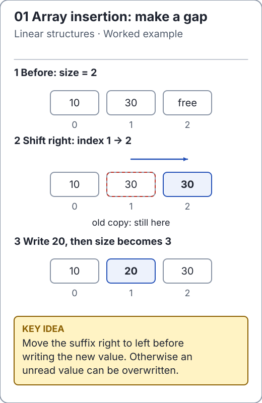

# Java Data Structures and Algorithms

[](https://github.com/ichillous/JavaDataStructuresAndAlgorithms/actions/workflows/ci.yml)


Learn by predicting a result, tracing an invariant, and checking it against code.
This repository combines 47 library classes, runnable terminal lessons, a progressive
study path, and Markdown examples that compile and execute in the test suite.

Isiah's original topic URLs remain useful entry points. Their lessons now use the
maintained library; earlier versions remain in Git history. There is one source of
implementation truth, with tests and explanations beside it.

## Start in five minutes

Install a **JDK 17 or newer**, then:

```sh
git clone https://github.com/ichillous/JavaDataStructuresAndAlgorithms.git
cd JavaDataStructuresAndAlgorithms
./mvnw clean verify
java -jar target/java-data-structures-and-algorithms-1.0.0-SNAPSHOT.jar
```

Windows: use `mvnw.cmd clean verify`. No global Maven installation is needed. The
wrapper downloads Maven 3.9.11 and verifies its pinned SHA-256 checksum. First build
requires internet; subsequent builds can reuse the cache, and the lessons run offline.
There are no runtime dependencies. JUnit is used only for tests.

## Run a lesson, then change the example

```sh
java -jar target/java-data-structures-and-algorithms-1.0.0-SNAPSHOT.jar learn list
java -jar target/java-data-structures-and-algorithms-1.0.0-SNAPSHOT.jar learn binary-search 4
java -jar target/java-data-structures-and-algorithms-1.0.0-SNAPSHOT.jar learn negative-edges
java -jar target/java-data-structures-and-algorithms-1.0.0-SNAPSHOT.jar learn range-queries
java -jar target/java-data-structures-and-algorithms-1.0.0-SNAPSHOT.jar learn lru
```

The lab traces search intervals, compares graph preconditions, updates range queries,
and shows cache eviction. It asks you to predict first and suggests the next experiment.
Use `--help` for command syntax; invalid commands return status 2 with usage guidance.
Running the JAR without arguments still runs the original showcase.

For diagrams, browse the [visual index](docs/visuals/README.md), or open
`docs/visuals/index.html` in a browser after cloning. It includes 26 diagrams with
light/dark variants and five step-throughs. The committed assets need no build,
package installation or account. For browsers that restrict local file pages,
run `python3 -m http.server --bind 127.0.0.1 8000` and visit
`http://127.0.0.1:8000/docs/visuals/`. [Preview images and visual checks](docs/visuals/verification.md)
show the desktop/phone layouts and the scope of verification.

| Your next step | Read or run |
| --- | --- |
| Learn in order | [Roadmap and checkpoints](docs/learning-roadmap.md) |
| See diagrams and algorithm states | [Visual index](docs/visuals/README.md) and the local [interactive companion](docs/visuals/index.html) |
| Browse all implementations and contracts | [Catalog](docs/catalog.md) |
| Compare time, space and assumptions | [Complexity guide](docs/complexity.md) |
| Practice independently | [Exercises](docs/exercises.md), then [worked solutions](docs/solutions.md) |
| Understand validation and its limits | [Quality bar](docs/quality.md) and [validation evidence](docs/validation.md) |
| Understand changes from the original notes | [Migration guide](docs/migration.md) |
| Extend the library | [Contributing](CONTRIBUTING.md) |

<!-- visual:generated -->
<picture><source media="(prefers-color-scheme: dark)" srcset="docs/visuals/assets/array-insertion-dark.svg"></picture>

**Figure 01.** See the state change, then explore all diagrams and step-throughs in the visual index. [Visual index and step-throughs](docs/visuals/README.md).
<!-- /visual:generated -->

## Topic map

| Topic | Lessons | Maintained implementations |
| --- | --- | --- |
| Linear storage | [Arrays](data-structures/arrays/overview.md), [lists](data-structures/linked-lists/overview.md), [stacks](data-structures/stacks/overview.md), [queues](data-structures/queues/overview.md) | Dynamic array, doubly linked list, stack, circular queue, ring deque |
| Lookup and order | [Hashing](data-structures/hash-tables/overview.md), [open addressing](data-structures/hash-tables/open-addressing.md), [LFU cache](data-structures/hash-tables/lfu-cache.md), [trees](data-structures/trees/overview.md), [red-black trees](data-structures/trees/red-black-trees.md), [heaps](data-structures/heaps/overview.md), [tries](data-structures/tries/overview.md), [range queries](data-structures/range-queries/overview.md) | Chained and linear-probing maps, LRU and LFU caches, BST, AVL, red-black ordered map with rank/select, min-heap, trie, union-find, Fenwick and minimum segment trees, sparse table, lazy range-add segment tree |
| Searching and sorting | [Linear](algorithms/searching/linear-search.md), [binary](algorithms/searching/binary-search.md), [merge](algorithms/sorting/merge-sort.md), [quick](algorithms/sorting/quick-sort.md), [heap](algorithms/sorting/heap-sort.md), [counting, radix and Comparator sorts](algorithms/sorting/non-comparison-and-comparator-sorts.md) | Search bounds, five comparison sorts, counting and radix sort, a stable Comparator merge sort, inversion counting |
| Patterns and selection | [Pointers, windows, stacks, differences and sweeps](algorithms/array-patterns/overview.md), [selection](algorithms/searching/selection.md) | Two-pointer pair sum, repeat-free window, next greater, histogram area, difference arrays, interval merge and meeting rooms; k-th smallest, stable top-k, k-way merge, majority vote |
| Strings and text | [Pattern matching](algorithms/strings/pattern-matching.md), [multi-pattern search and suffix arrays](algorithms/strings/multi-pattern-and-suffix-arrays.md) | KMP, Z-function, Rabin–Karp, Manacher, Aho-Corasick, suffix arrays and LCP |
| Graphs | [Representation](data-structures/graphs/representation.md), [BFS](algorithms/graph/bfs.md), [DFS](algorithms/graph/dfs.md), [shortest paths](algorithms/graph/shortest-paths.md), [graph structure](algorithms/graph/graph-structure.md), [minimum spanning trees](algorithms/graph/minimum-spanning-trees.md) | Traversals, paths, topological order, Dijkstra, Bellman–Ford, 0-1 BFS, DAG shortest paths, A* and Floyd–Warshall, Kruskal and Prim, SCCs and bridges, articulation points, bipartite checks, cycle witnesses and Euler paths |
| Flows, matching and trees | [Flows and matching](algorithms/graph/flows-and-matching.md), [tree queries](algorithms/graph/tree-queries.md) | Dinic max flow and min cut, Hopcroft-Karp matching, binary-lifting LCA and tree diameter |
| Problem solving | [DP](algorithms/dynamic-programming/overview.md), [greedy](algorithms/greedy/overview.md), [backtracking](algorithms/backtracking/overview.md), [divide and conquer](algorithms/divide-and-conquer/overview.md) | Coin change, knapsack, LCS/LIS, edit distance, reconstructed LCS strings, edit scripts, knapsack items, coin choices and LIS indices, Kadane, sliding-window maximum, activity selection, permutations, queens, signed subset sum and Sudoku |
| Classic dynamic programs | [Coins, word break, palindromes, matrix chain, TSP and weighted intervals](algorithms/dynamic-programming/classic-problems.md) | Coin combinations, word break, longest palindromic subsequence, matrix-chain order, Held-Karp, weighted interval scheduling |
| Huffman coding | [Optimal prefix codes from frequencies](algorithms/greedy/huffman-coding.md) | Huffman code lengths, exchange argument, canonical codes |
| Math and randomness | [Number theory](algorithms/math/number-theory.md), [randomized sampling](algorithms/math/randomized-sampling.md) | gcd and extended gcd, modular power and inverse, sieve, deterministic Miller-Rabin and Fibonacci mod m, all exact on `long`; reservoir sampling, Fisher-Yates shuffle and the alias method, driven by a caller-supplied `RandomGenerator` |
| Probabilistic | [Probabilistic structures](data-structures/probabilistic/overview.md) | Bloom filter (no false negatives) and Count-Min sketch (never undercounts) |

## An example you can trust and modify

Greedy largest-coin-first uses three coins for amount six with `[1,3,4]`; DP finds
two. For a graph with negative edges, Bellman–Ford can find a finite route when no
reachable negative cycle exists.

```java
import io.github.ichillous.dsa.algorithms.DynamicProgramming;
import io.github.ichillous.dsa.graphs.AdvancedGraphAlgorithms;
import io.github.ichillous.dsa.graphs.WeightedGraph;
import java.util.List;

assert DynamicProgramming.minimumCoins(new int[]{1, 3, 4}, 6) == 2;
var graph = WeightedGraph.directed(3)
    .addEdge(0, 1, 4).addEdge(0, 2, 5).addEdge(1, 2, -7);
var routes = AdvancedGraphAlgorithms.bellmanFord(graph, 0);
assert routes.pathTo(2).equals(List.of(0, 1, 2));
assert routes.distanceTo(2).orElseThrow() == -3;
```

Java blocks are imports plus statements, suitable for a method or JShell. The
[documentation test](src/test/java/io/github/ichillous/dsa/documentation/DocumentedExamplesTest.java)
wraps each block in a temporary class, compiles it for Java 17 with warnings as
errors, and executes its assertions. A failing assertion probe verifies that
assertions really are enabled. When copying a block into your own Java program,
run it with `java -ea`; Java normally disables assertions and does not evaluate
their expressions. Examples stay connected to the implementation.

## Verification

```sh
./mvnw clean verify                     # complete tests, docs, JAR and coverage checks
./mvnw -Dtest=AvlTreeTest test           # focused development check
./mvnw -Dtest=DocumentedExamplesTest test # execute the Markdown lessons
python3 scripts/check_docs.py           # local file links; Python 3 required
```

Tests include edge cases and deterministic comparisons against JDK collections,
brute-force small solvers, exact-integer shortest-path models, and connectivity
oracles. CI runs the complete build, packaged showcase and terminal lessons on
Linux JDK 17/21 and Windows JDK 21. Compiler warnings and Javadoc errors fail the
build. Coverage floors are 90% of lines and 85% of branches across production
code, including examples; coverage is evidence, not a proof of correctness.

Generated results: `target/surefire-reports/`, `target/reports/apidocs/index.html`,
and `target/site/jacoco/index.html`. Generated files are ignored by Git.

## Contracts to read before choosing an algorithm

- Nulls are rejected; collection elements and map/cache keys/values are non-null.
- Sorts and `Sampling.shuffle` mutate arrays; Sudoku mutates only after finding a complete
  solution. Other algorithm inputs are preserved. Returned collection snapshots are immutable.
- Bounds and ranges are documented; ranges are generally half open. Empty minima
  and unreachable distances use optional values rather than numeric sentinels.
- Ordered sets use natural-order equivalence. String positions are UTF-16 code
  units; there is no implicit normalization or case folding.
- Signed arithmetic and overflow rules differ by API. Exact Bellman–Ford work
  distinguishes negative cycles, unreachable vertices and out-of-range finite distances.
- Structures are not thread safe. Enumeration and subset search have explicit size
  limits; pseudopolynomial DP can still exhaust memory on large numeric capacities.
- Randomized APIs never create their own generator. They take a caller-supplied
  `java.util.random.RandomGenerator`, so a seeded generator reproduces a run and a test can
  fix its seed.
- Probabilistic structures have one-sided errors: a Bloom filter has false positives but
  no false negatives, and a Count-Min sketch never undercounts. Oversized tables are rejected
  before allocation (Bloom bits at most 2^30, sketch width x depth at most 2^25).
- Array-backed collections double their capacity up to `Integer.MAX_VALUE - 8` and then
  throw `OutOfMemoryError`; DP tables beyond that size are rejected with
  `IllegalArgumentException`. Number-theory, flow and DP arithmetic is exact or throws
  `ArithmeticException`; it does not wrap.

Use the [catalog](docs/catalog.md) for each exact contract. This is an educational
library; standard Java collections are usually the starting point in application code.
