# Algorithms

These lessons teach the procedures that work on data: searching, sorting, selection, graph methods, dynamic programming, greedy choice, backtracking, string matching and number theory. Each one states its precondition and invariant, traces a concrete example and links the maintained Java method, so name the task first and the map below shows where to go.

| At&nbsp;a&nbsp;glance | |
| --- | --- |
| **Use&nbsp;it&nbsp;when** | You know the task (find, order, select, traverse, optimize, match or compute) and must choose the method whose precondition your input meets. |
| **Avoid&nbsp;it&nbsp;when** | You are still choosing how to store the data: start with [data structures](../data-structures/README.md). |
| **Cost** | Each lesson states time and extra space; the [complexity guide](../docs/complexity.md) collects them for every maintained method. |
| **In&nbsp;this&nbsp;repo** | The [`algorithms`](../src/main/java/io/github/ichillous/dsa/algorithms) and [`graphs`](../src/main/java/io/github/ichillous/dsa/graphs) packages, such as `SearchAlgorithms`, `SortAlgorithms` and `GraphAlgorithms`. |
| **In&nbsp;the&nbsp;JDK** | `Arrays.sort`, `Arrays.binarySearch`, `Collections.sort`, `String.indexOf` and `BigInteger.modPow`; no direct equivalent for graph algorithms or dynamic programming. |

<!-- visual:generated algorithms-map | Each card pairs a task with its family, a method to start with and the folders to open. -->
<picture><source media="(prefers-color-scheme: dark)" srcset="../docs/visuals/assets/algorithms-map-dark.svg"></picture>

**Figure 53.** Each card pairs a task with its family, a method to start with and the folders to open. [Visual index and step-throughs](../docs/visuals/README.md).
<!-- /visual:generated -->

## Start here

1. [Recurrences, amortization and honest cost models](complexity-analysis/time-complexity.md): the cost vocabulary every other lesson uses.
2. [Binary search as a boundary problem](searching/binary-search.md): the invariant-first style behind `lowerBound` and binary search on the answer.
3. [Choosing a sort](sorting/README.md): when to use a repository sort or a JDK sort for a concrete input.
4. [Choosing a graph algorithm](graph/README.md): picks the graph method by question, precondition and cost.
5. [Dynamic programming starts with a state definition](dynamic-programming/overview.md): how to define a state before writing a recurrence.

## Pick by problem

| If you need to | Read | Solution finder |
| :--- | :--- | :--- |
| Find a value or its insertion point in sorted data | [Binary search](searching/binary-search.md) | [Sorted search](../docs/solution-finder.md#find-a-value-or-its-insertion-point-in-sorted-data) |
| Find the smallest value that makes a condition true | [Binary search on the answer](searching/binary-search-on-answer.md) | [Search the answer](../docs/solution-finder.md#find-the-smallest-value-that-makes-a-condition-true) |
| Find the k-th smallest item, such as a median | [Selection](searching/selection.md) | [k-th smallest](../docs/solution-finder.md#find-the-k-th-smallest-item-median-percentile) |
| Sort objects by a key and keep equal keys in order | [Counting, radix and stable sorts](sorting/non-comparison-and-comparator-sorts.md) | [Stable sort](../docs/solution-finder.md#sort-objects-by-a-key-keeping-equal-keys-in-their-original-order) |
| Find the longest window that satisfies a condition | [Array patterns](array-patterns/overview.md) | [Windows](../docs/solution-finder.md#find-the-longest-or-shortest-window-that-satisfies-a-condition) |
| Visit everything reachable, or count fewest edges | [Breadth-first search](graph/bfs.md) | [Reachability](../docs/solution-finder.md#visit-everything-reachable-from-a-start-vertex) |
| Order tasks that depend on each other | [Topological sort](graph/topological-sort.md) | [Dependencies](../docs/solution-finder.md#order-tasks-that-depend-on-each-other) |
| Find the cheapest path from one source | [Shortest paths](graph/shortest-paths.md) | [One source](../docs/solution-finder.md#from-one-source) |
| Connect every vertex at the lowest total cost | [Minimum spanning forests](graph/minimum-spanning-trees.md) | [Spanning trees](../docs/solution-finder.md#connect-every-vertex-at-the-lowest-total-cost) |
| Send the most flow through a network, or match two sides | [Max flow and matching](graph/flows-and-matching.md) | [Max flow](../docs/solution-finder.md#find-the-maximum-flow-and-the-minimum-cut) |
| Choose items under a capacity | [Dynamic-programming patterns](dynamic-programming/problems.md) | [Knapsack](../docs/solution-finder.md#choose-items-under-a-capacity) |
| Find every occurrence of one pattern in a text | [Pattern matching](strings/pattern-matching.md) | [One pattern](../docs/solution-finder.md#find-one-pattern-in-a-text) |
| Compute a gcd, a modular power or the primes up to n | [Number theory](math/number-theory.md) | [Modular arithmetic](../docs/solution-finder.md#divisibility-modular-arithmetic-and-primes) |

## Every lesson

Generated from each lesson: a figure from the lesson (one not already shown above it when the lesson has one), its title and its "Use it when" row.

<!-- visual:gallery algorithms -->
### Array patterns

| Figure | Lesson | Use it when |
| :---: | :--- | :--- |
| <a href="array-patterns/overview.md"><picture><source media="(prefers-color-scheme: dark)" srcset="../docs/visuals/assets/two-pointers-pair-sum-dark.svg">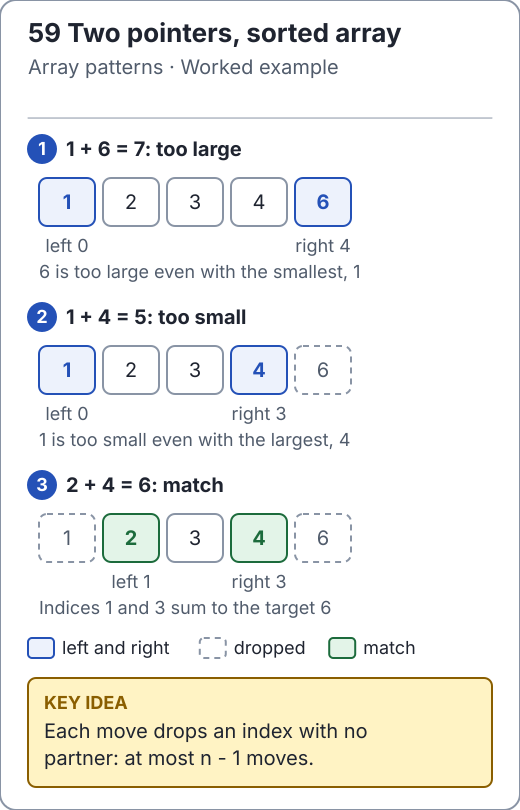</picture></a> | [Array patterns: pointers, windows, stacks, differences and sweeps](array-patterns/overview.md) | One left-to-right scan can replace nested loops: pair sums in sorted data, longest windows, next-greater queries, many range updates, overlapping intervals. |

### Backtracking

| Figure | Lesson | Use it when |
| :---: | :--- | :--- |
| <a href="backtracking/overview.md"><picture><source media="(prefers-color-scheme: dark)" srcset="../docs/visuals/assets/queens-backtracking-dark.svg">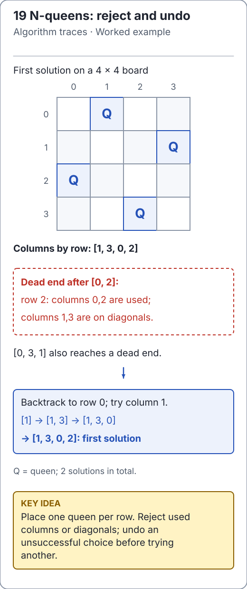</picture></a> | [Backtracking: choose, explore, undo](backtracking/overview.md) | You need valid combinations or one witness under constraints that can reject a partial solution early. |
| <a href="backtracking/problems.md"><picture><source media="(prefers-color-scheme: dark)" srcset="../docs/visuals/assets/subset-sum-halves-dark.svg">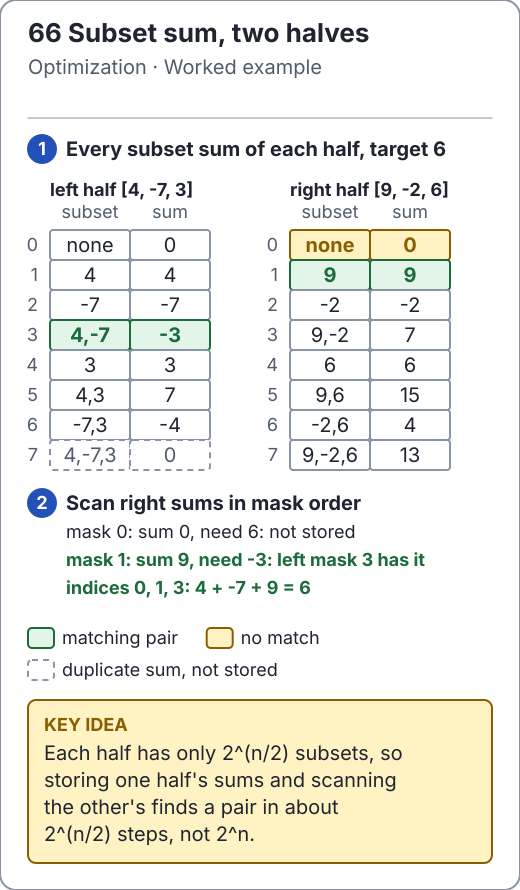</picture></a> | [Constraint puzzles and signed subset sum](backtracking/problems.md) | You need one valid solution to a constraint puzzle (Sudoku) or a subset hitting an exact target. |

### Bit manipulation

| Figure | Lesson | Use it when |
| :---: | :--- | :--- |
| <a href="bit-manipulation/overview.md"><picture><source media="(prefers-color-scheme: dark)" srcset="../docs/visuals/assets/bitmask-subsets-dark.svg">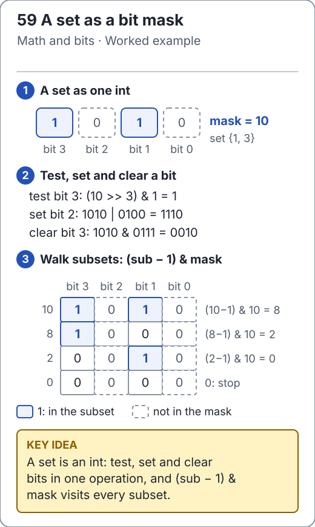</picture></a> | [Bit manipulation: masks, subsets and exact shifts](bit-manipulation/overview.md) | A set has at most 32 or 64 members, or you need parity, lowest-set-bit, or subset enumeration. |

### Complexity analysis

| Figure | Lesson | Use it when |
| :---: | :--- | :--- |
| <a href="complexity-analysis/space-complexity.md"><picture><source media="(prefers-color-scheme: dark)" srcset="../docs/visuals/assets/merge-recursion-dark.svg">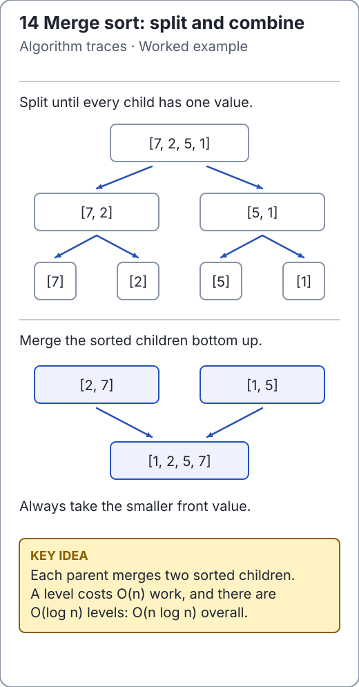</picture></a> | [Practical memory contracts: capacity, snapshots and search](complexity-analysis/space-complexity.md) | You must say what memory an operation needs beyond its input: workspace, retained capacity, output and the recursion stack. |
| <a href="complexity-analysis/time-complexity.md"><picture><source media="(prefers-color-scheme: dark)" srcset="../docs/visuals/assets/complexity-growth-dark.svg">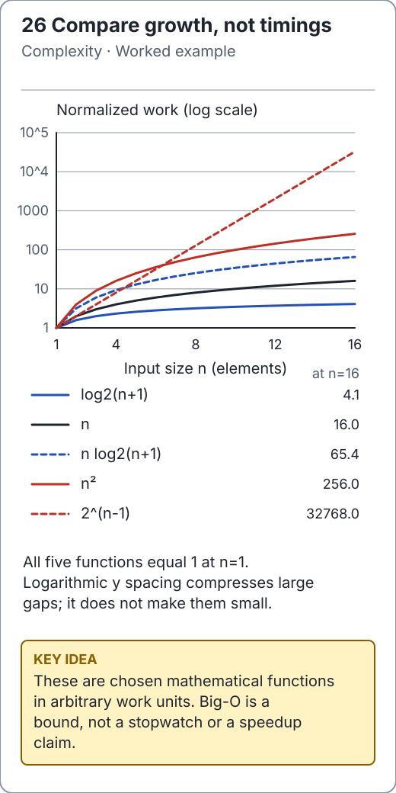</picture></a> | [Recurrences, amortization and honest cost models](complexity-analysis/time-complexity.md) | You need to say how work grows with input size, by solving a recurrence or by amortized accounting. |

### Divide and conquer

| Figure | Lesson | Use it when |
| :---: | :--- | :--- |
| <a href="divide-and-conquer/overview.md"><picture><source media="(prefers-color-scheme: dark)" srcset="../docs/visuals/assets/quick-partition-dark.svg">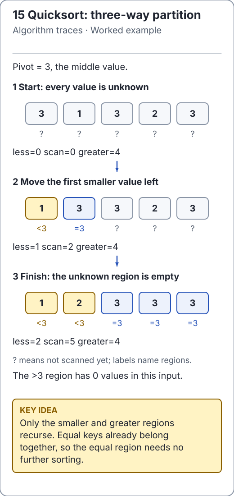</picture></a> | [Divide and conquer: define what comes back](divide-and-conquer/overview.md) | Subproblems are independent and a cheap combine rule exists: sorting, counting cross pairs, searching a sorted range. |
| <a href="divide-and-conquer/problems.md"><picture><source media="(prefers-color-scheme: dark)" srcset="../docs/visuals/assets/inversion-count-merge-dark.svg">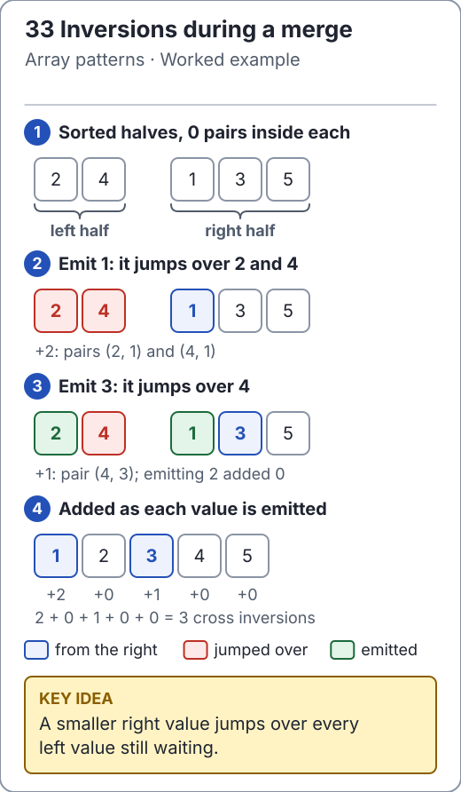</picture></a> | [Array problems: combine, extend or discard](divide-and-conquer/problems.md) | You can state an invariant that lets one pass reuse earlier work: a merge counts cross pairs, a running sum extends a range, a deque keeps useful candidates. |

### Dynamic programming

| Figure | Lesson | Use it when |
| :---: | :--- | :--- |
| <a href="dynamic-programming/README.md"><picture><source media="(prefers-color-scheme: dark)" srcset="../docs/visuals/assets/lcs-traceback-dark.svg">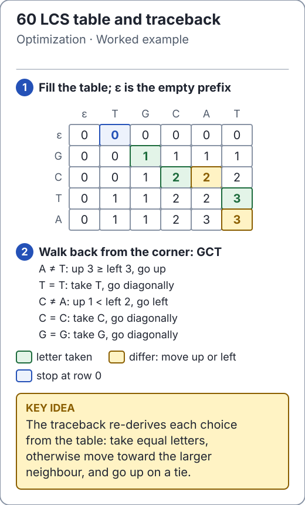</picture></a> | [Recognize the DP family](dynamic-programming/README.md) | You face an optimization or counting problem and need to pick a state shape quickly. |
| <a href="dynamic-programming/classic-problems.md"><picture><source media="(prefers-color-scheme: dark)" srcset="../docs/visuals/assets/matrix-chain-splits-dark.svg">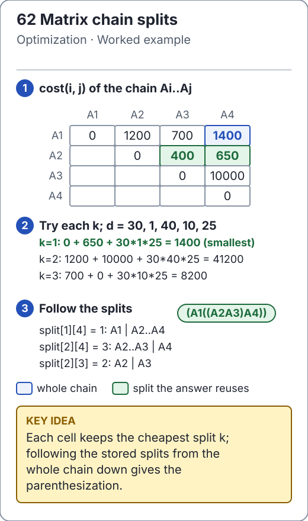</picture></a> | [Classic dynamic programs](dynamic-programming/classic-problems.md) | You need exact answers for counting, segmentation, bracketing, tours or weighted scheduling. |
| <a href="dynamic-programming/overview.md"><picture><source media="(prefers-color-scheme: dark)" srcset="../docs/visuals/assets/coin-dp-dark.svg">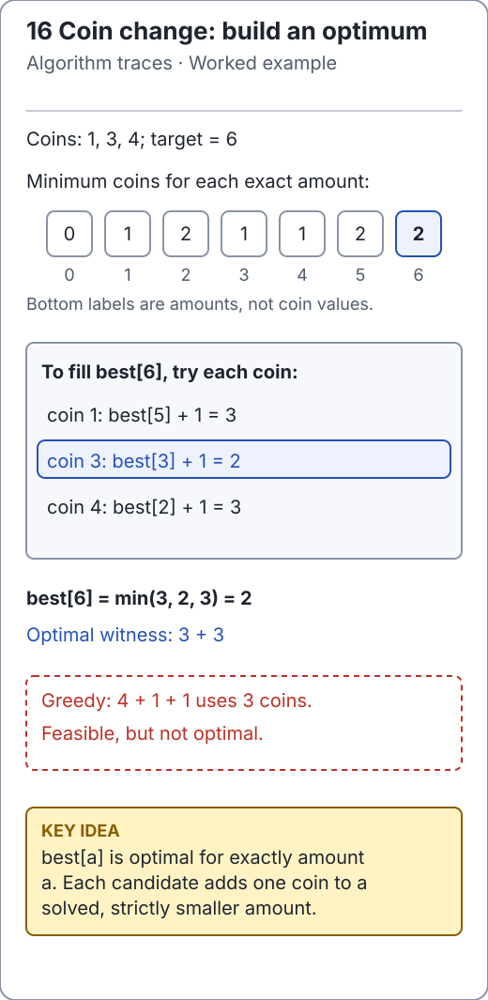</picture></a> | [Dynamic programming starts with a state definition](dynamic-programming/overview.md) | A solution is built from smaller states that recur, and one state fits in a sentence. |
| <a href="dynamic-programming/problems.md"><picture><source media="(prefers-color-scheme: dark)" srcset="../docs/visuals/assets/knapsack-state-dark.svg">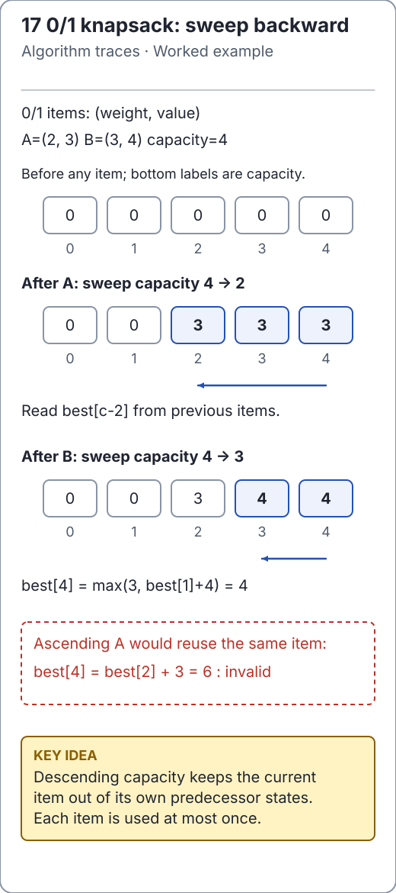</picture></a> | [Dynamic-programming patterns and their boundaries](dynamic-programming/problems.md) | You need the best value over a sequence or two strings: knapsack, LCS, edit distance, LIS. |

### Graph algorithms

| Figure | Lesson | Use it when |
| :---: | :--- | :--- |
| <a href="graph/README.md"><picture><source media="(prefers-color-scheme: dark)" srcset="../docs/visuals/assets/articulation-points-dark.svg">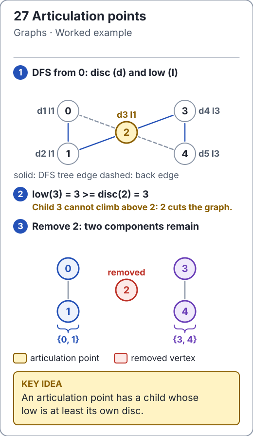</picture></a> | [Choosing a graph algorithm](graph/README.md) | You have a graph problem and want the right method, its precondition and its cost before you read a lesson. |
| <a href="graph/bfs.md"><picture><source media="(prefers-color-scheme: dark)" srcset="../docs/visuals/assets/bfs-frontier-dark.svg">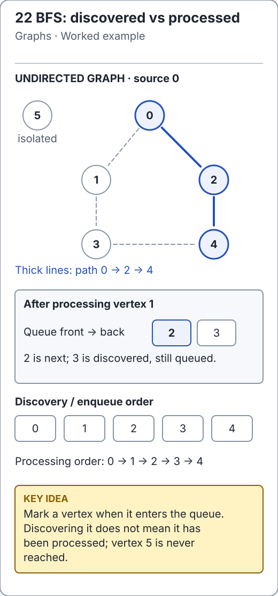</picture></a> | [Breadth-first search and choosing a distance model](graph/bfs.md) | You need reachability, fewest-edge paths, distance layers or undirected components. |
| <a href="graph/dfs.md"><picture><source media="(prefers-color-scheme: dark)" srcset="../docs/visuals/assets/bfs-vs-dfs-order-dark.svg">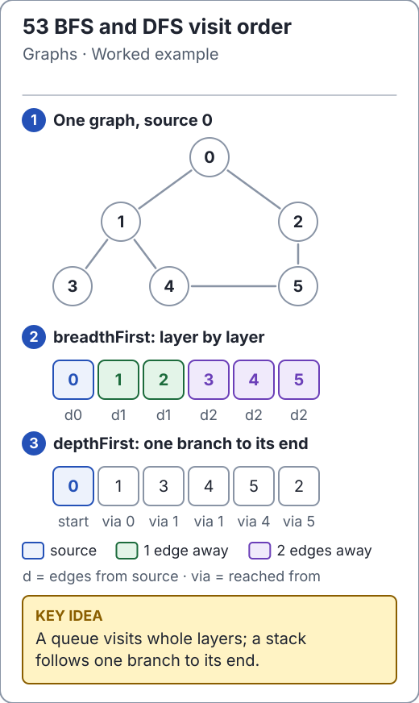</picture></a> | [Depth-first search, finishing order and connectivity](graph/dfs.md) | You need to explore one branch fully: reachability, finishing order, SCCs, bridges and other structure. |
| <a href="graph/flows-and-matching.md"><picture><source media="(prefers-color-scheme: dark)" srcset="../docs/visuals/assets/max-flow-min-cut-dark.svg">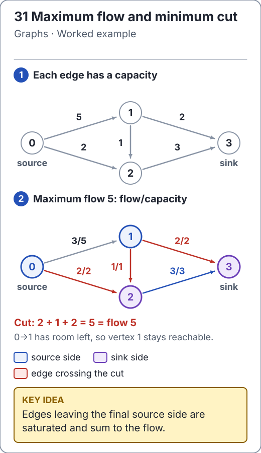</picture></a> | [Max flow, min cut and bipartite matching](graph/flows-and-matching.md) | You must route the most of something through capacity-limited links, find the cheapest set of links separating two vertices, or pair items from two sides (tasks to workers). |
| <a href="graph/graph-structure.md"><picture><source media="(prefers-color-scheme: dark)" srcset="../docs/visuals/assets/bipartite-odd-cycle-dark.svg">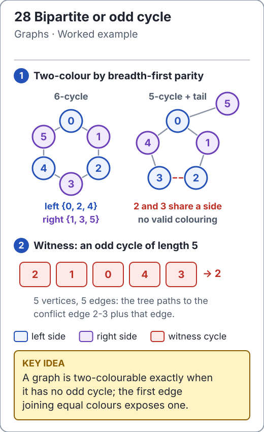</picture></a> | [Graph structure: cut vertices, bipartiteness, cycles and Euler paths](graph/graph-structure.md) | You need to know which vertices hold a graph together, whether it splits into two sides, where a cycle is, or whether one walk can use every edge once. |
| <a href="graph/minimum-spanning-trees.md"><picture><source media="(prefers-color-scheme: dark)" srcset="../docs/visuals/assets/mst-kruskal-prim-dark.svg">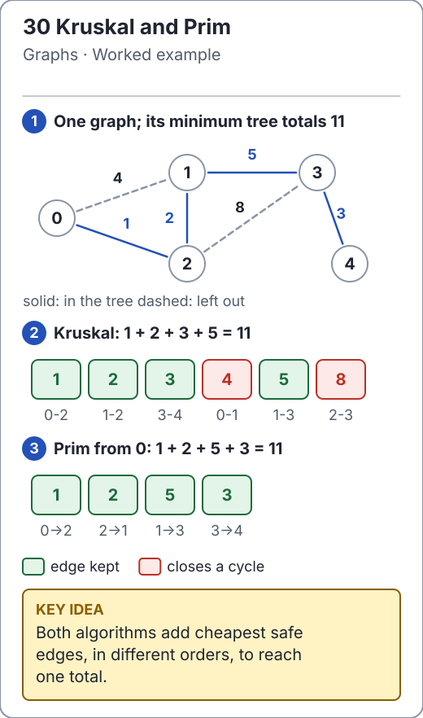</picture></a> | [Minimum spanning forests: Kruskal and Prim](graph/minimum-spanning-trees.md) | You must connect every vertex as cheaply as possible and the connection need not be a shortest path between any two of them: networks, clustering, cheapest wiring. |
| <a href="graph/shortest-paths.md"><picture><source media="(prefers-color-scheme: dark)" srcset="../docs/visuals/assets/shortest-path-chooser-dark.svg">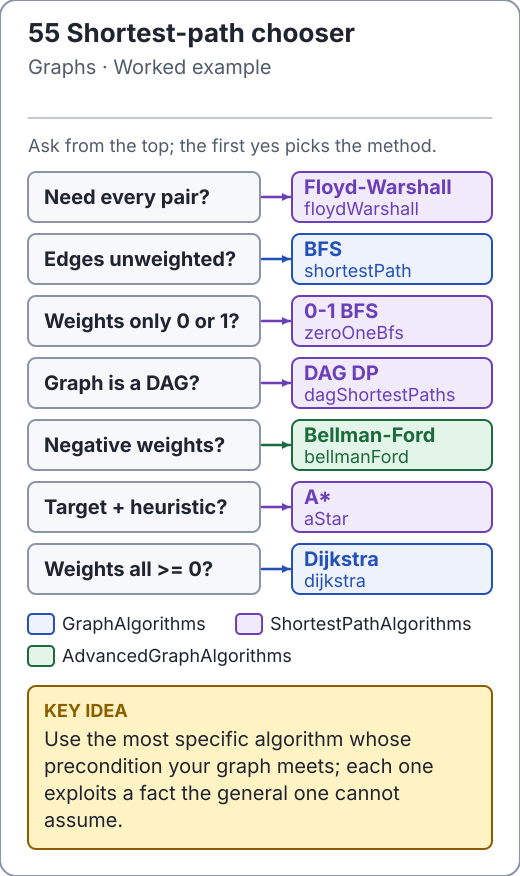</picture></a> | [Shortest-path toolkit: 0-1 BFS, DAGs, A* and Floyd–Warshall](graph/shortest-paths.md) | You know something about the graph (weights 0 or 1, acyclic, a target with a heuristic, all pairs wanted) that lets a specialised method beat the general one. |
| <a href="graph/topological-sort.md"><picture><source media="(prefers-color-scheme: dark)" srcset="../docs/visuals/assets/topological-kahn-dark.svg">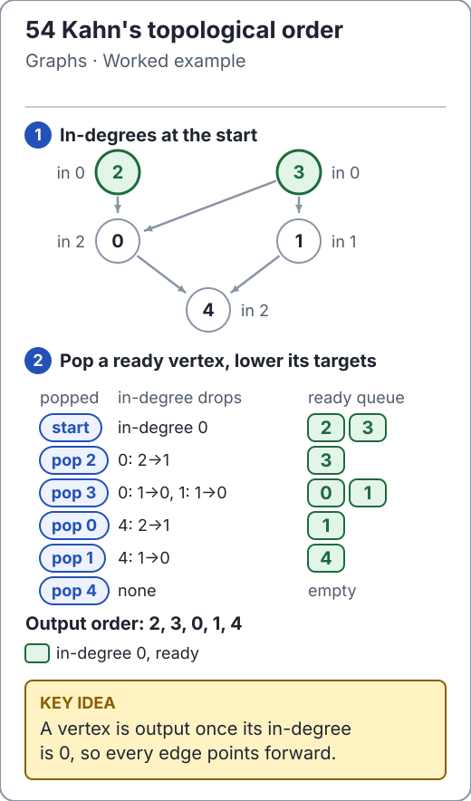</picture></a> | [Topological sort: order work so prerequisites come first](graph/topological-sort.md) | Work has prerequisites: build steps, course plans, spreadsheet cells, any "A before B" rules that must all hold. |
| <a href="graph/tree-queries.md"><picture><source media="(prefers-color-scheme: dark)" srcset="../docs/visuals/assets/lca-binary-lifting-dark.svg">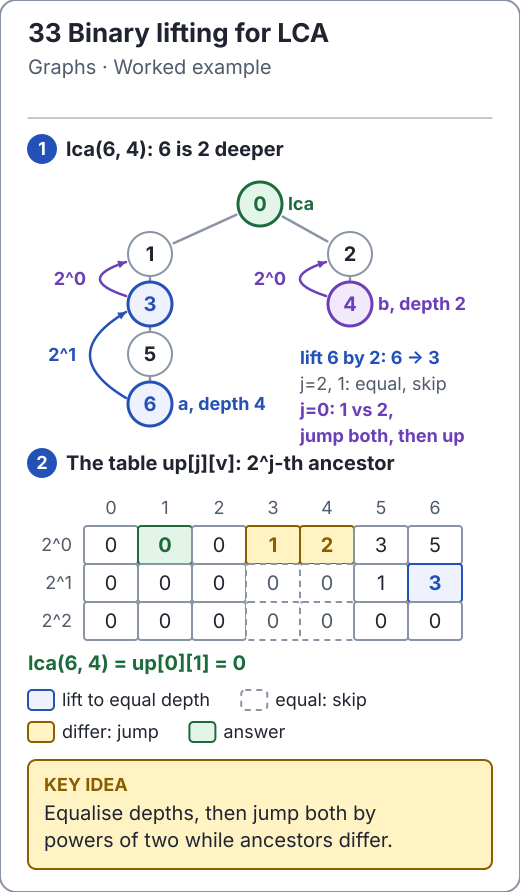</picture></a> | [Tree queries: lowest common ancestor and diameter](graph/tree-queries.md) | You ask many questions about one fixed tree: lowest common ancestor, distance between two vertices, k-th ancestor, or the longest path. |

### Greedy

| Figure | Lesson | Use it when |
| :---: | :--- | :--- |
| <a href="greedy/huffman-coding.md"><picture><source media="(prefers-color-scheme: dark)" srcset="../docs/visuals/assets/huffman-tree-dark.svg">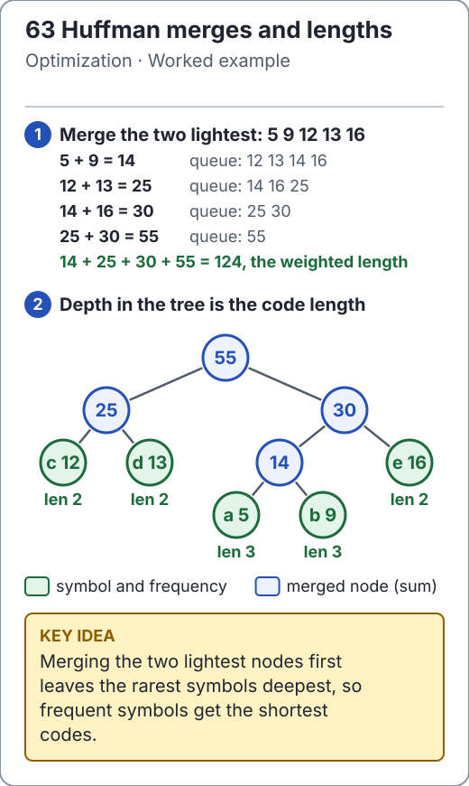</picture></a> | [Huffman coding](greedy/huffman-coding.md) | You know symbol frequencies and want the shortest prefix code with whole-bit codewords. |
| <a href="greedy/overview.md"><picture><source media="(prefers-color-scheme: dark)" srcset="../docs/visuals/assets/activity-selection-dark.svg">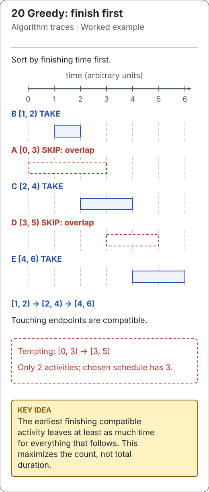</picture></a> | [Greedy algorithms need an exchange argument](greedy/overview.md) | A proof (an exchange argument) shows some optimum contains the local choice, as for earliest-finish activity selection. |
| <a href="greedy/problems.md"><picture><source media="(prefers-color-scheme: dark)" srcset="../docs/visuals/assets/coin-dp-dark.svg"></picture></a> | [Greedy choice across different objectives](greedy/problems.md) | A cut-property or exchange argument covers your exact objective, as for Kruskal and Huffman merging. |

### Math and randomness

| Figure | Lesson | Use it when |
| :---: | :--- | :--- |
| <a href="math/number-theory.md"><picture><source media="(prefers-color-scheme: dark)" srcset="../docs/visuals/assets/modpow-squares-dark.svg">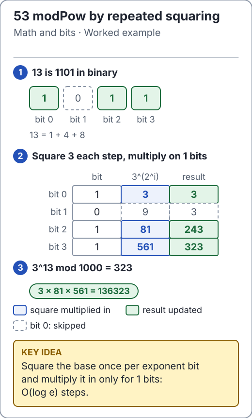</picture></a> | [Number theory: gcd, modular powers, primes and Fibonacci mod m](math/number-theory.md) | You need a gcd, a modular inverse, a power modulo `m`, all primes up to a limit, or a primality verdict for a `long`. |
| <a href="math/randomized-sampling.md"><picture><source media="(prefers-color-scheme: dark)" srcset="../docs/visuals/assets/reservoir-sampling-dark.svg">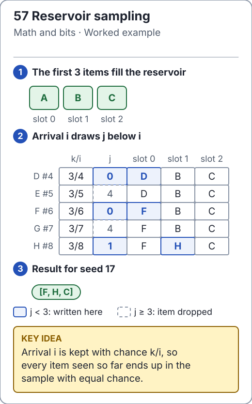</picture></a> | [Randomized sampling: reservoir, Fisher-Yates and the alias method](math/randomized-sampling.md) | You need a uniform sample from a stream, a uniform shuffle, or many weighted draws from fixed weights. |

### Searching

| Figure | Lesson | Use it when |
| :---: | :--- | :--- |
| <a href="searching/binary-search-on-answer.md"><picture><source media="(prefers-color-scheme: dark)" srcset="../docs/visuals/assets/predicate-boundary-dark.svg">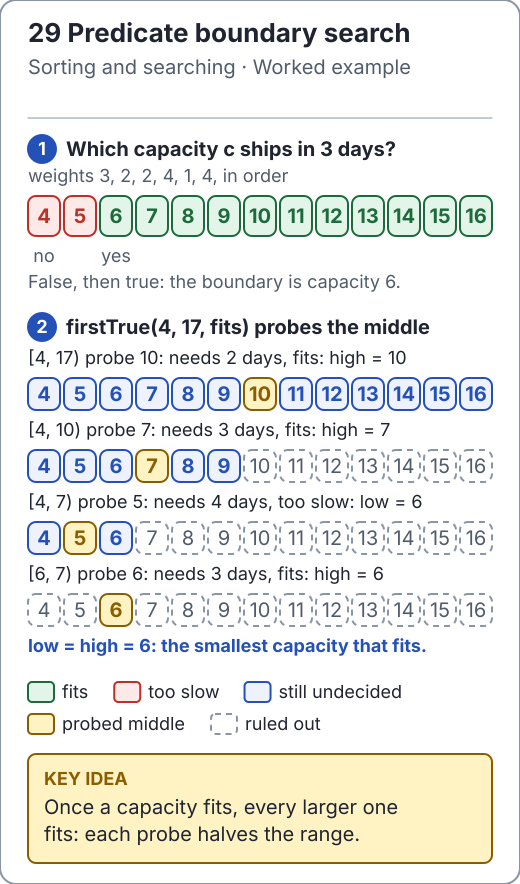</picture></a> | [Binary search on the answer](searching/binary-search-on-answer.md) | You want the smallest (or, by negating the test, the largest) value that satisfies a condition that, once true, stays true for larger values. |
| <a href="searching/binary-search.md"><picture><source media="(prefers-color-scheme: dark)" srcset="../docs/visuals/assets/binary-bound-dark.svg">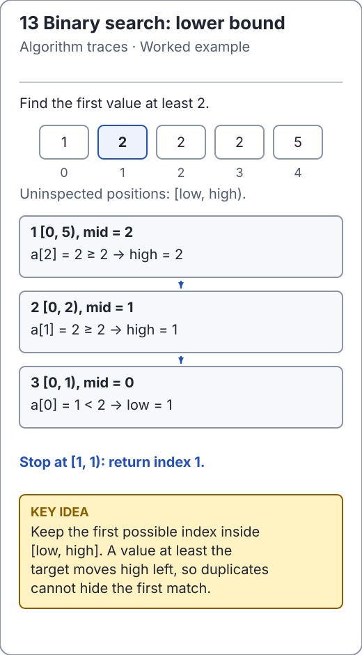</picture></a> | [Binary search as a boundary problem](searching/binary-search.md) | The data is in ascending order, or a yes/no question flips from false to true exactly once, and you query repeatedly. |
| <a href="searching/linear-search.md"><picture><source media="(prefers-color-scheme: dark)" srcset="../docs/visuals/assets/linear-scan-first-match-dark.svg">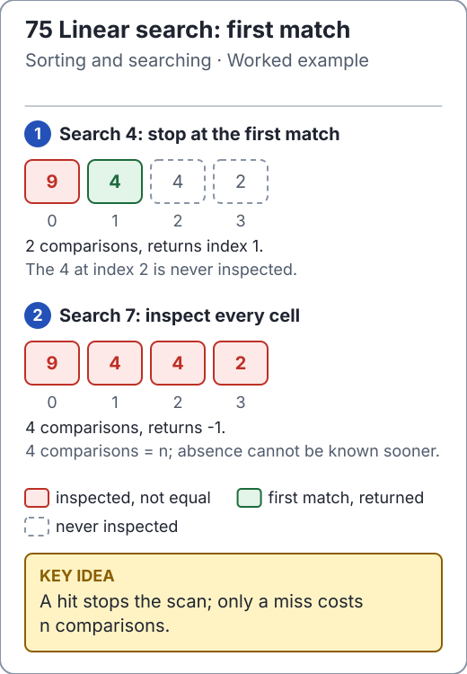</picture></a> | [Linear search and the first-match contract](searching/linear-search.md) | The data is unsorted or tiny, you query once, or the match test is not an ordering. |
| <a href="searching/selection.md"><picture><source media="(prefers-color-scheme: dark)" srcset="../docs/visuals/assets/quickselect-shrink-dark.svg">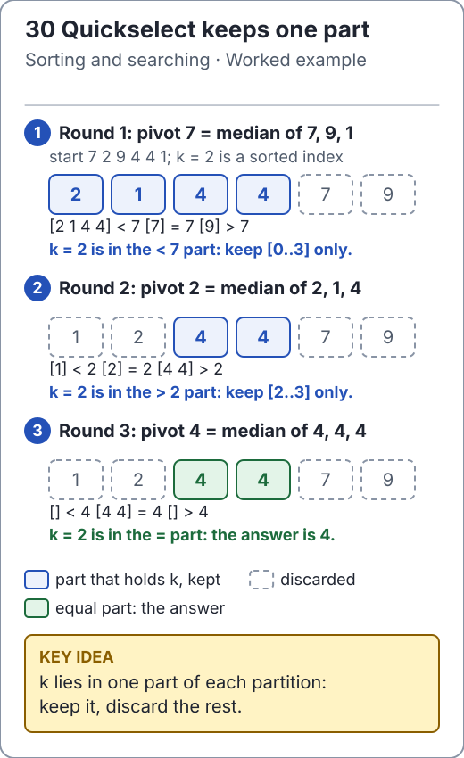</picture></a> | [Selection: k-th smallest, top-k, k-way merge and majority](searching/selection.md) | You need one rank, the k best, a merge of sorted runs, or a majority value, and not the whole order. |

### Sorting

| Figure | Lesson | Use it when |
| :---: | :--- | :--- |
| <a href="sorting/README.md"><picture><source media="(prefers-color-scheme: dark)" srcset="../docs/visuals/assets/sort-stability-dark.svg">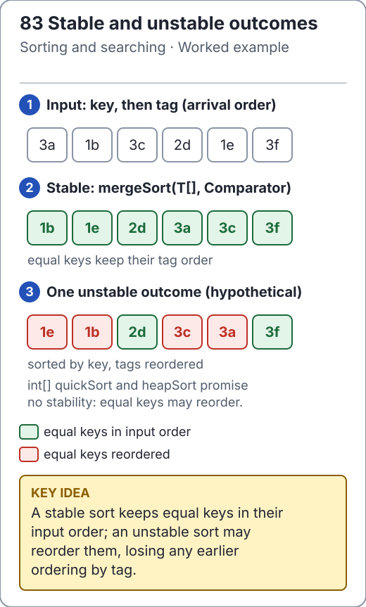</picture></a> | [Choosing a sort](sorting/README.md) | You must choose between the repository sorts and the JDK sorts for a concrete input. |
| <a href="sorting/bubble-sort.md"><picture><source media="(prefers-color-scheme: dark)" srcset="../docs/visuals/assets/bubble-swaps-dark.svg">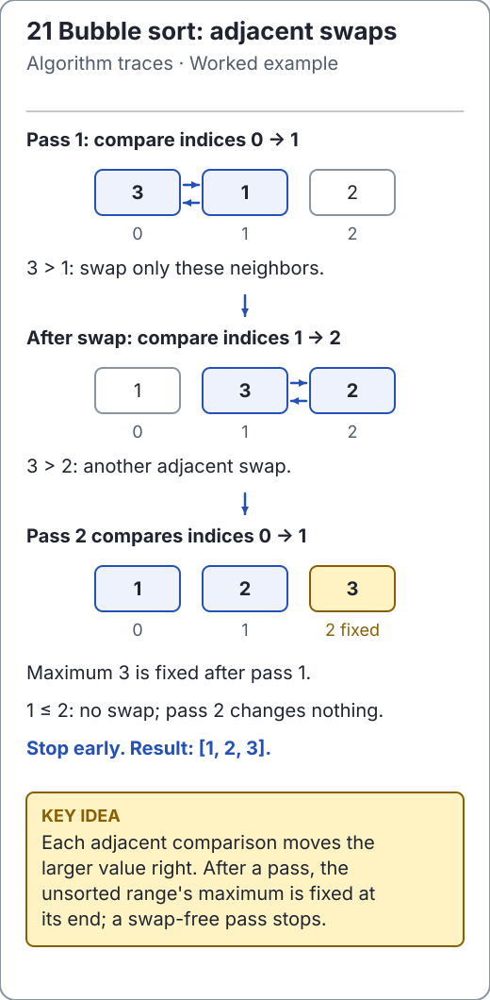</picture></a> | [Bubble sort, insertion sort and local order](sorting/bubble-sort.md) | You are learning the sorted-suffix invariant, or an array is known to be almost sorted and tiny. |
| <a href="sorting/heap-sort.md"><picture><source media="(prefers-color-scheme: dark)" srcset="../docs/visuals/assets/heapsort-phases-dark.svg">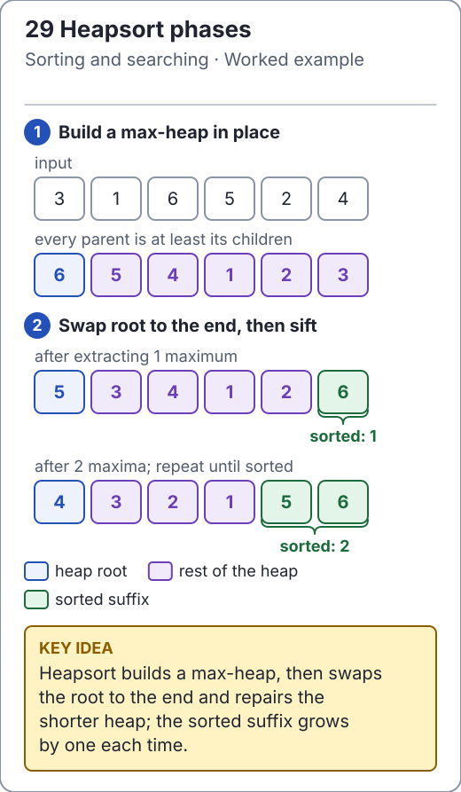</picture></a> | [Heapsort and the sorted suffix](sorting/heap-sort.md) | You need a worst-case O(n log n) bound and O(1) extra space for an `int[]`. |
| <a href="sorting/insertion-sort.md"><picture><source media="(prefers-color-scheme: dark)" srcset="../docs/visuals/assets/insertion-sort-shift-dark.svg">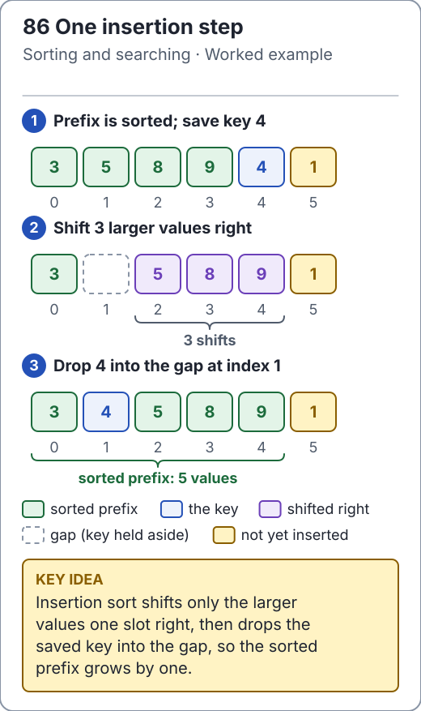</picture></a> | [Insertion sort: grow a sorted prefix](sorting/insertion-sort.md) | The array is tiny or nearly sorted, or you insert a few values into an already sorted array. |
| <a href="sorting/merge-sort.md"><picture><source media="(prefers-color-scheme: dark)" srcset="../docs/visuals/assets/merge-recursion-dark.svg"></picture></a> | [Merge sort: combine two proven results](sorting/merge-sort.md) | You need a guaranteed O(n log n) bound and stability, and can afford an O(n) buffer. |
| <a href="sorting/non-comparison-and-comparator-sorts.md"><picture><source media="(prefers-color-scheme: dark)" srcset="../docs/visuals/assets/counting-sort-counts-dark.svg">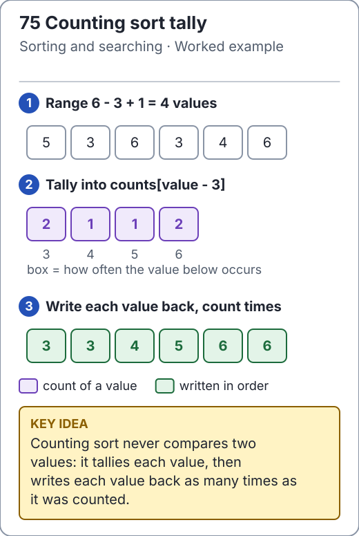</picture></a> | [Counting, radix and stable Comparator sorts](sorting/non-comparison-and-comparator-sorts.md) | Integer keys fall in a small range (`countingSort`), keys span the full `int` range (`radixSort`), or objects need a stable sort by a key (`mergeSort(T[], Comparator)`). |
| <a href="sorting/quick-sort.md"><picture><source media="(prefers-color-scheme: dark)" srcset="../docs/visuals/assets/quick-partition-dark.svg"></picture></a> | [Three-way quicksort with a bounded call stack](sorting/quick-sort.md) | You sort an `int[]` in place, especially one with many duplicate values. |

### Strings

| Figure | Lesson | Use it when |
| :---: | :--- | :--- |
| <a href="strings/multi-pattern-and-suffix-arrays.md"><picture><source media="(prefers-color-scheme: dark)" srcset="../docs/visuals/assets/aho-corasick-links-dark.svg">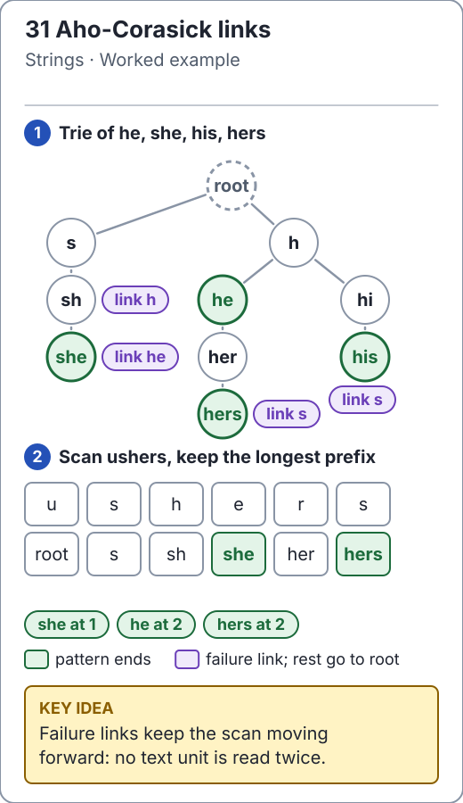</picture></a> | [Multi-pattern matching and suffix arrays](strings/multi-pattern-and-suffix-arrays.md) | Many fixed patterns must be found in one pass over a text (Aho–Corasick), or a fixed text will answer many substring questions: occurrences, distinct substrings, the longest repeated substring (suffix array). |
| <a href="strings/pattern-matching.md"><picture><source media="(prefers-color-scheme: dark)" srcset="../docs/visuals/assets/kmp-overlap-dark.svg">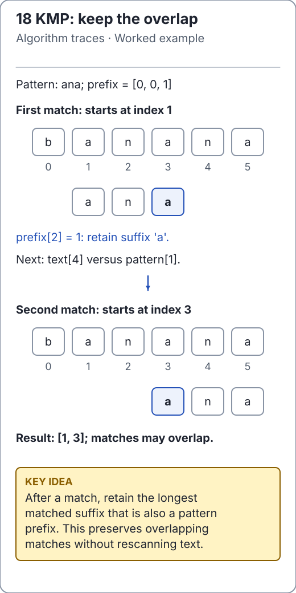</picture></a> | [Pattern matching: Z-function, Rabin–Karp and Manacher](strings/pattern-matching.md) | One pattern is searched in one text and you need every match or a linear-time guarantee (KMP, Z-function), a cheap rolling-hash filter before an exact check (Rabin–Karp), or the longest palindromic substring (Manacher). |

<!-- /visual:gallery -->

See also the [solution finder](../docs/solution-finder.md), the [implementation catalog](../docs/catalog.md), the [complexity guide](../docs/complexity.md) and the [visual index](../docs/visuals/README.md).
