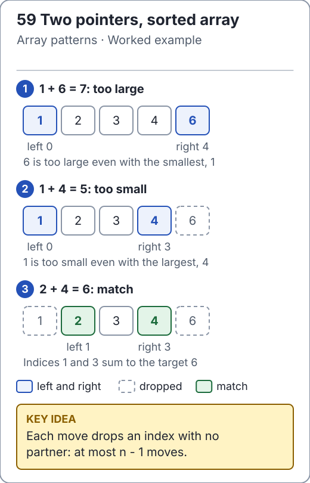
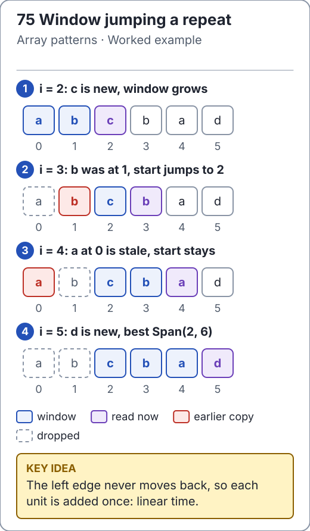
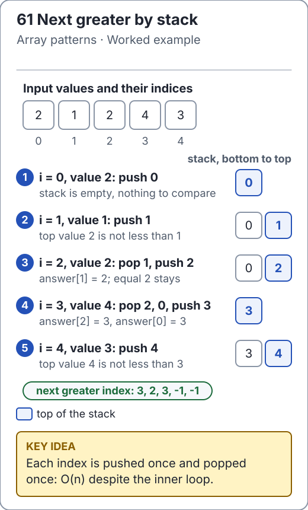
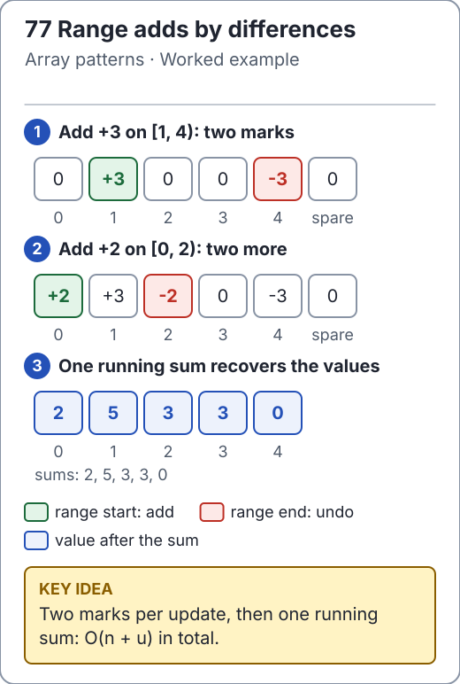
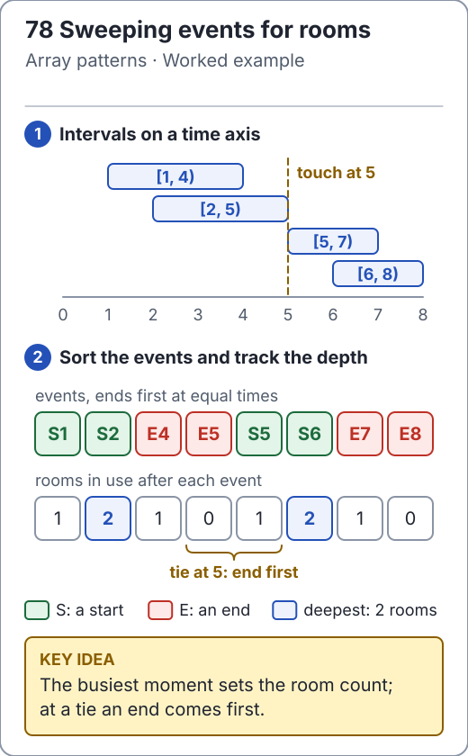

# Array patterns: pointers, windows, stacks, differences and sweeps

Five linear-scan patterns recur in array and interval problems. The maintained
[ArrayPatterns](../../src/main/java/io/github/ichillous/dsa/algorithms/ArrayPatterns.java)
implements one reference for each. Every method rejects null arguments, never
modifies its input and returns fresh or immutable results. Ranges are half-open
`[from, to)`. Intervals reuse
[GreedyAlgorithms.Interval](../../src/main/java/io/github/ichillous/dsa/algorithms/GreedyAlgorithms.java),
so they are non-empty and touching endpoints are allowed.

| At&nbsp;a&nbsp;glance | |
| --- | --- |
| **Use&nbsp;it&nbsp;when** | One left-to-right scan can replace nested loops: pair sums in sorted data, longest windows, next-greater queries, many range updates, overlapping intervals. |
| **Avoid&nbsp;it&nbsp;when** | The precondition fails (unsorted input for two pointers) or updates and queries interleave, which needs a tree structure rather than one batch pass. |
| **Cost** | O(n) for the scans and O(n + u) for `u` range updates; O(n log n) where intervals must be sorted first |
| **In&nbsp;this&nbsp;repo** | [`ArrayPatterns`](../../src/main/java/io/github/ichillous/dsa/algorithms/ArrayPatterns.java) |
| **In&nbsp;the&nbsp;JDK** | `ArrayDeque` as a stack, `Arrays.parallelPrefix` for prefix sums, `Arrays.sort` for interval order; no direct equivalent of the two-pointer or window scans |

| Pattern | Method | Precondition |
| --- | --- | --- |
| Two pointers | `pairWithSum(sorted, target)` | Ascending order, not checked (a scan would cost as much as the search) |
| Variable sliding window | `longestSubstringWithoutRepeats(text)` | None; works on UTF-16 units |
| Monotonic stack | `nextGreaterIndices(values)`, `largestRectangle(heights)` | Heights must be at least 0 |
| Difference array | `applyRangeAdds(values, updates)` | Each update ends at or before `values.length` |
| Interval sweep | `mergeIntervals(intervals)`, `minimumMeetingRooms(intervals)` | None |

## Two pointers: excluded indices have no partner

Start with `left = 0` and `right = n - 1`. The invariant is that no index below
`left` has a partner above it, and no index above `right` has a partner below it.
If `a[left] + a[right]` is too small, `left` cannot pair with any remaining index
(the largest one is already too small), so it is excluded. If it is too large,
`right` is excluded symmetrically. The first match therefore uses the smallest
first index that has any partner, and its largest partner. Sums use `long`, so
`Integer.MAX_VALUE + Integer.MAX_VALUE` does not wrap.

<!-- visual:generated two-pointers-pair-sum -->
<picture><source media="(prefers-color-scheme: dark)" srcset="../../docs/visuals/assets/two-pointers-pair-sum-dark.svg"></picture>

**Figure 74.** pairWithSum on 1, 2, 3, 4, 6 with target 6 starts at the two ends: 1 + 6 is too large so the right index drops, 1 + 4 is too small so the left index drops, and 2 + 4 matches at indices 1 and 3. [Visual index and step-throughs](../../docs/visuals/README.md).
<!-- /visual:generated -->

Target `6` in `[1, 2, 3, 4, 6]`:

```text
left right sum  action
 0    4     7   too large: right = 3 (index 4 has no partner below)
 0    3     5   too small: left = 1 (index 0 has no partner above)
 1    3     6   match -> (1, 3)
```

## Variable window: jump the start past the repeat

Keep the last index of every UTF-16 unit. Extend the window one unit at a time;
when the unit was last seen inside the window, move `start` to just after that
earlier occurrence. The window `[start, i]` always holds distinct units. Update
the best range only when strictly longer, so ties keep the earliest start. The
result is a half-open `StringAlgorithms.Span`, the same type that
`longestPalindromicSubstring` returns.

<!-- visual:generated sliding-window-distinct -->
<picture><source media="(prefers-color-scheme: dark)" srcset="../../docs/visuals/assets/sliding-window-distinct-dark.svg"></picture>

**Figure 75.** longestSubstringWithoutRepeats on abcbad grows the window to abc, jumps its start to index 2 when b repeats, ignores the stale earlier a at index 0, and ends with the longest window cbad at indices 2 to 5. [Visual index and step-throughs](../../docs/visuals/README.md).
<!-- /visual:generated -->

`"abba"`:

```text
i unit previous start window best
0  a     -       0    [0,0]  (0,1)
1  b     -       0    [0,1]  (0,2)
2  b     1       2    [2,2]  (0,2)
3  a     0       2    [2,3]  (0,2)   previous 0 is before start: ignored
```

## Monotonic stack: resolve elements when a bigger one arrives

For next-greater, the stack holds unresolved indices whose values are
non-increasing. A new value pops every smaller value and becomes their answer.
Each index is pushed and popped once, so the loop is O(n) despite the inner
`while`. The histogram version keeps strictly increasing heights; a popped bar's
rectangle spans from the element below it in the stack to the current index.

<!-- visual:generated monotonic-stack-next-greater -->
<picture><source media="(prefers-color-scheme: dark)" srcset="../../docs/visuals/assets/monotonic-stack-next-greater-dark.svg"></picture>

**Figure 76.** nextGreaterIndices on 2, 1, 2, 4, 3 keeps unresolved indices on a stack: index 1 is resolved by the second 2, the equal 2 at index 0 stays, and the 4 resolves indices 2 and 0, giving 3, 2, 3, -1, -1. [Visual index and step-throughs](../../docs/visuals/README.md).
<!-- /visual:generated -->

`[2, 1, 2, 4, 3]` (the stack lists indices):

```text
i value pops                       stack after
0   2   -                          [0]
1   1   -                          [0, 1]
2   2   index 1 -> 2               [0, 2]    equal is not greater
3   4   index 2 -> 3, index 0 -> 3 [3]
4   3   -                          [3, 4]    result [3, 2, 3, -1, -1]
```

## Difference array: pay at the boundaries, sum once

Adding `d` to `[from, to)` changes only two entries of a difference array:
`diff[from] += d` and `diff[to] -= d`. A running prefix sum then reconstructs all
values, so `u` updates on `n` values cost O(n + u) instead of O(nu). The prefix
can transiently leave `long` range even when every final value fits, for example
two additions of `Long.MAX_VALUE` offset by a base value of `-Long.MAX_VALUE`. The
implementation keeps 128-bit sums and throws `ArithmeticException` only when a
final value does not fit.

<!-- visual:generated difference-array-ranges -->
<picture><source media="(prefers-color-scheme: dark)" srcset="../../docs/visuals/assets/difference-array-ranges-dark.svg"></picture>

**Figure 77.** applyRangeAdds on five zeros marks +3 at index 1 and -3 at index 4, then +2 at index 0 and -2 at index 2, and one running sum produces 2, 5, 3, 3, 0. [Visual index and step-throughs](../../docs/visuals/README.md).
<!-- /visual:generated -->

Length 5 with `+3` on `[1, 4)` and `+2` on `[0, 2)`:

```text
diff   = [2, 3, -2, 0, -3, 0]
prefix = [2, 5,  3, 3,  0]      result for indices 0..4
```

## Interval sweep: sort, then compare with the open interval

`mergeIntervals` sorts by start and extends the last output interval whenever
the next start is at most its end, so `[10, 12)` joins `[8, 10)`.
`minimumMeetingRooms` sorts starts and ends separately and sweeps them, freeing
a room for every end at or before the next start. The answer is the maximum
number of intervals covering one point.

<!-- visual:generated interval-sweep-rooms -->
<picture><source media="(prefers-color-scheme: dark)" srcset="../../docs/visuals/assets/interval-sweep-rooms-dark.svg"></picture>

**Figure 78.** minimumMeetingRooms on the intervals [1, 4), [2, 5), [5, 7) and [6, 8) sorts the eight start and end events, processes the end at 5 before the start at 5, and reaches a depth of 2, so two rooms suffice. [Visual index and step-throughs](../../docs/visuals/README.md).
<!-- /visual:generated -->

`[0,30), [5,10), [15,20)`:

```text
sorted starts 0 5 15      sorted ends 10 20 30
start 0:  nothing ended, depth 1
start 5:  nothing ended, depth 2
start 15: end 10 <= 15 frees one, depth 1 then 2     answer 2
```

## Executable example

```java
import io.github.ichillous.dsa.algorithms.ArrayPatterns;
import io.github.ichillous.dsa.algorithms.ArrayPatterns.IndexPair;
import io.github.ichillous.dsa.algorithms.ArrayPatterns.RangeAdd;
import io.github.ichillous.dsa.algorithms.GreedyAlgorithms.Interval;
import io.github.ichillous.dsa.algorithms.StringAlgorithms.Span;
import java.util.Arrays;
import java.util.List;
import java.util.Optional;

assert ArrayPatterns.pairWithSum(new int[] {1, 2, 3, 4, 6}, 6)
        .equals(Optional.of(new IndexPair(1, 3)));
assert ArrayPatterns.pairWithSum(new int[] {Integer.MAX_VALUE, Integer.MAX_VALUE},
        2L * Integer.MAX_VALUE).isPresent();

assert ArrayPatterns.longestSubstringWithoutRepeats("abba").equals(new Span(0, 2));
assert ArrayPatterns.longestSubstringWithoutRepeats("").equals(new Span(0, 0));

assert Arrays.equals(ArrayPatterns.nextGreaterIndices(new int[] {2, 1, 2, 4, 3}),
        new int[] {3, 2, 3, -1, -1});
assert ArrayPatterns.largestRectangle(new int[] {2, 1, 5, 6, 2, 3}) == 10;

long[] original = new long[5];
long[] shifted = ArrayPatterns.applyRangeAdds(original,
        List.of(new RangeAdd(1, 4, 3), new RangeAdd(0, 2, 2)));
assert Arrays.equals(shifted, new long[] {2, 5, 3, 3, 0});
assert Arrays.equals(original, new long[5]);

List<Interval> meetings = List.of(new Interval(0, 30), new Interval(5, 10), new Interval(15, 20));
assert ArrayPatterns.minimumMeetingRooms(meetings) == 2;
assert ArrayPatterns.mergeIntervals(List.of(
        new Interval(1, 3), new Interval(2, 6), new Interval(8, 10), new Interval(10, 12)))
        .equals(List.of(new Interval(1, 6), new Interval(8, 12)));
```

## Costs

| Method | Time | Extra space |
| --- | --- | --- |
| `pairWithSum` | O(n) | O(1) |
| `longestSubstringWithoutRepeats` | O(n) expected | O(distinct units) |
| `nextGreaterIndices`, `largestRectangle` | O(n) | O(n) |
| `applyRangeAdds` | O(n + u) | O(n) |
| `mergeIntervals`, `minimumMeetingRooms` | O(n log n) | O(n) |

## Pitfalls

**Unsorted input breaks two pointers.** For `[3, 1, 2]` and target `3` a pair
exists (`1 + 2`), but the scan sees `3 + 2` first, discards index 2, then
`3 + 1`, discards index 1, and ends with no answer. The precondition is the reason
the exclusions are sound; the method does not validate it. A related trap is the
sliding window treating an earlier repeat as current: in `"abba"` the final `a`
repeats an index before the window start, so `start` must not move backwards.

Touching intervals are merged by `mergeIntervals` but do not conflict in
`minimumMeetingRooms`; both follow from half-open ranges, where `[1, 2)` and
`[2, 3)` share no point but leave no gap.

## In real Java

Use `ArrayDeque` (`push` and `pop` work at the head) when you need a stack, and
`Arrays.parallelPrefix` when you only need a running sum. The JDK prefix helper
combines with the function you give it, so with `Long::sum` it wraps silently on
overflow. `applyRangeAdds` keeps 128-bit sums and reports a final value that does
not fit.

```java
import io.github.ichillous.dsa.algorithms.ArrayPatterns;
import io.github.ichillous.dsa.algorithms.ArrayPatterns.RangeAdd;
import java.util.ArrayDeque;
import java.util.Arrays;
import java.util.Deque;
import java.util.List;

long[] diff = {2, 3, -2, 0, -3, 0};
Arrays.parallelPrefix(diff, Long::sum);
assert Arrays.equals(Arrays.copyOf(diff, 5), new long[] {2, 5, 3, 3, 0});

long[] wrapped = {Long.MAX_VALUE, 1};
Arrays.parallelPrefix(wrapped, Long::sum);
assert wrapped[1] == Long.MIN_VALUE;

boolean rejected = false;
try {
    ArrayPatterns.applyRangeAdds(new long[2],
            List.of(new RangeAdd(0, 2, Long.MAX_VALUE), new RangeAdd(1, 2, 1)));
} catch (ArithmeticException expected) {
    rejected = true;
}
assert rejected;

Deque<Integer> stack = new ArrayDeque<>();
stack.push(1);
stack.push(2);
assert stack.pop() == 2 && stack.peek() == 1;
```

## Common mistakes

1. **Popping on `<=` in next-greater.** For `[2, 1, 2]` the equal `2` at index 2
   would resolve index 0 and give `2` instead of `-1`. The invariant is that
   resolution needs a strictly greater value.
2. **Moving the window start backwards.** In `"abba"` the last `a` was seen at
   index 0, before `start = 2`. Setting `start = 1` would admit the repeated `b`
   and break the invariant that `[start, i]` holds distinct units.
3. **Sizing the difference array as `n`.** For length 5 an update on `[2, 5)`
   writes `diff[5]`, which needs `n + 1` slots. The end mark of an update that
   reaches the last index must not be lost.

## Check yourself

<details>
<summary>Why does <code>pairWithSum</code> on <code>[3, 1, 2]</code> with target 3 miss <code>1 + 2</code>?</summary>

The input is not ascending, so the exclusion argument fails: `3 + 2` is too
large, which only proves index 2 has no partner if every smaller value sits to
its left. The method does not validate order, so the result is unspecified.

</details>

<details>
<summary>Why does <code>minimumMeetingRooms</code> say <code>[1, 2)</code> and <code>[2, 3)</code> share one room?</summary>

Intervals are half-open, so they share no point. The sweep processes an end at
or before the next start first, freeing the room before the next meeting takes it.

</details>

<details>
<summary>Each index is popped at most once, so why does the nested <code>while</code> in the monotonic stack not make it quadratic?</summary>

Every index is pushed once and popped at most once, so the inner loop runs at
most `n` times across the whole scan. The cost counts pops in total, not per
outer iteration.

</details>

## Practice

1. Change the two-pointer invariant to count all pairs summing to a target in an
   array with duplicates; trace `[1, 1, 2, 2]` with target `3`.
2. Extend the window to allow at most one repeated unit and state the new
   invariant before coding.
3. Use a difference array to find the maximum number of simultaneously active
   `[start, end)` intervals when all endpoints are below 1000, then compare with
   `minimumMeetingRooms`.

See the [catalog](../../docs/catalog.md) for the source and tests and the
[complexity guide](../../docs/complexity.md) for the cost assumptions. The [solution finder](../../docs/solution-finder.md#12-array-and-sequence-patterns) compares this technique with its alternatives.
