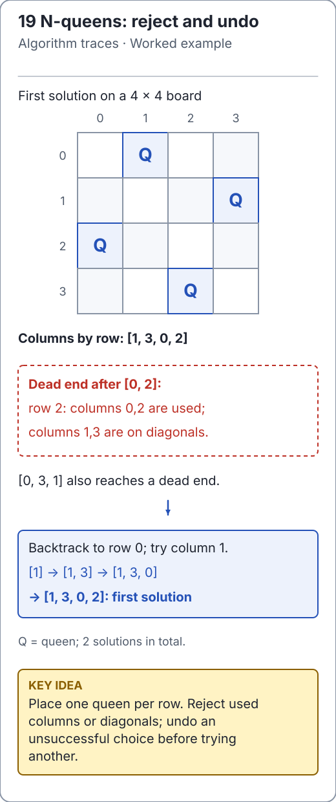

# Backtracking: choose, explore, undo

Backtracking explores a tree of partial solutions while rejecting branches that
already violate a constraint. It is useful when valid combinations matter more
than a single local choice. The maintained
[Backtracking](../../src/main/java/io/github/ichillous/dsa/algorithms/Backtracking.java)
returns immutable results and limits input sizes because it materializes every
solution. Enumeration can be expensive even when each individual test is cheap.

| At a glance | |
| --- | --- |
| **Use it when** | You need valid combinations or one witness under constraints that can reject a partial solution early |
| **Avoid it when** | Subproblems overlap (use DP) or a proven greedy rule exists |
| **Cost** | Exponential in the worst case: O(n · n!) for the permutation and queens examples |
| **In this repo** | [`Backtracking.uniquePermutations`](../../src/main/java/io/github/ichillous/dsa/algorithms/Backtracking.java) and `nQueens` |
| **In the JDK** | No direct equivalent; `ArrayList` as the path, copied at each solution |

<!-- visual:generated queens-backtracking -->
<picture><source media="(prefers-color-scheme: dark)" srcset="../../docs/visuals/assets/queens-backtracking-dark.svg"></picture>

**Figure 19.** Trace failed placements before reaching the first valid board. [Visual index and step-throughs](../../docs/visuals/README.md).
<!-- /visual:generated -->

## The state invariant

A recursive call owns a valid partial solution. It selects a currently legal
choice, updates the bookkeeping, explores the smaller remaining problem, then
undoes **every** state change before trying a sibling. Reaching a complete state
requires copying it; retaining the same mutable list would corrupt prior results.

For permutations of `[1, 1, 2]`, equal values occupy distinct input positions, but
choosing equivalent unused `1` positions at the same depth would duplicate a branch:

```text
[]
├─ 1 -> [1, 1, 2], [1, 2, 1]
├─ 1 -> skip: equivalent first choice
└─ 2 -> [2, 1, 1]
```

```java
import io.github.ichillous.dsa.algorithms.Backtracking;
import java.util.List;

int[] input = {1, 1, 2};
var permutations = Backtracking.uniquePermutations(input);
assert permutations.equals(List.of(
        List.of(1, 1, 2), List.of(1, 2, 1), List.of(2, 1, 1)));
assert input[0] == 1 && input[1] == 1 && input[2] == 2;
assert Backtracking.uniquePermutations(new int[0]).equals(List.of(List.of()));
```

The algorithm sorts a copy, tracks used indices and permits an equal value only
when its equivalent predecessor is already used on the current path. It rejects
null and inputs longer than nine. Worst-case time is O(n · n!), and space is
O(n + nk) including `k` returned permutations. Empty input has one empty ordering.

## Pruning with N-Queens

Place exactly one queen per row. Track occupied columns and both diagonal families;
a call at row `r` then contains `r` mutually nonattacking queens. A conflict can
never be fixed by adding more queens, so that branch can safely be pruned.

```java
import io.github.ichillous.dsa.algorithms.Backtracking;
import java.util.List;

assert Backtracking.nQueens(4).equals(List.of(
        List.of(1, 3, 0, 2), List.of(2, 0, 3, 1)));
assert Backtracking.nQueens(2).isEmpty();
assert Backtracking.nQueens(0).equals(List.of(List.of()));
```

Solutions encode the column for each row; sizes are limited to `0..12`. A loose
time bound is O(n · n!), with O(n + nk) storage including output. These are upper
bounds, not a claim that pruning removes the exponential growth.

**Pitfall:** `current.contains(value)` prevents the second `1` from ever being
chosen. Used **positions** and duplicate-branch suppression solve different
problems. Forgetting to undo an occupied column also silently removes valid boards.

## In real Java

The recursion path is usually one mutable `ArrayList` that is appended to and
trimmed. Because a list is a reference, recording a solution by adding the path
itself stores the same object many times; the later undo steps then empty every
"saved" result. Copy at the moment of success.

```java
import java.util.ArrayList;
import java.util.List;

List<Integer> path = new ArrayList<>();
List<List<Integer>> aliased = new ArrayList<>();
List<List<Integer>> copied = new ArrayList<>();
path.add(1);
path.add(2);
aliased.add(path);
copied.add(new ArrayList<>(path));
path.remove(path.size() - 1); // undo
path.remove(path.size() - 1);
assert aliased.get(0).isEmpty(); // corrupted by the undo
assert copied.get(0).equals(List.of(1, 2));
```

## Common mistakes

- **Not undoing a choice.** If `nQueens(4)` forgets to free a column after trying
  a row, valid boards such as `[1, 3, 0, 2]` disappear: the invariant "bookkeeping
  matches the current path" breaks.
- **Deduplicating with `contains`.** For `[1, 1, 2]` the check "value already in
  the path" refuses the second `1` entirely, so `[1, 1, 2]` is never produced.
  Track used positions and skip only equivalent siblings.
- **Storing the live path.** Adding the mutable list instead of a copy yields
  empty or identical results after the search ends, as the example above shows.

## Practice

1. Trace which of the two equal positions is allowed at each permutation depth.
2. Validate queens solutions independently using row, column and diagonal checks.
3. Explain why pruning a negative remaining sum is unsafe with signed inputs;
   continue with [puzzles and subset sum](problems.md).

## Check yourself

<details>
<summary>What must a recursive call do to the state before it tries the next sibling choice?</summary>

Undo every change it made for the previous choice (path entry, used flag, occupied column and diagonals), so the next sibling starts from exactly the state the call received.

</details>

<details>
<summary>Why is a conflict a safe reason to prune in N-Queens?</summary>

Adding more queens can never remove an attack between two queens already placed, so no completion of that partial board is valid.

</details>

<details>
<summary>Why does `uniquePermutations([1, 1, 2])` return three lists rather than six?</summary>

The two equal values are interchangeable, so choosing either at the same depth repeats a branch. Skipping an equal value unless its predecessor is already used keeps one of each ordering.

</details>

Check the [solutions](../../docs/solutions.md) after trying a small search tree. The [solution finder](../../docs/solution-finder.md#20-backtracking-and-search) compares this technique with its alternatives.
