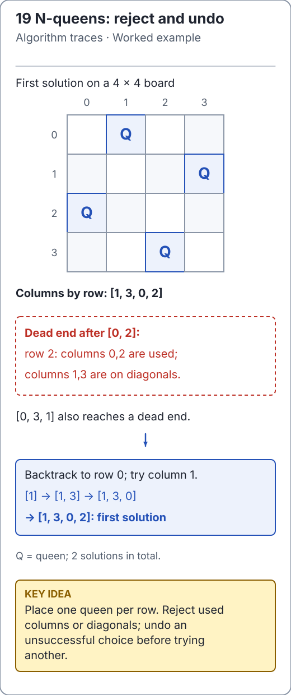

# Constraint puzzles and signed subset sum

These problems have different output and mutation contracts. Read them before
choosing a search strategy. Maintained APIs live in
[BacktrackingPuzzles](../../src/main/java/io/github/ichillous/dsa/algorithms/BacktrackingPuzzles.java);
small complete enumerations are covered in the [overview](overview.md).

<!-- visual:generated -->
<picture><source media="(prefers-color-scheme: dark)" srcset="../../docs/visuals/assets/queens-backtracking-dark.svg"></picture>

**Figure 19.** The queens search illustrates choose, reject and undo. Sudoku applies the same pattern with row, column and box constraints. [Visual index and step-throughs](../../docs/visuals/README.md).
<!-- /visual:generated -->

## Sudoku: preserve givens, propagate legal choices

`solveSudoku` accepts a 9×9 `int[][]` with digits `1..9` and `0` for unknown cells.
Malformed shapes, out-of-range entries and contradictory givens are rejected.
The caller's board is changed only on success; an unsatisfiable valid board returns
false unchanged. The method finds one solution, without claiming uniqueness.

The invariant is that each placed digit agrees with its row, column and 3×3 box.
Choosing the empty cell with the fewest legal candidates detects contradictions
earlier than an arbitrary scan order. A digit is tentatively placed, explored,
then removed if that branch fails.

```java
import io.github.ichillous.dsa.algorithms.BacktrackingPuzzles;
import java.util.Arrays;

int[][] board = {
    {5, 3, 0, 0, 7, 0, 0, 0, 0},
    {6, 0, 0, 1, 9, 5, 0, 0, 0},
    {0, 9, 8, 0, 0, 0, 0, 6, 0},
    {8, 0, 0, 0, 6, 0, 0, 0, 3},
    {4, 0, 0, 8, 0, 3, 0, 0, 1},
    {7, 0, 0, 0, 2, 0, 0, 0, 6},
    {0, 6, 0, 0, 0, 0, 2, 8, 0},
    {0, 0, 0, 4, 1, 9, 0, 0, 5},
    {0, 0, 0, 0, 8, 0, 0, 7, 9}
};
boolean solved = BacktrackingPuzzles.solveSudoku(board);
assert solved;
assert Arrays.equals(board[0], new int[] {5, 3, 4, 6, 7, 8, 9, 1, 2});
for (int row = 0; row < 9; row++) {
    boolean[] seen = new boolean[10];
    for (int digit : board[row]) {
        assert digit >= 1 && digit <= 9 && !seen[digit];
        seen[digit] = true;
    }
}
```

A loose bound with `e` empty cells is O(9^e) search nodes. The fixed 9×9 candidate
scans add bounded work per node; solver board state and search depth use O(81 + e)
space. Heuristics can reduce actual work but do not make general constraint search
polynomial. For example, two givens of `5` in one row are invalid input even if
they are separated by empty cells.

## Subset sum: a pruning counterexample

Given `[4, -7, 3]` and target `-4`, the subset `[-7, 3]` succeeds. A rule that
returns false whenever the remaining target is negative would reject it before
searching. Pruning is valid only when its assumptions are part of the input contract.

The maintained method accepts signed `int` values and a `long` target, returns an
optional immutable list of **selected indices**, and does not mutate input. At
most 30 elements are accepted. An empty witness is valid for target zero.

```java
import io.github.ichillous.dsa.algorithms.BacktrackingPuzzles;
import java.util.List;

int[] values = {4, -7, 3};
List<Integer> witness = BacktrackingPuzzles.subsetSum(values, -4L).orElseThrow();
long sum = 0L;
for (int index : witness) {
    sum += values[index];
}
assert sum == -4L;
assert witness.equals(List.of(1, 2));
assert BacktrackingPuzzles.subsetSum(values, 100L).isEmpty();
assert BacktrackingPuzzles.subsetSum(values, 0L).orElseThrow().isEmpty();
```

Meet-in-the-middle splits the indices, hashes left-half subset sums and scans
right-half sums for complements. Its invariant is that each stored sum has a real
witness from one half; complementary sums therefore combine disjoint valid
indices. Time is expected O(2^(n/2) + n), assuming constant expected hash lookup,
and space is O(2^(n/2) + n) including the witness. The 30-element cap limits each
half to at most 32,768 subsets. Hash lookup is an expected bound, not a worst-case
constant-time promise. When several witnesses exist, numeric subset-mask order
breaks ties; it is not lexicographic ordering of index lists.

## Related search formulations

| Problem | Partial state and safe rejection |
| --- | --- |
| Word search on a board | Current cell, matched prefix and cells used on this path; reject a mismatched next letter and undo visited state on return |
| Hamiltonian path | Current path and used vertices; reject repeated vertices, require every vertex at completion |
| Knight's tour | Board position and visited squares; move ordering can help but does not itself prove failure or optimality |

These are extension exercises, not additional maintained puzzle APIs. Their
state spaces can be enormous; a compact example is not evidence of scalability.

## Practice

1. Validate every row, column and box of a returned Sudoku board; checking rows
   alone is necessary but insufficient.
2. Snapshot an unsatisfiable Sudoku input and verify that failure preserves it.
3. Compare subset-sum witnesses with exhaustive masks for small signed arrays;
   check both the selected indices and their sum, without requiring one arbitrary
   witness when several solutions exist.

The [solutions](../../docs/solutions.md) explain failure atomicity and witness checks.
