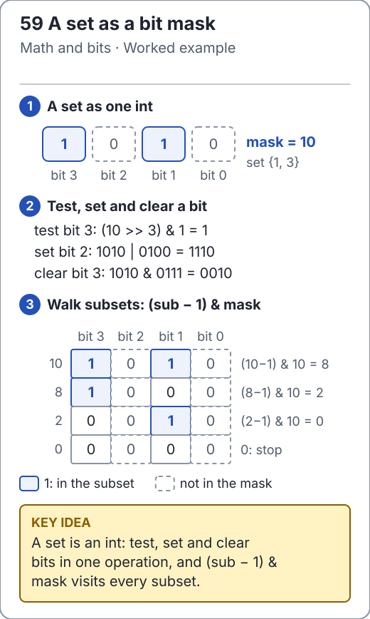

# Bit manipulation: masks, subsets and exact shifts

Use bit tricks when a small set, a flag word or a parity fact fits in one `int` or `long`: the whole value is copied, compared and combined in single operations. Everything here uses only the JDK (`Integer`, `Long`, `BitSet`), so there is no maintained class in this repository to link; each example below is a few statements checked with assertions.

| At a glance | |
| --- | --- |
| **Use it when** | A set has at most 32 or 64 members, or you need parity, lowest-set-bit, or subset enumeration |
| **Avoid it when** | Members are not small dense integers, or the set can outgrow one word (use `BitSet`) |
| **Cost** | O(1) per test, set, clear or toggle; walking all subsets of a mask with `k` set bits takes `2^k` steps |
| **In this repo** | No dedicated class; the subset-sum search in [BacktrackingPuzzles](../../src/main/java/io/github/ichillous/dsa/algorithms/BacktrackingPuzzles.java) identifies subsets by bit mask ([lesson](../backtracking/problems.md)) |
| **In the JDK** | `Integer.bitCount`, `Integer.lowestOneBit`, `Integer.numberOfTrailingZeros`, `Long.rotateLeft`, `java.util.BitSet` |

## Preconditions and edge cases

- Bit `i` of an `int` has value `1 << i` for `i` in `[0, 31]`; for a `long`, `1L << i` for `i` in `[0, 63]`.
- Java masks the shift count: an `int` shift uses only the low 5 bits of the count and a `long` shift the low 6. So `1 << 32 == 1`, `1 << -1 == 1 << 31` and `1L << 64 == 1L`. A shift never throws and never gives zero because the count was too large.
- `1 << 31` is `Integer.MIN_VALUE`, which is negative. A mask that uses bit 31 of an `int` is a negative number.
- `>>` copies the sign bit into the vacated positions; `>>>` fills them with zeros. They agree for nonnegative values and differ for negative ones.
- `Integer.lowestOneBit(0)` is 0 and `Integer.numberOfTrailingZeros(0)` is 32, so a loop over set bits must stop when the value is 0 rather than rely on the result.

## The invariants

**One bit is one membership.** With `mask` representing a set of indices, `(mask >> i) & 1` tests `i`, `mask | (1 << i)` adds it, `mask & ~(1 << i)` removes it and `mask ^ (1 << i)` toggles it. Each touches only bit `i`, so the other members are unchanged.

<!-- visual:generated bitmask-subsets -->
<picture><source media="(prefers-color-scheme: dark)" srcset="../../docs/visuals/assets/bitmask-subsets-dark.svg"></picture>

**Figure 33.** The set {1, 3} of four elements is the int mask 1010 = 10. Testing bit 3 gives 1, setting bit 2 gives 1110, clearing bit 3 gives 0010, and (sub - 1) & mask walks the subsets 10, 8, 2 and 0. [Visual index and step-throughs](../../docs/visuals/README.md).
<!-- /visual:generated -->

```java
int mask = 0b1010; // the set {1, 3}
assert Integer.bitCount(mask) == 2;
assert ((mask >> 3) & 1) == 1;
assert ((mask >> 2) & 1) == 0;
assert (mask | (1 << 2)) == 0b1110;
assert (mask & ~(1 << 3)) == 0b0010;
assert (mask ^ (1 << 1)) == 0b1000;
```

**Subtracting one flips the low bits.** `x - 1` turns the lowest set bit of `x` into 0 and every zero below it into 1. Therefore `x & (x - 1)` clears exactly the lowest set bit, and `x & -x` isolates it (the JDK method `Integer.lowestOneBit` returns the same value). Repeating `rest &= rest - 1` visits each set bit once, in increasing order.

```java
assert (12 & (12 - 1)) == 8;
assert (12 & -12) == 4 && Integer.lowestOneBit(12) == 4;
assert Integer.numberOfTrailingZeros(12) == 2;

java.util.List<Integer> positions = new java.util.ArrayList<>();
for (int rest = 0b101100; rest != 0; rest &= rest - 1) {
    positions.add(Integer.numberOfTrailingZeros(rest));
}
assert positions.equals(java.util.List.of(2, 3, 5));
```

**Subsets of a mask.** Starting from `sub = mask`, the step `sub = (sub - 1) & mask` produces the next smaller subset: the subtraction borrows through the bits the mask does not own, and the `& mask` clears them again. The walk reaches 0 after exactly `2^bitCount(mask)` values, and it never yields a value with a bit outside the mask.

```text
mask = 1011 (11)
sub = 1011 (11)  next = (1011 - 1) & 1011 = 1010 & 1011 = 1010
sub = 1010 (10)  next = 1001 & 1011 = 1001
sub = 1001 (9)   next = 1000 & 1011 = 1000
sub = 1000 (8)   next = 0111 & 1011 = 0011
sub = 0011 (3)   next = 0010
sub = 0010 (2)   next = 0001
sub = 0001 (1)   next = 0000
sub = 0000 (0)   stop: 2^3 = 8 subsets
```

```java
int mask = 0b1011;
java.util.List<Integer> subsets = new java.util.ArrayList<>();
for (int sub = mask; ; sub = (sub - 1) & mask) {
    subsets.add(sub);
    if (sub == 0) {
        break;
    }
}
assert subsets.equals(java.util.List.of(11, 10, 9, 8, 3, 2, 1, 0));
assert subsets.size() == 1 << Integer.bitCount(mask);
```

**XOR cancels pairs.** `x ^ x == 0` and `x ^ 0 == x`, and XOR is commutative and associative. XOR-ing every element of an array in which each value appears twice except one leaves the unpaired value, using O(1) extra space.

```java
int[] values = {4, 9, 4, 7, 9};
int unpaired = 0;
for (int value : values) {
    unpaired ^= value;
}
assert unpaired == 7;
```

## Signed and unsigned shifts, and overflow

```java
assert (-8 >> 1) == -4;                   // sign bit copied in
assert (-8 >>> 1) == 2147483644;          // zero filled
assert (Integer.MIN_VALUE >> 31) == -1;
assert (Integer.MIN_VALUE >>> 31) == 1;

assert (1 << 31) == Integer.MIN_VALUE;    // bit 31 is the sign bit
assert (1 << 32) == 1;                    // the shift count is taken modulo 32
assert (1L << 31) == 2147483648L;         // a long has room
assert (1L << 63) == Long.MIN_VALUE;
assert (1L << 64) == 1L;                  // modulo 64 for long

assert Long.rotateLeft(0x8000000000000001L, 1) == 3L; // the top bit wraps around
assert Long.rotateRight(1L, 1) == Long.MIN_VALUE;
```

`1 << n` is an `int` expression even when you assign it to a `long`: the shift happens in 32 bits first. Write `1L << n` whenever `n` can exceed 30. `Integer.MIN_VALUE` is its own negation, so `x & -x` returns `Integer.MIN_VALUE` for it, and `Integer.bitCount(-1)` is 32 because a negative `int` has its high bits set.

## BitSet when one word is not enough

`java.util.BitSet` grows as needed and offers `get`, `set`, `cardinality` and `nextSetBit`. Iterate with `nextSetBit(i + 1)` until it returns `-1`; the call with `i + 1` skips the bit just visited.

```java
java.util.BitSet bits = new java.util.BitSet();
bits.set(3);
bits.set(5);
bits.set(70);
assert bits.cardinality() == 3 && !bits.get(4);
java.util.List<Integer> found = new java.util.ArrayList<>();
for (int i = bits.nextSetBit(0); i >= 0; i = bits.nextSetBit(i + 1)) {
    found.add(i);
}
assert found.equals(java.util.List.of(3, 5, 70));
```

For a set of enum constants prefer `java.util.EnumSet`, and for flags with names prefer an enum over raw `int` constants; the bit tricks above are for when the arithmetic itself is the point.

## In real Java

Reach for `Integer.bitCount`, `Integer.numberOfTrailingZeros`, `Integer.highestOneBit` and `Long.rotateLeft` instead of writing loops; their results are fully specified. A behavior worth knowing is that `Integer.toBinaryString` of a negative number prints all 32 bits, while `Integer.toString(-8, 2)` prints a sign and the magnitude:

```java
assert Integer.toBinaryString(-8).length() == 32;
assert Integer.toString(-8, 2).equals("-1000");
assert Integer.parseInt("1010", 2) == 10;
assert Integer.numberOfLeadingZeros(1) == 31;
```

## Costs

| Operation | Time | Space |
| --- | --- | --- |
| Test, set, clear, toggle one bit | O(1) | O(1) |
| `Integer.bitCount`, `lowestOneBit`, `numberOfTrailingZeros` | O(1) | O(1) |
| Visit every set bit by `rest &= rest - 1` | O(k) for `k` set bits | O(1) |
| Walk all subsets of a mask with `k` set bits | O(2^k) | O(1) |
| `BitSet.nextSetBit` loop over a set | proportional to the set's length in words plus the bits found | O(length / 64) words |

## Pitfalls

**Using `1 << i` for `i >= 32`.** A mask built with `for i in 0..39: mask |= 1 << i` in an `int` repeats bits instead of reaching 40 distinct positions: `1 << 32 == 1`, so only 32 bits can ever be set. With `1L << i` and a `long` all 40 bits are distinct. The invariant broken is "bit `i` is member `i`".

**Treating `Integer.MIN_VALUE` as a normal power of two.** The test `x != 0 && (x & (x - 1)) == 0` accepts `Integer.MIN_VALUE`, which is `1 << 31`, because `MIN_VALUE & (MIN_VALUE - 1)` is 0. If "power of two" must mean a positive value, add `x > 0`.

**Shifting a negative number with `>>` when you wanted bits.** `-8 >> 1` is `-4`, not a bit pattern with a zero on top. Use `>>>` to treat the 32 bits as unsigned. The invariant broken is "the top bits are zero after a right shift".

```java
int wrong = 0;
for (int i = 0; i < 40; i++) {
    wrong |= 1 << i;
}
assert Integer.bitCount(wrong) == 32;
long right = 0;
for (int i = 0; i < 40; i++) {
    right |= 1L << i;
}
assert Long.bitCount(right) == 40;
assert (Integer.MIN_VALUE & (Integer.MIN_VALUE - 1)) == 0; // passes the naive power-of-two test
```

## Practice

1. List the subsets visited by `(sub - 1) & mask` for `mask = 0b0110`, and say how many there are.
2. Use `x & (x - 1)` to count the set bits of `0b101101` without `Integer.bitCount`, and state how many iterations it takes.
3. Predict `1 << 35`, `1L << 35` and `-1 >>> 28`, then check each with an assertion.

## Check yourself

<details>
<summary>Why does `(sub - 1) & mask` never leave the mask?</summary>

The `& mask` clears every bit the mask does not contain, so each result is a subset of `mask`. The subtraction only makes the next smaller value; the AND removes the bits borrowed through the bits outside the mask.

</details>

<details>
<summary>What is `1 << 32` for an `int`, and what does `1L << 32` give?</summary>

`1 << 32` is 1, because an `int` shift count is taken modulo 32. `1L << 32` is 4294967296, because the shift happens on a `long`.

</details>

<details>
<summary>How does XOR find the one value that appears once among pairs?</summary>

`x ^ x` is 0 and `x ^ 0` is `x`, and XOR is commutative and associative, so every paired value cancels regardless of position. Only the unpaired value remains in the accumulator.

</details>

See the [catalog](../../docs/catalog.md) for the maintained source, the [complexity guide](../../docs/complexity.md) for the bounds, and the [solution finder](../../docs/solution-finder.md#21-disjoint-sets-and-bitsets) for bitsets compared with their alternatives. Related lessons: [backtracking](../backtracking/problems.md) and [number theory](../math/number-theory.md).
