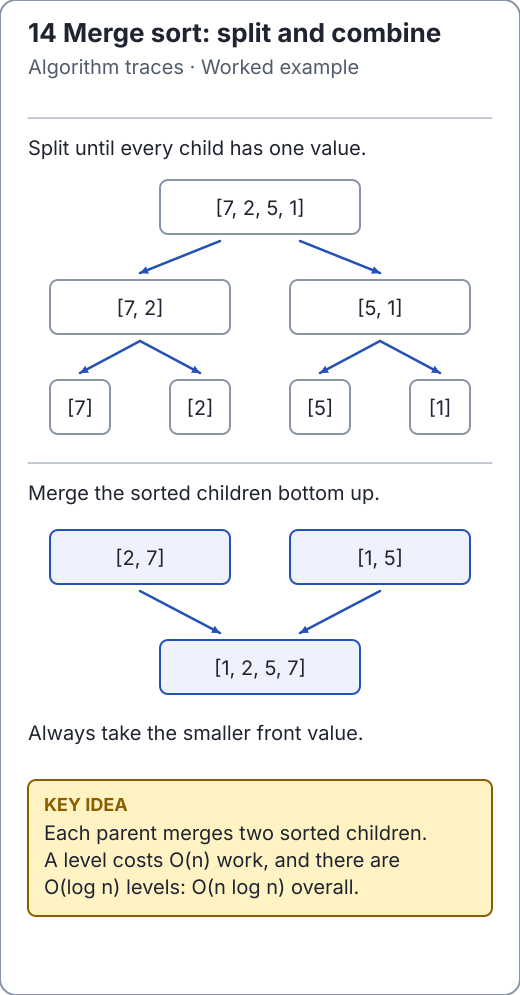

# Practical memory contracts: capacity, snapshots and search

The [space foundations](../../complexity-analysis/space-complexity.md) explain
input, workspace and output. Here, track which object owns each allocation and
when a caller can safely retain it. These distinctions affect API behavior as
well as the big-O description.

| At&nbsp;a&nbsp;glance | |
| --- | --- |
| **Use&nbsp;it&nbsp;when** | You must say what memory an operation needs beyond its input: workspace, retained capacity, output and the recursion stack. |
| **Avoid&nbsp;it&nbsp;when** | You would sum allocation sizes over all calls; that measures traffic, not the peak that is live at once. |
| **Cost** | A model of live storage, for example O(depth) for a recursion path or O(capacity) for a grown array |
| **In&nbsp;this&nbsp;repo** | [`DynamicArray`](../../src/main/java/io/github/ichillous/dsa/collections/DynamicArray.java), [`Graph`](../../src/main/java/io/github/ichillous/dsa/graphs/Graph.java) snapshots |
| **In&nbsp;the&nbsp;JDK** | `ArrayList.trimToSize()`, `List.subList` (a view), `List.copyOf` (a detached copy) |

<!-- visual:generated merge-recursion | This call tree depicts operations across time, not simultaneous allocations. Live frames on one branch determine recursion-stack space. -->
<picture><source media="(prefers-color-scheme: dark)" srcset="../../docs/visuals/assets/merge-recursion-dark.svg"></picture>

**Figure 14.** This call tree depicts operations across time, not simultaneous allocations. Live frames on one branch determine recursion-stack space. [Visual index and step-throughs](../../docs/visuals/README.md).
<!-- /visual:generated -->

## Capacity is retained state

`DynamicArray`, `ArrayStack` and `ArrayQueue` grow arrays geometrically. Removing
values releases their occupied references but does not shrink those arrays.
Stored space is O(capacity), which can reflect a past maximum or a large initial
reservation rather than the present element count. A resizing append temporarily
needs both the old and new arrays while values are copied.

The queue stores logical order around a circular buffer. Dequeue changes a head
index instead of shifting all elements. Its invariant is that logical element `i`
lives at `(head + i) mod capacity`; growing must copy logical order before resetting
head to zero. See the [queue lesson](../../data-structures/queues/implementation.md).

## Snapshot results are detached from later mutation

The graph API returns immutable neighbor snapshots, not live collections exposing
internal adjacency. Taking a snapshot of degree `d` costs O(d) time and storage.

```java
import io.github.ichillous.dsa.graphs.Graph;
import java.util.List;

var graph = Graph.directed(3).addEdge(0, 1);
var before = graph.neighbors(0);
graph.addEdge(0, 2);
assert before.equals(List.of(1));
assert graph.neighbors(0).equals(List.of(1, 2));
boolean immutable = false;
try {
    before.add(2);
} catch (UnsupportedOperationException expected) {
    immutable = true;
}
assert immutable;
```

BFS/DFS bounds include adjacency snapshots, visited state and results. A traversal
with an O(V) visited array and copied adjacency may use O(V + E), even though an
abstract textbook traversal over directly accessible adjacency needs only O(V)
extra state. Describe the implementation being used.

## In real Java

`ArrayList.trimToSize()` is documented to trim the capacity to the current size,
so an application can minimize the storage of a list. `List.subList` returns a
view that is backed by the original list, so a small window can keep a large list
reachable and sees later non-structural changes. `List.copyOf` takes a detached
copy instead. The example checks the view and the copy; capacity is not observable
through the `ArrayList` API, so for `trimToSize` it checks only that the contents survive.

```java
import java.util.ArrayList;
import java.util.List;

List<Integer> big = new ArrayList<>(List.of(10, 20, 30, 40, 50));
List<Integer> view = big.subList(0, 2);
List<Integer> copy = List.copyOf(big.subList(0, 2));
big.set(0, 99);
assert view.get(0) == 99;
assert copy.get(0) == 10;

ArrayList<Integer> grown = new ArrayList<>(1_000);
grown.add(1);
grown.trimToSize();
// ArrayList exposes no capacity getter, so only the contents can be checked here.
assert grown.equals(List.of(1));
```

## Search trees and returned solutions

A depth-`d` recursive search can use O(d) path state while still returning
exponentially many solutions. The maintained permutation API limits input to nine
values and copies each completed solution. The input limit prevents accidental
unbounded enumeration; it does not change the underlying exponential growth.

Sudoku works on a private fixed-size board and copies back only on success.
That extra storage provides a useful mutation guarantee. A failed Fenwick update
similarly needs a validation strategy before changing retained sums. Saving memory
by partially mutating caller state can weaken the API contract.

**Counterexample:** summing allocation sizes across all completed recursive calls
measures allocation traffic, not peak live memory. Conversely, ignoring a returned
list because “the algorithm already finished” hides memory still owned by its caller.
Java does not guarantee tail-call elimination, so tail-recursive source still
needs a stack-depth analysis.

## Common mistakes

1. **Counting the whole call tree as stack.** Merge sort on 8 values makes 15
   calls but at most 4 are live on one root-to-leaf path, so the stack is
   O(log n); the invariant is that only the current path holds frames.
2. **Reading size as storage.** Add 1,000 values to a `DynamicArray`, then remove
   999: size is 1 but the backing array keeps its grown capacity, so stored space
   is O(capacity), not O(size).
3. **Keeping a `subList` of a huge list.** `big.subList(0, 2)` on a million-element
   list looks like two elements but keeps the whole backing list reachable. Copy
   what you need if the result outlives the source.

## Check yourself

<details>
<summary>How many frames are live at the deepest point of merge sort on 16 values?</summary>

Five: the ranges of size 16, 8, 4, 2 and 1 on one path. That is `log2(16) + 1`
frames, plus the single shared merge buffer, which is separate workspace.

</details>

<details>
<summary>Why does a resizing append briefly need both the old and the new array?</summary>

The new array is allocated before the live values are copied into it, so during
the copy both exist. The old array becomes garbage only after the copy.

</details>

<details>
<summary>Why can a materialized permutation result use far more memory than a streaming one?</summary>

The materialized result owns every completed permutation at once, so its memory
grows with the number of solutions. A streaming consumer holds one at a time
unless it chooses to keep them.

</details>

## Practice

1. Contrast the neighbor snapshot with an array/list iterator invalidated by a
   structural mutation. Which behavior is promised by each API?
2. Account for a graph traversal's snapshots, state arrays, explicit frames and output.
3. Propose a streaming permutation API and compare its memory lifetime with the
   current materialized result, including what happens when a consumer keeps results.

Use the [solutions](../../docs/solutions.md) and
[complexity table](../../docs/complexity.md) to check your accounting.
