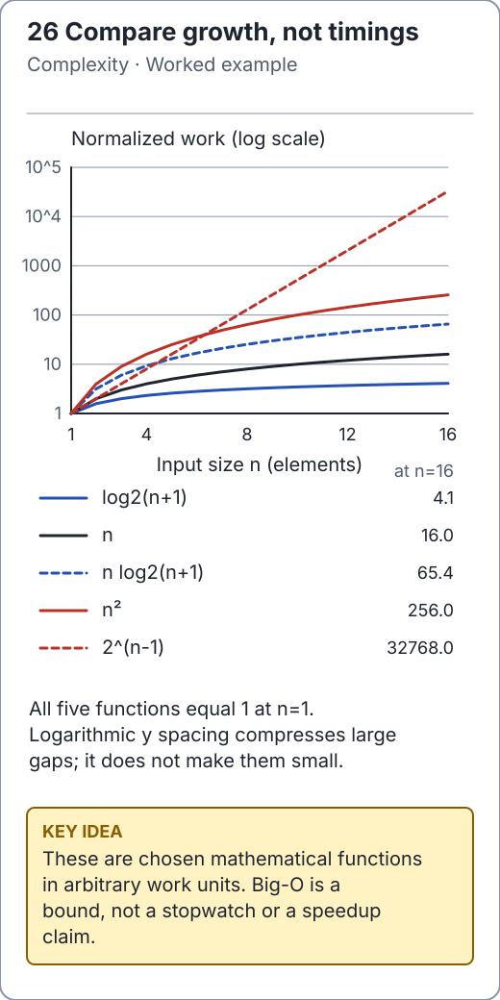

# Recurrences, amortization and honest cost models

Start with the [time-complexity foundations](../../complexity-analysis/time-complexity.md).
This lesson derives bounds for actual patterns used in the repository rather than
assigning a complexity to code merely because it contains recursion or a loop.

| At a glance | |
| --- | --- |
| **Use it when** | You need to say how work grows with input size, by solving a recurrence or by amortized accounting |
| **Avoid it when** | You want a wall-clock prediction or a comparison of constant factors; a bound counts steps in a stated model and nothing more |
| **Cost** | The analysis itself is paper work; the result is a growth rate such as O(n log n) or O(1) amortized |
| **In this repo** | [`DynamicArray`](../../src/main/java/io/github/ichillous/dsa/collections/DynamicArray.java) for amortized growth, [`SortAlgorithms`](../../src/main/java/io/github/ichillous/dsa/algorithms/SortAlgorithms.java) for recurrences |
| **In the JDK** | `ArrayList` (`add` documented as amortized constant time), `HashMap` (cost depends on `hashCode`) |

<!-- visual:generated complexity-growth -->
<picture><source media="(prefers-color-scheme: dark)" srcset="../../docs/visuals/assets/complexity-growth-dark.svg"></picture>

**Figure 26.** Five illustrative functions share a value of one at input size one. A logarithmic work axis shows logarithmic, linear, n log n, quadratic and exponential growth without implying benchmark timings. [Visual index and step-throughs](../../docs/visuals/README.md).
<!-- /visual:generated -->

## Balanced divide and conquer

A merge-sort call guarantees a sorted interval. Two half-size children plus a
linear merge give `T(n) = 2T(n/2) + O(n)`. For a power-of-two size, each merge level
touches at most `n` values and there are `log2(n)` such levels. This simple model
counts full-merge work; the maintained implementation can skip ordered merges.

```java
int n = 16;
long fullMergeVisits = 0L;
int levels = 0;
for (int width = n; width > 1; width /= 2) {
    fullMergeVisits += n;
    levels++;
}
assert levels == 4;
assert fullMergeVisits == 64L;
```

By contrast, a partition sequence of sizes `n-1, n-2, ...` sums to Θ(n²). A
quicksort implementation can bound stack depth without fixing that worst-case
time: [smaller-partition recursion](../sorting/quick-sort.md) does precisely that.
The recurrence describes work; live frames determine stack space separately.

## A sequence can be cheap despite expensive individual steps

A geometrically growing array copies capacities `1, 2, 4, 8, ...`. For `m` appends,
the total copied entries are less than `2m`, in addition to `m` writes. The
accounting invariant is that earlier cheap appends pay for the next capacity copy;
no probabilistic assumption is needed.

```java
import io.github.ichillous.dsa.collections.DynamicArray;

int count = 16;
long modeledCopies = 0L;
for (int capacity = 1; capacity < count; capacity *= 2) {
    modeledCopies += capacity;
}
var values = new DynamicArray<Integer>(0);
for (int value = 0; value < count; value++) {
    values.add(value);
}
assert modeledCopies == 15L;
assert modeledCopies < 2L * count;
assert values.size() == 16 && values.get(15) == 15;
```

This model gives O(1) **amortized** append but O(n) time for an individual growth.
Indexed insertion still shifts O(n) elements and is not covered by that append
bound. Growing by a fixed single slot would copy `1 + 2 + ... + m` entries instead,
so it would make repeated appends quadratic.

## In real Java

The `ArrayList` documentation states that `add` runs in amortized constant time
and that the other operations run in linear time, roughly speaking. A hash
table's cost bound rests on an assumption the caller controls: the `Object`
contract notes that distinct hash codes for unequal objects may improve hash-table
performance. Correctness never depends on that. A key whose `hashCode` is
constant still gives the right answers, and only the cost model changes.

```java
import java.util.ArrayList;
import java.util.HashMap;
import java.util.List;
import java.util.Map;

record Collide(int id) {
    @Override
    public int hashCode() {
        return 42;
    }
}

Map<Collide, Integer> map = new HashMap<>();
for (int id = 0; id < 1_000; id++) {
    map.put(new Collide(id), id);
}
assert map.size() == 1_000;
assert map.get(new Collide(777)) == 777;
assert map.get(new Collide(1_000)) == null;

List<Integer> list = new ArrayList<>();
list.add(1);
list.add(2);
list.add(0, 0);
assert list.equals(List.of(0, 1, 2));
```

The last lines show why `add(0, x)` is outside the amortized append bound: it
shifts every later element, so it is a different operation.

## Include the size hidden inside an operation

Hashing and equality may inspect a key; string comparisons are not always O(1).
Bellman–Ford here uses exact integers to avoid false overflow, so its relaxation
cost includes integer bit length. Numeric-capacity DP may allocate a table much
larger than the number of bits used to encode that capacity.

**Pitfall:** calling a nested scan “linear” because each individual iteration is
simple ignores how often it restarts. Conversely, the deque in
[sliding-window maximum](../divide-and-conquer/problems.md) is linear because
each index enters and leaves at most once across the whole run.

## Common mistakes

1. **Multiplying a loop bound by an inner `while` that is amortized.** Next-greater
   on `[5, 4, 3, 2, 1, 6]` pops five indices at once when 6 arrives, but every
   index is pushed and popped once, so the total is O(n), not O(n^2).
2. **Calling a halving recursion logarithmic while copying the range.** Binary
   search that passes `Arrays.copyOfRange` slices copies 512 + 256 + ... values on
   an array of 1,024, which is linear overall. The invariant behind O(log n) is O(1)
   work per halving.
3. **Counting string comparisons as O(1).** Sorting 1,000 strings that share a
   999-character prefix compares up to 999 characters per comparison, so the model
   must include the key length, not just `n log n` comparisons.

## Check yourself

<details>
<summary>Why does merge sort have `log2(n)` merge levels that each touch at most `n` values?</summary>

Every level halves the range size, so a power-of-two size needs `log2(n)`
levels. The ranges on one level are disjoint, so together they hold at most `n`
values.

</details>

<details>
<summary>What does "amortized O(1)" mean for the append that triggers growth from capacity 8?</summary>

That single append is O(n): it copies 8 values. The claim is about the whole
sequence, where earlier cheap appends pay for it so total copies stay below `2m`
for `m` appends.

</details>

<details>
<summary>Why can a recurrence not tell you the stack space of quicksort?</summary>

The recurrence counts work across all calls. Stack space is set by the deepest
chain of live calls, which depends on which partition is recursed into first, not
on the total number of calls.

</details>

## Practice

1. Draw merge-sort work for sizes 8 and 16, distinguishing leaves from merge levels.
2. Repeat the copy sum with capacity multiplication by 3; explain why a constant
   factor greater than one still gives linear total copying.
3. State the probability assumption in expected hash lookup, then contrast it with
   the deterministic accounting proof for dynamic-array growth.

See the [solutions](../../docs/solutions.md) and
[implementation-specific bounds](../../docs/complexity.md).
