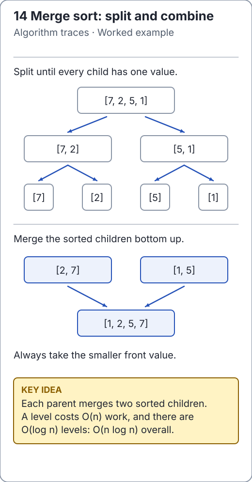

# Divide and conquer: define what comes back

Divide and conquer splits a problem into smaller instances, solves them, then
combines their answers. The split alone is not enough: specify what each recursive
call guarantees and why combining those guarantees solves the parent instance.

<!-- visual:generated -->
<picture><source media="(prefers-color-scheme: dark)" srcset="../../docs/visuals/assets/merge-recursion-dark.svg"></picture>

**Figure 14.** Split into singletons, then merge sorted children bottom up. [Visual index and step-throughs](../../docs/visuals/README.md).
<!-- /visual:generated -->

## Example: a sorted interval

For maintained [merge sort](../sorting/merge-sort.md), a call on `[from, to)`
returns with precisely those values sorted. Length zero or one is already sorted.
The two child intervals cover the parent without overlap. Once both are sorted,
a linear merge produces a sorted parent with the same multiplicities.

```text
sort [0, 8)
├─ sort [0, 4)
│  ├─ sort [0, 2)
│  └─ sort [2, 4)
└─ sort [4, 8)
   ├─ sort [4, 6)
   └─ sort [6, 8)
```

The call invariant describes one interval; the merge-loop invariant describes
which values have already been emitted. Keep these separate when proving the
algorithm. Every recursive interval must shrink, or the base case may never arrive.

```java
import io.github.ichillous.dsa.algorithms.SortAlgorithms;
import java.util.Arrays;

int[] input = {8, 2, 7, 1, 6, 3, 5, 4};
SortAlgorithms.mergeSort(input);
assert Arrays.equals(input, new int[] {1, 2, 3, 4, 5, 6, 7, 8});
```

## Different splits give different recurrences

| Algorithm | Subproblems and combining work | Bound and assumption |
| --- | --- | --- |
| Binary search | One half-size problem, O(1) comparison work | O(log n) time, ascending input |
| Merge sort | Two half-size problems, O(n) merge | O(n log n) worst time, O(n) buffer plus stack |
| Quicksort | Two data-dependent regions, O(n) partition | O(n log n) for balanced splits; O(n²) worst |
| Merge-based inversion count | Two halves plus linear cross-pair count | O(n log n) time, O(n) auxiliary space |

For a balanced two-way split with linear combine, each recursion level has O(n)
work and there are O(log n) levels. For a chain of sizes `n, n-1, n-2, ...`, the
sum is quadratic instead. The number of recursive calls alone does not determine
peak space; simultaneously live buffers and frames do.

**Counterexample:** splitting into halves but copying the entire original array
in every leaf call adds O(n²) copying. Halving a parameter does not by itself prove
a logarithmic total running time.

## Relation to dynamic programming

Merge sort's child ranges are disjoint. Fibonacci's naive recursive children
repeatedly ask for the same states. Caching is useful in the second situation,
while caching every merge-sort result adds storage without eliminating a matching
pattern of repeated states. Inspect dependencies rather than choosing a technique
because it uses recursion.

## Practice

1. Label the value ranges returned by the four size-two calls in the trace.
2. Derive `T(n) = 2T(n/2) + O(n)` using work per level, not a memorized formula.
3. Find a combine rule for inversion counts, then compare with the linear
   maximum-subarray and sliding-window techniques in [worked problems](problems.md).

The [solutions](../../docs/solutions.md) and
[recurrence lesson](../complexity-analysis/time-complexity.md) provide checks.
