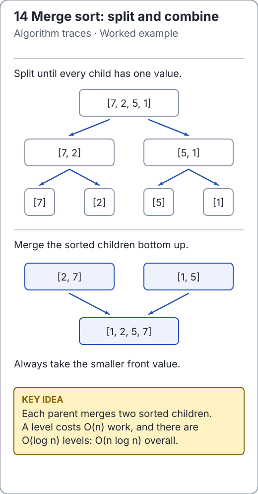
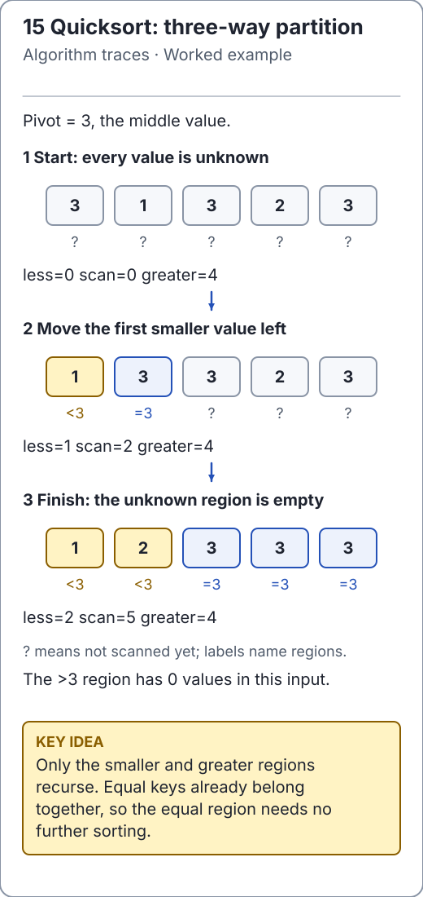

# Divide and conquer: define what comes back

Divide and conquer splits a problem into smaller instances, solves them, then
combines their answers. The split alone is not enough: specify what each recursive
call guarantees and why combining those guarantees solves the parent instance.

| At a glance | |
| --- | --- |
| **Use it when** | Subproblems are independent and a cheap combine rule exists: sorting, counting cross pairs, searching a sorted range |
| **Avoid it when** | Subproblems repeat the same states (use caching or dynamic programming), or the split cannot be kept balanced and the combine step costs more than the split saves |
| **Cost** | `T(n) = 2T(n/2) + O(n)` gives O(n log n); one half and O(1) work gives O(log n); live frames decide stack space separately |
| **In this repo** | [`SortAlgorithms.mergeSort`](../../src/main/java/io/github/ichillous/dsa/algorithms/SortAlgorithms.java), [`SequenceAlgorithms.countInversions`](../../src/main/java/io/github/ichillous/dsa/algorithms/SequenceAlgorithms.java) |
| **In the JDK** | `Arrays.sort`, `Arrays.binarySearch`, `List.sort` |

<!-- visual:generated merge-recursion -->
<picture><source media="(prefers-color-scheme: dark)" srcset="../../docs/visuals/assets/merge-recursion-dark.svg"></picture>

**Figure 14.** Split into singletons, then merge sorted children bottom up. [Visual index and step-throughs](../../docs/visuals/README.md).
<!-- /visual:generated -->

## Example: a sorted interval

For maintained [merge sort](../sorting/merge-sort.md), a call on `[from, to)`
returns with precisely those values sorted. Length zero or one is already sorted.
The two child intervals cover the parent without overlap. Once both are sorted,
a linear merge produces a sorted parent with the same multiplicities.

```text
sort [0, 8)
├─ sort [0, 4)
│  ├─ sort [0, 2)
│  └─ sort [2, 4)
└─ sort [4, 8)
   ├─ sort [4, 6)
   └─ sort [6, 8)
```

The call invariant describes one interval; the merge-loop invariant describes
which values have already been emitted. Keep these separate when proving the
algorithm. Every recursive interval must shrink, or the base case may never arrive.

```java
import io.github.ichillous.dsa.algorithms.SortAlgorithms;
import java.util.Arrays;

int[] input = {8, 2, 7, 1, 6, 3, 5, 4};
SortAlgorithms.mergeSort(input);
assert Arrays.equals(input, new int[] {1, 2, 3, 4, 5, 6, 7, 8});
```

## Different splits give different recurrences

| Algorithm | Subproblems and combining work | Bound and assumption |
| --- | --- | --- |
| Binary search | One half-size problem, O(1) comparison work | O(log n) time, ascending input |
| Merge sort | Two half-size problems, O(n) merge | O(n log n) worst time, O(n) buffer plus stack |
| Quicksort | Two data-dependent regions, O(n) partition | O(n log n) for balanced splits; O(n²) worst |
| Merge-based inversion count | Two halves plus linear cross-pair count | O(n log n) time, O(n) auxiliary space |

<!-- visual:generated quick-partition -->
<picture><source media="(prefers-color-scheme: dark)" srcset="../../docs/visuals/assets/quick-partition-dark.svg"></picture>

**Figure 15.** Gather duplicate pivot values into one finished equal region. [Visual index and step-throughs](../../docs/visuals/README.md).
<!-- /visual:generated -->

For a balanced two-way split with linear combine, each recursion level has O(n)
work and there are O(log n) levels. For a chain of sizes `n, n-1, n-2, ...`, the
sum is quadratic instead. The number of recursive calls alone does not determine
peak space; simultaneously live buffers and frames do.

**Counterexample:** splitting into halves but copying the entire original array
in every leaf call adds O(n²) copying. Halving a parameter does not by itself prove
a logarithmic total running time.

## In real Java

`Arrays.sort(Object[], Comparator)` is documented as stable: equal elements are
not reordered. That is the same promise a merge makes when it takes the left
element on ties. For primitive arrays stability cannot be observed, which is why
the library's `int[]` sort does not claim it. (OpenJDK implementation note: the
object sort is a merge sort and `Arrays.sort(int[])` is a dual-pivot quicksort;
the specification guarantees stability for the object sort, and the algorithms are
named only in non-normative Implementation Notes.)

```java
import java.util.Arrays;
import java.util.Comparator;

String[] words = {"pear", "fig", "plum", "kiwi", "apple", "date"};
Arrays.sort(words, Comparator.comparingInt(String::length));
assert Arrays.equals(words, new String[] {"fig", "pear", "plum", "kiwi", "date", "apple"});

int[] sorted = {1, 3, 5, 7};
assert Arrays.binarySearch(sorted, 5) == 2;
assert Arrays.binarySearch(sorted, 4) == -3;
```

`binarySearch` returns `-(insertion point) - 1` for a missing key, here
`-(2) - 1`, and its input must already be sorted.

## Common mistakes

1. **Breaking ties the wrong way in a merge.** Counting inversions with `<`
   instead of `<=` on `[2, 2]` reports 1 pair, but equal values are not an
   inversion. The invariant is that a right value is counted only when strictly
   smaller than the next left value.
2. **Computing the midpoint as `(from + to) / 2`.** With `from = 2_000_000_000`
   and `to = 2_100_000_000` the `int` sum overflows. `from + (to - from) / 2`
   keeps the midpoint inside `[from, to)`.
3. **A range that does not shrink.** If a one-element range `[from, from + 1)` is
   split at `middle = from`, one child is the whole parent and the recursion never
   ends. The base case must stop at length zero or one.

## Check yourself

<details>
<summary>Why does `T(n) = 2T(n/2) + O(n)` give O(n log n) for merge sort?</summary>

Each of the `log2(n)` levels merges disjoint ranges that together hold `n`
values, so every level costs O(n). Levels times work per level gives O(n log n).

</details>

<details>
<summary>Why is caching useless for merge sort but useful for naive Fibonacci?</summary>

Merge sort's child ranges are disjoint, so no two calls ask for the same state.
Naive Fibonacci recomputes the same arguments repeatedly, so remembering them
removes real repeated work.

</details>

<details>
<summary>Quicksort recurses on both partitions, so why is its worst case O(n^2)?</summary>

The split depends on the data. If every partition removes one element, the sizes
are `n - 1, n - 2, ...`, whose linear partition costs sum to a quadratic total.

</details>

## Relation to dynamic programming

Merge sort's child ranges are disjoint. Fibonacci's naive recursive children
repeatedly ask for the same states. Caching is useful in the second situation,
while caching every merge-sort result adds storage without eliminating a matching
pattern of repeated states. Inspect dependencies rather than choosing a technique
because it uses recursion.

## Practice

1. Label the value ranges returned by the four size-two calls in the trace.
2. Derive `T(n) = 2T(n/2) + O(n)` using work per level, not a memorized formula.
3. Find a combine rule for inversion counts, then compare with the linear
   maximum-subarray and sliding-window techniques in [worked problems](problems.md).

The [solutions](../../docs/solutions.md) and
[recurrence lesson](../complexity-analysis/time-complexity.md) provide checks.
