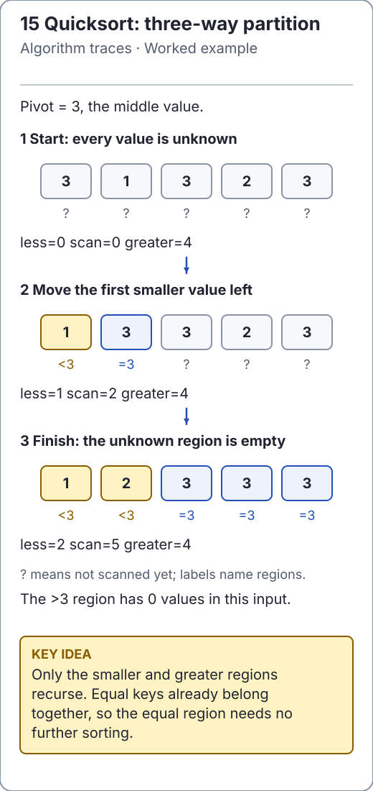

# Array problems: combine, extend or discard

The maintained [SequenceAlgorithms](../../src/main/java/io/github/ichillous/dsa/algorithms/SequenceAlgorithms.java)
shows three useful ways to avoid recomputing array work. All methods reject null
and leave input unchanged. Choose the method by the invariant you can prove,
rather than forcing every array problem into recursion.

<!-- visual:generated -->
<picture><source media="(prefers-color-scheme: dark)" srcset="../../docs/visuals/assets/quick-partition-dark.svg"></picture>

**Figure 15.** Gather duplicate pivot values into one finished equal region. [Visual index and step-throughs](../../docs/visuals/README.md).
<!-- /visual:generated -->

## Count inversions during a merge

An inversion is a pair `i < j` with `a[i] > a[j]`. Recursively count pairs within
each half. During merging, when a right value is smaller than the current left
value, it is smaller than **every remaining left value**. Add their count once.
Equal values do not count as inversions.

```text
merge left [2, 4] and right [1, 3, 5]
emit 1: add 2 inversions, (2,1) and (4,1)
emit 2: add 0
emit 3: add 1 inversion, (4,3)
total cross inversions = 3
```

```java
import io.github.ichillous.dsa.algorithms.SequenceAlgorithms;
import java.util.Arrays;

int[] values = {2, 4, 1, 3, 5};
assert SequenceAlgorithms.countInversions(values) == 3L;
assert Arrays.equals(values, new int[] {2, 4, 1, 3, 5});
assert SequenceAlgorithms.countInversions(new int[] {2, 2, 2}) == 0L;
assert SequenceAlgorithms.countInversions(new int[0]) == 0L;
```

The copied array, merge buffer and stack use O(n) auxiliary space; time is
O(n log n). The `long` count matters: a descending array has `n(n-1)/2` inversions,
which exceeds `int` for some valid Java array lengths.

## Maximum subarray: Kadane's extension invariant

Keep the greatest-sum nonempty range ending at the current index. A strictly
negative preceding sum can only hurt a new range, so discard it. A zero preceding
sum must be retained to honor the earliest-start tie policy. Track the best range
seen anywhere as a separate state.

For `[-2, 1, -3, 4, -1, 2, 1, -5, 4]`, the sums of the best ranges ending at each
position are `[-2, 1, -2, 4, 3, 5, 6, 1, 5]`; the global best is `[3, 7)` with sum 6.

```java
import io.github.ichillous.dsa.algorithms.SequenceAlgorithms;

var best = SequenceAlgorithms.maximumSubarray(
        new int[] {-2, 1, -3, 4, -1, 2, 1, -5, 4}).orElseThrow();
assert best.startInclusive() == 3 && best.endExclusive() == 7 && best.sum() == 6L;
var negative = SequenceAlgorithms.maximumSubarray(new int[] {-8, -3, -5}).orElseThrow();
assert negative.startInclusive() == 1 && negative.endExclusive() == 2 && negative.sum() == -3L;
var tied = SequenceAlgorithms.maximumSubarray(new int[] {0, 1}).orElseThrow();
assert tied.startInclusive() == 0 && tied.endExclusive() == 2;
assert SequenceAlgorithms.maximumSubarray(new int[0]).isEmpty();
```

Time is O(n) and auxiliary space O(1). The result is an optional nonempty range;
ties choose earliest start, then earliest end. Sums of any Java `int[]` fit in a
`long`. Initializing the best answer to zero would incorrectly return an empty
solution for all-negative input. A divide-and-conquer solution can also work,
but combining left/right/crossing optima is unnecessary for this linear method.

## Sliding-window maximum: keep only useful candidates

A deque stores unexpired indices in decreasing value order. An index with a
later value at least as large can be removed: every future window containing the
earlier index also contains the later, better candidate. Expire old indices from
the front; the front then identifies the current maximum.

```java
import io.github.ichillous.dsa.algorithms.SequenceAlgorithms;
import java.util.Arrays;

int[] input = {1, 3, -1, -3, 5, 3, 6, 7};
int[] maxima = SequenceAlgorithms.slidingWindowMaximum(input, 3);
assert Arrays.equals(maxima, new int[] {3, 3, 5, 5, 6, 7});
assert Arrays.equals(SequenceAlgorithms.slidingWindowMaximum(input, 1), input);
```

Require `1 <= window <= input.length`; empty input has no valid window. Each index
enters and leaves the deque at most once, giving O(n) time despite nested loops.
Auxiliary storage is O(window), plus O(n-window+1) output. Keeping values without
indices loses the information needed to expire an old maximum correctly.

## Practice

1. Count inversions by an independent quadratic pair scan on small arrays.
2. Exhaustively enumerate nonempty subarrays and verify sums **and tie indices**.
3. Compare deque results with a direct maximum scan for each window; include equal
   values, negative values and windows of sizes 1 and `n`.

Use the [solutions](../../docs/solutions.md) to review the reference models.
