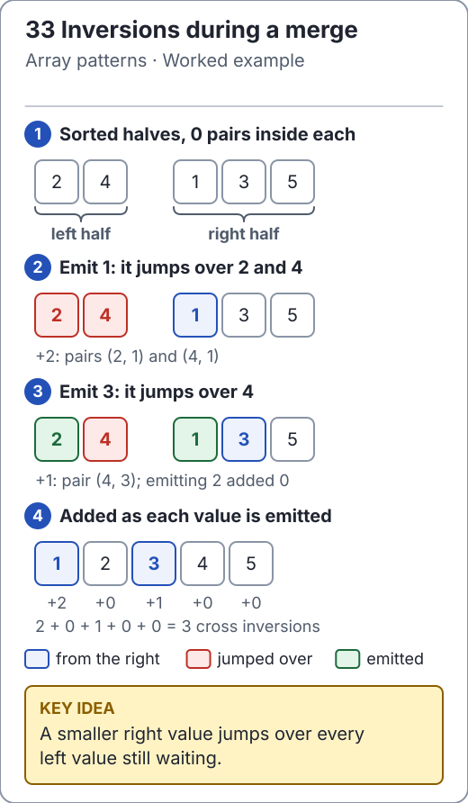

# Array problems: combine, extend or discard

The maintained [SequenceAlgorithms](../../src/main/java/io/github/ichillous/dsa/algorithms/SequenceAlgorithms.java)
shows three useful ways to avoid recomputing array work. All methods reject null
and leave input unchanged. Choose the method by the invariant you can prove,
rather than forcing every array problem into recursion.

| At a glance | |
| --- | --- |
| **Use it when** | You can state an invariant that lets one pass reuse earlier work: a merge counts cross pairs, a running sum extends a range, a deque keeps useful candidates |
| **Avoid it when** | The invariant needs rescanning the array for each answer, or the input violates the precondition (a window longer than the array) |
| **Cost** | O(n log n) for the inversion count, O(n) for Kadane and for the sliding-window deque |
| **In this repo** | [`SequenceAlgorithms`](../../src/main/java/io/github/ichillous/dsa/algorithms/SequenceAlgorithms.java) |
| **In the JDK** | `ArrayDeque` for the window, `Math.addExact` and `Math.toIntExact` for checked counts; no direct equivalent of the three algorithms |

## Count inversions during a merge

An inversion is a pair `i < j` with `a[i] > a[j]`. Recursively count pairs within
each half. During merging, when a right value is smaller than the current left
value, it is smaller than **every remaining left value**. Add their count once.
Equal values do not count as inversions.

<!-- visual:generated inversion-count-merge -->
<picture><source media="(prefers-color-scheme: dark)" srcset="../../docs/visuals/assets/inversion-count-merge-dark.svg"></picture>

**Figure 79.** countInversions on 2, 4, 1, 3, 5 merges the sorted halves 2, 4 and 1, 3, 5: emitting 1 jumps over two left values, emitting 3 jumps over one, and the other values add nothing, for 3 inversions. [Visual index and step-throughs](../../docs/visuals/README.md).
<!-- /visual:generated -->

```text
merge left [2, 4] and right [1, 3, 5]
emit 1: add 2 inversions, (2,1) and (4,1)
emit 2: add 0
emit 3: add 1 inversion, (4,3)
total cross inversions = 3
```

```java
import io.github.ichillous.dsa.algorithms.SequenceAlgorithms;
import java.util.Arrays;

int[] values = {2, 4, 1, 3, 5};
assert SequenceAlgorithms.countInversions(values) == 3L;
assert Arrays.equals(values, new int[] {2, 4, 1, 3, 5});
assert SequenceAlgorithms.countInversions(new int[] {2, 2, 2}) == 0L;
assert SequenceAlgorithms.countInversions(new int[0]) == 0L;
```

The copied array, merge buffer and stack use O(n) auxiliary space; time is
O(n log n). The `long` count matters: a descending array has `n(n-1)/2` inversions,
which exceeds `int` for some valid Java array lengths.

## Maximum subarray: Kadane's extension invariant

Keep the greatest-sum nonempty range ending at the current index. A strictly
negative preceding sum can only hurt a new range, so discard it. A zero preceding
sum must be retained to honor the earliest-start tie policy. Track the best range
seen anywhere as a separate state.

For `[-2, 1, -3, 4, -1, 2, 1, -5, 4]`, the sums of the best ranges ending at each
position are `[-2, 1, -2, 4, 3, 5, 6, 1, 5]`; the global best is `[3, 7)` with sum 6.

```java
import io.github.ichillous.dsa.algorithms.SequenceAlgorithms;

var best = SequenceAlgorithms.maximumSubarray(
        new int[] {-2, 1, -3, 4, -1, 2, 1, -5, 4}).orElseThrow();
assert best.startInclusive() == 3 && best.endExclusive() == 7 && best.sum() == 6L;
var negative = SequenceAlgorithms.maximumSubarray(new int[] {-8, -3, -5}).orElseThrow();
assert negative.startInclusive() == 1 && negative.endExclusive() == 2 && negative.sum() == -3L;
var tied = SequenceAlgorithms.maximumSubarray(new int[] {0, 1}).orElseThrow();
assert tied.startInclusive() == 0 && tied.endExclusive() == 2;
assert SequenceAlgorithms.maximumSubarray(new int[0]).isEmpty();
```

Time is O(n) and auxiliary space O(1). The result is an optional nonempty range;
ties choose earliest start, then earliest end. Sums of any Java `int[]` fit in a
`long`. Initializing the best answer to zero would incorrectly return an empty
solution for all-negative input. A divide-and-conquer solution can also work,
but combining left/right/crossing optima is unnecessary for this linear method.

## Sliding-window maximum: keep only useful candidates

A deque stores unexpired indices in decreasing value order. An index with a
later value at least as large can be removed: every future window containing the
earlier index also contains the later, better candidate. Expire old indices from
the front; the front then identifies the current maximum.

```java
import io.github.ichillous.dsa.algorithms.SequenceAlgorithms;
import java.util.Arrays;

int[] input = {1, 3, -1, -3, 5, 3, 6, 7};
int[] maxima = SequenceAlgorithms.slidingWindowMaximum(input, 3);
assert Arrays.equals(maxima, new int[] {3, 3, 5, 5, 6, 7});
assert Arrays.equals(SequenceAlgorithms.slidingWindowMaximum(input, 1), input);
```

Require `1 <= window <= input.length`; empty input has no valid window. Each index
enters and leaves the deque at most once, giving O(n) time despite nested loops.
Auxiliary storage is O(window), plus O(n-window+1) output. Keeping values without
indices loses the information needed to expire an old maximum correctly.

## In real Java

The inversion count is a `long` because a descending array of 100,000 values has
`n(n - 1) / 2 = 4,999,950,000` inversions, more than `Integer.MAX_VALUE`.
`Math.toIntExact` documents that it throws `ArithmeticException` when its `long`
argument does not fit an `int`, so a caller who needs an `int` can fail loudly
instead of truncating.

```java
import io.github.ichillous.dsa.algorithms.SequenceAlgorithms;

int[] descending = new int[100_000];
for (int i = 0; i < descending.length; i++) {
    descending[i] = descending.length - i;
}
long inversions = SequenceAlgorithms.countInversions(descending);
assert inversions == 100_000L * 99_999L / 2;
assert inversions > Integer.MAX_VALUE;
boolean rejected = false;
try {
    Math.toIntExact(inversions);
} catch (ArithmeticException expected) {
    rejected = true;
}
assert rejected;
```

## Common mistakes

1. **Starting Kadane's best at 0.** For `[-8, -3, -5]` that returns an empty
   range with sum 0. The invariant is that the answer is a nonempty range, so the
   best sum starts at the first element.
2. **Merging with `<` on ties when counting inversions.** For `[2, 2, 2]` the
   right values would each jump the equal left values and report 3 pairs instead
   of 0.
3. **Keeping values instead of indices in the window deque.** For `[5, 1, 1]`
   with window 2 the second window `[1, 1]` must report 1, but a deque holding
   only the value 5 cannot tell that 5 has left the window.

## Check yourself

<details>
<summary>In a merge of left `[2, 4]` and right `[1, 3, 5]`, why does emitting 1 add exactly 2?</summary>

Both left values are still waiting and both are larger than 1. Because each half
is sorted, a right value smaller than the front left value is smaller than every
remaining left value, so one subtraction counts them all.

</details>

<details>
<summary>Why is the sliding-window deque linear although it has a nested loop?</summary>

Each index enters the deque once and leaves it at most once, from the back when a
better candidate arrives or from the front when it expires. The inner loop
therefore runs at most `n` times in total.

</details>

<details>
<summary>Why does Kadane's method keep a preceding sum of zero?</summary>

Dropping it would start the range later, but the policy is the earliest start
among equal sums. For `[0, 1]` the answer is the range `[0, 2)`, not `[1, 2)`.

</details>

## Practice

1. Count inversions by an independent quadratic pair scan on small arrays.
2. Exhaustively enumerate nonempty subarrays and verify sums **and tie indices**.
3. Compare deque results with a direct maximum scan for each window; include equal
   values, negative values and windows of sizes 1 and `n`.

Use the [solutions](../../docs/solutions.md) to review the reference models. The [solution finder](../../docs/solution-finder.md#12-array-and-sequence-patterns) compares this technique with its alternatives.
