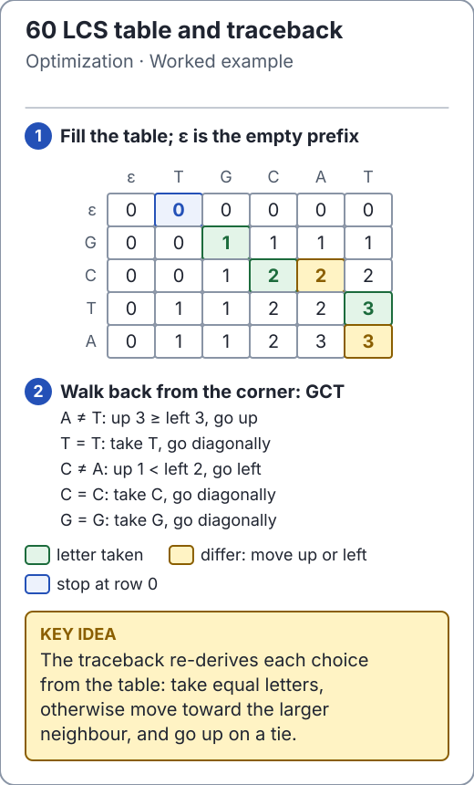
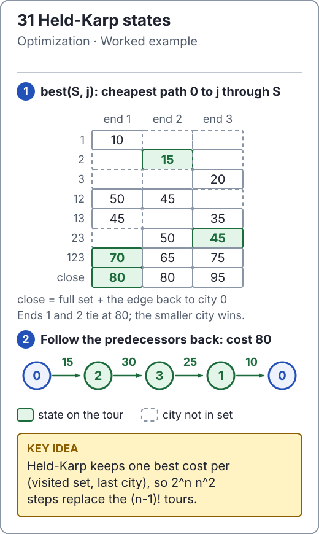

# Recognize the DP family

Most dynamic-programming problems are one of a few shapes. Naming the shape tells
you what the state is, how large the table gets and which loop order is legal. This
page maps each family to a maintained method; the
[overview](overview.md), [problem set](problems.md) and
[classic problems](classic-problems.md) give the full derivations.

| At a glance | |
| --- | --- |
| **Use it when** | You face an optimization or counting problem and need to pick a state shape quickly |
| **Avoid it when** | A greedy proof exists, or you need every optimal solution rather than one value |
| **Cost** | States times work per state; each family below states its own bound |
| **In this repo** | [`DynamicProgramming`](../../src/main/java/io/github/ichillous/dsa/algorithms/DynamicProgramming.java) and [`DynamicProgrammingClassics`](../../src/main/java/io/github/ichillous/dsa/algorithms/DynamicProgrammingClassics.java) |
| **In the JDK** | No direct equivalent; plain arrays, `long` and `Math.addExact` |

## The families

| Family | State shape | Repo method | Cost | The question that reveals it |
| --- | --- | --- | --- | --- |
| Linear | One index or amount, `best[a]` | `minimumCoins`, `wordBreak` | O(c · a); O(n · L) lookups | "Does the answer for `a` follow from answers for smaller `a`?" |
| Grid (two sequences) | A prefix of each input, `(i, j)` | `editScript`, `longestCommonSubsequence` | O(mn) | "Compare two strings or sequences position by position?" |
| Interval | A range `(i, j)` of one input | `matrixChainOrder`, `longestPalindromicSubsequenceLength` | O(n^3) and O(n^2) | "Is the best answer for a range found by splitting it in two?" |
| Knapsack | Items processed so far and remaining capacity | `knapsack01`, `countCoinCombinations` | O(nW) | "Each item is taken or skipped under a budget?" |
| Subsequence | Best ending at or using the first `i` elements | `longestIncreasingSubsequenceLength` | O(n log n) | "Pick elements in order, not contiguous?" |
| Bitmask | A set of visited items plus a last item | `travelingSalesman` | O(2^n n^2), n at most 16 | "Must every item be used once, and n is tiny?" |
| Scheduling with binary search | The first `i` items sorted by end | `weightedIntervalScheduling` | O(n log n) | "Choose non-overlapping jobs with weights?" |

<!-- visual:generated lcs-traceback | The grid family: a state per pair of prefixes, here for LCS of GCTA and TGCAT. -->
<picture><source media="(prefers-color-scheme: dark)" srcset="../../docs/visuals/assets/lcs-traceback-dark.svg"></picture>

**Figure 28.** The grid family: a state per pair of prefixes, here for LCS of GCTA and TGCAT. [Visual index and step-throughs](../../docs/visuals/README.md).
<!-- /visual:generated -->

<!-- visual:generated held-karp-masks | The bitmask family: a state per visited set and last city. -->
<picture><source media="(prefers-color-scheme: dark)" srcset="../../docs/visuals/assets/held-karp-masks-dark.svg"></picture>

**Figure 31.** The bitmask family: a state per visited set and last city. [Visual index and step-throughs](../../docs/visuals/README.md).
<!-- /visual:generated -->

## The invariant and a trace

In every family, a state's stored value is the optimum for exactly the sub-problem
its definition names, and every dependency is computed before its dependents. The
shape decides the order: ascending amounts, increasing range length, subsets before
supersets, or intervals sorted by end.

```text
linear     best[a] from best[a - coin]              ascending a
grid       dp[i][j] from dp[i-1][j-1], dp[i-1][j], dp[i][j-1]
interval   cost(i, j) from cost(i, k) and cost(k+1, j)   increasing length
bitmask    best(S, j) from best(S minus j, i)       subsets before supersets
```

## Executable example

```java
import io.github.ichillous.dsa.algorithms.DynamicProgramming;
import io.github.ichillous.dsa.algorithms.DynamicProgrammingClassics;
import java.util.List;

// linear: one amount
assert DynamicProgramming.minimumCoins(new int[] {1, 3, 4}, 6) == 2;
// grid: two prefixes
assert DynamicProgramming.longestCommonSubsequence("GCTA", "TGCAT").equals("GCT");
assert DynamicProgramming.editDistance("brain", "paint") == 3;
// interval: a range of matrices
assert DynamicProgrammingClassics.matrixChainOrder(new int[] {30, 1, 40, 10, 25}).cost() == 1400;
// knapsack: items and capacity
assert DynamicProgramming.knapsack01Items(new int[] {2, 3, 4}, new int[] {4, 5, 7}, 5)
        .equals(List.of(0, 1));
// subsequence: ordered, not contiguous
assert DynamicProgramming.longestIncreasingSubsequenceLength(new int[] {10, 9, 2, 5, 3, 7, 101, 18}) == 4;
// bitmask: visited set and last city
long[][] distances = {{0, 10, 15, 20}, {10, 0, 35, 25}, {15, 35, 0, 30}, {20, 25, 30, 0}};
assert DynamicProgrammingClassics.travelingSalesman(distances).cost() == 80;
```

## Costs

| Family | Time | Space | Limit to remember |
| --- | --- | --- | --- |
| Linear | O(states * choices) | O(a) | Numeric amount sets the size (pseudopolynomial) |
| Grid | O(mn) | O(min(m, n)) for values, O(mn) to reconstruct | Table size can exhaust memory |
| Interval | O(n^3) | O(n^2) | Cubic time |
| Knapsack | O(nW) | O(W) | Capacity `W` is a number, not an input length |
| Subsequence | O(n log n) for LIS | O(n) | The tails array is not an actual subsequence |
| Bitmask | O(2^n n^2) | O(2^n n) | Capped at 16 cities here |
| Scheduling | O(n log n) | O(n) | Intervals are half-open |

## Pitfall

Picking the family by the story rather than the state. "Choose items under a
budget" suggests knapsack, but coin change with unlimited reuse is a linear table
over amounts, and its loop direction differs from 0/1 knapsack. If you cannot write
the state in one sentence, you have not picked a family yet.

## Practice

1. Name the family and write the state for "the fewest jumps to reach the last
   index of an array", then say which repo method has the same shape.
2. Which family is "longest palindromic subsequence" and why is it not a grid over
   two different strings?
3. Why does a bitmask state need both the visited set and the last city?

## Check yourself

<details>
<summary>Which family does weighted interval scheduling belong to, and what does binary search do there?</summary>

Scheduling with binary search. After sorting by end, binary search finds `p(i)`, the last interval compatible with interval `i`, so the transition is `max(best[i-1], w_i + best[p(i)])`.

</details>

<details>
<summary>Why is 0/1 knapsack's capacity a poor measure of input size?</summary>

Capacity is a number, so the table has `W + 1` entries while `W` needs only about log W bits. Time O(nW) is therefore pseudopolynomial.

</details>

<details>
<summary>What question separates the interval family from the linear family?</summary>

Whether the best answer for a range comes from splitting the range at some point and combining two sub-ranges (interval), or from one smaller prefix or amount (linear).

</details>

See the [catalog](../../docs/catalog.md), the [complexity guide](../../docs/complexity.md) and the [solution finder](../../docs/solution-finder.md#18-dynamic-programming).
