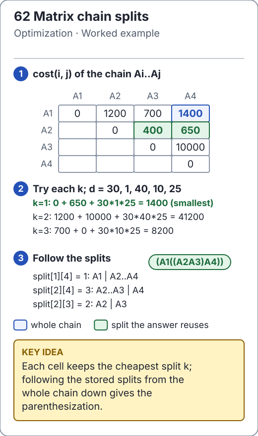
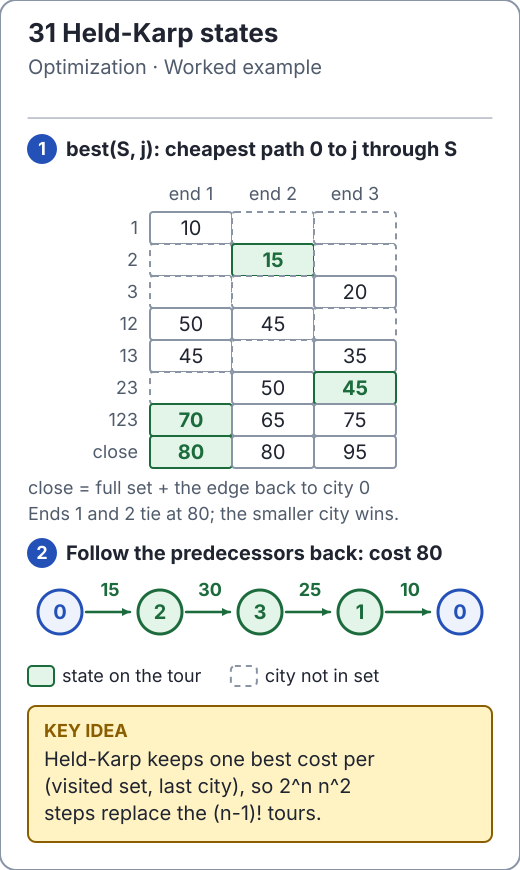
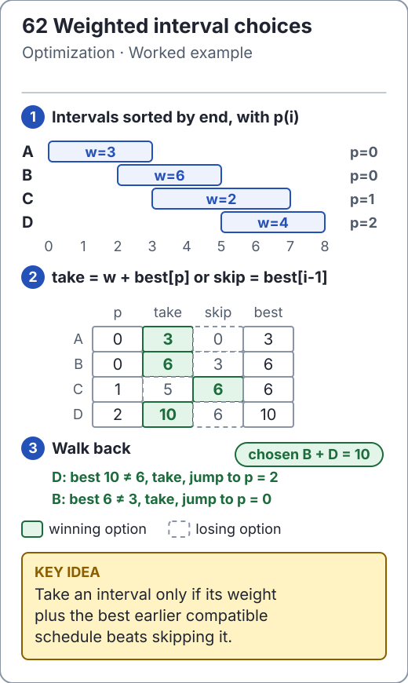

# Classic dynamic programs

Use dynamic programming when a problem has **overlapping subproblems** (the same
smaller question is asked many times) and **optimal substructure** (the answer to
a question is built from answers to smaller ones). Every problem below is solved
by naming the state, writing the transition, fixing an evaluation order in which
dependencies are ready, and reading the answer from a known cell. The maintained
[DynamicProgrammingClassics](../../src/main/java/io/github/ichillous/dsa/algorithms/DynamicProgrammingClassics.java)
implements six of them. For the general method see the
[overview](overview.md) and [problem set](problems.md).

| At a glance | |
| --- | --- |
| **Use it when** | You need exact answers for counting, segmentation, bracketing, tours or weighted scheduling |
| **Avoid it when** | A simple greedy rule is proven, or `n` is past the exponential limit (16 cities for Held-Karp) |
| **Cost** | From O(n log n) for weighted intervals to O(2^n n^2) for Held-Karp; see [Costs](#costs) |
| **In this repo** | [`DynamicProgrammingClassics`](../../src/main/java/io/github/ichillous/dsa/algorithms/DynamicProgrammingClassics.java) |
| **In the JDK** | No direct equivalent; `Math.addExact` and `Math.multiplyExact` for overflow-safe sums |

Preconditions and conventions shared by all six methods: null arguments are
rejected, inputs are never modified, returned lists are immutable, and results
that do not fit the stated type throw `ArithmeticException` instead of wrapping.

## The six problems at a glance

| Problem | State | Transition | Order | Answer |
| --- | --- | --- | --- | --- |
| Coin combinations | `ways[a]`: combinations of the coins seen so far summing to `a` | `ways[a] += ways[a - coin]` | coin by coin (outer), amount ascending (inner) | `ways[amount]` |
| Word break | `breakable[i]`: suffix from `i` can be split | `breakable[i] = OR over j of (text[i..j) in dictionary AND breakable[j])` | `i` from the end to 0 | `breakable[0]`, then read the shortest-first-word path left to right |
| Longest palindromic subsequence | `lps(i, j)` for `text[i..j]` | equal ends: `lps(i+1, j-1) + 2`; else `max(lps(i+1, j), lps(i, j-1))` | `i` descending, `j` ascending | `lps(0, n-1)` |
| Matrix chain | `cost(i, j)` for `Ai..Aj` | `min over k of cost(i,k) + cost(k+1,j) + d[i-1]*d[k]*d[j]` | increasing chain length | `cost(1, n)` |
| Held-Karp TSP | `best(S, j)`: cheapest path from city 0 through set `S`, ending at `j` | `min over i in S minus j of best(S minus j, i) + d[i][j]` | bitmask ascending (subsets before supersets) | `min over j of best(all, j) + d[j][0]` |
| Weighted interval scheduling | `best[i]`: maximum weight using the first `i` intervals by end | `max(best[i-1], w_i + best[p(i)])` | `i` ascending after sorting by end | `best[n]` |

The coin loop order is the whole difference between counting combinations and
counting ordered sequences. The sections below walk through each problem.

## Coin combinations

`countCoinCombinations(coins, amount)` counts unordered combinations, so `1 + 2`
and `2 + 1` are one way. Duplicated denominations collapse. Amount 0 has one
combination (choose nothing), and an unreachable amount has zero.

The invariant: after processing the first `c` coins, `ways[a]` is the number of
combinations of only those coins that sum to `a`. Processing a coin extends each
combination by any number of copies of that coin, and iterating `a` ascending
lets one coin be reused. Counts are checked `long` values; any table entry that
overflows throws, even for an amount that would itself have been small.

```text
coins {1, 2, 5}, amount 5       ways[0..5]
start                           1 0 0 0 0 0
after coin 1                    1 1 1 1 1 1
after coin 2                    1 1 2 2 3 3
after coin 5                    1 1 2 2 3 4   -> 4 combinations
```

**Pitfall:** swapping the loops (amount outer, coins inner) counts ordered
sequences, so `{1, 2}` with amount 3 gives 3 instead of 2. Greedy "largest coin
first" is also not a counting method and is not even a minimum-coin method: with
coins `{1, 3, 4}` and amount 6 it picks `4 + 1 + 1` (three coins) while `3 + 3`
needs two.

## Word break

`wordBreak(text, dictionary)` returns a segmentation into dictionary words, or
`Optional.empty()`. The empty text segments into the empty list, and an empty
dictionary word is rejected. When several segmentations exist the **segmentation
with the shortest possible first word, recursively** is returned, which is the
lexicographically smallest sequence of word lengths. Right-to-left feasibility
makes that greedy choice safe: a first word is taken only if the rest is known to
be breakable.

```text
text "catsanddog", dictionary {cat, cats, and, sand, dog}
i=10 true (empty suffix)     i=7 "dog" true     i=6 "ddog" false
i=3 "sanddog" true (sand+dog)     i=0 "catsanddog" true
read left to right: shortest word at 0 with breakable remainder is "cat" -> "sanddog"
answer [cat, sand, dog]   (also valid but not chosen: [cats, and, dog])
```

**Pitfall:** choosing the longest dictionary word at each step is not a valid
strategy. For `"abcd"` with `{ab, abc, cd}` it takes `abc` and is left with `d`,
which no word matches, although `ab` followed by `cd` works; the suffix table is
what makes the choice safe. Matching is exact UTF-16 string equality.

## Longest palindromic subsequence

`longestPalindromicSubsequenceLength(text)` returns the length of the longest
subsequence (characters in order, not necessarily adjacent) that reads the same
backwards. Lengths count UTF-16 code units. Only two rows of the table are kept,
so extra space is O(n).

```text
text "bbbab"         j=0 j=1 j=2 j=3 j=4
i=4                                  1
i=3                              1   1
i=2                          1   1   3
i=1                      1   2   2   3
i=0                  1   2   3   3   4   -> 4 ("bbbb")
```

**Pitfall:** this is a subsequence, not a substring. The longest palindromic
substring of `"bbbab"` is `"bbb"` (3), a different and easier question.

## Matrix chain order

`matrixChainOrder(dimensions)` chooses the cheapest bracketing of `A1 A2 ... An`
where `Ai` is `dimensions[i-1] x dimensions[i]`. Multiplying `p x q` by `q x r`
costs `p*q*r`. The result lists the cost and a string such as `"((A1A2)A3)"`; a
single matrix is `"A1"` with cost 0. Equal-cost splits go to the **smallest
split `k`**. Every product and sum is checked: a candidate above `Long.MAX_VALUE`
loses to every representable one, so the answer is exact whenever the optimum fits
in a `long`, and `ArithmeticException` means the optimum itself does not.

```text
dimensions [10, 30, 5, 60]
cost(1,2) = 10*30*5  = 1500          cost(2,3) = 30*5*60 = 9000
cost(1,3): k=1 -> 0 + 9000 + 10*30*60 = 27000
           k=2 -> 1500 + 0 + 10*5*60  = 4500   (best)
answer 4500, "((A1A2)A3)"
```

A four-matrix chain shows the whole mechanism: the cost table, the candidate
splits for the full chain, and the stored splits that are followed back.

<!-- visual:generated matrix-chain-splits -->
<picture><source media="(prefers-color-scheme: dark)" srcset="../../docs/visuals/assets/matrix-chain-splits-dark.svg"></picture>

**Figure 62.** The cost table for four matrices with dimensions 30, 1, 40, 10, 25, the three candidate splits of the whole chain, and the stored splits that give (A1((A2A3)A4)) at cost 1400. [Visual index and step-throughs](../../docs/visuals/README.md).
<!-- /visual:generated -->

**Pitfall:** multiplying strictly left to right is not always optimal. For
`[30, 1, 40, 10, 25]` the left-to-right order `(((A1A2)A3)A4)` costs 20700, while
the optimal order costs 1400, about fifteen times less.

## Held-Karp travelling salesman

`travelingSalesman(distances)` returns the cheapest closed tour that starts at
city 0, visits every other city once and returns, with a cost that includes the
return edge. Distances may be asymmetric or negative. The solver is exact and
exponential, so it is capped at **16 cities**, and each entry must lie in
`[-2^47, 2^47]`, so a sum of 16 edges stays far below the `long` limit. One city
gives the tour `[0]` with cost 0. Ties choose the smallest predecessor and the
smallest final city.

```text
4 cities, d = [[0,10,15,20],[10,0,35,25],[15,35,0,30],[20,25,30,0]]
best({1},1)=10  best({2},2)=15  best({3},3)=20
best({1,2},2)=10+35=45 ...      best({1,2,3},j) over all j
close the cycle with d[j][0]; optimum 80 (0-1-3-2-0 and 0-2-3-1-0 tie)
```

<!-- visual:generated held-karp-masks -->
<picture><source media="(prefers-color-scheme: dark)" srcset="../../docs/visuals/assets/held-karp-masks-dark.svg"></picture>

**Figure 63.** The Held-Karp table for four cities, one cost per visited set and last city, the closing edge back to city 0, and the optimal tour 0, 2, 3, 1, 0 of cost 80. [Visual index and step-throughs](../../docs/visuals/README.md).
<!-- /visual:generated -->

The figure lists every (visited set, last city) state and shows the tie: ending
at city 1 and at city 2 both cost 80, and the smaller last city gives the tour
0, 2, 3, 1.

**Pitfall:** nearest-neighbour (always travel to the closest unvisited city) is
fast but not optimal. Brute force over permutations costs O((n-1)!); Held-Karp
reduces that to O(2^n n^2) by remembering only the best path per (set, last
city), which is why it still stops being practical past roughly twenty cities.

## Weighted interval scheduling

`weightedIntervalScheduling(intervals)` picks pairwise compatible half-open
intervals `[start, end)` of maximum total weight; one ending at 5 is compatible
with one starting at 5. Weights are non-negative and the total is a checked
`long`. After sorting by end, `p(i)` (found by binary search) is the number of
intervals ending no later than interval `i` starts. Ties skip the interval that
sorts later, so zero-weight intervals are never chosen. The chosen list is sorted
by end.

```text
A [0,3) 3   B [2,5) 6   C [3,7) 2   D [5,8) 4          sorted by end: A B C D
i  interval  p(i)  take = w + best[p]   skip = best[i-1]   best[i]
1  A         0     3                    0                 3
2  B         0     6                    3                 6
3  C         1     2 + 3 = 5            6                 6
4  D         2     4 + 6 = 10           6                 10
walk back: D taken (jump to p=2), B taken (jump to 0)  -> [B, D], total 10
```

<!-- visual:generated weighted-interval-choice -->
<picture><source media="(prefers-color-scheme: dark)" srcset="../../docs/visuals/assets/weighted-interval-choice-dark.svg"></picture>

**Figure 64.** Four weighted intervals sorted by end with their last compatible interval, the take-or-skip comparison for each, and the walk back that chooses B and D for total weight 10. [Visual index and step-throughs](../../docs/visuals/README.md).
<!-- /visual:generated -->

**Pitfall:** the unweighted rule "earliest end first" from
[greedy algorithms](../greedy/overview.md) fails with weights. Here it takes `A`
and then `C` for 5 and misses the heavy `B`.

## Executable example

```java
import io.github.ichillous.dsa.algorithms.DynamicProgrammingClassics;
import io.github.ichillous.dsa.algorithms.DynamicProgrammingClassics.ChainOrder;
import io.github.ichillous.dsa.algorithms.DynamicProgrammingClassics.Schedule;
import io.github.ichillous.dsa.algorithms.DynamicProgrammingClassics.Tour;
import io.github.ichillous.dsa.algorithms.DynamicProgrammingClassics.WeightedInterval;
import java.util.List;
import java.util.Optional;

assert DynamicProgrammingClassics.countCoinCombinations(new int[] {1, 2, 5}, 5) == 4;
assert DynamicProgrammingClassics.countCoinCombinations(new int[] {2}, 3) == 0;
assert DynamicProgrammingClassics.countCoinCombinations(new int[] {2}, 0) == 1;

Optional<List<String>> split = DynamicProgrammingClassics.wordBreak(
        "catsanddog", List.of("cat", "cats", "and", "sand", "dog"));
assert split.equals(Optional.of(List.of("cat", "sand", "dog")));
assert DynamicProgrammingClassics.wordBreak("catsandog",
        List.of("cats", "dog", "sand", "and", "cat")).isEmpty();

assert DynamicProgrammingClassics.longestPalindromicSubsequenceLength("bbbab") == 4;

ChainOrder order = DynamicProgrammingClassics.matrixChainOrder(new int[] {10, 30, 5, 60});
assert order.cost() == 4500;
assert order.parenthesization().equals("((A1A2)A3)");

long[][] distances = {{0, 10, 15, 20}, {10, 0, 35, 25}, {15, 35, 0, 30}, {20, 25, 30, 0}};
Tour tour = DynamicProgrammingClassics.travelingSalesman(distances);
assert tour.cost() == 80;
assert tour.order().get(0) == 0 && tour.order().size() == 4;

WeightedInterval a = new WeightedInterval(0, 3, 3);
WeightedInterval b = new WeightedInterval(2, 5, 6);
WeightedInterval c = new WeightedInterval(3, 7, 2);
WeightedInterval d = new WeightedInterval(5, 8, 4);
Schedule schedule = DynamicProgrammingClassics.weightedIntervalScheduling(List.of(a, b, c, d));
assert schedule.totalWeight() == 10;
assert schedule.chosen().equals(List.of(b, d));
```

## In real Java

Results are immutable snapshots, so callers cannot corrupt a returned tour, and
exact arithmetic is the library's default policy: a total that does not fit in a
`long` throws instead of wrapping. When you combine results yourself, keep the
same policy with `Math.addExact` rather than `+`.

```java
import io.github.ichillous.dsa.algorithms.DynamicProgrammingClassics;
import io.github.ichillous.dsa.algorithms.DynamicProgrammingClassics.Tour;
import io.github.ichillous.dsa.algorithms.DynamicProgrammingClassics.WeightedInterval;
import java.util.List;

Tour tour = DynamicProgrammingClassics.travelingSalesman(
        new long[][] {{0, 10, 15, 20}, {10, 0, 35, 25}, {15, 35, 0, 30}, {20, 25, 30, 0}});
assert tour.order().equals(List.of(0, 2, 3, 1));
boolean immutable = false;
try {
    tour.order().add(9);
} catch (UnsupportedOperationException expected) {
    immutable = true;
}
assert immutable;

boolean overflow = false;
try {
    DynamicProgrammingClassics.weightedIntervalScheduling(List.of(
            new WeightedInterval(0, 1, Long.MAX_VALUE), new WeightedInterval(1, 2, 1)));
} catch (ArithmeticException expected) {
    overflow = true;
}
assert overflow;
```

## Costs

| Method | Time | Auxiliary space | Overflow behavior |
| --- | --- | --- | --- |
| `countCoinCombinations` | O(distinct coins * amount) | O(amount) | `ArithmeticException` if a count exceeds `long` |
| `wordBreak` | O(n * L) lookups, O(n * L^2) characters | O(n + dictionary) | none; lengths are `int` |
| `longestPalindromicSubsequenceLength` | O(n^2) | O(n) | none |
| `matrixChainOrder` | O(n^3) | O(n^2) | `ArithmeticException` only if the optimal cost exceeds `long`; overflowing candidates lose |
| `travelingSalesman` | O(2^n * n^2), `n <= 16` | about 4 MB at 16 cities plus a byte table | entries limited to +/-2^47, so no overflow |
| `weightedIntervalScheduling` | O(n log n) | O(n) | `ArithmeticException` if the total exceeds `long` |

Here `n` is the input size (matrices, cities, intervals or characters) and `L` is
the longest dictionary word. See the
[complexity guide](../../docs/complexity.md) for how these bounds are stated.

## Practice

1. Run the coin table by hand for `{2, 3}` and amount 7, then change the loop
   order to count ordered sequences and compare the two results.
2. For the intervals above, list `p(i)` for each interval and explain why
   `best[3]` equals `best[2]` instead of using `C`.
3. For `dimensions = [5, 10, 3, 12, 5]`, fill the matrix-chain cost table by
   increasing chain length and write the parenthesization the tie rule yields.

## Check yourself

<details>
<summary>Why does swapping the coin and amount loops change what <code>countCoinCombinations</code> counts?</summary>

With coins outer, each combination is built in coin order, so `1 + 2` and `2 + 1` are one way. With amount outer, every ordering is a separate path, so `{1, 2}` with amount 3 gives 3 instead of 2.

</details>

<details>
<summary>In the Held-Karp figure, why are ends 1 and 2 both 80 but the tour is 0, 2, 3, 1?</summary>

Equal closing costs go to the smallest last city, so the tour ends at city 1. Walking the predecessors back from there gives 0, 2, 3, 1; the reverse tour 0, 1, 3, 2 has the same cost.

</details>

<details>
<summary>In weighted interval scheduling, why does <code>best[3]</code> equal <code>best[2]</code> for the intervals above?</summary>

Taking C is worth 2 plus `best[1]` = 3, which is 5, and skipping keeps `best[2]` = 6. Skipping wins, and ties would also skip, so C is never chosen.

</details>

Look up the structures and algorithms in the
[catalog](../../docs/catalog.md) and the
[complexity guide](../../docs/complexity.md). The [solution finder](../../docs/solution-finder.md#18-dynamic-programming) compares this technique with its alternatives.
