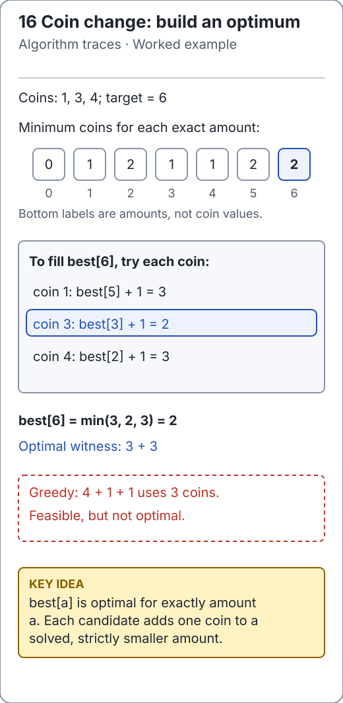

# Dynamic programming starts with a state definition

Dynamic programming replaces repeated subproblems with stored answers. Use it
when a complete solution can be expressed through smaller states and those states
recur. The maintained
[DynamicProgramming](../../src/main/java/io/github/ichillous/dsa/algorithms/DynamicProgramming.java)
contains bottom-up examples with explicit validation and no shared mutable state.

A useful design sequence is: define one state in a sentence, derive its recurrence,
identify base cases, choose an order that satisfies dependencies, then decide what
must be retained. Writing loops before the state often hides a different problem.

| At&nbsp;a&nbsp;glance | |
| --- | --- |
| **Use&nbsp;it&nbsp;when** | A solution is built from smaller states that recur, and one state fits in a sentence. |
| **Avoid&nbsp;it&nbsp;when** | A proven greedy rule exists, or the state space (such as a huge numeric capacity) will not fit in memory. |
| **Cost** | Number of states times work per state, for example O((c + 1)(a + 1)) time and O(a + 1) space for coin change |
| **In&nbsp;this&nbsp;repo** | [`DynamicProgramming.minimumCoins`](../../src/main/java/io/github/ichillous/dsa/algorithms/DynamicProgramming.java) and its siblings; the [family guide](README.md) maps problems to state shapes |
| **In&nbsp;the&nbsp;JDK** | No direct equivalent; use `long`, `Math.addExact` and plain arrays for tables |

<!-- visual:generated coin-dp -->
<picture><source media="(prefers-color-scheme: dark)" srcset="../../docs/visuals/assets/coin-dp-dark.svg"></picture>

**Figure 16.** Compare every final coin; the largest-first greedy choice loses. [Visual index and step-throughs](../../docs/visuals/README.md).
<!-- /visual:generated -->

## Worked example: unlimited coin change

Let `best[a]` mean the minimum number of coins totaling exactly `a`.
`best[0] = 0`; unreachable amounts have an infinity sentinel. For positive coin
value `c <= a`, a valid predecessor gives candidate `best[a-c] + 1`. Minimize over
all denominations. Ascending amounts make every smaller dependency available.

For coins `[1, 3, 4]`:

| Amount `a` | 0 | 1 | 2 | 3 | 4 | 5 | 6 |
| --- | --- | --- | --- | --- | --- | --- | --- |
| `best[a]` | 0 | 1 | 2 | 1 | 1 | 2 | 2 |
| One final choice | — | 1 | 1 | 3 | 4 | 1 | 3 |

The loop invariant is that every table entry below the current amount already
contains its optimum. Any optimum for the current amount ends with some coin;
removing it produces exactly one of the predecessor states considered.

```java
import io.github.ichillous.dsa.algorithms.DynamicProgramming;

assert DynamicProgramming.minimumCoins(new int[] {1, 3, 4}, 6) == 2;
assert DynamicProgramming.minimumCoins(new int[] {2, 4}, 3) == -1;
assert DynamicProgramming.minimumCoins(new int[0], 0) == 0;
```

Coins must be strictly positive; duplicates are permitted, each denomination may
be reused, and amount must be nonnegative. Null is rejected. Input is unchanged.
Validation/allocation included, time is O((c + 1)(a + 1)) and working space is
O(a + 1), where `c` is the number of supplied denominations.

This is **pseudopolynomial**: storing the numeric amount needs O(log(a + 1)) bits,
but the table has `a + 1` entries. A valid large amount can still exhaust memory.

## Memoization versus tabulation

Memoization discovers states through recursion and caches results. Tabulation
visits states in a chosen dependency order. Both require a correct state identity;
forgetting a parameter in a cache key can combine unrelated subproblems. Memoized
recursion also retains call frames, and Java does not guarantee tail-call removal.

**Counterexample:** always choosing the largest coin picks `4 + 1 + 1` for amount
6, while the table finds `3 + 3`. A plausible local rule is not a proof of global
optimality. Conversely, DP is unnecessary when a simple greedy rule has a proof.

## In real Java

The JDK has no dynamic-programming helper, so the choices are about arithmetic
and memory. Java `int` arithmetic wraps silently (JLS 15.18.2), which makes
`Integer.MAX_VALUE` a dangerous "infinity": adding one coin to it produces a
negative number that then wins every minimum. `Math.addExact` throws
`ArithmeticException` instead of wrapping, and a separate reachability test avoids
the sentinel altogether.

```java
import io.github.ichillous.dsa.algorithms.DynamicProgramming;

int infinity = Integer.MAX_VALUE;
assert infinity + 1 < 0; // the sentinel wraps around to a "better" value
boolean threw = false;
try {
    Math.addExact(infinity, 1);
} catch (ArithmeticException expected) {
    threw = true;
}
assert threw;
// The maintained method reports an unreachable amount explicitly instead.
assert DynamicProgramming.minimumCoins(new int[] {2}, 3) == -1;
```

## Common mistakes

- **Infinity plus one.** With coins `[2]` and amount 3, a `Integer.MAX_VALUE`
  sentinel plus one wraps negative, so state 3 looks cheaper than state 2. The
  invariant "every stored entry is its true optimum or marked unreachable" breaks.
- **A cache key that forgets a parameter.** Memoizing a two-parameter state such
  as `(i, j)` under `i` alone returns the answer for whichever `j` came first. Two
  different subproblems then share one entry, so the stored value is no longer the
  optimum for its state.
- **Wrong loop direction for the problem.** Iterating capacity ascending for a
  single-use item lets an item feed itself: one item of weight 2 and value 3 gives
  6 at capacity 4. Reuse is allowed only when the problem allows it; see
  [0/1 knapsack](problems.md).

## Practice

1. Fill the table for denominations `[2, 5]` through amount 7, marking unreachable
   states rather than adding to an infinity sentinel.
2. Explain which extra information would reconstruct the chosen coins.
3. Change unlimited coin reuse to “each supplied coin once.” Which state or loop
   direction changes? Continue with [0/1 knapsack](problems.md).

## Check yourself

<details>
<summary>What must a DP state definition contain before any loop is written?</summary>

One sentence saying what the state means, a recurrence for it, base cases, and an
order in which every dependency is computed first. If the sentence needs the word
"and" for an extra parameter, that parameter belongs in the state and the cache key.

</details>

<details>
<summary>Why does largest-coin-first fail for coins [1, 3, 4] and amount 6, and what does the table do differently?</summary>

Greedy takes 4 then 1 + 1 (three coins), but 3 + 3 uses two. The table compares
every final coin for every amount, so it never commits to a local choice that has no proof.

</details>

<details>
<summary>Why is the coin-change DP called pseudopolynomial?</summary>

Its table has amount + 1 entries, so time and space grow with the numeric value of
the amount, which is exponential in the number of bits needed to write it down.

</details>

Compare with the [solutions](../../docs/solutions.md) after deriving the recurrence. The [solution finder](../../docs/solution-finder.md#18-dynamic-programming) compares this technique with its alternatives.
