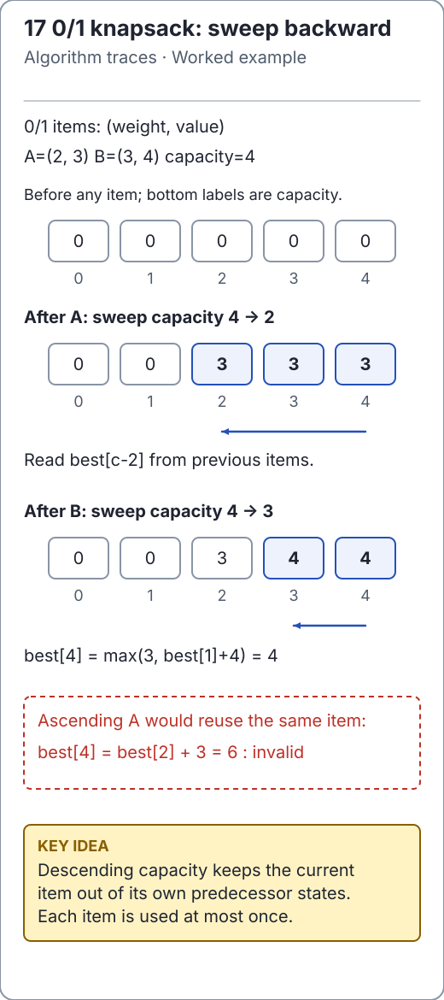

# Dynamic-programming patterns and their boundaries

These examples use the maintained
[DynamicProgramming](../../src/main/java/io/github/ichillous/dsa/algorithms/DynamicProgramming.java).
Inputs are not modified; null inputs are rejected. Distinguish a returned optimum
value from a reconstructed solution: these methods return values or lengths.

<!-- visual:generated -->
<picture><source media="(prefers-color-scheme: dark)" srcset="../../docs/visuals/assets/knapsack-state-dark.svg"></picture>

**Figure 17.** Sweep capacities backward so an item cannot reuse itself. [Visual index and step-throughs](../../docs/visuals/README.md).
<!-- /visual:generated -->

## 0/1 knapsack: descending capacity matters

`best[w]` is the maximum value achievable within capacity `w` after processed
items. For one new item, each state compares skipping it with taking it once.
Capacities are visited downward so a predecessor still describes earlier items.

```text
one item: weight 2, value 3, capacity 4
before:             [0, 0, 0, 0, 0]
descending update:  [0, 0, 3, 3, 3]  -> item used once
ascending update:   [0, 0, 3, 3, 6]  -> accidentally permits reuse
```

```java
import io.github.ichillous.dsa.algorithms.DynamicProgramming;

assert DynamicProgramming.knapsack01(new int[] {2}, new int[] {3}, 4) == 3L;
assert DynamicProgramming.knapsack01(
        new int[] {2, 3, 4}, new int[] {4, 5, 7}, 5) == 9L;
assert DynamicProgramming.knapsack01(new int[] {0, 2}, new int[] {5, 3}, 2) == 8L;
assert DynamicProgramming.knapsack01(new int[] {1}, new int[] {-4}, 1) == 0L;
```

Weights and capacity are nonnegative, lengths must match, and zero-weight items
may be chosen once. Negative values are permitted because selecting nothing is
valid. The result uses `long`. Time is O((n + 1)(W + 1)); auxiliary space is
O(W + 1). As with coin change, dependence on numeric capacity is pseudopolynomial.

## Two strings: retain the frontier

For LCS, state `(i, j)` is the longest subsequence common to the first `i` units of
one string and first `j` units of the other. Matching final units extend diagonal
state `(i-1, j-1)`; otherwise take the better of dropping one final unit.
For edit distance, neighboring states describe insertion, deletion or replacement.
Only the previous row and current row are needed for these value-only results.

```java
import io.github.ichillous.dsa.algorithms.DynamicProgramming;

assert DynamicProgramming.longestCommonSubsequenceLength("abcde", "ace") == 3;
assert DynamicProgramming.longestCommonSubsequenceLength("abc", "") == 0;
assert DynamicProgramming.editDistance("kitten", "sitting") == 3;
assert DynamicProgramming.editDistance("same", "same") == 0;
```

Both take O(mn + m + n) time including setup and O(min(m, n) + 1) auxiliary space.
Lengths and edit operations use UTF-16 units, not grapheme clusters. Reconstructing
an alignment requires more information or a different reconstruction strategy.

**Counterexample:** `"ace"` is a subsequence of `"abcde"`, but not a contiguous
substring. Substring matching is a different problem; see
[KMP](../searching/linear-search.md#from-arrays-to-text).

## Strict LIS: smallest possible tail

For every length `i + 1`, keep the smallest final value seen for any increasing
subsequence of that length. Replacing a tail with a smaller value keeps future
extensions at least as feasible. A lower-bound search finds the replacement slot.

```java
import io.github.ichillous.dsa.algorithms.DynamicProgramming;

assert DynamicProgramming.longestIncreasingSubsequenceLength(
        new int[] {10, 9, 2, 5, 3, 7, 101, 18}) == 4;
assert DynamicProgramming.longestIncreasingSubsequenceLength(new int[] {2, 2, 2}) == 1;
assert DynamicProgramming.longestIncreasingSubsequenceLength(new int[0]) == 0;
```

LIS takes O(n log(n + 1)) time and O(n) auxiliary space. Equal values replace a
tail; they do not extend a strictly increasing sequence. The tail array records
best possibilities by length and is not necessarily one actual subsequence.

## Practice

1. Trace knapsack with a zero-weight positive-value item; prove it is added once.
2. Draw the small LCS table for `"ab"` and `"ba"`; explain each transition.
3. Replace strict increase with nondecreasing order. Which boundary search changes?

Use the [solutions](../../docs/solutions.md) and
[complexity table](../../docs/complexity.md) to review the contracts.
