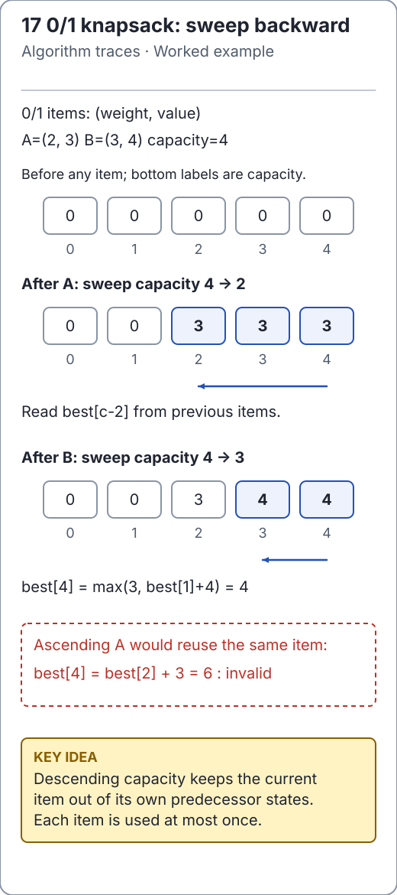
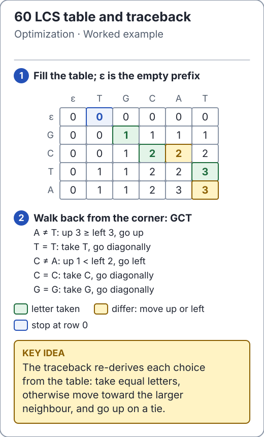
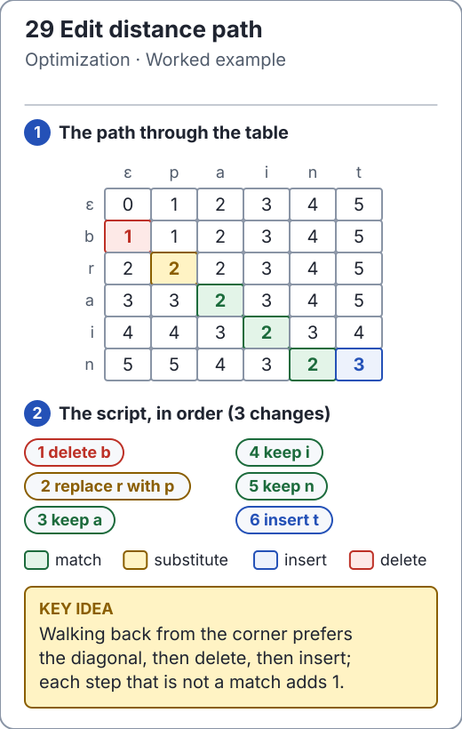

# Dynamic-programming patterns and their boundaries

These examples use the maintained
[DynamicProgramming](../../src/main/java/io/github/ichillous/dsa/algorithms/DynamicProgramming.java).
Inputs are not modified; null inputs are rejected. Distinguish a returned optimum
value from a reconstructed solution: these methods return values or lengths.

| At a glance | |
| --- | --- |
| **Use it when** | You need the best value over a sequence or two strings: knapsack, LCS, edit distance, LIS |
| **Avoid it when** | You need every optimal solution, or the numeric capacity or string lengths make the table too large |
| **Cost** | O(nW) for knapsack, O(mn) for LCS and edit distance, O(n log n) for LIS |
| **In this repo** | [`DynamicProgramming`](../../src/main/java/io/github/ichillous/dsa/algorithms/DynamicProgramming.java): `knapsack01`, `longestCommonSubsequence`, `editScript`, `longestIncreasingSubsequenceLength` |
| **In the JDK** | No direct equivalent; `Arrays.binarySearch` helps with the LIS tails array |

<!-- visual:generated knapsack-state -->
<picture><source media="(prefers-color-scheme: dark)" srcset="../../docs/visuals/assets/knapsack-state-dark.svg"></picture>

**Figure 17.** Sweep capacities backward so an item cannot reuse itself. [Visual index and step-throughs](../../docs/visuals/README.md).
<!-- /visual:generated -->

## 0/1 knapsack: descending capacity matters

`best[w]` is the maximum value achievable within capacity `w` after processed
items. For one new item, each state compares skipping it with taking it once.
Capacities are visited downward so a predecessor still describes earlier items.

```text
one item: weight 2, value 3, capacity 4
before:             [0, 0, 0, 0, 0]
descending update:  [0, 0, 3, 3, 3]  -> item used once
ascending update:   [0, 0, 3, 3, 6]  -> accidentally permits reuse
```

```java
import io.github.ichillous.dsa.algorithms.DynamicProgramming;

assert DynamicProgramming.knapsack01(new int[] {2}, new int[] {3}, 4) == 3L;
assert DynamicProgramming.knapsack01(
        new int[] {2, 3, 4}, new int[] {4, 5, 7}, 5) == 9L;
assert DynamicProgramming.knapsack01(new int[] {0, 2}, new int[] {5, 3}, 2) == 8L;
assert DynamicProgramming.knapsack01(new int[] {1}, new int[] {-4}, 1) == 0L;
```

Weights and capacity are nonnegative, lengths must match, and zero-weight items
may be chosen once. Negative values are permitted because selecting nothing is
valid. The result uses `long`. Time is O((n + 1)(W + 1)); auxiliary space is
O(W + 1). As with coin change, dependence on numeric capacity is pseudopolynomial.

## Two strings: retain the frontier

For LCS, state `(i, j)` is the longest subsequence common to the first `i` units of
one string and first `j` units of the other. Matching final units extend diagonal
state `(i-1, j-1)`; otherwise take the better of dropping one final unit.
For edit distance, neighboring states describe insertion, deletion or replacement.
Only the previous row and current row are needed for these value-only results.

```java
import io.github.ichillous.dsa.algorithms.DynamicProgramming;

assert DynamicProgramming.longestCommonSubsequenceLength("abcde", "ace") == 3;
assert DynamicProgramming.longestCommonSubsequenceLength("abc", "") == 0;
assert DynamicProgramming.editDistance("kitten", "sitting") == 3;
assert DynamicProgramming.editDistance("same", "same") == 0;
```

Both take O(mn + m + n) time including setup and O(min(m, n) + 1) auxiliary space.
Lengths and edit operations use UTF-16 units, not grapheme clusters. Reconstructing
an alignment requires more information or a different reconstruction strategy.

**Counterexample:** `"ace"` is a subsequence of `"abcde"`, but not a contiguous
substring. Substring matching is a different problem; see
[KMP](../searching/linear-search.md#from-arrays-to-text).

## Strict LIS: smallest possible tail

For every length `i + 1`, keep the smallest final value seen for any increasing
subsequence of that length. Replacing a tail with a smaller value keeps future
extensions at least as feasible. A lower-bound search finds the replacement slot.

```java
import io.github.ichillous.dsa.algorithms.DynamicProgramming;

assert DynamicProgramming.longestIncreasingSubsequenceLength(
        new int[] {10, 9, 2, 5, 3, 7, 101, 18}) == 4;
assert DynamicProgramming.longestIncreasingSubsequenceLength(new int[] {2, 2, 2}) == 1;
assert DynamicProgramming.longestIncreasingSubsequenceLength(new int[0]) == 0;
```

LIS takes O(n log(n + 1)) time and O(n) auxiliary space. Equal values replace a
tail; they do not extend a strictly increasing sequence. The tail array records
best possibilities by length and is not necessarily one actual subsequence.

## In real Java

The JDK offers no LCS or knapsack, but the LIS tails array is a sorted prefix, so
`Arrays.binarySearch` finds the slot to replace. Because strict-LIS tails are
strictly increasing, a hit is unique. The detail to remember is the miss: for an
absent key the method returns `-(insertion point) - 1`, so the replacement slot is
`-result - 1`. That slot is the first tail that is `>=` the value, or the current
size when the value extends the longest subsequence.

```java
import java.util.Arrays;

int[] tails = {2, 5, 7, 9}; // strictly increasing, as in strict LIS
int hit = Arrays.binarySearch(tails, 0, tails.length, 7);
assert hit == 2; // present: replace the tail at this index with the same value
int miss = Arrays.binarySearch(tails, 0, tails.length, 6);
assert miss == -3 && -miss - 1 == 2; // absent: insertion point 2 replaces tail 7
int beyond = Arrays.binarySearch(tails, 0, tails.length, 10);
assert beyond == -5 && -beyond - 1 == tails.length; // larger than all: append
```

## Common mistakes

- **Ascending capacity loop for 0/1 knapsack.** One item of weight 2 and value 3
  with capacity 4 yields 6 instead of 3. The invariant "each state describes only
  earlier items" fails because the item feeds itself.
- **Non-strict tail replacement in LIS.** Replacing only when the tail is strictly
  greater makes input `[2, 2, 2]` report 3 instead of 1, because equal values are
  appended as if they were increasing.
- **Counting characters instead of UTF-16 units.** `editDistance` works on
  UTF-16 units, so `"😀"` (one emoji, two units) against `"a"` costs 2, not 1.
  A distance defined over code points or grapheme clusters is a different problem.

## Practice

1. Trace knapsack with a zero-weight positive-value item; prove it is added once.
2. Draw the small LCS table for `"ab"` and `"ba"`; explain each transition.
3. Replace strict increase with nondecreasing order. Which boundary search changes?

Use the [solutions](../../docs/solutions.md) and
[complexity table](../../docs/complexity.md) to review the contracts.

## Recovering the solution, not just its value

The methods above return an optimum value. Five more return one optimal
*solution*: `longestCommonSubsequence` (a string), `editScript` (a list of
`EditStep`), `knapsack01Items` (ascending item indices),
`minimumCoinsChoice` (coin values, ascending, as an `Optional`) and
`longestIncreasingSubsequenceIndices` (ascending indices). Each one equals its
value-only twin in size or total and follows a documented deterministic tie rule
(see the Javadoc), because many optimal solutions usually exist.

**Invariant.** Reconstruction walks the finished table from the goal state back to
a base state, and at each state takes a step the table proves is optimal: the
stored value there equals the predecessor's value plus that step's gain. The
recovered path therefore reaches the stored optimum exactly.

There are two ways to keep the path. **Parent pointers** store the chosen step
beside each value (`minimumCoinsChoice` keeps the last coin per amount,
`longestIncreasingSubsequenceIndices` keeps a predecessor index per element); the
walk is trivial but each state carries extra data. **Re-deriving from the table**
keeps only values and, while walking back, tests which neighbor explains the
current cell (`longestCommonSubsequence` and `editScript` do this, and
`knapsack01Items` records one bit per item and capacity). Re-deriving is where the
tie rule lives: the order in which the neighbors are tested decides which optimum
is returned.

```text
LCS of A="ABCBDAB", B="BDCABA" (length 4); walk back from (7,6)
equal units are taken; else up if dp[i-1][j] >= dp[i][j-1], else left
(7,6) B/A  up      -> (6,6)
(6,6) A/A  take A  -> (5,5)
(5,5) D/B  up      -> (4,5)
(4,5) B/B  take B  -> (3,4)
(3,4) C/A  left    -> (3,3)
(3,3) C/C  take C  -> (2,2)
(2,2) B/D  left    -> (2,1)
(2,1) B/B  take B  -> (1,0)
taken in reverse: A B C B  -> reading forward: "BCBA"
```

The same walk on a smaller pair, with the tie at the corner made visible: the
corner cells above and to the left both hold 3, so the rule goes up first.

<!-- visual:generated lcs-traceback -->
<picture><source media="(prefers-color-scheme: dark)" srcset="../../docs/visuals/assets/lcs-traceback-dark.svg"></picture>

**Figure 58.** The longest-common-subsequence table for GCTA and TGCAT, with the path longestCommonSubsequence walks back from the corner: it goes up on the tie at the corner, takes T, C and G on equal letters, and returns GCT. [Visual index and step-throughs](../../docs/visuals/README.md).
<!-- /visual:generated -->

```java
import io.github.ichillous.dsa.algorithms.DynamicProgramming;
import java.util.List;
import java.util.Optional;

assert DynamicProgramming.longestCommonSubsequence("ABCBDAB", "BDCABA").equals("BCBA");

List<DynamicProgramming.EditStep> script = DynamicProgramming.editScript("kitten", "sitting");
long changes = script.stream()
        .filter(step -> step.operation() != DynamicProgramming.EditOperation.MATCH).count();
assert changes == DynamicProgramming.editDistance("kitten", "sitting") && changes == 3;

assert DynamicProgramming.knapsack01Items(
        new int[] {2, 3, 4}, new int[] {4, 5, 7}, 5).equals(List.of(0, 1));
assert DynamicProgramming.minimumCoinsChoice(new int[] {1, 3, 4}, 6)
        .equals(Optional.of(List.of(3, 3)));
assert DynamicProgramming.minimumCoinsChoice(new int[] {2, 4}, 7).isEmpty();
assert DynamicProgramming.minimumCoinsChoice(new int[0], 0).equals(Optional.of(List.of()));
assert DynamicProgramming.longestIncreasingSubsequenceIndices(
        new int[] {10, 9, 2, 5, 3, 7, 101, 18}).equals(List.of(2, 4, 5, 7));
```

`EditStep` indices are cursor positions before the step: `MATCH` and `SUBSTITUTE`
consume one unit of each string, `DELETE` consumes a source unit, and `INSERT`
emits a target unit. Replaying the script over the source yields the target.

<!-- visual:generated edit-distance-grid -->
<picture><source media="(prefers-color-scheme: dark)" srcset="../../docs/visuals/assets/edit-distance-grid-dark.svg"></picture>

**Figure 59.** The edit-distance table for brain and paint with the path editScript returns: delete b, replace r with p, keep a, i and n, then insert t, for distance 3. [Visual index and step-throughs](../../docs/visuals/README.md).
<!-- /visual:generated -->

The picture shows the walk for `"brain"` to `"paint"`: at each cell the diagonal
is tried first (a match or a substitution), then a delete, then an insert.

| Method | Time | Auxiliary space |
| --- | --- | --- |
| `longestCommonSubsequence` | O(mn) | O(mn) table kept for the walk back |
| `editScript` | O(mn) | O(mn) table, plus O(m + n) steps |
| `knapsack01Items` | O(nW) | O(W) longs plus n * (W + 1) bits, one row per item |
| `minimumCoinsChoice` | O(amount * coins) | O(amount) |
| `longestIncreasingSubsequenceIndices` | O(n log n) | O(n) |

Reconstruction costs memory the value-only versions avoid: LCS and edit distance
shrink to O(min(m, n)) by keeping two rows, but walking back needs every row.
Hirschberg's divide-and-conquer recovers an optimal LCS or alignment in
O(min(m, n)) extra space (plus the output, up to m + n steps for an edit script)
at about twice the time; it is **not implemented here**.
Large inputs still use the same table-size guard and can exhaust memory.

**Counterexample (ties are not unique):** `"ABCBDAB"` and `"BDCABA"` have
several common subsequences of length 4, including `"BCBA"`, `"BDAB"` and
`"BCAB"`. Another correct
implementation may return a different one, so compare lengths or validity, never
a pinned string, unless the tie rule is part of the contract. Likewise an LIS
index list is one optimum, not the leftmost or the only one.

### Practice

1. Hand-trace `editScript("ab", "ba")`; list the other minimum scripts and say which
   tie rule picks the returned one.
2. For `knapsack01Items` with two items of equal weight and value, explain which one
   is returned and why a later equal item is not preferred.
3. Change the LCS tie test to `>` instead of `>=`. Which string does
   `"ABCBDAB"` / `"BDCABA"` give now, and is its length still 4?

## Check yourself

<details>
<summary>Why does 0/1 knapsack sweep capacities downward?</summary>

A downward sweep reads `best[w - weight]` before it is overwritten for the current
item, so the predecessor still describes only earlier items. An upward sweep would let the same item be counted again.

</details>

<details>
<summary>In the LCS traceback, which neighbor is chosen when the cell above and the cell to the left are equal, and why does it matter?</summary>

The walk goes up, because the rule tests `dp[i-1][j] >= dp[i][j-1]`. Different tie
rules return different, equally long subsequences, so tests should compare lengths or validity.

</details>

<details>
<summary>Why does <code>editScript</code> for <code>"brain"</code> to <code>"paint"</code> start with a delete instead of a substitution?</summary>

The walk runs from the corner backwards, and the script is its reverse. The walk
ends in column 0 at row 1, where no diagonal exists and only a delete remains, so
that last step becomes the first operation: delete b, then replace r with p.

</details>

See the [catalog](../../docs/catalog.md) and the
[complexity guide](../../docs/complexity.md) for the contracts. The [solution finder](../../docs/solution-finder.md#18-dynamic-programming) compares this technique with its alternatives.
