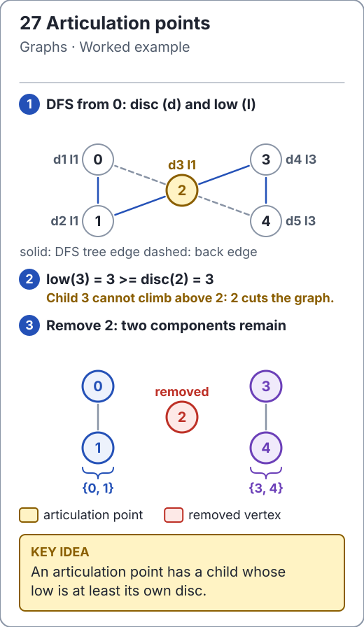

# Choosing a graph algorithm

Start from the question you are asking about a graph, not from an algorithm's name.
This page lists every graph lesson and every graph method in the repository,
grouped by question, with what each method needs and what it costs. All methods work
on vertices `0..V-1`, are iterative (a 100,000-vertex path does not overflow the call
stack) and never modify their input.

| At&nbsp;a&nbsp;glance | |
| --- | --- |
| **Use&nbsp;it&nbsp;when** | You have a graph problem and want the right method, its precondition and its cost before you read a lesson. |
| **Avoid&nbsp;it&nbsp;when** | You already know the algorithm; go straight to its lesson. |
| **Cost** | Most methods are O(V + E); shortest paths with weights, spanning trees and flows add a logarithmic or polynomial factor, listed below. |
| **In&nbsp;this&nbsp;repo** | [`Graph`](../../src/main/java/io/github/ichillous/dsa/graphs/Graph.java) and [`WeightedGraph`](../../src/main/java/io/github/ichillous/dsa/graphs/WeightedGraph.java) hold the data; the classes named in the tables below hold the algorithms. |
| **In&nbsp;the&nbsp;JDK** | No direct equivalent: `java.util` has no graph classes. Build adjacency with `Map` and `List`, or use this repository's classes. |

## The data

`Graph` stores unweighted edges, directed or undirected, and ignores duplicate
edges. `WeightedGraph` stores `long` weights and keeps parallel edges and loops.
`FlowNetwork` stores capacities. `BipartiteMatching` takes pairs of left and right
vertex numbers. Pick the kind first, because a method that needs a different kind
throws `IllegalArgumentException`.

## Which method answers my question?

| Question | Method | Needs | Cost | Lesson |
| --- | --- | --- | --- | --- |
| What can I reach, and in what order (level by level)? | `GraphAlgorithms.breadthFirst` | any `Graph` | O(V + E) | [BFS](bfs.md) |
| What can I reach by going deep first? | `GraphAlgorithms.depthFirst` | any `Graph` | O(V + E) | [DFS](dfs.md) |
| Fewest edges between two vertices? | `GraphAlgorithms.shortestPath` | any `Graph` | O(V + E) | [BFS](bfs.md) |
| Which tasks can run before which (a valid order)? | `GraphAlgorithms.topologicalSort` | directed, acyclic | O(V + E) | [Topological sort](topological-sort.md) |
| Cheapest path, nonnegative weights? | `GraphAlgorithms.dijkstra` | `WeightedGraph`, weights >= 0 | O(V + E log(E + 1)) | [BFS](bfs.md) |
| Cheapest path with negative weights? | `AdvancedGraphAlgorithms.bellmanFord` | `WeightedGraph`, no negative cycle | O(VE) relaxations | [BFS](bfs.md) |
| Cheapest path on a DAG, with 0 or 1 weights, with a heuristic, or between all pairs? | `ShortestPathAlgorithms` (`dagShortestPaths`, `zeroOneBfs`, `aStar`, `floydWarshall`) | see the decision table | see the lesson | [Shortest paths](shortest-paths.md) |
| Which vertices are connected (undirected)? | `GraphAlgorithms.connectedComponents` | undirected | O(V + E) | [BFS](bfs.md) |
| Which vertices reach each other (directed)? | `AdvancedGraphAlgorithms.stronglyConnectedComponents` | directed | O(V + E) | [DFS](dfs.md) |
| Which single edge, if cut, splits the graph? | `AdvancedGraphAlgorithms.bridges` | `Graph` | O(V + E) plus sorting the bridges | [DFS](dfs.md) |
| Which single vertex, if removed, splits it? | `GraphStructureAlgorithms.articulationPoints` | undirected | O(V + E) | [Graph structure](graph-structure.md) |
| Can I split the vertices into two sides with edges only between them? | `GraphStructureAlgorithms.bipartition`, with the witness from `oddCycle` | undirected | O(V + E) | [Graph structure](graph-structure.md) |
| Is there a directed cycle, and which? | `GraphStructureAlgorithms.directedCycle` | directed | O(V + E) | [Graph structure](graph-structure.md) |
| Is there a walk that uses every edge exactly once? | `GraphStructureAlgorithms.eulerianPath` | either kind | O(V + E) expected | [Graph structure](graph-structure.md) |
| Cheapest way to connect every vertex? | `GraphAlgorithms.minimumSpanningForest` (Kruskal), `GraphStructureAlgorithms.primMinimumSpanningForest` | undirected `WeightedGraph` | O(V + E log(E + 1)) | [Minimum spanning trees](minimum-spanning-trees.md) |
| How much can I push from a source to a sink, and where is the bottleneck? | `FlowNetwork.maxFlow` | capacities >= 0, source != sink | O(V^2 E) | [Flows and matching](flows-and-matching.md) |
| Largest set of pairs between two groups? | `BipartiteMatching.maximumMatching` | left and right numbered separately | O((V + E) sqrt(V)) | [Flows and matching](flows-and-matching.md) |
| Lowest common ancestor, distance or k-th ancestor in a tree? | `LowestCommonAncestor` | undirected tree | build O(V log V), query O(log V) | [Tree queries](tree-queries.md) |
| Longest path in a tree? | `TreeAlgorithms.diameterPath` | undirected tree | O(V) | [Tree queries](tree-queries.md) |

<!-- visual:generated articulation-points -->
<picture><source media="(prefers-color-scheme: dark)" srcset="../../docs/visuals/assets/articulation-points-dark.svg"></picture>

**Figure 27.** A bowtie graph of two triangles sharing vertex 2 is searched depth-first from 0 with discovery and low values shown, and removing vertex 2 leaves the separate components {0, 1} and {3, 4}. [Visual index and step-throughs](../../docs/visuals/README.md).
<!-- /visual:generated -->

## A worked decision

```text
question: "which servers, if one fails, cut the network in two?"
  network is undirected and unweighted        -> Graph, not WeightedGraph
  asks about a vertex, not an edge            -> articulationPoints (bridges is for edges)
  precondition: undirected                    -> satisfied
  cost: O(V + E), iterative                   -> fine for 100,000 servers
```

## Executable example

```java
import io.github.ichillous.dsa.graphs.BipartiteMatching;
import io.github.ichillous.dsa.graphs.FlowNetwork;
import io.github.ichillous.dsa.graphs.Graph;
import io.github.ichillous.dsa.graphs.GraphAlgorithms;
import io.github.ichillous.dsa.graphs.GraphStructureAlgorithms;
import java.util.List;

var servers = Graph.undirected(5).addEdge(0, 1).addEdge(1, 2).addEdge(2, 0)
        .addEdge(2, 3).addEdge(3, 4).addEdge(4, 2);
assert GraphStructureAlgorithms.articulationPoints(servers).equals(List.of(2));
assert GraphAlgorithms.connectedComponents(servers).size() == 1;
assert GraphAlgorithms.shortestPath(servers, 0, 4).size() == 3;   // 0, 2, 4

var jobs = List.of(new BipartiteMatching.Pair(0, 0), new BipartiteMatching.Pair(0, 1),
        new BipartiteMatching.Pair(1, 0));
assert BipartiteMatching.maximumMatching(2, 2, jobs).size() == 2;
assert new FlowNetwork(3).addEdge(0, 1, 10).addEdge(1, 2, 1).maxFlow(0, 2).value() == 1;
```

## Mistakes that cost the most

- **Choosing by name instead of by question.** Prim and Kruskal both give a spanning
  tree, but neither gives shortest paths between its vertices; use Dijkstra for that.
- **Ignoring the precondition.** `topologicalSort` throws on a cycle,
  `dijkstra` rejects negative weights, and the tree classes reject any graph that is
  not a tree. Read the Needs column before choosing.
- **Expecting parallel edges in `Graph`.** `Graph` keeps one edge per pair, so
  multigraph questions need `WeightedGraph` or a count of your own.

## Practice

1. Pick five questions from your own projects and find each one's row above; note
   which have a precondition you would have to establish first.
2. Run `articulationPoints` and `bridges` on the same small graph and explain why a
   vertex can be a cut vertex without any incident bridge.
3. Take a directed graph with a cycle and predict which of `topologicalSort`,
   `directedCycle` and `stronglyConnectedComponents` throw, return a witness or
   return groups.

## Check yourself

<details>
<summary>Which method finds the cheapest way to connect all vertices, and does it give shortest paths?</summary>

`minimumSpanningForest` (Kruskal) or `primMinimumSpanningForest`. Neither gives shortest paths: a spanning tree minimizes the total weight of its edges, not the distance between any pair of vertices.

</details>

<details>
<summary>Your graph is directed and may contain a cycle. Which ordering method can you call, and what happens?</summary>

`topologicalSort` rejects a directed cycle with `IllegalArgumentException` instead of returning a partial order. Use `directedCycle` to find a cycle, or `stronglyConnectedComponents` to group mutually reachable vertices.

</details>

<details>
<summary>Why are the whole-tree classes unsuitable for a graph with one extra edge?</summary>

A tree has exactly `V - 1` edges and is connected. One extra edge creates a cycle, so tree paths are no longer unique, and `LowestCommonAncestor` and `TreeAlgorithms.diameterPath` throw `IllegalArgumentException` rather than guess.

</details>

See the [catalog](../../docs/catalog.md) for source and test links, the
[complexity guide](../../docs/complexity.md) for the cost summary and the
[solution finder](../../docs/solution-finder.md#14-graph-traversal-and-structure)
for the neighboring alternatives.
