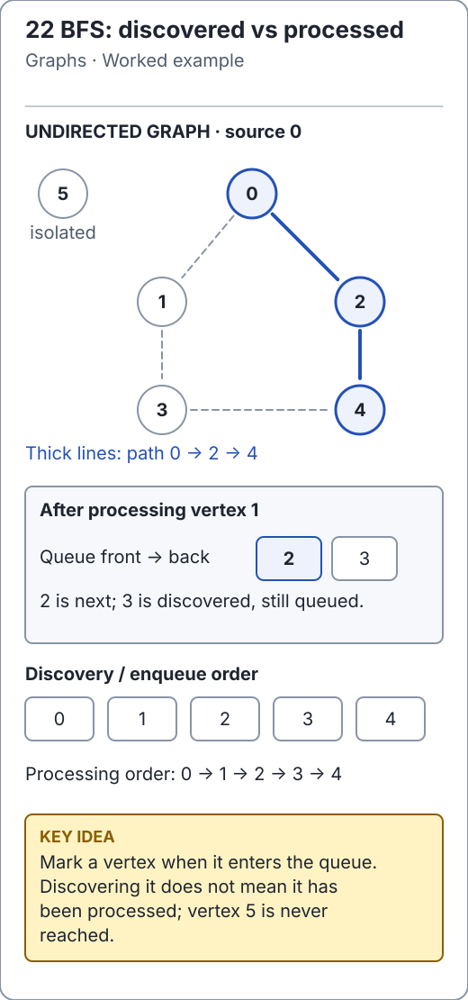
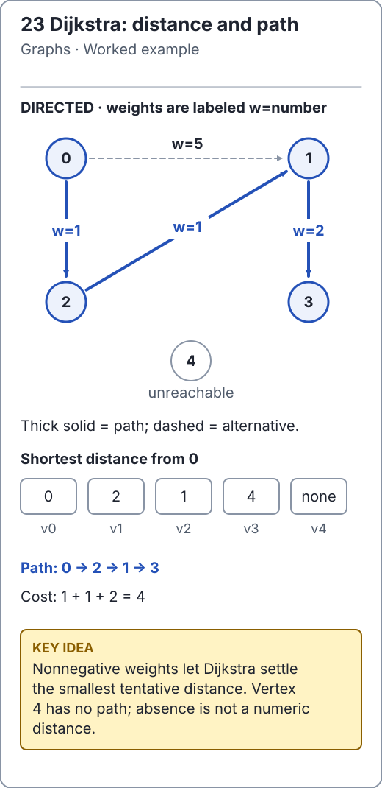

# Breadth-first search and choosing a distance model

BFS finds vertices reachable from a source in increasing number of edges. The
maintained [GraphAlgorithms](../../src/main/java/io/github/ichillous/dsa/graphs/GraphAlgorithms.java)
uses the repository's fixed-vertex [Graph](../../src/main/java/io/github/ichillous/dsa/graphs/Graph.java):
vertices are `0..V-1`, duplicate edges are ignored, neighbor order follows insertion
order, and directed edges are traversed only in their given direction. Invalid
vertices and null graphs are rejected. Do not mutate a graph during a computation.

| At&nbsp;a&nbsp;glance | |
| --- | --- |
| **Use&nbsp;it&nbsp;when** | You need reachability, fewest-edge paths, distance layers or undirected components. |
| **Avoid&nbsp;it&nbsp;when** | Edge costs differ: use Dijkstra (nonnegative), Bellman–Ford (negative) or the [shortest-path toolkit](shortest-paths.md). |
| **Cost** | O(V + E) time and auxiliary space for BFS, `shortestPath` and `connectedComponents`. |
| **In&nbsp;this&nbsp;repo** | [`GraphAlgorithms.breadthFirst`](../../src/main/java/io/github/ichillous/dsa/graphs/GraphAlgorithms.java), `shortestPath`, `connectedComponents` |
| **In&nbsp;the&nbsp;JDK** | no direct equivalent traversal; `ArrayDeque` as the FIFO queue |

<!-- visual:generated bfs-frontier -->
<picture><source media="(prefers-color-scheme: dark)" srcset="../../docs/visuals/assets/bfs-frontier-dark.svg"></picture>

**Figure 22.** Follow the queue separately from discovery; isolate unreachable vertex 5. [Visual index and step-throughs](../../docs/visuals/README.md).
<!-- /visual:generated -->

## Queue invariant: discovered once, processed by layer

Mark a vertex when it is **enqueued**, not when it is dequeued. Its first discovery
then gives a shortest unweighted path, and each vertex enters the queue at most
once. Queue distances never decrease; processing layer `d` discovers layer `d+1`.

```text
edges: 0--1--3
       |     |
       2-----4       vertices 5 and 6 isolated
queue after processing 0: [1, 2]
queue after processing 1: [2, 3]
queue after processing 2: [3, 4]
BFS order: [0, 1, 2, 3, 4]
```

```java
import io.github.ichillous.dsa.graphs.Graph;
import io.github.ichillous.dsa.graphs.GraphAlgorithms;
import java.util.List;

var graph = Graph.undirected(7).addEdge(0, 1).addEdge(0, 2)
        .addEdge(1, 3).addEdge(2, 4).addEdge(3, 4);
assert GraphAlgorithms.breadthFirst(graph, 0).equals(List.of(0, 1, 2, 3, 4));
assert GraphAlgorithms.shortestPath(graph, 0, 4).equals(List.of(0, 2, 4));
assert GraphAlgorithms.shortestPath(graph, 0, 6).isEmpty();
assert GraphAlgorithms.shortestPath(graph, 0, 0).equals(List.of(0));
assert GraphAlgorithms.connectedComponents(graph).size() == 3;
```

The maintained BFS, unweighted path and undirected-component methods take
O(V + E) time and O(V + E) auxiliary space including adjacency snapshots and
results. A single-source traversal visits only the reachable portion, but its
state arrays still include every vertex. An empty graph has no valid source.

**Counterexample:** marking only on dequeue can enqueue the same vertex through
several parents. Without additional care that increases work and can repeatedly
overwrite parents. A disconnected vertex must remain unreachable, not be assigned
a default distance of zero.

## Weighted paths: BFS's objective changes

A direct edge of weight 10 uses fewer edges than a two-edge route of total weight
2. BFS optimizes the former count. For nonnegative weights, use Dijkstra:

```java
import io.github.ichillous.dsa.graphs.GraphAlgorithms;
import io.github.ichillous.dsa.graphs.WeightedGraph;
import java.util.List;

var weighted = WeightedGraph.directed(4)
        .addEdge(0, 1, 10).addEdge(0, 2, 1).addEdge(2, 1, 1);
var paths = GraphAlgorithms.dijkstra(weighted, 0);
assert paths.distanceTo(1).orElseThrow() == 2L;
assert paths.pathTo(1).equals(List.of(0, 2, 1));
assert paths.distanceTo(3).isEmpty();
```

The maintained lazy-heap Dijkstra takes O(V + E log(E + 1)) time and O(V + E)
space; weighted graphs permit parallel edges, so the heap can contain more than
V entries. It rejects **every** negative edge, even in an unreachable component.
Unreachable distances are empty; a reachable `Long.MAX_VALUE` is valid. Overflowing
detours are ignored, but an unrepresentable final reachable shortest distance throws.

<!-- visual:generated dijkstra-path -->
<picture><source media="(prefers-color-scheme: dark)" srcset="../../docs/visuals/assets/dijkstra-path-dark.svg"></picture>

**Figure 23.** Compare weighted routes from source 0 and distinguish unreachable vertex 4. [Visual index and step-throughs](../../docs/visuals/README.md).
<!-- /visual:generated -->

## Signed edges: Bellman–Ford

[AdvancedGraphAlgorithms](../../src/main/java/io/github/ichillous/dsa/graphs/AdvancedGraphAlgorithms.java)
relaxes all directed adjacency edges repeatedly. Each finite label is the cost of
an actual walk. After pass `k`, paths of at most `k` edges have been considered;
in-place updates may also propagate longer paths. Without a reachable negative
cycle, a shortest simple path uses at most `V-1` edges. A further improvement then
proves that a source-reachable negative cycle exists.

```java
import io.github.ichillous.dsa.graphs.AdvancedGraphAlgorithms;
import io.github.ichillous.dsa.graphs.WeightedGraph;
import java.util.List;

var signed = WeightedGraph.directed(4)
        .addEdge(0, 1, 4).addEdge(0, 2, 5).addEdge(1, 2, -3);
var paths = AdvancedGraphAlgorithms.bellmanFord(signed, 0);
assert paths.distanceTo(2).orElseThrow() == 1L;
assert paths.pathTo(2).equals(List.of(0, 1, 2));
assert paths.distanceTo(3).isEmpty();
```

This implementation rejects the entire result for any source-reachable negative
cycle; unreachable cycles are ignored. A reachable undirected negative edge
already creates a negative closed walk. Relaxations use exact `BigInteger`
arithmetic, and only final reachable distances must fit in `long`.
There are O(VE) relaxations plus O(V + E) setup. With maximum intermediate bit
length `B = O(64 + log(VE + 1))`, time is O(V + E + VEB) bit operations and
auxiliary storage is O((V + E)B) bits including snapshots. These arithmetic costs
should not be hidden behind a constant-time `long` assumption.

## In real Java

A queue seeded with several sources computes distance to the nearest source in one O(V + E) pass, a pattern the single-source methods do not offer (think of the nearest of several exits). `ArrayDeque` is the JDK queue to use; the example checks the result against the library's single-source `shortestPath`.

```java
import io.github.ichillous.dsa.graphs.Graph;
import io.github.ichillous.dsa.graphs.GraphAlgorithms;
import java.util.ArrayDeque;
import java.util.Arrays;
import java.util.Deque;

Graph line = Graph.undirected(6);
for (int vertex = 0; vertex < 5; vertex++) {
    line.addEdge(vertex, vertex + 1);
}
int[] distance = new int[6];
Arrays.fill(distance, -1);
Deque<Integer> queue = new ArrayDeque<>();
for (int source : new int[] {0, 5}) {
    distance[source] = 0;
    queue.add(source);
}
while (!queue.isEmpty()) {
    int vertex = queue.remove();
    for (int neighbor : line.neighbors(vertex)) {
        if (distance[neighbor] < 0) {
            distance[neighbor] = distance[vertex] + 1;
            queue.add(neighbor);
        }
    }
}
assert Arrays.equals(distance, new int[] {0, 1, 2, 2, 1, 0});
for (int vertex = 0; vertex < 6; vertex++) {
    int fromFirst = GraphAlgorithms.shortestPath(line, 0, vertex).size() - 1;
    int fromLast = GraphAlgorithms.shortestPath(line, 5, vertex).size() - 1;
    assert distance[vertex] == Math.min(fromFirst, fromLast);
}
```

## Common mistakes

1. **Marking on dequeue.** On the diamond `0 -> 1, 0 -> 2, 1 -> 3, 2 -> 3`, vertex 3 is queued twice. This breaks "each vertex enters the queue at most once", so work and parent writes repeat.
2. **Using Dijkstra with a negative edge.** On `0 -> 1` (2), `0 -> 2` (1) and `1 -> 2` (-2), textbook Dijkstra settles vertex 2 at distance 1 before it processes vertex 1, but the true distance is 0 along `0, 1, 2`: the settled-vertex argument fails. This repository's `dijkstra` rejects the graph with `IllegalArgumentException` rather than answer, and `bellmanFord` gives distance 0 and path `[0, 1, 2]`.
3. **Giving Bellman–Ford an undirected negative edge.** `WeightedGraph.undirected(2).addEdge(0, 1, -1)` contains the closed walk 0, 1, 0 of total weight -2, a negative cycle, so `bellmanFord(graph, 0)` throws `IllegalArgumentException`. Distances are only defined without a reachable negative cycle.

## Practice

1. Validate returned paths edge by edge and compare their lengths with a distance
   oracle; do not demand one arbitrary tied path from every implementation.
2. Construct a negative edge that breaks Dijkstra's settled-vertex argument.
3. Add a negative cycle first outside and then inside the source's reachable set.
   Explain why Bellman–Ford treats those cases differently.

## Check yourself

<details>
<summary>What does <code>shortestPath(graph, 0, 4)</code> return when 4 cannot be reached?</summary>

An empty list. A reachable target always yields a path that includes both endpoints, and `shortestPath(graph, 2, 2)` is `[2]`.

</details>

<details>
<summary>Why is the first discovery of a vertex enough to give its shortest edge count?</summary>

The queue processes layer d completely before layer d + 1, so the vertex that first discovers a new neighbor lies in the earliest layer adjacent to it; no later discoverer is closer to the source, so its distance + 1 is the fewest edges.

</details>

<details>
<summary>Dijkstra returns <code>OptionalLong.empty()</code> for some vertex. What does that mean, and what does it not mean?</summary>

The vertex is unreachable from the source. It does not mean distance 0 or a missing graph vertex; a reachable `Long.MAX_VALUE` is still a valid distance.

</details>

Use the [solutions](../../docs/solutions.md) and continue with [DFS](dfs.md). The [solution finder](../../docs/solution-finder.md#15-shortest-paths) compares this technique with its alternatives.
