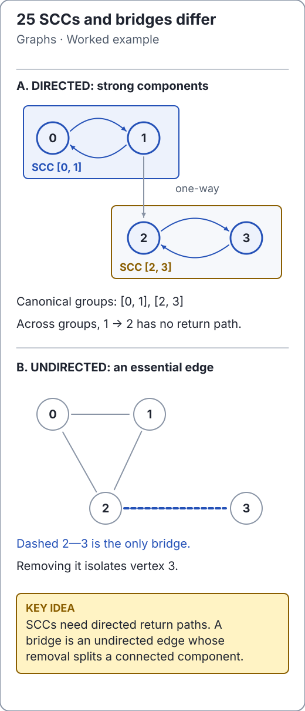

# Depth-first search, finishing order and connectivity

DFS follows one branch until it cannot advance, then resumes the nearest unfinished
branch. The maintained [GraphAlgorithms](../../src/main/java/io/github/ichillous/dsa/graphs/GraphAlgorithms.java)
uses explicit iterator frames rather than Java recursion. This preserves recursive
neighbor-order behavior while avoiding a call-stack limit on a long chain.
Null graphs and invalid source indices are rejected; input is unchanged.

<!-- visual:generated -->
<picture><source media="(prefers-color-scheme: dark)" srcset="../../docs/visuals/assets/scc-bridges-dark.svg"></picture>

**Figure 25.** Directed return paths form SCCs; undirected essential edges are bridges. [Visual index and step-throughs](../../docs/visuals/README.md).
<!-- /visual:generated -->

## Stack invariant

Active frames represent a path of discovered vertices. Each frame remembers which
neighbor comes next. Marking on discovery prevents cycles from reentering an
active vertex. When its neighbors are exhausted, a frame finishes and is popped.
A finish event is different from the first-discovery event returned by `depthFirst`.

```text
0 -> 1 -> 3
 \-> 2 -> 3       vertex 4 isolated
active frames: [0] -> [0,1] -> [0,1,3] -> [0,1] -> [0] -> [0,2]
discovery order: 0, 1, 3, 2
```

```java
import io.github.ichillous.dsa.graphs.Graph;
import io.github.ichillous.dsa.graphs.GraphAlgorithms;
import java.util.List;

var graph = Graph.directed(5).addEdge(0, 1).addEdge(0, 2)
        .addEdge(1, 3).addEdge(2, 3);
assert GraphAlgorithms.depthFirst(graph, 0).equals(List.of(0, 1, 3, 2));
assert GraphAlgorithms.depthFirst(graph, 4).equals(List.of(4));
var order = GraphAlgorithms.topologicalSort(graph);
assert order.size() == graph.vertexCount();
assert order.indexOf(0) < order.indexOf(1);
assert order.indexOf(0) < order.indexOf(2);
assert order.indexOf(1) < order.indexOf(3);
assert order.indexOf(2) < order.indexOf(3);
```

DFS costs O(V + E) time and O(V + E) auxiliary space including adjacency snapshots.
`topologicalSort` is a separate Kahn indegree algorithm with the same bounds. It
requires a directed acyclic graph and rejects cycles. A discovery list is not a
topological order: reversing discovery order does not generally fix it either.

**Counterexample:** DFS can first reach a destination along a long branch even
when a direct source edge exists. Use [BFS](bfs.md) for a minimum-edge path.
Also, “visited” alone cannot distinguish a directed edge to an ancestor from an
edge to an already completed branch; recursive-style cycle proofs need more state.

## Strongly connected components

In a directed graph, two vertices share an SCC precisely when each can reach the
other. A one-way edge does not merge SCCs. The maintained
[AdvancedGraphAlgorithms](../../src/main/java/io/github/ichillous/dsa/graphs/AdvancedGraphAlgorithms.java)
uses iterative Kosaraju: obtain finishing order, then traverse the reversed graph
in decreasing finish order. That order prevents a reverse traversal from spilling
into an unassigned different SCC.

```java
import io.github.ichillous.dsa.graphs.AdvancedGraphAlgorithms;
import io.github.ichillous.dsa.graphs.Graph;
import java.util.List;

var directed = Graph.directed(5).addEdge(0, 1).addEdge(1, 0)
        .addEdge(1, 2).addEdge(2, 3).addEdge(3, 2).addEdge(3, 4);
assert AdvancedGraphAlgorithms.stronglyConnectedComponents(directed).equals(
        List.of(List.of(0, 1), List.of(2, 3), List.of(4)));
```

Time and auxiliary space are O(V + E), including reversed adjacency and output.
Every vertex appears once, including isolated vertices. Results are canonical:
vertices ascend within each component, and components ascend by their smallest
vertex. A linear vertex sweep provides that order without comparison sorting.
Both result-list levels are immutable. Undirected input is rejected.

## Bridges: can the subtree escape its parent edge?

An undirected edge is a bridge when removing it increases the number of connected
components. DFS assigns discovery times and a `low` value: the earliest discovery
reachable from a subtree using tree edges followed by at most one back edge.
For a tree edge `parent -> child`, `low[child] > discovery[parent]` means the child
subtree has no alternative route to the parent or an ancestor, so that edge is a
bridge. The child's value is finalized when its frame finishes.

```java
import io.github.ichillous.dsa.graphs.AdvancedGraphAlgorithms;
import io.github.ichillous.dsa.graphs.AdvancedGraphAlgorithms.Bridge;
import io.github.ichillous.dsa.graphs.Graph;
import java.util.List;

var undirected = Graph.undirected(5).addEdge(0, 1).addEdge(1, 2)
        .addEdge(2, 0).addEdge(1, 3).addEdge(3, 4);
assert AdvancedGraphAlgorithms.bridges(undirected).equals(
        List.of(new Bridge(1, 3), new Bridge(3, 4)));
```

The triangle's edges have alternate routes; the two edges leaving it do not.
The maintained `Graph` suppresses duplicate edges, so this is a simple-graph
algorithm; a multigraph needs edge identities to distinguish the parent edge from
a parallel back edge. Self-loops are never bridges. Disconnected graphs are
supported, and directed graphs are rejected. Traversal takes O(V + E), with an
additional O(b log(b + 1)) sort for `b` normalized output bridges. Auxiliary space
including result and adjacency snapshots is O(V + E).

## Practice

1. Trace discovery and finish events separately on the first graph.
2. Compare SCC membership with pairwise mutual reachability on tiny graphs.
3. Remove each undirected edge in a tiny reference graph and recount components;
   compare this slow bridge oracle with the low-link result.

See the [solutions](../../docs/solutions.md) for canonicalization and oracle details.
