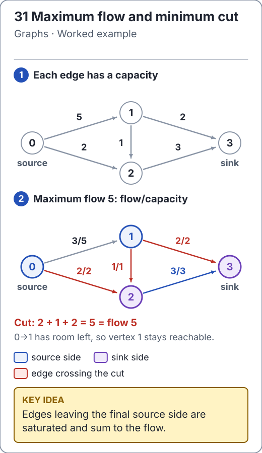
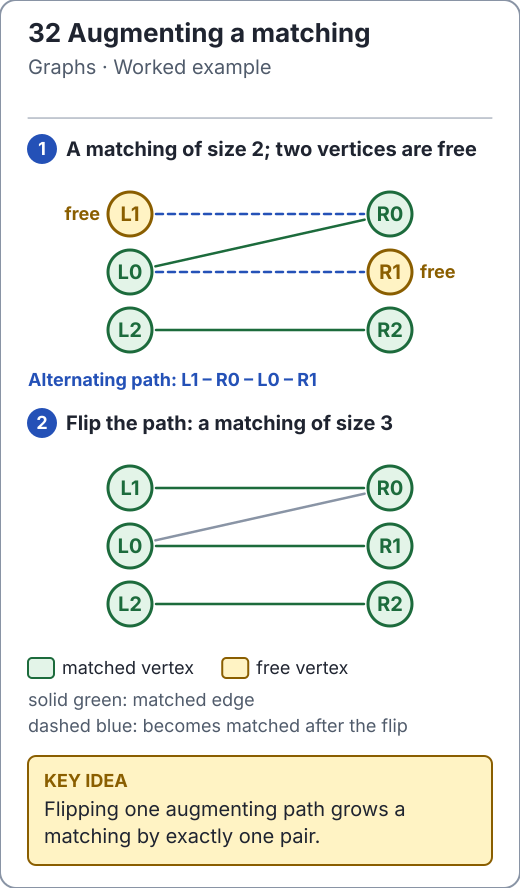

# Max flow, min cut and bipartite matching

A flow network is a directed graph whose edges carry a nonnegative `long` capacity.
A **flow** from a source `s` to a sink `t` assigns each edge an amount between 0 and
its capacity so that every vertex other than `s` and `t` receives exactly as much as
it sends. The **value** is the net amount leaving `s`. The maintained
[FlowNetwork](../../src/main/java/io/github/ichillous/dsa/graphs/FlowNetwork.java)
computes a maximum flow and a minimum cut with Dinic's algorithm, and
[BipartiteMatching](../../src/main/java/io/github/ichillous/dsa/graphs/BipartiteMatching.java)
computes a maximum matching with Hopcroft-Karp.

| At&nbsp;a&nbsp;glance | |
| --- | --- |
| **Use&nbsp;it&nbsp;when** | You must route the most of something through capacity-limited links, find the cheapest set of links separating two vertices, or pair items from two sides (tasks to workers). |
| **Avoid&nbsp;it&nbsp;when** | Edges carry costs to minimize (min-cost flow and the Hungarian algorithm are not implemented here) or you only need one path. |
| **Cost** | `maxFlow` O(V^2 E); `maximumMatching` O((V + E) sqrt(V)); both O(V + E) auxiliary space. |
| **In&nbsp;this&nbsp;repo** | [`FlowNetwork.maxFlow`](../../src/main/java/io/github/ichillous/dsa/graphs/FlowNetwork.java), [`BipartiteMatching.maximumMatching`](../../src/main/java/io/github/ichillous/dsa/graphs/BipartiteMatching.java) |
| **In&nbsp;the&nbsp;JDK** | No direct equivalent. |

Preconditions: vertices are `0..V-1`; capacities are `>= 0`; parallel edges are kept
and each is a separate edge; `source != sink`. The network is never mutated by a
computation, so the same call can be repeated.

## The invariant: residual graphs

For every edge `u -> v` with capacity `c` and current flow `f`, the **residual graph**
has a forward arc of residual `c - f` and a backward arc `v -> u` of residual `f`.
Pushing flow along a backward arc cancels earlier flow. Two facts drive everything:

- **Augmenting path theorem.** A flow is maximum exactly when the residual graph has
  no `s -> t` path.
- **Max-flow/min-cut.** At that point let `S` be the vertices reachable from `s`.
  Every edge leaving `S` is saturated and every edge entering `S` carries zero flow,
  so the flow value equals the capacity of the edges leaving `S`. No cut can be
  smaller, because every flow is at most every cut's capacity.

Dinic's algorithm repeats two steps. A BFS labels residual vertices by distance from
`s`. A blocking flow then saturates level-increasing arcs until no such path is left.
After each phase the `s -> t` residual distance strictly increases, so there are at
most `V - 1` phases. The depth-first blocking-flow search and the BFS are iterative,
so a 100,000-vertex path does not overflow the call stack.

<!-- visual:generated max-flow-min-cut -->
<picture><source media="(prefers-color-scheme: dark)" srcset="../../docs/visuals/assets/max-flow-min-cut-dark.svg"></picture>

**Figure 31.** A four-vertex flow network from source 0 to sink 3 carries a maximum flow of 5. The source side {0, 1} is the set reachable in the residual graph, and the three edges leaving it have capacities 2, 1 and 2, summing to 5. [Visual index and step-throughs](../../docs/visuals/README.md).
<!-- /visual:generated -->

The figure uses a slightly different network from the trace below, one whose minimum
cut separates two source-side vertices from the rest.

```text
s=0  t=3   edges (capacity): 0->1 (3), 0->2 (2), 1->2 (1), 1->3 (2), 2->3 (3)
phase 1: levels 0:0 1:1 2:1 3:2
         path 0->1->3 pushes 2, path 0->2->3 pushes 2
         arcs 1->3 and 0->2 are now saturated
phase 2: residual 0->1 has 1; 1->2 has 1; 2->3 has 1
         levels 0:0 1:1 2:2 3:3, path 0->1->2->3 pushes 1
phase 3: 0->1 is saturated and 0->2 too, so 3 is unreachable. Flow = 5
reachable from 0 in the last residual graph: {0}; cut edges 0->1 (3) + 0->2 (2) = 5
```

```java
import io.github.ichillous.dsa.graphs.FlowNetwork;
import io.github.ichillous.dsa.graphs.BipartiteMatching;
import java.util.List;

var network = new FlowNetwork(4)
        .addEdge(0, 1, 3).addEdge(0, 2, 2).addEdge(1, 2, 1)
        .addEdge(1, 3, 2).addEdge(2, 3, 3);
FlowNetwork.MaxFlow flow = network.maxFlow(0, 3);
assert flow.value() == 5;
assert flow.sourceSide().equals(List.of(0));
long cut = 0;
for (FlowNetwork.Edge e : network.edges()) {
    if (flow.sourceSide().contains(e.from()) && !flow.sourceSide().contains(e.to())) {
        cut += e.capacity();
    }
}
assert cut == flow.value();

var pairs = List.of(
        new BipartiteMatching.Pair(0, 0), new BipartiteMatching.Pair(0, 1),
        new BipartiteMatching.Pair(1, 0), new BipartiteMatching.Pair(2, 0));
List<BipartiteMatching.Pair> matching = BipartiteMatching.maximumMatching(3, 2, pairs);
assert matching.size() == 2;
assert matching.get(0).left() < matching.get(1).left();
```

## Matching as flow

A bipartite matching is a max-flow problem. Add a super-source with capacity-1 edges
to every left vertex, a capacity-1 edge from each left to each adjacent right vertex,
and capacity-1 edges from every right vertex to a super-sink. Integral capacities give
an integral maximum flow, whose saturated middle edges are a maximum matching.
<!-- visual:generated matching-augmenting-path -->
<picture><source media="(prefers-color-scheme: dark)" srcset="../../docs/visuals/assets/matching-augmenting-path-dark.svg"></picture>

**Figure 32.** A bipartite matching of size 2 leaves left vertex 1 and right vertex 1 free. Flipping the alternating path L1, R0, L0, R1 gives the maximum matching of size 3. [Visual index and step-throughs](../../docs/visuals/README.md).
<!-- /visual:generated -->

Hopcroft-Karp is Dinic's phase structure specialized to this unit network: each phase
runs a BFS that stops at the first layer reaching a free right vertex, then a DFS over
layered edges that augments only along shortest paths until a maximal set of
vertex-disjoint ones is found. The shortest augmenting path grows each phase. After
√V phases every remaining augmenting path is longer than √V, and the vertex-disjoint
augmenting paths that separate the current matching from a maximum one then number at
most √V, so at most √V more phases follow: O(√V) phases in total. Duplicate input pairs are
ignored, out-of-range vertices throw `IndexOutOfBoundsException`, and the result is
sorted by left vertex. When several maximum matchings exist the one returned is
deterministic but unspecified; test the size and validity, not one particular answer.

## Costs

| Operation | Time | Auxiliary space |
| --- | --- | --- |
| `maxFlow` (Dinic) | O(V^2 E) | O(V + E) |
| `maximumMatching` (Hopcroft-Karp) | O((V + E) sqrt(V)), i.e. O(E sqrt(V)) when no vertex is isolated, after an O(E log E) deduplicating sort | O(V + E) |

Residuals never overflow: a backward arc's residual is the flow on its edge, which is
bounded by that edge's capacity. The total value is accumulated with
`Math.addExact`, so an answer above `Long.MAX_VALUE` throws `ArithmeticException`
instead of wrapping. Two parallel paths of capacity `Long.MAX_VALUE / 2` are exact.

**Pitfall:** a greedy choice is not a flow. With edges `0-0`, `0-1` and `1-0`,
taking `0-0` first blocks left vertex 1, yet the maximum has size 2. The augmenting
path starts at free left vertex 1, takes right vertex 0 (undoing the match `0-0`
through a backward arc) and re-matches left vertex 0 to right vertex 1. A residual
graph without backward arcs would stop at the wrong answer. Also, a maximum flow is
not unique; only its value and the minimal source side are determined.

## Not implemented here

Minimum-cost flow (successive shortest paths) and the Hungarian algorithm for
minimum-cost perfect assignment on weighted bipartite graphs are not implemented in
this repository. Reach for them when edges carry costs; plain `BipartiteMatching`
only maximizes the count of pairs.

## In real Java

The JDK has no flow or matching API. What it does give you is checked arithmetic:
`Math.addExact` throws `ArithmeticException` when a `long` sum overflows, which is
how the flow total is accumulated. Capacity near `Long.MAX_VALUE` is therefore safe
to model as long as the value itself fits, and an impossible answer fails loudly:

```java
import io.github.ichillous.dsa.graphs.FlowNetwork;

long half = Long.MAX_VALUE / 2;
var fits = new FlowNetwork(2).addEdge(0, 1, half).addEdge(0, 1, half);
assert fits.maxFlow(0, 1).value() == 2 * half;

var tooBig = new FlowNetwork(2).addEdge(0, 1, Long.MAX_VALUE).addEdge(0, 1, Long.MAX_VALUE);
boolean overflowed = false;
try {
    tooBig.maxFlow(0, 1);
} catch (ArithmeticException expected) {
    overflowed = true;
}
assert overflowed;
```

## Common mistakes

- **Reporting the source's total outgoing capacity as the flow.** With `0->1 (10)`
  and `1->2 (1)` the answer is 1, not 10: every flow is at most every cut's
  capacity, and the cut `{0, 1}` versus `{2}` has capacity 1.
- **Counting edges that enter the source side in the cut.** Only edges leaving the
  side count. Adding an edge `2->1` of capacity 4 to the figure's network leaves the
  cut capacity at 5; counting both directions would give 9 and break "cut capacity
  equals flow value".
- **Mixing left and right index spaces in a matching.** `Pair(2, 0)` with
  `leftSize = 2` is out of range even though right vertex 2 might exist, because
  left and right vertices are numbered separately; `maximumMatching` throws
  `IndexOutOfBoundsException`.

## Practice

1. Compare `maxFlow` on random networks of at most eight vertices with the minimum over
   all `2^(V-2)` cuts that separate `s` from `t`. Use a fixed seed.
2. Verify a returned flow edge by edge: capacities respected, conservation at every
   inner vertex, and the cut formed by `sourceSide` equal to the value.
3. Model "assign tasks to workers" as a matching, then add one task adjacent to a
   single already-used worker and trace the augmenting path that reassigns it.

## Check yourself

<details>
<summary>Why does the residual graph need backward arcs?</summary>

A backward arc of residual `f` lets a later augmenting path cancel flow that an earlier path pushed. Without it a greedy choice could never be undone, and the search would stop at a flow that is not maximum, as in the matching counterexample above.

</details>

<details>
<summary>What does <code>sourceSide</code> contain, and why does the cut it defines equal the flow value?</summary>

It holds the vertices reachable from the source in the final residual graph. Every edge leaving that set is saturated and every edge entering it carries zero flow, so the flow leaving the set, which is the flow value, equals the capacity of the edges leaving it.

</details>

<details>
<summary>How does a matching become a flow problem, and what does an augmenting path correspond to?</summary>

Add a super-source with capacity-1 edges to every left vertex, capacity-1 edges for the pairs, and capacity-1 edges from every right vertex to a super-sink. An augmenting path from a free left vertex to a free right vertex alternates unmatched and matched pairs; flipping it adds one pair, just as pushing one unit along an augmenting path adds one unit of flow.

</details>

Continue with the [catalog](../../docs/catalog.md), the
[complexity guide](../../docs/complexity.md) and [BFS](bfs.md). The [solution finder](../../docs/solution-finder.md#16-spanning-trees-flows-and-matching) compares this technique with its alternatives.
