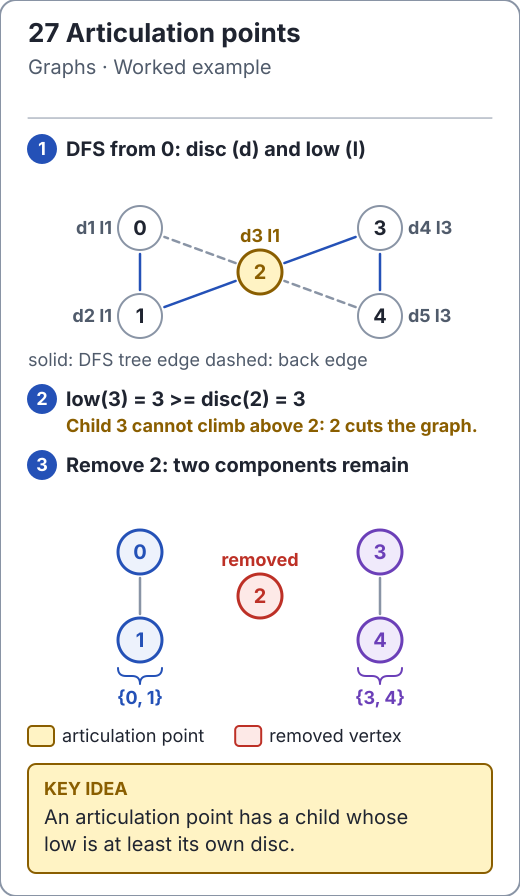
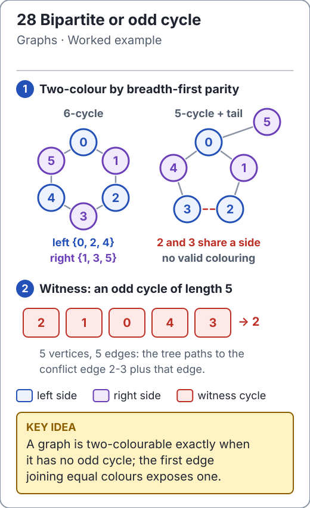
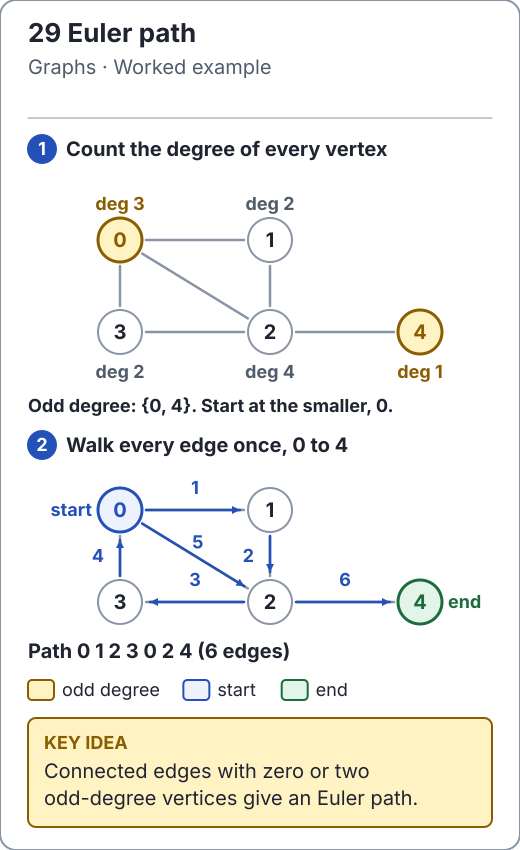

# Graph structure: cut vertices, bipartiteness, cycles and Euler paths

These algorithms answer structural questions about a graph rather than distances:
which vertices hold it together, whether it splits into two sides, where a cycle
is, and whether one walk can use every edge once. All are in the maintained
[GraphStructureAlgorithms](../../src/main/java/io/github/ichillous/dsa/graphs/GraphStructureAlgorithms.java)
and are iterative, so a 100,000-vertex path does not overflow the call stack.

| At&nbsp;a&nbsp;glance | |
| --- | --- |
| **Use&nbsp;it&nbsp;when** | You need to know which vertices hold a graph together, whether it splits into two sides, where a cycle is, or whether one walk can use every edge once. |
| **Avoid&nbsp;it&nbsp;when** | You need distances (use [shortest paths](shortest-paths.md)) or only reachability (use [BFS](bfs.md) or [DFS](dfs.md)). |
| **Cost** | O(V + E) time for every method here; Euler paths are O(V + E) expected. |
| **In&nbsp;this&nbsp;repo** | [`GraphStructureAlgorithms`](../../src/main/java/io/github/ichillous/dsa/graphs/GraphStructureAlgorithms.java): `articulationPoints`, `bipartition`, `oddCycle`, `directedCycle`, `eulerianPath` |
| **In&nbsp;the&nbsp;JDK** | No direct equivalent: `java.util` has no graph classes. |

**Preconditions.** Articulation points, bipartition and odd cycles need an
undirected `Graph`; the directed-cycle search needs a directed one; the Euler path
accepts either. A wrong direction throws `IllegalArgumentException`, null throws
`NullPointerException`, and inputs are never modified. `Graph` ignores duplicate
edges and stores an undirected self-loop as one edge with one adjacency entry.
This lesson relies on that: a loop is a cycle of length one, is never part of a
bipartition, and adds 2 to an undirected degree.

## The invariants

- **Articulation points.** In a DFS, `low[v]` is the earliest discovery time
  reachable from `v`'s subtree by tree edges plus at most one back edge. A non-root
  `p` is a cut vertex when some child `c` has `low[c] >= discovery[p]` (the subtree
  cannot get above `p`). A root is a cut vertex only with two or more DFS children.
  This uses `>=`, unlike bridges which use `>`, because removing `p` itself also
  cuts a back edge that ends exactly at `p`.
- **Bipartition.** BFS colors each vertex opposite to its parent. Every edge must
  join different colors; the first edge joining equal colors proves an odd cycle.
  The smallest vertex of each component is left.
- **Odd-cycle witness.** For a same-colored edge `u-v` the tree paths from `u` and
  `v` to their nearest common ancestor have lengths of equal parity, so path plus
  the edge has odd length.
- **Directed cycle.** DFS keeps the current path. An edge into a vertex still on the
  path closes a cycle made of the path suffix; an edge into a finished vertex does
  not.
- **Euler path (Hierholzer).** Walk unused edges until stuck, then splice detours in
  as the stack unwinds. The path exists exactly when the edges are in one component
  and the degrees allow it: undirected, zero or two odd-degree vertices; directed,
  every `out - in` is 0 except at most one `+1` (the start) and one `-1` (the end).
  The result has `E + 1` vertices.

<!-- visual:generated articulation-points -->
<picture><source media="(prefers-color-scheme: dark)" srcset="../../docs/visuals/assets/articulation-points-dark.svg"></picture>

**Figure 27.** A bowtie graph of two triangles sharing vertex 2 is searched depth-first from 0 with discovery and low values shown, and removing vertex 2 leaves the separate components {0, 1} and {3, 4}. [Visual index and step-throughs](../../docs/visuals/README.md).
<!-- /visual:generated -->

<!-- visual:generated bipartite-odd-cycle -->
<picture><source media="(prefers-color-scheme: dark)" srcset="../../docs/visuals/assets/bipartite-odd-cycle-dark.svg"></picture>

**Figure 28.** A 6-cycle splits into left {0, 2, 4} and right {1, 3, 5}, while a 5-cycle with a tail has an edge 2-3 joining two vertices of the same colour, and the witness is the odd cycle 2, 1, 0, 4, 3. [Visual index and step-throughs](../../docs/visuals/README.md).
<!-- /visual:generated -->

<!-- visual:generated euler-path -->
<picture><source media="(prefers-color-scheme: dark)" srcset="../../docs/visuals/assets/euler-path-dark.svg"></picture>

**Figure 29.** A square with a diagonal and a pendant edge has odd degree only at vertices 0 and 4, so the Euler path starts at 0 and walks every edge once: 0, 1, 2, 3, 0, 2, 4. [Visual index and step-throughs](../../docs/visuals/README.md).
<!-- /visual:generated -->

## A worked trace

```text
bowtie: triangles {0,1,2} and {2,3,4} share vertex 2
DFS from 0: disc 0=1, 1=2, 2=3, 3=4, 4=5, low(4)=3 (back edge 4-2)
finish 4: child of 3, low 3 >= disc(3)? low(4)=3 < disc(3)=4 -> 3 is not a cut
finish 3: child of 2, low(3)=3 >= disc(2)=3 -> 2 is a cut vertex
finish 2: child of 1, low(2)=1 < disc(1)=2 -> 1 is not a cut
articulation points: [2]

directed 0->1, 1->2, 2->0, 2->3     out-in: 2 is +1, 3 is -1, others 0
stack walk from 2 (first unused neighbor in insertion order): 2 0 1 2 3
Euler path: [2, 0, 1, 2, 3]
```

## Executable example

```java
import io.github.ichillous.dsa.graphs.Graph;
import io.github.ichillous.dsa.graphs.GraphStructureAlgorithms;
import java.util.List;

var bowtie = Graph.undirected(5).addEdge(0, 1).addEdge(1, 2).addEdge(2, 0)
        .addEdge(2, 3).addEdge(3, 4).addEdge(4, 2);
assert GraphStructureAlgorithms.articulationPoints(bowtie).equals(List.of(2));

var path = Graph.undirected(4).addEdge(0, 1).addEdge(1, 2).addEdge(2, 3);
var sides = GraphStructureAlgorithms.bipartition(path).orElseThrow();
assert sides.left().equals(List.of(0, 2));
assert sides.right().equals(List.of(1, 3));
assert GraphStructureAlgorithms.oddCycle(path).isEmpty();

var triangle = Graph.undirected(3).addEdge(0, 1).addEdge(1, 2).addEdge(2, 0);
assert GraphStructureAlgorithms.bipartition(triangle).isEmpty();
assert GraphStructureAlgorithms.oddCycle(triangle).orElseThrow().size() == 3;

var directed = Graph.directed(5).addEdge(0, 1).addEdge(1, 2).addEdge(2, 3)
        .addEdge(3, 1).addEdge(3, 4);
assert GraphStructureAlgorithms.directedCycle(directed).orElseThrow().equals(List.of(1, 2, 3));

var euler = Graph.directed(4).addEdge(0, 1).addEdge(1, 2).addEdge(2, 0).addEdge(2, 3);
assert GraphStructureAlgorithms.eulerianPath(euler).orElseThrow().equals(List.of(2, 0, 1, 2, 3));
var star = Graph.undirected(4).addEdge(0, 1).addEdge(0, 2).addEdge(0, 3);
assert GraphStructureAlgorithms.eulerianPath(star).isEmpty();

var loop = Graph.undirected(2).addEdge(0, 0).addEdge(0, 1);
assert GraphStructureAlgorithms.eulerianPath(loop).orElseThrow().equals(List.of(0, 0, 1));
```

## Costs and tie rules

| Operation | Time | Auxiliary space | Deterministic rule |
| --- | --- | --- | --- |
| `articulationPoints` | O(V + E) | O(V + E) | ascending vertex order |
| `bipartition` | O(V + E) | O(V + E) | smallest vertex of each component is left; lists ascending |
| `oddCycle` | O(V + E) | O(V + E) | first same-colored edge in BFS order |
| `directedCycle` | O(V + E) | O(V + E) | DFS from ascending vertices, neighbors in insertion order; starts at the vertex the closing edge reaches |
| `eulerianPath` | O(V + E) expected | O(V + E) | start vertex by the degree rule; first unused neighbor in `Graph` insertion order |

Space includes adjacency snapshots. The Euler walk is deterministic because `Graph`
keeps neighbors in insertion order; the expected-time bound comes from a hash lookup that
pairs the two adjacency entries of each undirected edge. A graph with no edges has the Euler path `[]`, whatever its
vertex count; isolated vertices are otherwise ignored.

## Pitfalls

- The degree count alone is not enough. Two disjoint cycles have all
  degrees even but no Euler path, because the edges are not connected. The
  implementation checks the degree rule first and then that the walk consumed
  `E` edges.
- Treating an undirected loop as degree 1 gives the wrong parity. Here a loop at
  `v` adds 2, so `[0-0, 0-1]` has odd vertices 0 and 1 and the path `[0, 0, 1]`.
- DFS "visited" is not enough for directed cycles: in the diamond
  `0->1, 0->2, 1->3, 2->3` vertex 3 is reached twice but there is no cycle,
  because the second arrival finds 3 already finished, not on the path.
- Using `low[c] > discovery[p]` (the bridge test) would miss cut vertices such as
  the center of a bowtie.

## In real Java

The JDK has no graph type, so production code either builds adjacency with
`java.util` collections (for example a `Map<Integer, List<Integer>>`) or reuses a
tested class such as this one. Know what the repository's `Graph` models before you
trust a structural answer: it keeps one edge per vertex pair. Adding the same edge
twice does not create a second parallel edge, so a "multigraph" input is silently
reduced and an Euler path of two parallel edges is a single step:

```java
import io.github.ichillous.dsa.graphs.Graph;
import io.github.ichillous.dsa.graphs.GraphStructureAlgorithms;
import java.util.List;

var doubled = Graph.undirected(2).addEdge(0, 1).addEdge(0, 1);
assert doubled.edgeCount() == 1;
assert GraphStructureAlgorithms.eulerianPath(doubled).orElseThrow().equals(List.of(0, 1));
// With two real parallel edges the walk would be 0, 1, 0 and every degree would be even.
```

If your data can repeat an edge and the repetition matters, count it yourself before
calling these methods, or model each parallel edge with its own intermediate vertex.

## Common mistakes

- **Marking a one-child DFS root as a cut vertex.** In the path `0-1-2` rooted at 0,
  vertex 0 has one DFS child. Removing it leaves `{1, 2}` connected, so the
  invariant "removal increases the component count" fails. Only a root with two or
  more children is a cut vertex.
- **Coloring only the component of vertex 0.** For edges `0-1`, `2-3`, `3-4`, `4-2`,
  a BFS from 0 finds no conflict, yet the triangle `2-3-4` is an odd cycle. The
  invariant "every edge joins different colors" must hold in every component, which
  is why `bipartition` starts a search from each uncolored vertex.
- **Starting a directed Euler path at the smallest vertex.** For `1->2`, `2->0` the
  out-minus-in balance is `+1` at vertex 1 and `-1` at vertex 0. Starting at 0, which
  has no outgoing edge, finds no walk; the start must be the vertex with `out - in = 1`.

## Practice

1. Remove each vertex of a small graph and recount components; compare with the
   `articulationPoints` answer.
2. Brute-force all `2^V` colorings of a graph on at most 10 vertices and check that
   a valid coloring exists exactly when `oddCycle` is empty.
3. Build a graph by XOR-ing a few random cycles (every degree stays even) and verify
   `eulerianPath` by deleting each consecutive edge from a multiset.

## Check yourself

<details>
<summary>Why does the articulation test use <code>low[c] &gt;= discovery[p]</code> while the bridge test uses <code>&gt;</code>?</summary>

When `low[c] == discovery[p]`, the subtree's best escape is a back edge that ends at `p`. If `p` is removed that edge disappears with it, so the subtree is cut off and `p` is a cut vertex. If only the tree edge `p-c` is removed, the same back edge is a different edge and still connects the subtree, so equality means `p-c` is not a bridge.

</details>

<details>
<summary>Which edge proves that a graph is not bipartite, and how is the witness cycle built from it?</summary>

The first edge `u-v` whose endpoints received the same BFS color. The two BFS-tree paths from `u` and `v` to their nearest common ancestor have equal parity, so those paths plus the edge `u-v` form a cycle of odd length.

</details>

<details>
<summary>A connected undirected graph has four odd-degree vertices. Does an Euler path exist?</summary>

No. A walk that uses every edge once can leave an odd number of unmatched edge ends only at its start and its end, so at most two vertices may have odd degree. With four, `eulerianPath` returns an empty `Optional`.

</details>

See the [catalog](../../docs/catalog.md) for the source and test links, the
[complexity guide](../../docs/complexity.md) for the cost summary, and
[depth-first search](dfs.md) for bridges and strongly connected components. For
the spanning-forest counterpart see [minimum spanning trees](minimum-spanning-trees.md). The [solution finder](../../docs/solution-finder.md#14-graph-traversal-and-structure) compares this technique with its alternatives.
