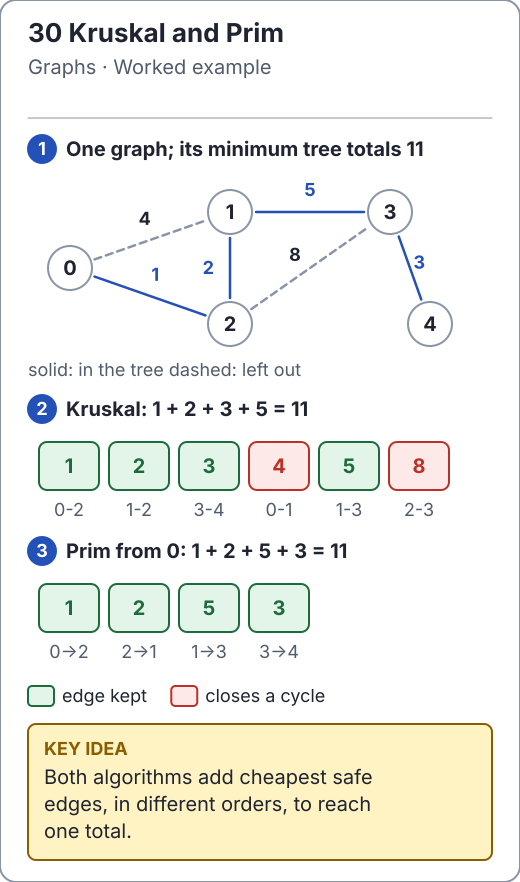

# Minimum spanning forests: Kruskal and Prim

A spanning forest connects every vertex that the graph connects, using no cycle and
the least total weight. A connected graph with `V` vertices gives a tree of `V - 1`
edges; a graph with `c` components gives `V - c` edges. Isolated vertices count as
components. Two maintained implementations give the same total weight:

- [GraphAlgorithms](../../src/main/java/io/github/ichillous/dsa/graphs/GraphAlgorithms.java)
  `minimumSpanningForest` is Kruskal: sort edges, add each one that joins two
  different sets.
- [GraphStructureAlgorithms](../../src/main/java/io/github/ichillous/dsa/graphs/GraphStructureAlgorithms.java)
  `primMinimumSpanningForest` is Prim: grow one tree from a start vertex by always
  taking the cheapest edge that leaves it.

| At a glance | |
| --- | --- |
| **Use it when** | You must connect every vertex as cheaply as possible and the connection need not be a shortest path between any two of them: networks, clustering, cheapest wiring. |
| **Avoid it when** | You need cheapest routes between vertices (use [shortest paths](shortest-paths.md)) or the graph is directed. |
| **Cost** | O(V + E log(E + 1)) time and O(V + E) auxiliary space for both Kruskal and the lazy-heap Prim. |
| **In this repo** | [`GraphAlgorithms.minimumSpanningForest`](../../src/main/java/io/github/ichillous/dsa/graphs/GraphAlgorithms.java) (Kruskal), [`GraphStructureAlgorithms.primMinimumSpanningForest`](../../src/main/java/io/github/ichillous/dsa/graphs/GraphStructureAlgorithms.java) |
| **In the JDK** | No direct equivalent. |

**Preconditions.** An undirected `WeightedGraph`; a directed one throws
`IllegalArgumentException`. Negative weights, parallel edges and loops are allowed
(loops are never chosen). The total is accumulated exactly and must fit in a
`long`, otherwise `ArithmeticException` is thrown; intermediate cancellation, such
as `Long.MIN_VALUE` and `Long.MAX_VALUE` edges in one tree, is not an error.

## The invariant

The cut property: for any partition of the vertices, a cheapest edge crossing it
belongs to some minimum spanning forest. Prim applies it with the partition
"vertices already in the tree" versus the rest. Kruskal applies it with the
component of the cheapest remaining edge. Because both only ever add a crossing edge
that is cheapest, an exchange argument shows the final forest is minimum. Prim
restarts from the smallest unvisited vertex once its heap is empty, which gives one
tree per component.

<!-- visual:generated mst-kruskal-prim | The graph of the trace below plus vertex 4 and edge 3-4 of weight 3, so its minimum spanning tree weighs 11 rather than 8; Kruskal keeps the edges of weight 1, 2, 3, 5 and Prim from vertex 0 picks 1, 2, 5, 3. -->
<picture><source media="(prefers-color-scheme: dark)" srcset="../../docs/visuals/assets/mst-kruskal-prim-dark.svg"></picture>

**Figure 30.** The graph of the trace below plus vertex 4 and edge 3-4 of weight 3, so its minimum spanning tree weighs 11 rather than 8; Kruskal keeps the edges of weight 1, 2, 3, 5 and Prim from vertex 0 picks 1, 2, 5, 3. [Visual index and step-throughs](../../docs/visuals/README.md).
<!-- /visual:generated -->

## A worked trace

```text
edges: 0-1 (4), 0-2 (1), 1-2 (2), 1-3 (5), 2-3 (8)        start at 0
heap {0-1:4, 0-2:1}   take 0-2 (1)   tree {0,2}   push 1-2:2, 2-3:8
heap {0-1:4, 1-2:2, 2-3:8}   take 1-2 (2)   tree {0,1,2}   push 1-3:5
heap {0-1:4, 1-3:5, 2-3:8}   0-1 now internal, skip
take 1-3 (5)   tree {0,1,2,3}   total 1 + 2 + 5 = 8
```

## Executable example

```java
import io.github.ichillous.dsa.graphs.GraphAlgorithms;
import io.github.ichillous.dsa.graphs.GraphStructureAlgorithms;
import io.github.ichillous.dsa.graphs.WeightedGraph;

var graph = WeightedGraph.undirected(5).addEdge(0, 1, 4).addEdge(0, 2, 1)
        .addEdge(1, 2, 2).addEdge(1, 3, 5).addEdge(2, 3, 8);
var prim = GraphStructureAlgorithms.primMinimumSpanningForest(graph);
var kruskal = GraphAlgorithms.minimumSpanningForest(graph);
assert prim.totalWeight() == 8;
assert prim.totalWeight() == kruskal.totalWeight();
assert prim.components() == 2;          // vertex 4 is isolated
assert prim.edges().size() == graph.vertexCount() - prim.components();

var signed = WeightedGraph.undirected(4).addEdge(0, 1, Long.MIN_VALUE)
        .addEdge(1, 2, Long.MAX_VALUE).addEdge(2, 3, 1).addEdge(3, 3, -5);
assert GraphStructureAlgorithms.primMinimumSpanningForest(signed).totalWeight() == 0;

var ties = WeightedGraph.undirected(4).addEdge(0, 3, 1).addEdge(0, 2, 1).addEdge(0, 1, 1);
var tied = GraphStructureAlgorithms.primMinimumSpanningForest(ties);
assert tied.edges().get(0).to() == 1;   // equal weights: smaller target first
```

## Costs and choices

| Algorithm | Time | Auxiliary space | Tie rule |
| --- | --- | --- | --- |
| Kruskal | O(V + E log(E + 1)) | O(V + E) | equal weights keep input order |
| Prim, lazy binary heap | O(V + E log(E + 1)) | O(V + E) | smaller weight, then smaller target vertex, then smaller source vertex |

The lazy heap receives each edge at most once, so it holds at most E entries, some
of them stale: they are skipped on removal rather than decreased in place. With a dense graph and an adjacency
matrix, an array-scan Prim runs in O(V^2) without a heap, but this library uses
adjacency lists. Prim edges are listed in selection order and oriented from the
tree vertex to the newly reached vertex; Kruskal returns the edges in the original
orientation.

## Pitfall: same total, different forest

With equal weights there can be several minimum forests. Prim and Kruskal may pick
different ones, so compare **totals and component counts**, not edge lists. Another
trap is to run Prim once from vertex 0 on a disconnected graph: that spans only one
component. The implementation restarts for every unvisited vertex. Finally, Prim
computes a minimum spanning tree, not shortest paths: the tree path between two
vertices need not be their shortest path (compare Dijkstra).

## In real Java

The JDK has no spanning-tree API, so use this class or write the algorithm over
your own adjacency. One behavior is worth relying on: Kruskal here sorts the edge
list by weight and equal weights keep the order in which you added the edges, so
the chosen forest is reproducible. In a triangle whose three edges all weigh 1, the
first two added are kept and the third closes a cycle:

```java
import io.github.ichillous.dsa.graphs.GraphAlgorithms;
import io.github.ichillous.dsa.graphs.WeightedGraph;

var triangle = WeightedGraph.undirected(3).addEdge(0, 1, 1).addEdge(1, 2, 1).addEdge(0, 2, 1);
var forest = GraphAlgorithms.minimumSpanningForest(triangle);
assert forest.totalWeight() == 2;
assert forest.edges().size() == 2;
assert forest.edges().get(0).from() == 0 && forest.edges().get(0).to() == 1;
assert forest.edges().get(1).from() == 1 && forest.edges().get(1).to() == 2;

var reordered = WeightedGraph.undirected(3).addEdge(0, 2, 1).addEdge(1, 2, 1).addEdge(0, 1, 1);
assert GraphAlgorithms.minimumSpanningForest(reordered).edges().get(0).to() == 2;
```

Reordering the input changes which minimum forest you get but never its total.

## Common mistakes

- **Summing weights in an `int`.** Two edges of weight `2_000_000_000` total
  `4_000_000_000`, which wraps to a negative `int`. The invariant "the total equals
  the true sum" needs a `long` at least; the library accumulates exactly and throws
  `ArithmeticException` when the total does not fit in a `long`.
- **Dropping negative edges before running.** For `0-1 (-3)`, `1-2 (4)`, `0-2 (5)`
  the minimum tree is `0-1`, `1-2` with total 1. Filtering the negative edge leaves
  only `1-2` and `0-2`, total 9. The cut property never uses the sign of a weight.
- **Adding a loop or a second edge inside one component.** An edge `3-3` of weight
  `-5` looks cheapest, but a tree has no cycle and `V - c` edges. Kruskal's
  union-find test rejects it because both endpoints are already in one set.

## Practice

1. Hand-run Prim from each possible start vertex on the worked example; the total
   must always be 8 even though the selection order changes.
2. Enumerate every edge subset of a tiny graph, keep acyclic ones with `V - c`
   edges and confirm the minimum total matches both algorithms.
3. Make a graph with several equal-weight edges and explain why the two edge lists
   differ while the totals agree.

## Check yourself

<details>
<summary>State the cut property and say which algorithm uses which partition.</summary>

For any partition of the vertices, a cheapest edge that crosses it belongs to some minimum spanning forest. Prim uses "vertices already in the tree" versus the rest; Kruskal uses the component of the cheapest remaining edge that joins two different components.

</details>

<details>
<summary>Prim and Kruskal return different edge lists on the same graph. Is one of them wrong?</summary>

Not necessarily. With equal weights several minimum forests exist, and the tie rules differ (input order for Kruskal, smaller target then smaller source for Prim). Compare the total weight and component count instead of the edge lists.

</details>

<details>
<summary>Why is the path between two vertices in a minimum spanning tree not necessarily their shortest path?</summary>

The tree minimizes the sum of all its edges, not the distance between any pair. In a triangle with weights 2, 2 and 3, the tree drops the weight-3 edge, yet that edge (cost 3) beats the tree path between its endpoints (cost 4).

</details>

See the [catalog](../../docs/catalog.md) for the source and test links, the
[complexity guide](../../docs/complexity.md) for the cost summary, and
[graph structure](graph-structure.md) for the related structural algorithms. The [solution finder](../../docs/solution-finder.md#16-spanning-trees-flows-and-matching) compares this technique with its alternatives.
