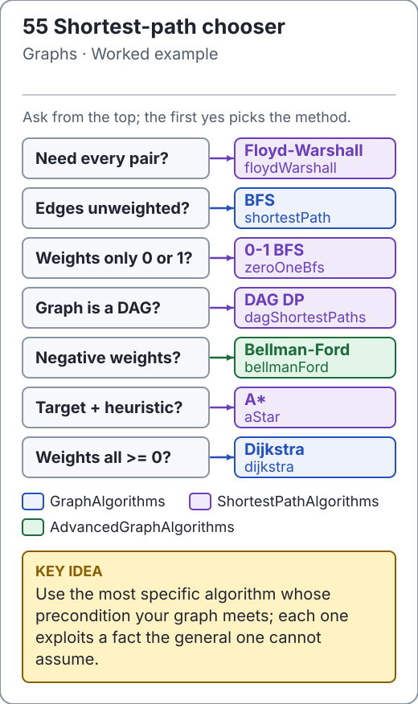
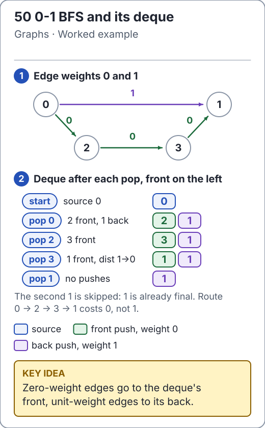
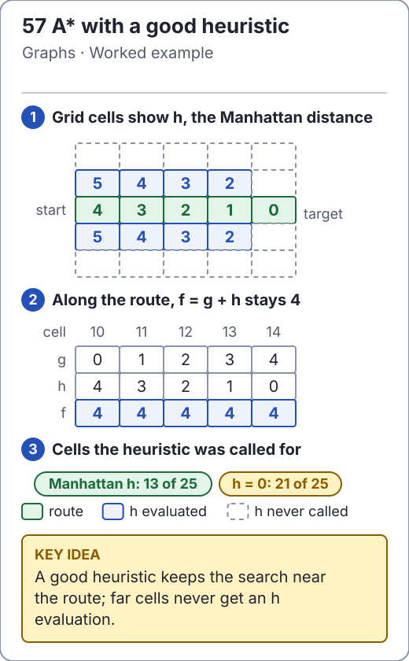
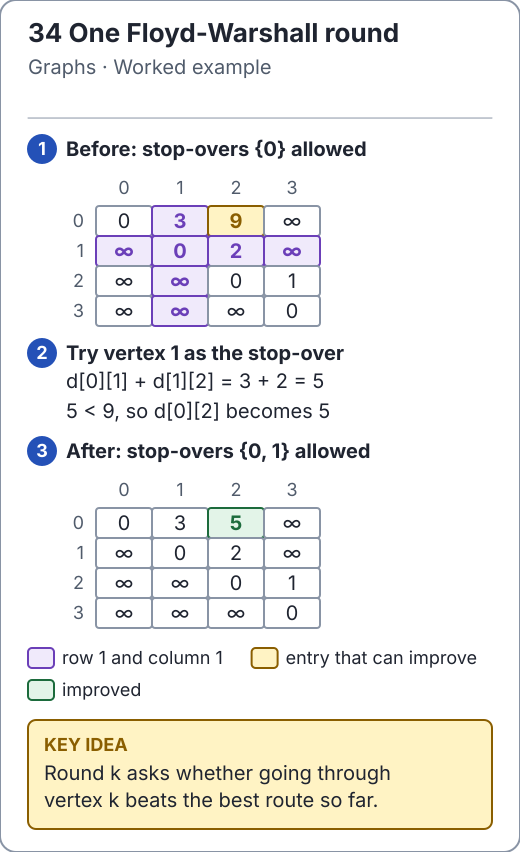
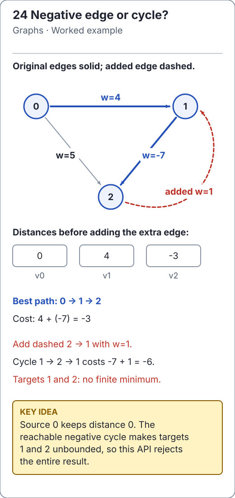

# Shortest-path toolkit: 0-1 BFS, DAGs, A* and Floyd–Warshall

Purpose: pick the cheapest correct shortest-path algorithm for the structure you
actually have. [ShortestPathAlgorithms](../../src/main/java/io/github/ichillous/dsa/graphs/ShortestPathAlgorithms.java)
adds four specialised tools to the [BFS](bfs.md) lesson's Dijkstra and Bellman–Ford
methods. All use the repository's
[WeightedGraph](../../src/main/java/io/github/ichillous/dsa/graphs/WeightedGraph.java):
vertices `0..V-1`, `long` weights, parallel edges and self-loops allowed. Unreachable
vertices have empty distances and paths. Null graphs are rejected, bad vertices throw
`IndexOutOfBoundsException`, and a violated precondition throws
`IllegalArgumentException`. Inputs are never mutated; results are detached snapshots.
Read [DFS](dfs.md) for the topological-order idea used by the DAG method.

| At a glance | |
| --- | --- |
| **Use it when** | You know something about the graph (weights 0 or 1, acyclic, a target with a heuristic, all pairs wanted) that lets a specialised method beat the general one. |
| **Avoid it when** | The general method already meets your size: Dijkstra for nonnegative weights needs no special structure. |
| **Cost** | 0-1 BFS and DAG paths O(V + E); A* O(V + E log(E + 1)) worst case plus heuristic calls; Floyd–Warshall O(V³). |
| **In this repo** | [`ShortestPathAlgorithms`](../../src/main/java/io/github/ichillous/dsa/graphs/ShortestPathAlgorithms.java): `zeroOneBfs`, `dagShortestPaths`, `aStar`, `floydWarshall` |
| **In the JDK** | no direct equivalent; `ArrayDeque` (0-1 BFS) and `PriorityQueue` (Dijkstra, A*) are the building blocks |

## Decision table

| Graph | Algorithm |
| --- | --- |
| unweighted | BFS |
| 0/1 weights | 0-1 BFS |
| nonnegative weights | Dijkstra |
| heuristic available | A* |
| DAG | topological DP |
| negative weights | Bellman–Ford |
| all pairs | Floyd–Warshall |
| sparse all-pairs | Johnson, not implemented here |

Choose the most specific row that applies; each more specific algorithm exploits a
structural fact that the general one cannot assume. Ask the questions in the diagram's order, which
reaches the most specific correct method first; the table lists the same methods.

<!-- visual:generated shortest-path-chooser | Ask the questions from the top; each answer is the algorithm and the repository method that implements it. -->
<picture><source media="(prefers-color-scheme: dark)" srcset="../../docs/visuals/assets/shortest-path-chooser-dark.svg"></picture>

**Figure 61.** Ask the questions from the top; each answer is the algorithm and the repository method that implements it. [Visual index and step-throughs](../../docs/visuals/README.md).
<!-- /visual:generated -->

## The invariants

* **0-1 BFS.** A deque holds vertices in nondecreasing distance order. A weight-0
  edge pushes to the front (same distance), a weight-1 edge to the back (one more).
  The first time a vertex leaves the deque its distance is final. Every edge in the
  whole graph must be 0 or 1.
* **DAG DP.** Process vertices in topological order; when a vertex is processed all
  its predecessors are done, so its label is final. Negative weights are fine because
  no cycle exists. The graph must be directed and acyclic everywhere, including parts
  unreachable from the source.
* **A\*.** With heuristic `h`, expand by `f = g + h`. If `h(target) = 0` and
  `h(u) <= w(u,v) + h(v)` on every edge (consistency), `f` never decreases along a
  path, so a vertex leaves the queue with its optimal `g` and is never reopened. The
  implementation verifies `h >= 0`, `h(target) = 0` and consistency on every edge it
  scans, and throws `IllegalArgumentException` on a violation. It cannot verify edges
  the search never scans, so a heuristic is still your responsibility.
* **Floyd–Warshall.** After the round that allows vertex `k` (rounds run for
  `k = 0, 1, ...`), `d[i][j]` is the shortest walk from `i` to `j` using only
  intermediate vertices `0..k`; before the first round there are none. Any `d[i][i] < 0` is a negative cycle
  and is rejected, anywhere in the graph; a negative undirected edge is such a cycle.

## Worked trace: 0-1 BFS

```text
edges: 0 -1-> 1,  0 -0-> 2,  2 -0-> 3,  3 -0-> 1
start          deque [0]            dist 0:0
pop 0: 0->1 (w=1) back, 0->2 (w=0) front     deque [2, 1]   dist 1:1, 2:0
pop 2: 2->3 (w=0) front                      deque [3, 1]   dist 3:0
pop 3: 3->1 (w=0) improves 1 from 1 to 0    deque [1, 1]   dist 1:0
pop 1: final; the duplicate 1 is skipped
path to 1: 0 -> 2 -> 3 -> 1, distance 0
```

<!-- visual:generated zero-one-bfs-deque | The deque after each pop on the trace below: zero-weight targets go to the front, unit-weight targets to the back. -->
<picture><source media="(prefers-color-scheme: dark)" srcset="../../docs/visuals/assets/zero-one-bfs-deque-dark.svg"></picture>

**Figure 62.** The deque after each pop on the trace below: zero-weight targets go to the front, unit-weight targets to the back. [Visual index and step-throughs](../../docs/visuals/README.md).
<!-- /visual:generated -->

## Executable example: 0-1 BFS and DAG paths

```java
import io.github.ichillous.dsa.graphs.ShortestPathAlgorithms;
import io.github.ichillous.dsa.graphs.WeightedGraph;
import java.util.List;
import java.util.OptionalLong;

var grid = WeightedGraph.directed(5)
        .addEdge(0, 1, 1).addEdge(0, 2, 0).addEdge(2, 3, 0).addEdge(3, 1, 0);
var tree = ShortestPathAlgorithms.zeroOneBfs(grid, 0);
assert tree.distanceTo(1).equals(OptionalLong.of(0));
assert tree.pathTo(1).equals(List.of(0, 2, 3, 1));
assert tree.distanceTo(4).isEmpty();

var dag = WeightedGraph.directed(4)
        .addEdge(0, 1, 4).addEdge(0, 2, 5).addEdge(1, 2, -3).addEdge(2, 3, 2);
var signed = ShortestPathAlgorithms.dagShortestPaths(dag, 0);
assert signed.distanceTo(3).equals(OptionalLong.of(3));
assert signed.pathTo(3).equals(List.of(0, 1, 2, 3));
```

## Longest path in a DAG by negation

Longest simple paths are NP-hard in general, but in a DAG negating every weight turns
a longest path into a shortest path. Signed weights are exactly what the DAG method
accepts.

```java
import io.github.ichillous.dsa.graphs.ShortestPathAlgorithms;
import io.github.ichillous.dsa.graphs.WeightedGraph;
import java.util.List;

// Task durations: the longest chain 0 -> 1 -> 3 takes 3 + 4 = 7.
long[][] edges = {{0, 1, 3}, {0, 2, 2}, {1, 3, 4}, {2, 3, 1}};
var negated = WeightedGraph.directed(4);
for (long[] edge : edges) {
    negated.addEdge((int) edge[0], (int) edge[1], -edge[2]);
}
var tree = ShortestPathAlgorithms.dagShortestPaths(negated, 0);
assert -tree.distanceTo(3).orElseThrow() == 7L;
assert tree.pathTo(3).equals(List.of(0, 1, 3));
```

Negation is only safe where `Long.MIN_VALUE` cannot occur; this method itself stays
exact, but `-Long.MIN_VALUE` in your own code overflows.

## Executable example: A* and Floyd–Warshall

```java
import io.github.ichillous.dsa.graphs.ShortestPathAlgorithms;
import io.github.ichillous.dsa.graphs.WeightedGraph;
import java.util.List;
import java.util.OptionalLong;

// A 3x3 grid with unit edges, cell = row * 3 + col; the target is cell 8 (row 2, col 2).
var grid = WeightedGraph.undirected(9);
for (int row = 0; row < 3; row++) {
    for (int col = 0; col < 3; col++) {
        if (col < 2) grid.addEdge(row * 3 + col, row * 3 + col + 1, 1);
        if (row < 2) grid.addEdge(row * 3 + col, (row + 1) * 3 + col, 1);
    }
}
var route = ShortestPathAlgorithms.aStar(grid, 0, 8,
        v -> Math.abs(v / 3 - 2) + Math.abs(v % 3 - 2)).orElseThrow();
assert route.distance() == 4L;
assert route.path().size() == 5;

var graph = WeightedGraph.directed(3).addEdge(0, 1, 4).addEdge(1, 2, -1).addEdge(0, 2, 5);
var all = ShortestPathAlgorithms.floydWarshall(graph);
assert all.distance(0, 2).equals(OptionalLong.of(3));
assert all.path(0, 2).equals(List.of(0, 1, 2));
assert all.distance(2, 0).isEmpty();
assert all.distance(1, 1).equals(OptionalLong.of(0));
```

A* counts only what the heuristic function reveals. `aStar` evaluates `h` at most once per vertex, so counting calls to the function you pass counts the vertices the search reached. The figure compares the Manhattan heuristic with `h = 0`, which orders the queue by `g` alone (ties by vertex number, so the count depends on the library's tie-break), as Dijkstra does; it does not claim which cells were expanded, because the public API does not expose that.

<!-- visual:generated astar-heuristic | A* on a 5 by 5 grid: along the route f = g + h is constant, and the heuristic is called for fewer cells than with h = 0. -->
<picture><source media="(prefers-color-scheme: dark)" srcset="../../docs/visuals/assets/astar-heuristic-dark.svg"></picture>

**Figure 63.** A* on a 5 by 5 grid: along the route f = g + h is constant, and the heuristic is called for fewer cells than with h = 0. [Visual index and step-throughs](../../docs/visuals/README.md).
<!-- /visual:generated -->

Floyd–Warshall improves a matrix of distances one stop-over vertex at a time. The figure shows one round on a four-vertex graph: allowing vertex 1 as a stop-over changes exactly one entry.

<!-- visual:generated floyd-warshall-via | One Floyd-Warshall round: d[0][2] improves from 9 to 5 once vertex 1 may be used as a stop-over. -->
<picture><source media="(prefers-color-scheme: dark)" srcset="../../docs/visuals/assets/floyd-warshall-via-dark.svg"></picture>

**Figure 64.** One Floyd-Warshall round: d[0][2] improves from 9 to 5 once vertex 1 may be used as a stop-over. [Visual index and step-throughs](../../docs/visuals/README.md).
<!-- /visual:generated -->

## Negative weights

`dijkstra` and `aStar` reject any negative edge, and `zeroOneBfs` accepts only weights 0 and 1. A negative edge without a negative cycle reachable from the source is fine for `dagShortestPaths` (on a DAG) and for [`AdvancedGraphAlgorithms.bellmanFord`](../../src/main/java/io/github/ichillous/dsa/graphs/AdvancedGraphAlgorithms.java) (see the [BFS lesson](bfs.md)); a reachable negative cycle makes distances meaningless, and this repository rejects it.

<!-- visual:generated bellman-negative -->
<picture><source media="(prefers-color-scheme: dark)" srcset="../../docs/visuals/assets/bellman-negative-dark.svg"></picture>

**Figure 24.** A negative edge yields -3; an added cycle makes targets 1 and 2 unbounded. [Visual index and step-throughs](../../docs/visuals/README.md).
<!-- /visual:generated -->

## Costs

| Method | Time | Auxiliary space | Notes |
| --- | --- | --- | --- |
| `zeroOneBfs` | O(V + E) | O(V + E) | distances at most `V-1`, no overflow |
| `dagShortestPaths` | O(V + E) arithmetic operations | O(V + E) | exact `BigInteger` labels, final `longValueExact` |
| `aStar` | O(V + E log(E + 1)) worst case, plus heuristic calls | O(V + E) | good `h` expands far fewer vertices than Dijkstra |
| `floydWarshall` | O(V³) | O(V²) | exact arithmetic; stops at the first `d[i][i] < 0` |

The DAG and Floyd–Warshall methods use exact `BigInteger` intermediates like
Bellman–Ford, so an overflowing detour never produces a wrong answer. Only final
reachable distances must fit in `long`; otherwise `ArithmeticException`. A reachable
`Long.MAX_VALUE` is valid. A\* follows Dijkstra's policy for `g`: overflowing detours
are ignored, and `ArithmeticException` is thrown if the target is reachable but every
route exceeds `long`. Its priority `f = g + h` is the exact sum: because `0 <= g, h <= 2^63-1` it fits in
an unsigned 64-bit value and is compared with `Long.compareUnsigned`. Capping `f` at
`Long.MAX_VALUE` would tie entries that differ, letting a vertex with a larger `f`
expand before the target; exact ordering keeps expansion order independent of
that cap.

## Counterexample: an inconsistent heuristic

On the path `0 -> 1 -> 2` with unit weights, `h(0) = 5` and `h(1) = h(2) = 0` makes
`h(0) > w(0,1) + h(1)`. The heuristic is not even admissible (the true remaining cost
is 2), and A\* could return a suboptimal route on larger graphs. This library throws
`IllegalArgumentException` at the first scanned violating edge instead. Likewise, 0-1
BFS rejects weight 2: splitting it into two weight-1 edges changes the vertex count, and
silently treating it as 1 would return wrong distances.

## In real Java

`ArrayDeque` is the JDK deque for 0-1 BFS: `addFirst` and `addLast` give the two push ends and `null` elements are rejected. `PriorityQueue` has no decrease-key operation, and its `remove(Object)` takes linear time, so Dijkstra-style code adds a cheaper duplicate entry and skips stale ones when they are polled, which is what the lazy heap in this repository does.

```java
import java.util.ArrayDeque;
import java.util.ArrayList;
import java.util.Deque;
import java.util.List;
import java.util.PriorityQueue;

Deque<Integer> deque = new ArrayDeque<>();
deque.addLast(1);  // a weight-1 edge: back
deque.addFirst(2); // a weight-0 edge: front
assert deque.peekFirst() == 2 && deque.peekLast() == 1;
boolean rejectsNull = false;
try {
    deque.addFirst(null);
} catch (NullPointerException expected) {
    rejectsNull = true;
}
assert rejectsNull;

long[] best = {Long.MAX_VALUE, Long.MAX_VALUE};
PriorityQueue<long[]> heap = new PriorityQueue<>((a, b) -> Long.compare(a[1], b[1]));
heap.add(new long[] {1, 10});
best[1] = 10;
heap.add(new long[] {1, 3}); // a cheaper route found later: add, do not update
best[1] = 3;
List<Long> settled = new ArrayList<>();
while (!heap.isEmpty()) {
    long[] entry = heap.poll();
    if (entry[1] == best[(int) entry[0]]) {
        settled.add(entry[1]);
    } // else a stale entry, skipped
}
assert settled.equals(List.of(3L));
```

## Common mistakes

1. **Feeding 0-1 BFS a weight of 2.** `WeightedGraph.directed(4).addEdge(0, 1, 1).addEdge(2, 3, 2)` makes `zeroOneBfs(graph, 0)` throw `IllegalArgumentException`, although the weight-2 edge is unreachable from 0. The deque is sorted by distance only while every edge adds 0 or 1.
2. **Passing an overestimating heuristic to A\*.** On the unit path `0 -> 1 -> 2` with `h(0) = 5` and `h(1) = h(2) = 0`, the true remaining cost from 0 is 2. This breaks `h(u) <= w(u, v) + h(v)`, and `aStar` throws `IllegalArgumentException` at edge `0 -> 1`.
3. **Expecting the DAG method to ignore a cycle the source cannot reach.** `WeightedGraph.directed(4).addEdge(0, 1, 1).addEdge(2, 3, 1).addEdge(3, 2, 1)` makes `dagShortestPaths(graph, 0)` throw `IllegalArgumentException`: the graph must be acyclic as a whole, since a topological order exists only without cycles.

## Practice

1. Reduce a weight-2 edge graph to 0-1 BFS by inserting intermediate vertices, and
   compare the result with Dijkstra.
2. Build a grid where Manhattan distance is a consistent heuristic, then one where
   blocked cells make Euclidean distance still consistent. Count vertices expanded by
   A\* versus Dijkstra.
3. Add a negative cycle in a component the source cannot reach: show Bellman–Ford from
   that source ignores it while Floyd–Warshall rejects the graph.

## Check yourself

<details>
<summary>Why does a weight-0 edge push to the front of the deque and a weight-1 edge to the back?</summary>

The deque holds vertices in nondecreasing distance order. A zero-weight target has the same distance as the current vertex, so it belongs at the front; a unit-weight target is one farther, so it belongs at the back.

</details>

<details>
<summary>What does `f = g + h` stay at along an optimal route when the heuristic is consistent and the grid has unit edges?</summary>

The optimal route length. In the figure `f` is 4 for every cell from 10 to 14, because each step raises `g` by 1 and lowers the Manhattan `h` by 1.

</details>

<details>
<summary>Floyd–Warshall has just finished the round that allows vertex k. Which paths does `d[i][j]` now account for?</summary>

The shortest walks from i to j whose intermediate vertices all lie in 0 through k. That round asks whether `d[i][k] + d[k][j]` beats the current value.

</details>

Continue with the [catalog](../../docs/catalog.md) and the
[complexity guide](../../docs/complexity.md). The oracle tests for these methods are in
[ShortestPathAlgorithmsTest](../../src/test/java/io/github/ichillous/dsa/graphs/ShortestPathAlgorithmsTest.java). The [solution finder](../../docs/solution-finder.md#15-shortest-paths) compares this technique with its alternatives.
