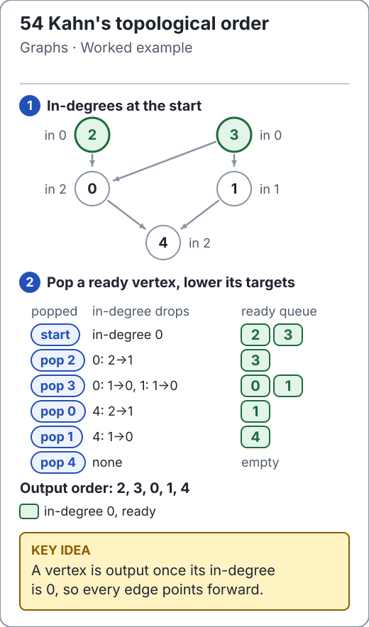

# Topological sort: order work so prerequisites come first

A topological order lists the vertices of a directed graph so that every edge `u -> v` has `u` before `v`. It exists exactly when the graph has no directed cycle. [`GraphAlgorithms.topologicalSort`](../../src/main/java/io/github/ichillous/dsa/graphs/GraphAlgorithms.java) implements Kahn's algorithm on the repository's fixed-vertex [`Graph`](../../src/main/java/io/github/ichillous/dsa/graphs/Graph.java).

| At a glance | |
| --- | --- |
| **Use it when** | Work has prerequisites: build steps, course plans, spreadsheet cells, any "A before B" rules that must all hold. |
| **Avoid it when** | The graph is undirected or may contain a cycle you need to explain (use `directedCycle` for the witness), or you only need reachability. |
| **Cost** | O(V + E) time and auxiliary space. |
| **In this repo** | [`GraphAlgorithms.topologicalSort`](../../src/main/java/io/github/ichillous/dsa/graphs/GraphAlgorithms.java); the witness is [`GraphStructureAlgorithms.directedCycle`](../../src/main/java/io/github/ichillous/dsa/graphs/GraphStructureAlgorithms.java) |
| **In the JDK** | no direct equivalent; `ArrayDeque` or `PriorityQueue` holds the ready vertices |

## Purpose and preconditions

The graph must be directed and acyclic. The method rejects an undirected graph and any directed cycle, including a self-loop, with `IllegalArgumentException`; it never returns a partial order. An empty graph has an empty order, isolated vertices appear in the order, and the input is not modified. A null graph is rejected.

## The invariant

Kahn's algorithm keeps an in-degree count for every vertex and a FIFO queue of the vertices whose count is zero. Whenever a vertex is popped and output, every target of its outgoing edges loses one from its count; a count that reaches zero joins the queue. Invariant: a vertex is output only when all of its predecessors have already been output, so every edge points forward in the output. If fewer than V vertices come out, the unprocessed vertices all lie on or behind a directed cycle, and the method throws.

<!-- visual:generated topological-kahn | Kahn's algorithm on a five-vertex DAG: in-degrees, the ready queue after each pop, and the output order. -->
<picture><source media="(prefers-color-scheme: dark)" srcset="../../docs/visuals/assets/topological-kahn-dark.svg"></picture>

**Figure 30.** Kahn's algorithm on a five-vertex DAG: in-degrees, the ready queue after each pop, and the output order. [Visual index and step-throughs](../../docs/visuals/README.md).
<!-- /visual:generated -->

## Worked trace

```text
edges: 2->0, 3->0, 3->1, 0->4, 1->4        in-degrees: 0:2 1:1 2:0 3:0 4:2
start      ready [2, 3]
pop 2      0: 2->1                          ready [3]
pop 3      0: 1->0, 1: 1->0                 ready [0, 1]
pop 0      4: 2->1                          ready [1]
pop 1      4: 1->0                          ready [4]
pop 4      no targets                       ready []
output 2, 3, 0, 1, 4: five of five vertices, so the graph is acyclic
```

## Executable example: the order and the cycle case

Ready vertices are seeded in ascending vertex order and taken first-in first-out, so the result is deterministic. Adding `4 -> 3` closes the cycle `0 -> 4 -> 3 -> 0`: `topologicalSort` now throws, and `directedCycle` names the loop.

```java
import io.github.ichillous.dsa.graphs.Graph;
import io.github.ichillous.dsa.graphs.GraphAlgorithms;
import io.github.ichillous.dsa.graphs.GraphStructureAlgorithms;
import java.util.List;

Graph dag = Graph.directed(5)
        .addEdge(2, 0).addEdge(3, 0).addEdge(3, 1).addEdge(0, 4).addEdge(1, 4);
assert GraphAlgorithms.topologicalSort(dag).equals(List.of(2, 3, 0, 1, 4));
assert GraphStructureAlgorithms.directedCycle(dag).isEmpty();

dag.addEdge(4, 3);
boolean rejected = false;
try {
    GraphAlgorithms.topologicalSort(dag);
} catch (IllegalArgumentException expected) {
    rejected = true;
}
assert rejected;
assert GraphStructureAlgorithms.directedCycle(dag).orElseThrow().equals(List.of(0, 4, 3));
```

## Uses

* **Build order.** Tasks are vertices and "needs" is an edge from prerequisite to dependent. Any topological order is a valid build sequence, and several can exist.
* **Course prerequisites.** Decide the edge direction first: `algebra -> calculus` means algebra comes before calculus. A cycle means the requirements are contradictory, and `directedCycle` names one cycle (the first it finds) so you can see which courses conflict.
* **DAG shortest paths.** [`ShortestPathAlgorithms.dagShortestPaths`](../../src/main/java/io/github/ichillous/dsa/graphs/ShortestPathAlgorithms.java) relaxes edges in topological order, so negative weights are fine and the cost is O(V + E). See the [shortest-path toolkit](shortest-paths.md).

Real data has labels, not integers. Number the labels, sort, then translate back:

```java
import io.github.ichillous.dsa.graphs.Graph;
import io.github.ichillous.dsa.graphs.GraphAlgorithms;
import java.util.ArrayList;
import java.util.List;

String[] tasks = {"compile", "test", "package", "deploy"};
Graph build = Graph.directed(4)
        .addEdge(0, 1).addEdge(0, 2).addEdge(1, 3).addEdge(2, 3);
List<String> plan = new ArrayList<>();
for (int task : GraphAlgorithms.topologicalSort(build)) {
    plan.add(tasks[task]);
}
assert plan.equals(List.of("compile", "test", "package", "deploy"));
```

## In real Java

The JDK has no topological sort. The library's order is only one of many valid ones; if you need the smallest vertex number among the ready vertices each time, replace the FIFO queue with a `PriorityQueue`, whose `poll` returns the least element. The two orders below differ, and both place every edge forward.

```java
import io.github.ichillous.dsa.graphs.Graph;
import io.github.ichillous.dsa.graphs.GraphAlgorithms;
import java.util.ArrayList;
import java.util.List;
import java.util.PriorityQueue;

Graph graph = Graph.directed(4).addEdge(1, 0).addEdge(2, 3);
int[] indegree = new int[4];
for (int vertex = 0; vertex < 4; vertex++) {
    for (int target : graph.neighbors(vertex)) {
        indegree[target]++;
    }
}
PriorityQueue<Integer> ready = new PriorityQueue<>();
for (int vertex = 0; vertex < 4; vertex++) {
    if (indegree[vertex] == 0) {
        ready.add(vertex);
    }
}
List<Integer> smallestFirst = new ArrayList<>();
while (!ready.isEmpty()) {
    int vertex = ready.poll();
    smallestFirst.add(vertex);
    for (int target : graph.neighbors(vertex)) {
        if (--indegree[target] == 0) {
            ready.add(target);
        }
    }
}
assert smallestFirst.equals(List.of(1, 0, 2, 3));
assert GraphAlgorithms.topologicalSort(graph).equals(List.of(1, 2, 0, 3));
```

A `PriorityQueue` makes the algorithm O(V log V + E) instead of O(V + E).

## Costs

| Operation | Time | Auxiliary space | Notes |
| --- | --- | --- | --- |
| `topologicalSort` | O(V + E) | O(V + E) | in-degree array, ready queue, adjacency snapshots, result |
| `directedCycle` | O(V + E) | O(V + E) | iterative DFS, returns the first cycle found |
| Heap-based variant above | O(V log V + E) | O(V + E) | lets you choose which ready vertex comes next |

## Pitfall: a DFS discovery order is not a topological order

On `0 -> 1, 0 -> 2, 2 -> 1`, `depthFirst` from 0 returns `[0, 1, 2]`, but edge `2 -> 1` points backward. `topologicalSort` returns `[0, 2, 1]`. Reversing a discovery order does not repair it in general; only finish times (or Kahn's in-degree rule) give a valid order. The order is also not unique: `[1, 2, 0, 3]` and `[1, 0, 2, 3]` both satisfy the edges `1 -> 0` and `2 -> 3`, so tests should check that every edge points forward rather than compare against one arbitrary order.

## Practice

1. Model four courses where two have prerequisites and write a test that checks every edge goes forward in the result, instead of comparing to one fixed order.
2. Add one edge to a valid DAG so that it becomes cyclic and assert that `topologicalSort` throws while `directedCycle` returns a loop whose consecutive vertices are edges.
3. Compute the longest chain from one source in a DAG of task durations by negating weights and calling `dagShortestPaths`, then compare with a brute-force search on a five-vertex graph.

## Check yourself

<details>
<summary>What does it prove if Kahn's algorithm outputs fewer than V vertices?</summary>

The remaining vertices lie on or behind a directed cycle: none of them can reach in-degree zero, because each waits for a predecessor that never gets output.

</details>

<details>
<summary>Is the topological order of a DAG unique?</summary>

Not in general. It is unique only when the graph forces a single order, for example a chain. `[1, 2, 0, 3]` and `[1, 0, 2, 3]` are both valid for `1 -> 0, 2 -> 3`.

</details>

<details>
<summary>Why can `dagShortestPaths` handle negative weights when Dijkstra cannot?</summary>

It processes vertices in topological order, so when a vertex is processed every predecessor is already final; no cycle exists to make a negative edge keep lowering earlier labels.

</details>

Continue with the [graph catalog](../../docs/catalog.md), the [complexity guide](../../docs/complexity.md) and the [solution finder](../../docs/solution-finder.md#14-graph-traversal-and-structure), then the [DFS lesson](dfs.md) for finishing order and the [shortest-path toolkit](shortest-paths.md).
