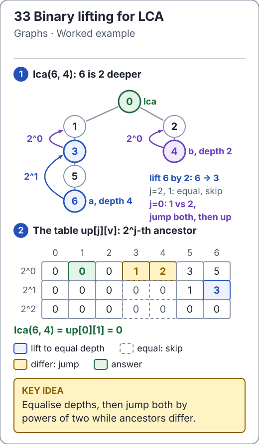
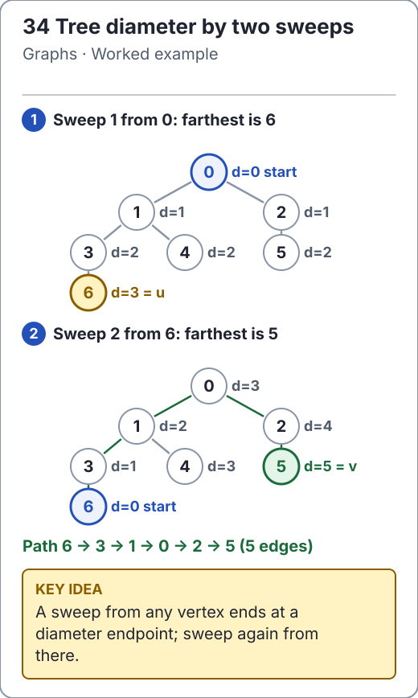

# Tree queries: lowest common ancestor and diameter

A tree on `V` vertices is a connected undirected graph with exactly `V - 1` edges.
Two maintained classes answer pairwise and whole-tree questions on the repository's
[Graph](../../src/main/java/io/github/ichillous/dsa/graphs/Graph.java):
[LowestCommonAncestor](../../src/main/java/io/github/ichillous/dsa/graphs/LowestCommonAncestor.java)
(binary lifting) and
[TreeAlgorithms](../../src/main/java/io/github/ichillous/dsa/graphs/TreeAlgorithms.java)
(`diameterPath`).

| At a glance | |
| --- | --- |
| **Use it when** | You ask many questions about one fixed tree: lowest common ancestor, distance between two vertices, k-th ancestor, or the longest path. |
| **Avoid it when** | The graph has a cycle or several components (the classes reject it) or the tree changes between queries. |
| **Cost** | Build O(V log V); each LCA, distance or k-th-ancestor query O(log V); `diameterPath` O(V). |
| **In this repo** | [`LowestCommonAncestor`](../../src/main/java/io/github/ichillous/dsa/graphs/LowestCommonAncestor.java), [`TreeAlgorithms.diameterPath`](../../src/main/java/io/github/ichillous/dsa/graphs/TreeAlgorithms.java) |
| **In the JDK** | No direct equivalent. |

**Preconditions.** The graph must be undirected, non-empty, connected and have
exactly `V - 1` edges; anything else throws `IllegalArgumentException`. A
self-loop counts as an edge in `Graph.edgeCount()`, so it makes the graph a
non-tree, as does a cycle, a second component or a directed graph. A root that is
not a vertex throws `IndexOutOfBoundsException`. Neither class retains or mutates
the graph, and every traversal is iterative, so a 100,000-vertex path is safe.

## Invariant: binary lifting

Root the tree. Store `up[j][v]`, the `2^j`-th ancestor of `v`, where the root is its
own ancestor. Level 0 comes from a BFS, and `up[j][v] = up[j-1][ up[j-1][v] ]`.
Any climb of `k` edges is the sum of the powers of two in `k`, so it takes at most
`log2(V) + 1` table jumps. To find `lca(a, b)`:

1. Lift the deeper vertex until both have equal depth. If they now coincide, done.
2. For `j` from high to low, if `up[j][a] != up[j][b]`, move both up. Equal
   ancestors may be at or above the answer, so unequal ones are strictly below it
   and the jump never overshoots.
3. The answer is the shared parent `up[0][a]`.

`distance(a, b) = depth(a) + depth(b) - 2 * depth(lca(a, b))`.

<!-- visual:generated lca-binary-lifting -->
<picture><source media="(prefers-color-scheme: dark)" srcset="../../docs/visuals/assets/lca-binary-lifting-dark.svg"></picture>

**Figure 33.** In a seven-vertex tree rooted at 0, lca(6, 4) lifts vertex 6 by 2 to vertex 3, finds the 2^2 and 2^1 ancestors equal, jumps both vertices by 2^0 to 1 and 2, and returns their parent 0, read from the table of 2^j-th ancestors. [Visual index and step-throughs](../../docs/visuals/README.md).
<!-- /visual:generated -->

```text
        0
      /   \          depth: 0 -> 0;  1, 2 -> 1;  3, 4, 5 -> 2
     1     2         up[0]: 1->0  2->0  3->1  4->1  5->2
    / \     \        up[1]: 3->0  4->0  5->0
   3   4     5

lca(3, 4): equal depth; up[1][3] = up[1][4] = 0 so no jump;
           up[0][3] = up[0][4] = 1 so no jump; answer up[0][3] = 1
lca(3, 5): equal depth; up[1] equal (0, 0) so no jump;
           up[0][3] = 1 != up[0][5] = 2 so move to 1 and 2; answer up[0][1] = 0
distance(3, 5) = 2 + 2 - 2 * 0 = 4
kthAncestor(3, 2): binary 10, so one jump up[1][3] = 0
```

```java
import io.github.ichillous.dsa.graphs.Graph;
import io.github.ichillous.dsa.graphs.LowestCommonAncestor;
import io.github.ichillous.dsa.graphs.TreeAlgorithms;
import java.util.List;
import java.util.OptionalInt;

var tree = Graph.undirected(6).addEdge(0, 1).addEdge(0, 2)
        .addEdge(1, 3).addEdge(1, 4).addEdge(2, 5);
var lca = new LowestCommonAncestor(tree, 0);
assert lca.lca(3, 4) == 1;
assert lca.lca(3, 5) == 0;
assert lca.lca(1, 4) == 1;
assert lca.depth(5) == 2;
assert lca.distance(3, 5) == 4;
assert lca.kthAncestor(3, 2).equals(OptionalInt.of(0));
assert lca.kthAncestor(3, 3).isEmpty();
assert TreeAlgorithms.diameterPath(tree).equals(List.of(3, 1, 0, 2, 5));
assert TreeAlgorithms.diameterPath(Graph.undirected(1)).equals(List.of(0));
```

`kthAncestor(v, k)` is empty when `k > depth(v)` and throws for negative `k`.
Re-rooting changes depths and answers, so choose the root deliberately.

## Diameter by two BFS sweeps

`diameterPath` runs BFS from vertex 0, takes a farthest vertex `u`, runs BFS from
`u`, and takes a farthest vertex `v`. The path `u..v` is a longest path.

<!-- visual:generated tree-diameter -->
<picture><source media="(prefers-color-scheme: dark)" srcset="../../docs/visuals/assets/tree-diameter-dark.svg"></picture>

**Figure 34.** In a seven-vertex tree, a breadth-first sweep from vertex 0 ends farthest at 6, and a second sweep from 6 ends farthest at 5, so the path 6, 3, 1, 0, 2, 5 of 5 edges is a longest path. [Visual index and step-throughs](../../docs/visuals/README.md).
<!-- /visual:generated -->

*Proof sketch.* Let `x..y` be a diameter, `s` the start, `u` a farthest vertex from
`s`, and `m` the vertex of `x..y` nearest `s`. If the tree path from `s` to `u`
passes through `m`, then `d(s,u) >= d(s,y)` gives `d(m,u) >= d(m,y)`, so
`d(x,u) = d(x,m) + d(m,u) >= d(x,y)`. Otherwise it leaves the path `s..m` at some
`w != m`, and `d(w,u) >= d(w,m) + d(m,y)` gives
`d(x,u) = d(x,m) + d(m,w) + d(w,u) >= d(x,m) + d(m,y) = d(x,y)`. Either way a
diameter ends at `u`, and repeating the argument from `u` shows that a farthest
vertex from `u` ends one too. Unique paths are essential, so trees qualify
and graphs with cycles do not.

**Ties are deterministic.** Each sweep picks the smallest-numbered farthest vertex,
and the list runs from the first endpoint to the second. For edges `0-1`, `0-2`
the farthest vertices from 0 are 1 and 2, the smaller is 1, and from 1 the farthest
is 2, so the result is `[1, 0, 2]`. Other diameters may exist, so when comparing with
other implementations validate length and edges instead of expecting one path.

## Costs

| Operation | Time | Space |
| --- | --- | --- |
| Constructor (validation, BFS, lifting table) | O(V log V) | O(V log V) |
| `lca`, `distance`, `kthAncestor` | O(log V) | O(1) |
| `depth` | O(1) | O(1) |
| `diameterPath` (including validation) | O(V) | O(V), including adjacency snapshots |

Not implemented here: the **Euler tour** with a sparse table gives O(1) LCA
queries after O(V log V) preprocessing, and **heavy-light decomposition** supports
path aggregates and updates in O(log^2 V). Both build on the same rooted-tree
model.

## Pitfall

Double BFS is wrong on a graph with a cycle: a farthest vertex need not be a
diameter endpoint, and shortest-path distances no longer equal tree-path lengths.
The classes therefore reject non-trees instead of guessing. A self-loop leaves a
graph connected with `V` edges; the edge-count check is what rejects it.

## In real Java

The JDK has no tree-query class; `java.util.TreeMap` and `TreeSet` are balanced
search trees for ordered keys, not for arbitrary rooted trees. The classes here
return `OptionalInt` from `kthAncestor` instead of a sentinel, so "above the root"
cannot be mistaken for a vertex. The root you pick also decides every answer: the
same tree rooted elsewhere has other ancestors.

```java
import io.github.ichillous.dsa.graphs.Graph;
import io.github.ichillous.dsa.graphs.LowestCommonAncestor;
import java.util.OptionalInt;

var tree = Graph.undirected(6).addEdge(0, 1).addEdge(0, 2)
        .addEdge(1, 3).addEdge(1, 4).addEdge(2, 5);
assert new LowestCommonAncestor(tree, 0).lca(3, 5) == 0;
assert new LowestCommonAncestor(tree, 3).lca(3, 5) == 3;      // 3 is now the root
assert new LowestCommonAncestor(tree, 3).depth(5) == 4;
assert new LowestCommonAncestor(tree, 3).kthAncestor(5, 5).equals(OptionalInt.empty());
```

## Common mistakes

- **Skipping the depth equalization.** In the figure's tree, `lca(6, 3)` is 3, an
  ancestor of 6. Comparing ancestors without first lifting 6 to depth 2 makes the
  loop jump both vertices past 3 and return 0. The invariant "the vertices have
  equal depth before the high-to-low loop" is what keeps the loop from overshooting.
- **Editing the `Graph` after building the object.** The constructor reads the graph
  once and does not keep it. Add an edge afterwards and `lca` and `depth` still
  answer for the old tree; rebuild the object after changes.
- **Using `diameterPath` on a weighted tree.** It counts edges. For the star
  `0-1`, `0-2`, `0-3` with weights 1, 1 and 100, it returns `[1, 0, 2]`, but the
  heaviest path is `2-0-3` with weight 101.

## Practice

1. Compute `lca` for every pair in the six-vertex tree above by walking parents, then
   compare with the lifting table.
2. Build a tree with two diameters that share their middle vertex. Predict the path
   produced by the smallest-vertex tie rule, then check it.
3. Use `kthAncestor` to implement "jump to the ancestor at depth `d`" and explain
   why the query is empty when `d` exceeds the vertex's own depth.

## Check yourself

<details>
<summary>Why does the loop over <code>j</code> go from the highest level down, and why does it jump only when the ancestors differ?</summary>

Equal ancestors may sit at or above the answer, while different ones are strictly below it, so jumping only on a difference never overshoots. Going from high to low lets the jumps add up to the exact number of edges below the answer, like writing a number in binary.

</details>

<details>
<summary>What does the figure's table store, and why is the root its own ancestor at every level?</summary>

`up[j][v]` is the `2^j`-th ancestor of `v`. Making the root its own ancestor keeps the recurrence `up[j][v] = up[j-1][up[j-1][v]]` defined for every vertex, so a jump that would leave the tree stops at the root instead of failing.

</details>

<details>
<summary>Why does double BFS fail on a graph with a cycle?</summary>

The proof relies on a unique path between any two vertices. With a cycle, BFS distances are shortest-path distances, not tree-path lengths, and a farthest vertex need not end a longest simple path, which is why the classes reject non-trees.

</details>

Return to the [catalog](../../docs/catalog.md) or the
[complexity guide](../../docs/complexity.md), or continue with [DFS](dfs.md). The [solution finder](../../docs/solution-finder.md#17-trees-as-data) compares this technique with its alternatives.
