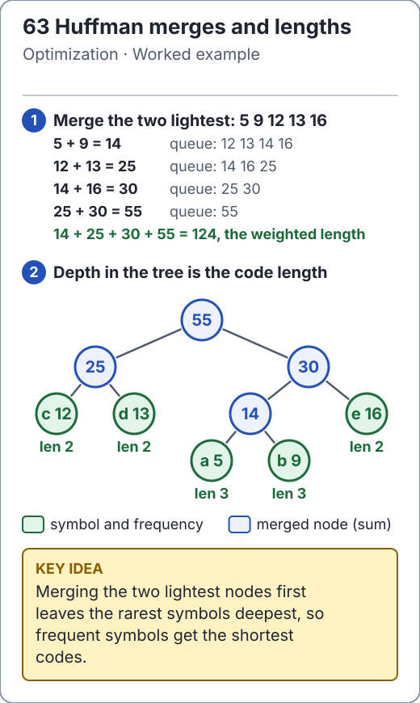

# Huffman coding

Use Huffman's algorithm to turn symbol frequencies into a **prefix code** of
minimum total length: no codeword is a prefix of another, so a bit stream decodes
without separators. The maintained
[GreedyAlgorithms](../../src/main/java/io/github/ichillous/dsa/algorithms/GreedyAlgorithms.java)
provides the two halves: `huffmanCodeLengths` computes how long each code should
be, and `canonicalCodes` turns lengths into actual bit strings. Splitting them
matches real formats such as DEFLATE, which store only the lengths and rebuild
the codes on both sides.

| At a glance | |
| --- | --- |
| **Use it when** | You know symbol frequencies and want the shortest prefix code with whole-bit codewords |
| **Avoid it when** | Frequencies are unknown or drifting (use an adaptive scheme), or fractional bits per symbol matter |
| **Cost** | O(n log n) time, O(n) space for the lengths |
| **In this repo** | [`GreedyAlgorithms.huffmanCodeLengths`](../../src/main/java/io/github/ichillous/dsa/algorithms/GreedyAlgorithms.java) and `canonicalCodes` |
| **In the JDK** | `java.util.zip.Deflater` and `Inflater` for ready-made compression; `PriorityQueue` for the merge loop |

Preconditions: frequencies are `long` values that are at least 0 (negative values
throw `IllegalArgumentException`), and null arrays are rejected. Inputs are never
modified and results are fresh arrays or immutable lists.

## What the methods return

| Case | `huffmanCodeLengths` |
| --- | --- |
| Frequency 0 | length 0: the symbol is unused and has no code |
| Exactly one used symbol | length 1, because a code needs at least one bit |
| No used symbols (or an empty array) | all zeros |
| Two or more used symbols | optimal lengths; they satisfy the Kraft equality `sum 2^-length = 1` |

`canonicalCodes(lengths)` returns `""` for length 0. Symbols are ordered by
length, then by index; the first code is all zeros, each next code is the
previous plus 1 in binary, and a longer length appends zeros. The lengths must
satisfy the Kraft inequality `sum 2^-length <= 1`, which is exactly when a prefix
code exists; otherwise `IllegalArgumentException` is thrown. Incomplete codes
(sum below 1) are accepted.

## The greedy step and its exchange argument

Repeatedly remove the two lowest-weight nodes, join them under a new node whose
weight is their sum, and put it back. When one node remains, a symbol's code
length is its depth in the tree.

Why the greedy merge is safe, as a sketch. Let `x` and `y` be the two least
frequent symbols. Take any optimal tree and a deepest pair of sibling leaves `a`
and `b`. Swapping `x` with `a` and `y` with `b` cannot increase the total cost,
because each swap moves a rarer symbol deeper and a more frequent one shallower
(the cost change is `(f_a - f_x)(depth_x - depth_a) <= 0` for each swap). So some
optimal tree has `x` and `y` as deepest siblings. Merging them into one symbol of
weight `f_x + f_y` gives a smaller instance whose optimal cost differs by exactly
`f_x + f_y`, so induction on the number of symbols completes the proof.

## Worked trace

```text
frequencies  A5  B9  C12  D13  E16  F45
merge 5 + 9    = 14      (A, B)
merge 12 + 13  = 25      (C, D)
merge 14 + 16  = 30      ((A,B), E)
merge 25 + 30  = 55      ((C,D), ((A,B),E))
merge 45 + 55  = 100     (F, rest)

lengths      A4 B4 C3 D3 E3 F1
cost         5*4 + 9*4 + 12*3 + 13*3 + 16*3 + 45*1 = 224
canonical    F "0"   C "100"  D "101"  E "110"  A "1110"  B "1111"
```

The same merging on five symbols, drawn as a tree. A symbol's code length is its
depth, and the sum of the merge weights equals the weighted length.

<!-- visual:generated huffman-tree -->
<picture><source media="(prefers-color-scheme: dark)" srcset="../../docs/visuals/assets/huffman-tree-dark.svg"></picture>

**Figure 63.** Five symbols with frequencies 5, 9, 12, 13 and 16 are merged two lightest at a time into a tree, which gives code lengths 3, 3, 2, 2 and 2 and a weighted length of 124. [Visual index and step-throughs](../../docs/visuals/README.md).
<!-- /visual:generated -->

Ties are broken deterministically: among equal weights, leaves (numbered by
symbol index) come before internal nodes, and internal nodes come in creation
order. Different tie rules give different but equally optimal lengths, so compare
total cost, not individual lengths, when checking another implementation.

## Executable example

```java
import io.github.ichillous.dsa.algorithms.GreedyAlgorithms;
import java.util.List;

long[] frequencies = {5, 9, 12, 13, 16, 45};
int[] lengths = GreedyAlgorithms.huffmanCodeLengths(frequencies);
assert java.util.Arrays.equals(lengths, new int[] {4, 4, 3, 3, 3, 1});
long cost = 0;
for (int i = 0; i < frequencies.length; i++) {
    cost += frequencies[i] * lengths[i];
}
assert cost == 224;

List<String> codes = GreedyAlgorithms.canonicalCodes(lengths);
assert codes.equals(List.of("1110", "1111", "100", "101", "110", "0"));

// Unused symbols get length 0 and an empty code; one used symbol gets one bit.
assert java.util.Arrays.equals(
        GreedyAlgorithms.huffmanCodeLengths(new long[] {0, 7, 0}), new int[] {0, 1, 0});
assert GreedyAlgorithms.canonicalCodes(new int[] {0, 1, 0}).equals(List.of("", "0", ""));

// Lengths that cannot form a prefix code are rejected.
boolean rejected = false;
try {
    GreedyAlgorithms.canonicalCodes(new int[] {1, 1, 1});
} catch (IllegalArgumentException expected) {
    rejected = true;
}
assert rejected;
```

## In real Java

Production code rarely writes its own Huffman coder. `java.util.zip.Deflater`
and `Inflater` provide general-purpose compression using the ZLIB library, whose
DEFLATE format combines Huffman codes with other techniques. `deflate` returns the
number of bytes it wrote, which may be fewer than the buffer holds, and `finished()`
reports completion after `finish()`.

```java
import java.nio.charset.StandardCharsets;
import java.util.Arrays;
import java.util.zip.DataFormatException;
import java.util.zip.Deflater;
import java.util.zip.Inflater;

byte[] input = "aaaaaaaaaabbbbbbbbbbaaaaaaaaaa".repeat(20).getBytes(StandardCharsets.UTF_8);
Deflater deflater = new Deflater();
deflater.setInput(input);
deflater.finish();
byte[] packed = new byte[input.length];
int packedLength = deflater.deflate(packed);
assert deflater.finished();
deflater.end();
assert packedLength < input.length;

Inflater inflater = new Inflater();
inflater.setInput(packed, 0, packedLength);
byte[] restored = new byte[input.length];
int restoredLength;
try {
    restoredLength = inflater.inflate(restored);
} catch (DataFormatException e) {
    throw new AssertionError(e);
}
inflater.end();
assert restoredLength == input.length;
assert Arrays.equals(input, restored);
```

## Costs

| Method | Time | Auxiliary space | Overflow behavior |
| --- | --- | --- | --- |
| `huffmanCodeLengths` | O(n log n) with a priority queue | O(n) | merged weights use checked addition; `ArithmeticException` if the total frequency exceeds `Long.MAX_VALUE` |
| `canonicalCodes` | O(n log n + sum of lengths) | O(sum of lengths) for the output | the Kraft check is exact integer arithmetic, so no overflow |

Lengths are at most the number of used symbols minus one. See the
[complexity guide](../../docs/complexity.md) for how these bounds are stated.

## Pitfalls and limits

- Huffman is optimal among prefix codes that assign one whole codeword to each
  symbol. A fixed 3-bit code for the six symbols above costs 300 bits against
  224, but arithmetic coding can still beat Huffman on skewed sources because it
  is not limited to whole bits per symbol.
- Frequencies need not be probabilities; any non-negative weights work, but they
  must describe the same stream you will encode.
- The code lengths are not unique when weights tie. Two correct implementations
  may disagree on lengths while agreeing on the total cost.
- Run-length encoding, which replaces repeated symbols with a (symbol, count)
  pair, is a different compression idea and is **not implemented here**.

## Practice

1. Build the tree by hand for frequencies `{1, 1, 2, 4}` and confirm the lengths
   `{3, 3, 2, 1}`, using the leaves-first tie rule when two weights match.
2. Assign canonical codes to lengths `{2, 2, 2, 3, 3}` and show that the codes
   are prefix-free.
3. Find lengths with Kraft sum above 1 that nonetheless look plausible, such as
   `{1, 2, 2, 2}`, and explain why no prefix code can have them.

## Check yourself

<details>
<summary>Why does Huffman merge the two lightest nodes rather than the two heaviest?</summary>

Rare symbols belong deepest, so they must be siblings at the bottom; merging them first gives a smaller instance whose optimum differs by exactly their combined weight.

</details>

<details>
<summary>What does `huffmanCodeLengths` return for frequencies `{0, 7, 0}`, and why?</summary>

`{0, 1, 0}`. Zero-frequency symbols are unused and get length 0, and a single used symbol still needs one bit.

</details>

<details>
<summary>Why can two correct Huffman implementations disagree on lengths but not on total cost?</summary>

Equal weights can be merged in different orders, giving different trees; every such tree is optimal, so the weighted length is the same.

</details>

Look up the structures and algorithms in the
[catalog](../../docs/catalog.md), the
[complexity guide](../../docs/complexity.md) and the
[greedy overview](overview.md). The [solution finder](../../docs/solution-finder.md#19-greedy) compares this technique with its alternatives.
