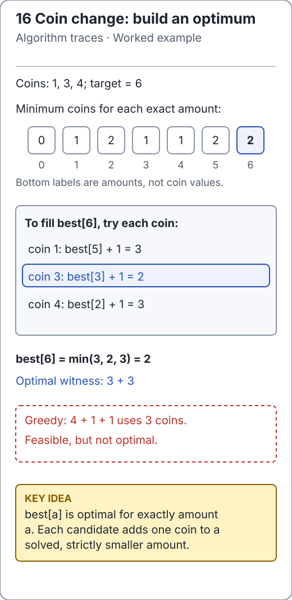

# Greedy choice across different objectives

A rule is correct for a particular feasible set and objective. Changing “number
of activities” to “total value,” or allowing item reuse, can invalidate its proof.
The examples below separate a maintained API from a small executable JDK exercise.

| At&nbsp;a&nbsp;glance | |
| --- | --- |
| **Use&nbsp;it&nbsp;when** | A cut-property or exchange argument covers your exact objective, as for Kruskal and Huffman merging. |
| **Avoid&nbsp;it&nbsp;when** | The objective or feasible set changed (values, reuse, arbitrary coins) and no proof was redone. |
| **Cost** | O(n log n) for the sort or heap in each example below |
| **In&nbsp;this&nbsp;repo** | [`GraphAlgorithms.minimumSpanningForest`](../../src/main/java/io/github/ichillous/dsa/graphs/GraphAlgorithms.java) and [`GreedyAlgorithms.huffmanCodeLengths`](../../src/main/java/io/github/ichillous/dsa/algorithms/GreedyAlgorithms.java) |
| **In&nbsp;the&nbsp;JDK** | `PriorityQueue` for the repeated "take the smallest" step |

## Coin change: a local rule that fails

<!-- visual:generated coin-dp -->
<picture><source media="(prefers-color-scheme: dark)" srcset="../../docs/visuals/assets/coin-dp-dark.svg"></picture>

**Figure 16.** Compare every final coin; the largest-first greedy choice loses. [Visual index and step-throughs](../../docs/visuals/README.md).
<!-- /visual:generated -->

For denominations `[1, 3, 4]` and amount 6, largest-first chooses `4 + 1 + 1`.
The optimum is `3 + 3`. Some coin systems admit a greedy rule, but arbitrary
positive denominations do not. Use the maintained
[DP formulation](../dynamic-programming/overview.md) when its numeric table fits.

```java
import io.github.ichillous.dsa.algorithms.DynamicProgramming;

int greedyCoinCount = 3; // 4 + 1 + 1 for this specific counterexample.
int optimalCoinCount = DynamicProgramming.minimumCoins(new int[] {1, 3, 4}, 6);
assert optimalCoinCount == 2;
assert greedyCoinCount > optimalCoinCount;
```

The DP uses O((c + 1)(a + 1)) time and O(a + 1) storage, with positive reusable
coins and nonnegative amount. A greedy counterexample is not a claim that every
DP is faster; it establishes that the local rule can return a wrong optimum.

## Kruskal: cheapest safe edge

For an undirected weighted graph, Kruskal scans edges by increasing weight and
adds an edge only when it joins different components. The invariant is an acyclic
selected forest extendable to a minimum spanning forest. The cut property
justifies the cheapest crossing edge; disjoint sets enforce acyclicity.

```java
import io.github.ichillous.dsa.graphs.GraphAlgorithms;
import io.github.ichillous.dsa.graphs.WeightedGraph;

var graph = WeightedGraph.undirected(4)
        .addEdge(0, 1, 4).addEdge(1, 2, -2).addEdge(0, 2, 5);
var forest = GraphAlgorithms.minimumSpanningForest(graph);
assert forest.totalWeight() == 2L;
assert forest.edges().size() == 2;
assert forest.components() == 2; // Vertex 3 is isolated.
assert forest.edges().size() == graph.vertexCount() - forest.components();
```

This maintained algorithm accepts signed weights and parallel edges, ignores
self-loops, rejects directed graphs and returns immutable snapshots. Time is
O(V + E log(E + 1)); working storage including output is O(V + E). Total weight is
accumulated exactly and must fit in `long` at completion. A disconnected graph has
a minimum **forest**, not a spanning tree joining vertices with nonexistent edges.
Prim's algorithm, which grows the forest from one vertex at a time, is compared with
Kruskal in [minimum spanning trees](../graph/minimum-spanning-trees.md).

## Huffman merging as a JDK exercise

For positive symbol frequencies, an optimal binary prefix-code tree can place
two least-frequent symbols at deepest sibling leaves. Merging them reduces to a
smaller instance. Each merge increases weighted code length by the combined
frequency, so summing merge weights gives the final weighted length.

```java
import java.util.List;
import java.util.PriorityQueue;

var frequencies = new PriorityQueue<Long>(List.of(5L, 9L, 12L, 13L, 16L, 45L));
long weightedLength = 0L;
while (frequencies.size() > 1) {
    long merged = Math.addExact(frequencies.remove(), frequencies.remove());
    weightedLength = Math.addExact(weightedLength, merged);
    frequencies.add(merged);
}
assert weightedLength == 224L;
assert frequencies.element() == 100L;
```

For `k` supplied frequencies, heap construction plus `k-1` merges costs O(k log k)
time and O(k) storage. This example computes a weighted length, not actual codes;
code construction requires recording tree children. The maintained
`GreedyAlgorithms.huffmanCodeLengths` and `canonicalCodes` record the tree and build the
codes; see [Huffman coding](huffman-coding.md). It assumes the displayed
positive frequencies and at least two symbols. Equal-weight choices can produce
different equally good trees. Checked arithmetic exposes overflow instead of
silently changing the objective.

## In real Java

`PriorityQueue` is the JDK tool for "repeatedly take the smallest". Its iterator
and `toString` do not promise sorted order; only `poll`, `remove` and `peek` expose
the head. When elements compare equal the head is one of them, chosen arbitrarily,
so a deterministic tie rule needs an explicit second key in the comparator.

```java
import java.util.Comparator;
import java.util.List;
import java.util.PriorityQueue;

record Node(long weight, int id) { }

var queue = new PriorityQueue<Node>(
        Comparator.comparingLong(Node::weight).thenComparingInt(Node::id));
queue.addAll(List.of(new Node(5, 2), new Node(5, 0), new Node(5, 1), new Node(3, 9)));
assert queue.poll().id() == 9;
assert queue.poll().id() == 0; // equal weights fall back to the id
assert queue.poll().id() == 1;
assert queue.poll().id() == 2;
assert queue.isEmpty();
```

## Common mistakes

- **Largest coin first with arbitrary denominations.** Coins `[1, 3, 4]` and
  amount 6 give three coins against the optimal two. The invariant "some optimum
  contains this choice" is false.
- **Kruskal without the component test.** For the triangle 0-1, 1-2, 0-2, adding
  all three edges creates a cycle. The invariant "the selected edges form a
  forest" needs the disjoint-set check on every edge.
- **Merging the two heaviest in Huffman.** Frequencies `{1, 1, 2, 4}` merged
  heaviest-first give weighted length 21 instead of 14. The proof needs the two
  *least* frequent symbols as deepest siblings.

## Practice

1. Explain why the activity-selection exchange argument does not prove coin change.
2. Enumerate tiny spanning forests and compare weight, components and acyclicity.
3. Trace Huffman merges `5+9`, `12+13`, `14+16`, `25+30`, `45+55`; then record
   tree children to derive code lengths and confirm the same weighted total.

## Check yourself

<details>
<summary>What does the cut property say about Kruskal's choice?</summary>

For any cut of the vertices, a cheapest edge crossing it can be added to some minimum spanning forest. Kruskal's next cheapest edge that joins two components is such an edge.

</details>

<details>
<summary>Why can't the activity-selection exchange argument prove greedy coin change?</summary>

It relies on a replacement that never hurts the count of remaining room. Coin change has no such structure: replacing a coin changes the remainder, and `[1, 3, 4]` with amount 6 shows the local choice 4 can lose.

</details>

<details>
<summary>Why does the Huffman JDK exercise report a weighted length but not code lengths?</summary>

It only sums merge weights. Code lengths are depths in the tree, so the tree children must be recorded, which `huffmanCodeLengths` does.

</details>

The [solutions](../../docs/solutions.md) discuss independent oracles and proof scope. The [solution finder](../../docs/solution-finder.md#19-greedy) compares this technique with its alternatives.
