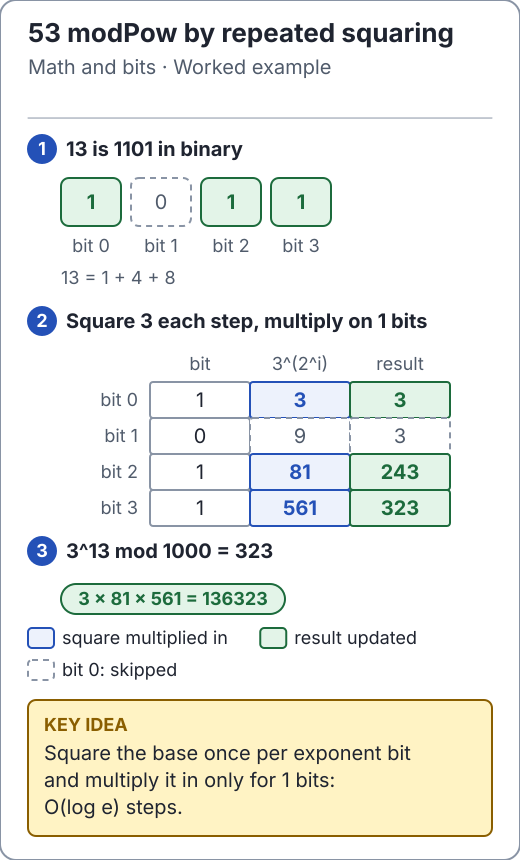
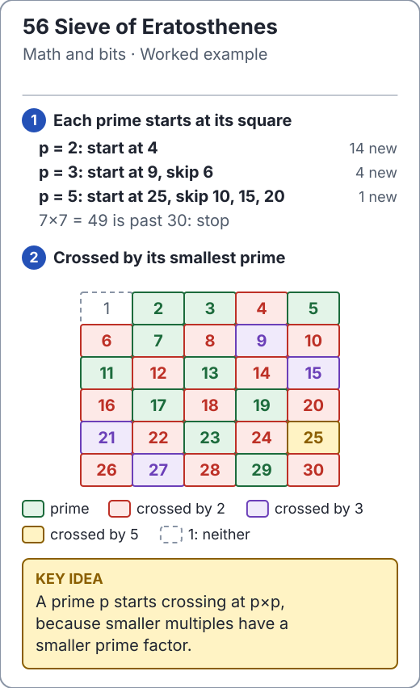
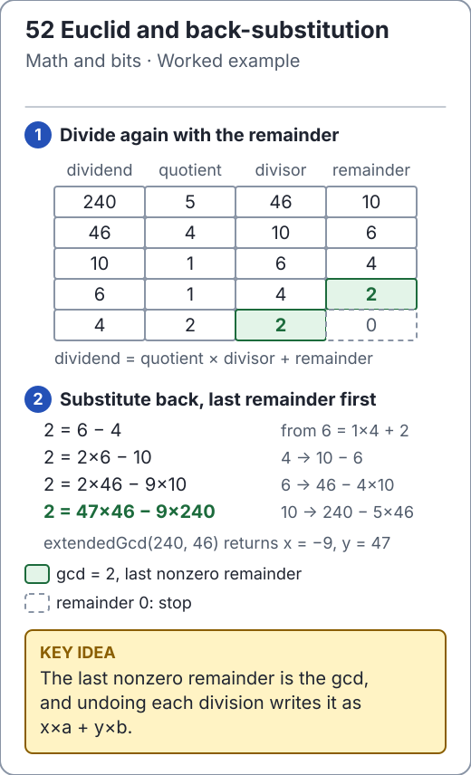

# Number theory: gcd, modular powers, primes and Fibonacci mod m

Use these tools when integers are too large to enumerate but you only need a
remainder, a divisor or a primality verdict. The maintained
[NumberTheory](../../src/main/java/io/github/ichillous/dsa/algorithms/NumberTheory.java)
works on `long` with one overflow rule: the answer is exact or the method throws
`ArithmeticException`; nothing wraps. Modular operations are exact for every
modulus up to `Long.MAX_VALUE`, including moduli above about 3 * 10^9 where a plain
`a * b % m` silently overflows.

| At a glance | |
| --- | --- |
| **Use it when** | You need a gcd, a modular inverse, a power modulo `m`, all primes up to a limit, or a primality verdict for a `long` |
| **Avoid it when** | Values exceed 64 bits (use `BigInteger`) or you need many primes beyond 50,000,000 |
| **Cost** | `gcd`, `extendedGcd`, `modInverse` O(log min); `modPow` O(log e) multiplies; `primesUpTo(n)` O(n log log n); `isPrime` O(log n) per base |
| **In this repo** | [NumberTheory](../../src/main/java/io/github/ichillous/dsa/algorithms/NumberTheory.java) |
| **In the JDK** | `BigInteger.gcd`, `modPow`, `modInverse`, `isProbablePrime`; `Math.floorMod`, `Math.multiplyExact` |

The JDK already has `BigInteger` (`gcd`, `modPow`, `modInverse`, `isProbablePrime`)
and the `Math.*Exact` family. Prefer them when you need arbitrary size or a
one-off answer. This class shows how the 64-bit versions work and gives primitives
without allocation.

## Preconditions and edge cases

| Method | Requires | Edge behavior |
| --- | --- | --- |
| `gcd(a, b)`, `lcm(a, b)` | none | Signs ignored, result nonnegative; `gcd(0, 0) = 0`, `lcm(0, x) = 0`; `gcd(MIN_VALUE, 0)` throws because 2^63 does not fit; `gcd(MIN_VALUE, 2) = 2`; `lcm` throws on overflow |
| `extendedGcd(a, b)` | none | `a*x + b*y = gcd`; `(0, 0)` gives `(0, 1, 0)`; checked arithmetic |
| `modPow(base, e, m)` | `m >= 1`, `e >= 0` | Negative base reduced first; result in `[0, m)`; `m = 1` gives 0; violations throw `IllegalArgumentException` |
| `modInverse(a, m)` | `m >= 1` | Empty when `gcd(a, m) != 1`; modulo 1 the inverse is 0 |
| `primesUpTo(limit)` | `0 <= limit <= 50_000_000` | 0 and 1 give an empty list; result is immutable |
| `isPrime(n)` | none | Correct for every `long`; negatives, 0 and 1 are not prime |
| `fibonacciMod(n, m)` | `n >= 0`, `m >= 1` | `F(0) = 0`, `F(1) = 1`; `m = 1` gives 0 |

## The invariants

**gcd.** `gcd(a, b) = gcd(b, a mod b)`: any common divisor of `a` and `b` divides
`a - q*b`, and the reverse holds too, so the set of common divisors is unchanged
while the second argument shrinks. Java's signed `%` cannot overflow, so
`Long.MIN_VALUE` needs no special casing until the final absolute value.

**Extended gcd.** Each running remainder is kept together with coefficients that
express it as `a*x + b*y`. When `r_new = r_old - q*r`, the same subtraction is
applied to the coefficients, so the identity holds at every step; at the end the
last nonzero remainder is the gcd and its coefficients are the Bezout pair. A
modular inverse is the `x` of `extendedGcd(a, m)` when the gcd is 1, because
`a*x = 1 - m*y`.

**Modular power.** Square-and-multiply keeps `result * base^remaining` congruent
to the answer. Every product goes through an exact modular multiply: when the full
product fits in 63 bits it is one remainder, otherwise a double-and-add loop
keeps every intermediate below `m`, so nothing overflows.

<!-- visual:generated modpow-squares -->
<picture><source media="(prefers-color-scheme: dark)" srcset="../../docs/visuals/assets/modpow-squares-dark.svg"></picture>

**Figure 53.** NumberTheory.modPow(3, 13, 1000) reads the bits of 13 = 1101 from the lowest: the squares of 3 are 3, 9, 81 and 561 modulo 1000, and the result 3, 3, 243, 323 changes only on the 1 bits, ending at 323. [Visual index and step-throughs](../../docs/visuals/README.md).
<!-- /visual:generated -->

**Sieve.** When the loop reaches an unmarked `p`, no smaller prime divides it, so
`p` is prime. Marking starts at `p*p` since smaller multiples already have a
smaller prime factor.

<!-- visual:generated sieve-grid -->
<picture><source media="(prefers-color-scheme: dark)" srcset="../../docs/visuals/assets/sieve-grid-dark.svg"></picture>

**Figure 54.** NumberTheory.primesUpTo(30) on a grid of 1 to 30: 2 crosses out 14 multiples from 4, 3 crosses out 4 more from 9, 5 crosses out 25, and the ten numbers never crossed are the primes 2, 3, 5, 7, 11, 13, 17, 19, 23 and 29. [Visual index and step-throughs](../../docs/visuals/README.md).
<!-- /visual:generated -->

**Miller-Rabin.** Write `n - 1 = d * 2^s` with `d` odd. For an odd prime `n` and a
base `a` not divisible by `n`, either `a^d = 1` or `a^(d*2^r) = -1` for some
`r < s` (mod `n`). A base that breaks both proves `n` composite. The twelve bases
2 through 37 are known to leave no composite below about 3.18 * 10^23 undetected, so the
test is deterministic for all 64-bit inputs (2^64 is under 1.9 * 10^19), not probabilistic.

**Fibonacci.** The matrix power `[[1,1],[1,0]]^n` equals
`[[F(n+1), F(n)], [F(n), F(n-1)]]`. Square-and-multiply on the matrix needs
O(log n) matrix products, each reduced modulo `m`.

Trace of `extendedGcd(240, 46)`; each row shows the quotient `q` that was
just used, the two remainders afterwards, and their coefficients of
`a = 240` (x) and `b = 46` (y):

```text
q   old r   r   (x for old r, x for r)   (y for old r, y for r)
-   240    46   (1, 0)                    (0, 1)
5   46     10   (0, 1)                    (1, -5)
4   10     6    (1, -4)                   (-5, 21)
1   6      4    (-4, 5)                   (21, -26)
1   4      2    (5, -9)                   (-26, 47)
2   2      0    (-9, 23)                  (47, -120)
```

The last nonzero remainder is 2, with `x = -9`, `y = 47`:
`240 * (-9) + 46 * 47 = -2160 + 2162 = 2`.

<!-- visual:generated euclid-steps -->
<picture><source media="(prefers-color-scheme: dark)" srcset="../../docs/visuals/assets/euclid-steps-dark.svg"></picture>

**Figure 52.** NumberTheory.gcd(240, 46) divides 240 by 46, 46 by 10, 10 by 6, 6 by 4 and 4 by 2, reaching remainder 0, so the gcd is 2. Substituting the divisions backwards gives 2 = 47 times 46 minus 9 times 240, the coefficients of extendedGcd. [Visual index and step-throughs](../../docs/visuals/README.md).
<!-- /visual:generated -->

```java
import io.github.ichillous.dsa.algorithms.NumberTheory;
import java.util.List;

assert NumberTheory.gcd(-12, 18) == 6;
assert NumberTheory.gcd(Long.MIN_VALUE, 2) == 2;
assert NumberTheory.lcm(4, 6) == 12;
try {
    NumberTheory.gcd(Long.MIN_VALUE, 0);
    assert false : "2^63 does not fit in a long";
} catch (ArithmeticException expected) {
    assert expected.getMessage() != null;
}

NumberTheory.Bezout bezout = NumberTheory.extendedGcd(240, 46);
assert bezout.gcd() == 2;
assert 240 * bezout.x() + 46 * bezout.y() == 2;

assert NumberTheory.modPow(2, 10, 1000) == 24;
assert NumberTheory.modPow(3, 12, 13) == 1; // Fermat: 3^(13-1) = 1 mod 13
assert NumberTheory.modInverse(3, 7).getAsLong() == 5;
assert NumberTheory.modInverse(4, 8).isEmpty();

assert NumberTheory.primesUpTo(20).equals(List.of(2, 3, 5, 7, 11, 13, 17, 19));
assert NumberTheory.isPrime((1L << 61) - 1);
assert !NumberTheory.isPrime(561);
assert !NumberTheory.isPrime(Long.MAX_VALUE);

assert NumberTheory.fibonacciMod(10, 1000) == 55;
assert NumberTheory.fibonacciMod(90, (1L << 61) - 1) == 2_880_067_194_370_816_120L % ((1L << 61) - 1);
```

## In real Java

For one-off or arbitrary-size work use `BigInteger`. The two APIs disagree in one place worth knowing: when `a` has no inverse modulo `m`, `BigInteger.modInverse` throws `ArithmeticException` (its Javadoc: "this BigInteger has no multiplicative inverse mod m"), while `NumberTheory.modInverse` returns an empty `OptionalLong`.

```java
import io.github.ichillous.dsa.algorithms.NumberTheory;
import java.math.BigInteger;

BigInteger three = BigInteger.valueOf(3);
assert three.modPow(BigInteger.valueOf(13), BigInteger.valueOf(1000)).longValueExact()
        == NumberTheory.modPow(3, 13, 1000);
assert BigInteger.valueOf(240).gcd(BigInteger.valueOf(46)).intValueExact() == 2;
try {
    BigInteger.valueOf(4).modInverse(BigInteger.valueOf(8));
    assert false : "4 has no inverse modulo 8";
} catch (ArithmeticException expected) {
    assert NumberTheory.modInverse(4, 8).isEmpty();
}
```

## Costs

| Method | Time | Auxiliary space |
| --- | --- | --- |
| `gcd`, `lcm`, `extendedGcd`, `modInverse` | O(log min(\|a\|, \|b\|)) | O(1) |
| `modPow` | O(log e) modular multiplies, each O(1) or O(log m) for products above 63 bits | O(1) |
| `primesUpTo(n)` | O(n log log n) | O(n) bits plus the result list |
| `isPrime` | 12 bases, each O(log n) modular multiplies | O(1) |
| `fibonacciMod(n, m)` | O(log n) 2x2 matrix products (8 modular multiplies each) | O(1) |

## Pitfalls

**`a * b % m` overflows long before `m` does.** With `m = 2^62 + 1`, the value
`2^62` is congruent to -1, so its square is 1 modulo `m`. The naive expression
computes `2^124` in 64 bits, which wraps to 0, and reports 0. `modPow` returns 1.
The same silent wrap would make a hand-written Miller-Rabin accept composites.

**Fermat is not a primality test.** 561 is a Carmichael number: `2^560 mod 561 =
1` although 561 = 3 * 11 * 17. Miller-Rabin tests the stronger square-root
condition at each squaring and catches it.

**`Math.abs(Long.MIN_VALUE)` is negative.** A gcd that normalizes signs with
`Math.abs` first still gets `gcd(MIN_VALUE, 2) = 2` right, but returns the negative
`Long.MIN_VALUE` for `gcd(MIN_VALUE, 0)` and `gcd(MIN_VALUE, MIN_VALUE)`, because
the true answer 2^63 does not fit. This implementation reduces with signed `%` and
throws `ArithmeticException` in exactly those cases instead of returning a negative gcd.

```java
import io.github.ichillous.dsa.algorithms.NumberTheory;

assert Math.abs(Long.MIN_VALUE) < 0; // abs cannot negate MIN_VALUE
long m = (1L << 62) + 1;
long big = 1L << 62;
assert big * big % m == 0; // the wrapped, wrong answer
assert NumberTheory.modPow(big, 2, m) == 1; // the exact answer
assert NumberTheory.modPow(2, 560, 561) == 1; // passes the Fermat test ...
assert !NumberTheory.isPrime(561); // ... yet 561 is composite
```

## Practice

1. Use `extendedGcd(17, 5)` to compute the inverse of 5 modulo 17 by hand, then
   check it with `modInverse`.
2. Why does the sieve start marking at `p * p`, and how many marks does `p = 7`
   make for `limit = 100`?
3. The Pisano period of 10 is 60. Use it to predict `fibonacciMod(10^18, 10)`
   without a large exponent, then confirm with the method.

## Check yourself

<details>
<summary>Why is the gcd of 240 and 46 the remainder 2 and not the final remainder 0?</summary>

Each step keeps the gcd of the pair, and the last division `4 = 2 * 2 + 0` shows 2 divides 4, so the pair `(4, 2)` has gcd 2. The remainder 0 only signals that the process can stop.

</details>

<details>
<summary>For exponent 13, how many modular squarings and how many multiplies into the result does `modPow` do?</summary>

13 is `1101` in binary: the loop runs four times and squares the base each time, so four squarings. It multiplies into the result only on the three 1 bits, so three multiplies.

</details>

<details>
<summary>Why does `primesUpTo(30)` never sieve with 7?</summary>

The outer loop only runs while `p * p <= limit`, and 7 * 7 = 49 exceeds 30. Every composite up to 30 has a prime factor of at most 5, so 2, 3 and 5 have already crossed it out.

</details>

See the [catalog](../../docs/catalog.md) for the source and tests and the
[complexity guide](../../docs/complexity.md) for the bounds. The [solution finder](../../docs/solution-finder.md#22-math-and-number-theory) compares this technique with its alternatives.
