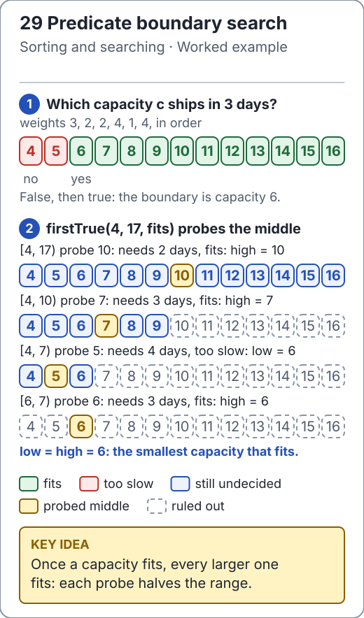

# Binary search on the answer

Some problems ask for the smallest value that makes a yes/no question true, such as the
smallest ship capacity that delivers every package in time. There is no sorted array to
search, but there is a range of candidate answers and a feasibility test. If the test is false
up to some boundary and true from there on, binary search finds the boundary. The maintained
[`SearchAlgorithms.firstTrue`](../../src/main/java/io/github/ichillous/dsa/algorithms/SearchAlgorithms.java)
does this for any `long` range and a `LongPredicate`.

| At&nbsp;a&nbsp;glance | |
| --- | --- |
| **Use&nbsp;it&nbsp;when** | You want the smallest (or, by negating the test, the largest) value that satisfies a condition that, once true, stays true for larger values. |
| **Avoid&nbsp;it&nbsp;when** | The condition is not monotone, or the answer set is small enough to scan, or a direct formula exists. |
| **Cost** | O(log(high - low)) feasibility tests, each costing whatever the test costs; O(1) extra space. |
| **In&nbsp;this&nbsp;repo** | [`SearchAlgorithms.firstTrue`](../../src/main/java/io/github/ichillous/dsa/algorithms/SearchAlgorithms.java) |
| **In&nbsp;the&nbsp;JDK** | No direct equivalent: `Arrays#binarySearch` searches an array by key, not a range by predicate. |

## Preconditions and the invariant

`firstTrue(lowInclusive, highExclusive, monotone)` returns the smallest value in
`[lowInclusive, highExclusive)` for which the predicate is true, or `highExclusive` when there
is none. The precondition is not checked: over the range, the predicate is false for a prefix
and then true for the rest, so it changes at most once. A null predicate throws
`NullPointerException`; `lowInclusive > highExclusive` throws `IllegalArgumentException`; an
empty range returns its bound without calling the predicate.

The invariant matches [lower bound](binary-search.md): every value below `low` is false, every
value at or above `high` is true or is the original upper bound, and only `[low, high)` is
undecided. Each probe tests the middle: a true result moves `high` to it, a false result moves
`low` just past it. The predicate is called
O(log(high - low)) times and never with a value outside the range. If the predicate is not
monotone the returned boundary is unspecified. The midpoint is
`low + ((high - low) >>> 1)`, which does not overflow even for
`[Long.MIN_VALUE, Long.MAX_VALUE)`, where `high - low` exceeds `Long.MAX_VALUE`.

## Worked example: minimum ship capacity

Packages weighing `3, 2, 2, 4, 1, 4` must ship in this order, and each day carries a run of
consecutive packages whose total weight is at most the ship's capacity. What is the smallest
capacity that finishes within 3 days?

The feasibility test for a capacity is a greedy loop: fill each day until the next package no
longer fits, then start a new day. Count the days and compare with 3. The candidate range is
bounded by the facts that no capacity below the heaviest package (4) can work, and that the
total weight (16) always works, so the range is `[4, 17)`.

Monotonicity has to be proved, not assumed. If capacity `c` ships everything in at most 3 days,
so does any `c' > c`: take the same daily groups; each still fits within `c'`. The test
"needs at most 3 days" is therefore false, then true.

That argument is about any grouping, while the predicate counts the days the greedy loop uses.
The two agree because greedy uses the fewest days for a fixed capacity. The invariant is:
after day `k`, greedy has shipped at least as many packages, in order, as any valid grouping
has after `k` days. It holds by induction, because greedy closes a day only when the next
package does not fit.

```text
low high mid  days needed  fits?  action
 4   17   10       2        yes    high = 10
 4   10    7       3        yes    high = 7
 4    7    5       4        no     low = 6
 6    7    6       3        yes    high = 6
 6    6                            answer = 6
```

<!-- visual:generated predicate-boundary | The monotone row of capacities 4 to 16 and the four probes firstTrue makes on the way to capacity 6. -->
<picture><source media="(prefers-color-scheme: dark)" srcset="../../docs/visuals/assets/predicate-boundary-dark.svg"></picture>

**Figure 85.** The monotone row of capacities 4 to 16 and the four probes firstTrue makes on the way to capacity 6. [Visual index and step-throughs](../../docs/visuals/README.md).
<!-- /visual:generated -->

```java
import io.github.ichillous.dsa.algorithms.SearchAlgorithms;
import java.util.Arrays;
import java.util.function.LongPredicate;

int[] weights = {3, 2, 2, 4, 1, 4};
int maxDays = 3;
LongPredicate fits = capacity -> {
    int days = 1;
    long load = 0;
    for (int weight : weights) {
        if (load + weight > capacity) {
            days++;
            load = 0;
        }
        load += weight;
    }
    return days <= maxDays;
};
long lowest = Arrays.stream(weights).max().getAsInt();
long highest = Arrays.stream(weights).sum();

long answer = SearchAlgorithms.firstTrue(lowest, highest + 1, fits);
assert answer == 6;

long brute = lowest;
while (!fits.test(brute)) {
    brute++;
}
assert brute == answer;                      // a linear scan agrees
assert !fits.test(answer - 1) && fits.test(answer);

// No candidate in [4, 5) fits, so the exclusive bound 5 comes back: not an answer.
assert !fits.test(4);
assert SearchAlgorithms.firstTrue(4, 5, fits) == 5;
```

## Costs

| Quantity | Cost | Assumption |
| --- | --- | --- |
| Feasibility tests | O(log(high - low)); at most 64 for any `long` range | Predicate is monotone |
| Total time | O(T log(high - low)) | One test costs T; here T is O(n) for n packages |
| Extra space | O(1) | The predicate keeps its own state |

For the example, n = 6 packages and a range of 13 candidates need 4 tests instead of 13.

## Off-by-one cases and counterexamples

**The bounds define the question.** `highExclusive` is the "none" answer, so the candidate range
must include the largest value that can possibly work; here that is the total weight, so the
exclusive bound is the total plus one. A result equal to `highExclusive` means that no candidate
qualified, and callers must check for it. For an empty range (`low == high`) the result is `low`
and the predicate is never called.

**A bound that is too low breaks the test, not the search.** With a lower bound below the heaviest
package, the greedy loop above "ships" a 4 on a day with capacity 3. Allowed 6 days, capacity 3
then passes the test, and `firstTrue(1, 17, ...)` answers 3, a capacity that cannot lift the
heaviest package.

**A non-monotone test gives no boundary.** "Needs exactly 3 days" is true for capacities 6, 7
and 8 and false on both sides, so it flips twice. Probing 10 finds it false and discards
everything below, including 6.

```java
import io.github.ichillous.dsa.algorithms.SearchAlgorithms;
import java.util.function.LongPredicate;

int[] weights = {3, 2, 2, 4, 1, 4};
java.util.function.LongToIntFunction daysNeeded = capacity -> {
    int days = 1;
    long load = 0;
    for (int weight : weights) {
        if (load + weight > capacity) {
            days++;
            load = 0;
        }
        load += weight;
    }
    return days;
};

// Too low a lower bound: capacity 3 cannot carry the weight 4, yet the test accepts it.
LongPredicate sixDays = capacity -> daysNeeded.applyAsInt(capacity) <= 6;
assert SearchAlgorithms.firstTrue(1, 17, sixDays) == 3;
assert SearchAlgorithms.firstTrue(4, 17, sixDays) == 4;

// Not monotone: exactly 3 days holds for capacities 6, 7, 8 only, and firstTrue misses it.
LongPredicate exactlyThree = capacity -> daysNeeded.applyAsInt(capacity) == 3;
assert exactlyThree.test(6);
assert SearchAlgorithms.firstTrue(4, 17, exactlyThree) == 17;
```

## Practice

1. Prove that "the shipment finishes within D days" is monotone in the capacity, then explain
   why "the shipment finishes in exactly D days" is not.
2. Use `firstTrue(0, x + 1, m -> m * m > x)` to compute the integer square root of a non-negative
   `long` x below 2^31 as that result minus one, and check `x = 0` and `x = 1`, where no value
   in the range passes the test.
3. Find the smallest divisor `d` such that the sum of `ceil(a_i / d)` over an array is at most a
   threshold. State the range and prove monotonicity before coding.

Check the [catalog](../../docs/catalog.md) and the [complexity guide](../../docs/complexity.md) for
the contract and costs, and the [solution finder](../../docs/solution-finder.md#9-searching) for
alternatives. Continue with [binary-search boundaries](binary-search.md) and
[selection](selection.md).

## Check yourself

<details>
<summary>Why is the exclusive upper bound the total weight plus one in the capacity example?</summary>

The total weight always fits everything in one day, so it is a valid candidate and must lie inside
the range; the exclusive bound is one past it. If none qualified, `firstTrue` returns that bound.

</details>

<details>
<summary>Why does "ships in exactly 3 days" break <code>firstTrue</code>?</summary>

It is false for capacities 4 and 5, true for 6 to 8, and false again from 9, so it changes more
than once. A probe at 10 sees false and discards the lower half, which holds the real answer 6.

</details>

<details>
<summary>About how many predicate calls does <code>firstTrue</code> make on a range of a billion candidates?</summary>

About 30, since each call halves the undecided range and 2^30 is just over a billion.

</details>
