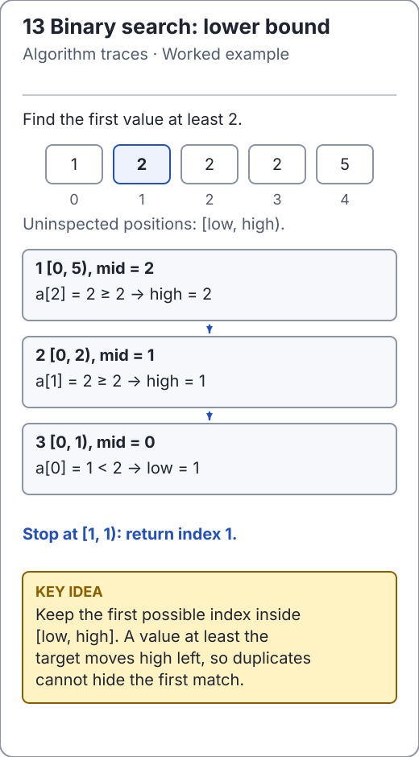

# Binary search as a boundary problem

Use binary search when an array is already in ascending order. The maintained
[SearchAlgorithms](../../src/main/java/io/github/ichillous/dsa/algorithms/SearchAlgorithms.java)
does not scan to validate sortedness: that would turn an O(log n) query into O(n).
Methods reject null, accept an empty array and never modify input.

| At a glance | |
| --- | --- |
| **Use it when** | The data is in ascending order, or a yes/no question flips from false to true exactly once, and you query repeatedly. |
| **Avoid it when** | The data is unsorted, queried once (a scan is cheaper than sorting), or changes with many inserts into an array. |
| **Cost** | O(log n) per query and O(1) extra space; O(n log n) to sort first. |
| **In this repo** | [`lowerBound`, `upperBound`, `binarySearch` and `firstTrue`](../../src/main/java/io/github/ichillous/dsa/algorithms/SearchAlgorithms.java) |
| **In the JDK** | `Arrays#binarySearch` and `Collections#binarySearch` |

| Method | Meaning when the target is absent |
| --- | --- |
| `lowerBound(a, x)` | First index with value at least `x`, possibly `a.length` |
| `upperBound(a, x)` | First index with value greater than `x`, possibly `a.length` |
| `binarySearch(a, x)` | First matching index, or `-1` |

<!-- visual:generated binary-bound -->
<picture><source media="(prefers-color-scheme: dark)" srcset="../../docs/visuals/assets/binary-bound-dark.svg"></picture>

**Figure 13.** Half-open ranges find the first target among duplicate values. [Visual index and step-throughs](../../docs/visuals/README.md).
<!-- /visual:generated -->

## The half-open invariant

For lower bound, every position before `low` contains a value below the target;
every position at or after `high` contains a value at least the target. Only
`[low, high)` remains unknown. Initially that interval is the whole array. Each
comparison shrinks it strictly, and `low == high` identifies the boundary.

Target `2` in `[1, 2, 2, 2, 5]`:

```text
low high middle value action
 0    5     2     2    high = 2
 0    2     1     2    high = 1
 0    1     0     1    low = 1
 1    1                answer = 1
```

```java
import io.github.ichillous.dsa.algorithms.SearchAlgorithms;

int[] sorted = {1, 2, 2, 2, 5};
assert SearchAlgorithms.binarySearch(sorted, 2) == 1;
assert SearchAlgorithms.lowerBound(sorted, 2) == 1;
assert SearchAlgorithms.upperBound(sorted, 2) == 4;
assert SearchAlgorithms.upperBound(sorted, 2)
        - SearchAlgorithms.lowerBound(sorted, 2) == 3;
assert SearchAlgorithms.lowerBound(sorted, 0) == 0;
assert SearchAlgorithms.lowerBound(sorted, 6) == sorted.length;
assert SearchAlgorithms.binarySearch(sorted, 4) == -1;
assert SearchAlgorithms.lowerBound(new int[0], 2) == 0;
```

These three search methods take O(log(n + 1)) time and O(1) extra space. The midpoint is
computed as `low + (high - low) / 2` so adding two large indices cannot overflow.
Preparing sorted data costs extra, and inserting into a sorted array can shift
O(n) elements even though finding its insertion position is logarithmic.

**Counterexample:** in `[2, 0, 1]` the predicate “value is below 2” is false,
true, true: it does not change once. `binarySearch(a, 2)` probes index 1, sees
0 < 2, discards index 0 and returns `-1`, although `a[0] == 2`. Binary search is
valid because the predicate changes once, not merely because a problem involves
numbers.

## In real Java

`Arrays.binarySearch` and `Collections.binarySearch` return `-(insertion point) - 1` when the key
is absent, so a negative result still tells you where to insert. When the key occurs several times,
the JDK makes no guarantee which match it returns, so use the bounds when the first or last
matters.

```java
import io.github.ichillous.dsa.algorithms.SearchAlgorithms;
import java.util.Arrays;
import java.util.Collections;
import java.util.List;

int[] sorted = {1, 2, 2, 2, 5};
int insertion = SearchAlgorithms.lowerBound(sorted, 3);
assert insertion == 4;
assert Arrays.binarySearch(sorted, 3) == -insertion - 1;   // -5: absent, would go at index 4
int any = Arrays.binarySearch(sorted, 2);
assert any >= 1 && any <= 3;                               // some match, not necessarily the first
assert SearchAlgorithms.binarySearch(sorted, 2) == 1;      // this repository returns the first

List<Integer> prices = List.of(10, 20, 30);
assert Collections.binarySearch(prices, 25) == -3;         // insertion point 2
```

Searching a range of answers rather than an array is the same technique:
[binary search on the answer](binary-search-on-answer.md) uses `firstTrue`.

## Common mistakes

1. **Overflowing the midpoint.** With `int` bounds `low = 1_500_000_000` and `high = 2_000_000_000`,
   `(low + high) / 2` adds to 3.5 billion, which wraps to a negative number. The invariant broken
   is that the midpoint lies in `[low, high)`; `low + (high - low) / 2` cannot overflow.
2. **Mixing inclusive and exclusive bounds.** Starting with `high = a.length - 1` but looping
   `while (low < high)` makes `lowerBound` return 4 for target 6 in `[1, 2, 2, 2, 5]`, where the
   correct answer is 5. The unknown region `[low, high)` no longer contains index 4, so the
   claim that everything at or after `high` is at least the target is false.
3. **Stopping at any equal element.** Returning as soon as `a[middle] == target` yields index 2
   for target `2` in `[1, 2, 2, 2, 5]`. It breaks the first-match contract that every position
   before the answer is below the target.

## Check yourself

<details>
<summary>Why does `upperBound(a, 2) - lowerBound(a, 2)` count the 2s in `[1, 2, 2, 2, 5]`?</summary>

`lowerBound` is the index of the first value at least 2 (1) and `upperBound` is the index of the
first value above 2 (4), so the half-open range `[1, 4)` holds exactly the equal values: 3.

</details>

<details>
<summary>What does `Arrays.binarySearch` return for key 3 in `{1, 2, 2, 2, 5}`?</summary>

`-5`. The insertion point is 4, and the JDK reports an absent key as `-(insertion point) - 1`.

</details>

<details>
<summary>What does `low == high` mean when the lower-bound loop ends?</summary>

Everything before it is below the target and everything from it on is at least the target, so
that shared index is the first position whose value is at least the target; it equals the array
length when every value is below the target.

</details>

## Practice

1. Trace both bounds when every element equals the target.
2. Use two bounds to count values in an inclusive range `[a, b]`.
3. Specify a monotonic feasibility predicate for finding the minimum machine
   capacity that completes a fixed workload; prove it is monotonic before coding. The
   [binary search on the answer](binary-search-on-answer.md) lesson works one example.

Check the [solutions](../../docs/solutions.md) and the
[complexity guide](../../docs/complexity.md) for assumptions behind the bounds. The [solution finder](../../docs/solution-finder.md#9-searching) compares this technique with its alternatives.
