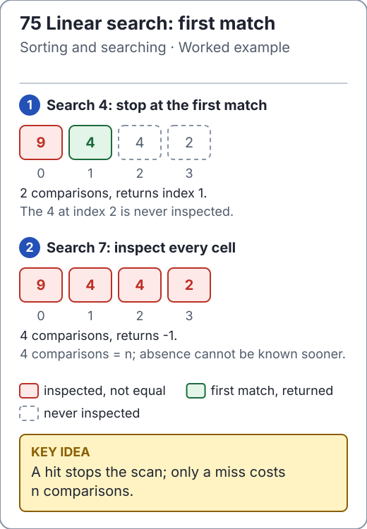

# Linear search and the first-match contract

Linear search answers a precise question: where does the target first occur in an
unsorted array? The maintained [search implementation](../../src/main/java/io/github/ichillous/dsa/algorithms/SearchAlgorithms.java)
returns a zero-based index, or `-1` if absent. It rejects null and does not mutate
input. Empty arrays are valid. No sorting or auxiliary index is required.

| At a glance | |
| --- | --- |
| **Use it when** | The data is unsorted or tiny, you query once, or the match test is not an ordering. |
| **Avoid it when** | The same large collection is queried again and again: sort it or index it once. |
| **Cost** | O(1) for a hit at index 0; O(n) for a miss or a hit at the end; O(1) extra space. |
| **In this repo** | [`SearchAlgorithms.linearSearch`](../../src/main/java/io/github/ichillous/dsa/algorithms/SearchAlgorithms.java) |
| **In the JDK** | `List#indexOf` and `List#lastIndexOf`; no direct equivalent for `int[]` |

## Why the scan is correct

Before visiting index `i`, none of the positions in `[0, i)` equals the target.
Finding a match at `i` therefore establishes that it is the first match. Advancing
past an unequal value preserves the invariant; reaching the end proves absence.

For target `4` in `[9, 4, 4, 2]` the scan stops at index 1 and never reads the second `4`;
a miss, such as `7`, reads every cell before it can answer `-1`.

<!-- visual:generated linear-scan-first-match -->
<picture><source media="(prefers-color-scheme: dark)" srcset="../../docs/visuals/assets/linear-scan-first-match-dark.svg"></picture>

**Figure 82.** linearSearch for 4 in 9, 4, 4, 2 inspects two cells and returns index 1, never reaching the second 4; a search for 7 inspects all four cells and returns -1. [Visual index and step-throughs](../../docs/visuals/README.md).
<!-- /visual:generated -->

The same trace in a table:

| Index inspected | Value | Established fact |
| --- | --- | --- |
| 0 | 9 | No match in `[0, 1)` |
| 1 | 4 | First match is 1; stop |

```java
import io.github.ichillous.dsa.algorithms.SearchAlgorithms;
import java.util.Arrays;

int[] values = {9, 4, 4, 2};
int[] original = values.clone();
assert SearchAlgorithms.linearSearch(values, 4) == 1;
assert SearchAlgorithms.linearSearch(values, 7) == -1;
assert SearchAlgorithms.linearSearch(new int[0], 4) == -1;
assert Arrays.equals(values, original);
```

One hit at the start costs O(1); absence or a hit at the end costs O(n). Auxiliary
space is O(1). An average-case claim requires a distribution of successful and
unsuccessful queries; “usually fast” is not a complexity argument. For repeated
queries, preprocessing can pay off: a hash index takes expected O(n) construction
under suitable hashing assumptions; a sorted copy needs O(n) copying plus
O(n log n) comparison sorting.

## From arrays to text

Repeatedly comparing a pattern at every text position can take O(tp) time. KMP
reuses the longest matched prefix that is also a suffix after a mismatch. The
maintained [string algorithms](../../src/main/java/io/github/ichillous/dsa/algorithms/StringAlgorithms.java)
use UTF-16 indices and include overlapping matches:

```java
import io.github.ichillous.dsa.algorithms.StringAlgorithms;
import java.util.List;

assert StringAlgorithms.kmpIndexOf("bananas", "ana") == 1;
assert StringAlgorithms.kmpFindAll("aaaaa", "aaa").equals(List.of(0, 1, 2));
assert StringAlgorithms.kmpFindAll("ab", "").equals(List.of(0, 1, 2));
assert StringAlgorithms.kmpIndexOf("abc", "z") == -1;
```

KMP takes O(t + p + k) time and O(p + k) space including `k` reported indices.
The empty pattern matches every boundary for all-match search. A UTF-16 index is
not necessarily a count of visible characters.

**Pitfall:** sorting `[9, 4, 4, 2]` before searching changes the meaning of an index.
The `9` is at index 0 in the original array but at index 3 in the sorted one.

## In real Java

For a `List`, use `indexOf` (first occurrence) and `lastIndexOf` (last occurrence). Both
compare with `equals`, so the argument must have the same element type: an `Integer` is never
equal to a `Long` with the same numeric value.

```java
import java.util.List;

List<Integer> ints = List.of(9, 4, 4, 2);
assert ints.indexOf(4) == 1;
assert ints.lastIndexOf(4) == 2;
assert ints.indexOf(7) == -1;

List<Long> longs = List.of(9L, 4L, 4L, 2L);
assert longs.indexOf(4) == -1;   // the int 4 boxes to an Integer, which is not equal to 4L
assert longs.indexOf(4L) == 1;
```

## Common mistakes

1. **Sorting first and reporting the sorted index.** Searching for `9` in `[9, 4, 4, 2]`
   gives index 0, but in the sorted copy `[2, 4, 4, 9]` it gives 3. The invariant broken is
   that the answer is a position in the array the caller holds.
2. **Not stopping at the first match.** A loop that keeps scanning and overwrites its answer
   returns index 2 for target `4` in `[9, 4, 4, 2]`. It breaks the first-match invariant: no
   position before the reported one equals the target.
3. **Stopping one cell early.** A bound of `index < values.length - 1` returns `-1` for target `2`
   in `[9, 4, 4, 2]`, although `2` is at index 3. It breaks the invariant that every position in
   `[0, n)` is inspected before absence is claimed.

## Practice

1. Count comparisons for a first-position hit and a miss.
2. Find the last occurrence without sorting; state the changed invariant.
3. Compare KMP with a simple substring oracle on overlapping and empty patterns.

## Check yourself

<details>
<summary>How many comparisons does `linearSearch` make for target 4 and for target 7 in `[9, 4, 4, 2]`?</summary>

Two for the `4` (index 0, then the match at index 1) and four for the `7`, which is every cell.

</details>

<details>
<summary>When can a scan stop early on a miss?</summary>

Only with extra knowledge. In an ascending array it can stop at the first value above the
target, which is the idea binary search builds on; in an unsorted array a larger value says
nothing about the cells that follow, so a miss needs all `n` comparisons.

</details>

<details>
<summary>Why does `List.of(4L).indexOf(4)` return `-1`?</summary>

`indexOf` compares with `equals`, and the `int` argument boxes to an `Integer`, which is not
equal to a `Long` even when the numbers match.

</details>

Use the [exercise solutions and verification guide](../../docs/solutions.md) after
writing your own trace. Continue with [binary-search boundaries](binary-search.md). The [solution finder](../../docs/solution-finder.md#9-searching) compares this technique with its alternatives.
