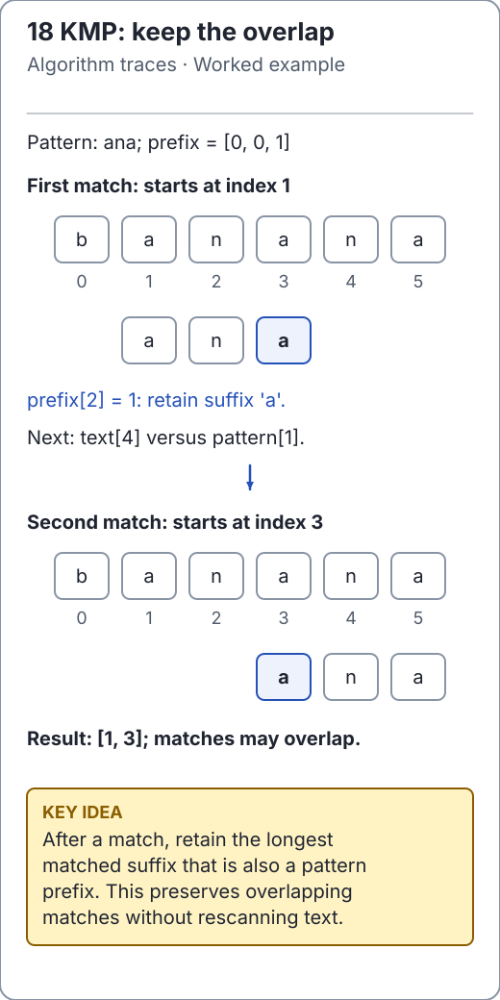

# Linear search and the first-match contract

Linear search answers a precise question: where does the target first occur in an
unsorted array? The maintained [search implementation](../../src/main/java/io/github/ichillous/dsa/algorithms/SearchAlgorithms.java)
returns a zero-based index, or `-1` if absent. It rejects null and does not mutate
input. Empty arrays are valid. No sorting or auxiliary index is required.

<!-- visual:generated -->
<picture><source media="(prefers-color-scheme: dark)" srcset="../../docs/visuals/assets/kmp-overlap-dark.svg"></picture>

**Figure 18.** For text, reusing matched-prefix information avoids restarting the entire comparison and preserves overlapping matches. [Visual index and step-throughs](../../docs/visuals/README.md).
<!-- /visual:generated -->

## Why the scan is correct

Before visiting index `i`, none of the positions in `[0, i)` equals the target.
Finding a match at `i` therefore establishes that it is the first match. Advancing
past an unequal value preserves the invariant; reaching the end proves absence.

For target `4` in `[9, 4, 4, 2]`:

| Index inspected | Value | Established fact |
| --- | --- | --- |
| 0 | 9 | No match in `[0, 1)` |
| 1 | 4 | First match is 1; stop |

```java
import io.github.ichillous.dsa.algorithms.SearchAlgorithms;
import java.util.Arrays;

int[] values = {9, 4, 4, 2};
int[] original = values.clone();
assert SearchAlgorithms.linearSearch(values, 4) == 1;
assert SearchAlgorithms.linearSearch(values, 7) == -1;
assert SearchAlgorithms.linearSearch(new int[0], 4) == -1;
assert Arrays.equals(values, original);
```

One hit at the start costs O(1); absence or a hit at the end costs O(n). Auxiliary
space is O(1). An average-case claim requires a distribution of successful and
unsuccessful queries; “usually fast” is not a complexity argument. For repeated
queries, preprocessing can pay off: a hash index takes expected O(n) construction
under suitable hashing assumptions; a sorted copy needs O(n) copying plus
O(n log n) comparison sorting.

## From arrays to text

Repeatedly comparing a pattern at every text position can take O(tp) time. KMP
reuses the longest matched prefix that is also a suffix after a mismatch. The
maintained [string algorithms](../../src/main/java/io/github/ichillous/dsa/algorithms/StringAlgorithms.java)
use UTF-16 indices and include overlapping matches:

```java
import io.github.ichillous.dsa.algorithms.StringAlgorithms;
import java.util.List;

assert StringAlgorithms.kmpIndexOf("bananas", "ana") == 1;
assert StringAlgorithms.kmpFindAll("aaaaa", "aaa").equals(List.of(0, 1, 2));
assert StringAlgorithms.kmpFindAll("ab", "").equals(List.of(0, 1, 2));
assert StringAlgorithms.kmpIndexOf("abc", "z") == -1;
```

KMP takes O(t + p + k) time and O(p + k) space including `k` reported indices.
The empty pattern matches every boundary for all-match search. A UTF-16 index is
not necessarily a count of visible characters.

**Pitfall:** sorting `[9, 4, 4, 2]` before searching changes the meaning of an index.
The first `4` in the sorted array is not its original position.

## Practice

1. Count comparisons for a first-position hit and a miss.
2. Find the last occurrence without sorting; state the changed invariant.
3. Compare KMP with a simple substring oracle on overlapping and empty patterns.

Use the [exercise solutions and verification guide](../../docs/solutions.md) after
writing your own trace. Continue with [binary-search boundaries](binary-search.md).
