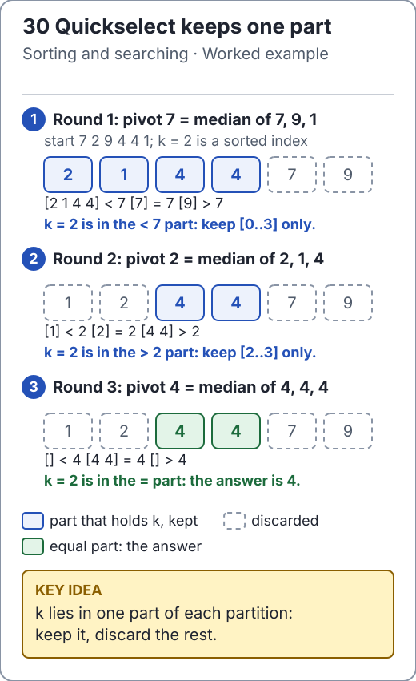
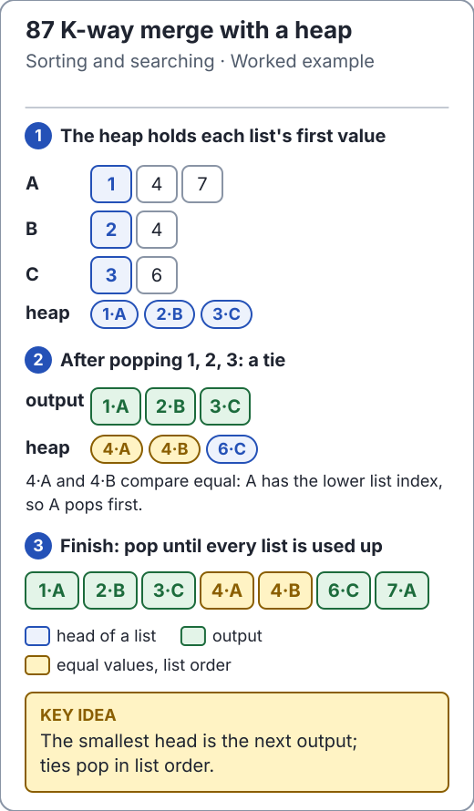

# Selection: k-th smallest, top-k, k-way merge and majority

Use selection when you need a rank or a few extreme elements, not a full order.
The maintained [Selection](../../src/main/java/io/github/ichillous/dsa/algorithms/Selection.java)
offers four tools. `kthSmallest` takes an unsorted `int[]` and a zero-based rank.
`smallestK` takes any collection of non-null elements and a comparator.
`mergeSorted` takes lists that are each already sorted. `majorityElement` takes an
`int[]`. Every method rejects null, leaves its input unchanged and returns a fresh
value; returned lists are immutable.

| At a glance | |
| --- | --- |
| **Use it when** | You need one rank, the k best, a merge of sorted runs, or a majority value, and not the whole order. |
| **Avoid it when** | You need many ranks or the full order: sort once. |
| **Cost** | `kthSmallest` O(n); `smallestK` O(n log(k + 1)); `mergeSorted` O(N log(k + 1)); `majorityElement` O(n). |
| **In this repo** | [`Selection`](../../src/main/java/io/github/ichillous/dsa/algorithms/Selection.java) |
| **In the JDK** | `PriorityQueue` and `Stream#sorted` with `limit`; no direct equivalent for a k-th smallest or a k-way merge |

## Which tool when

| Need | Tool | Why |
| --- | --- | --- |
| One rank (median, percentile) of an array | quickselect / introselect | Discards a constant fraction each round: O(n) |
| The k best of a stream or collection, in order, stable | bounded heap | O(n log k) time, O(k) space, never sorts everything |
| Many ranks, or the whole order | sort once | O(n log n), then every rank is an index |
| Several sorted runs into one | k-way merge with a heap | O(N log k), no re-sorting |
| An element held by more than half the positions | Boyer-Moore vote | One pass, O(1) space, plus a verifying pass |

## The invariant

Partition the range around a pivot into three parts: values below it, values equal
to it, values above it. The k-th smallest of the whole range lies in the part that
contains index `k`: everything to the left is smaller and everything to the right
is larger, so no rank inside another part can change. If `k` falls in the equal
part, the pivot value is the answer. Otherwise recurse into one part only.

A fixed pivot rule alone is not enough. With a median-of-three pivot, crafted
inputs make each round peel off only a handful of elements, so the work is
n + (n - 1) + (n - 2) + ... = O(n²). `kthSmallest` is therefore introselect with a
shrink-based trigger. After each median-of-three round it compares the segment that
still contains `k` with the segment the round started from. If the new segment is
longer than three quarters of the old one, the cheap pivot has failed, and the rest
of the selection uses median-of-medians pivots (medians of groups of five, then
their median), which discard a constant fraction of the segment every round.

Why that is linear in the worst case: every successful cheap round leaves at most
3/4 of the segment, so successful rounds cost at most n(1 + 3/4 + (3/4)^2 + ...) =
4n in total. At most one cheap round fails, costing at most n more, and the
median-of-medians phase on what remains is O(n). The three-way partition also keeps
all-equal input linear.

<!-- visual:generated quickselect-shrink | The partitions of kthSmallest on 7, 2, 9, 4, 4, 1 as the documented rule produces them; the library keeps them private. -->
<picture><source media="(prefers-color-scheme: dark)" srcset="../../docs/visuals/assets/quickselect-shrink-dark.svg"></picture>

**Figure 84.** The partitions of kthSmallest on 7, 2, 9, 4, 4, 1 as the documented rule produces them; the library keeps them private. [Visual index and step-throughs](../../docs/visuals/README.md).
<!-- /visual:generated -->

Trace of `[7, 2, 9, 4, 4, 1]` with `k = 2` (sorted: 1, 2, 4, 4, 7, 9):

```text
range      pivot  partition result (< | == | >)     where k=2 falls
[0..5]     7      [2 1 4 4] | [7] | [9]              left part, new range [0..3]
[0..3]     2      [1] | [2] | [4 4]                  right part, new range [2..3]
[2..3]     4      [] | [4 4] | []                    equal part: answer 4
```

The pivot is the median of the first, middle and last values of the range: 7, 9, 1
gives 7, then 2, 1, 4 gives 2, then 4, 4, 4 gives 4.

```java
import io.github.ichillous.dsa.algorithms.Selection;
import java.util.Comparator;
import java.util.List;
import java.util.OptionalInt;

int[] values = {7, 2, 9, 4, 4, 1};
assert Selection.kthSmallest(values, 2) == 4;
assert Selection.kthSmallest(values, 0) == 1;
assert Selection.kthSmallest(values, 5) == 9;
assert values[0] == 7 && values[5] == 1;

record Entry(String name, int score) {}
List<Entry> entries = List.of(new Entry("a", 5), new Entry("b", 1),
        new Entry("c", 5), new Entry("d", 1), new Entry("e", 3));
List<Entry> best = Selection.smallestK(entries, 3, Comparator.comparingInt(Entry::score));
assert best.equals(List.of(new Entry("b", 1), new Entry("d", 1), new Entry("e", 3)));

List<List<Integer>> runs = List.of(List.of(1, 4, 7), List.of(2, 4), List.of());
assert Selection.mergeSorted(runs, Comparator.<Integer>naturalOrder())
        .equals(List.of(1, 2, 4, 4, 7));

assert Selection.majorityElement(new int[] {3, 3, 4}).equals(OptionalInt.of(3));
assert Selection.majorityElement(new int[] {1, 2}).isEmpty();
```

## How the k-way merge picks

`mergeSorted` keeps a heap with the first unconsumed element of each non-empty list. The
smallest head is the next output; its list then contributes its next element to the heap. Heads
that compare equal are ordered by list index, so the result equals a stable sort of the
concatenated lists.

<!-- visual:generated kway-merge-heap | mergeSorted pops the smallest head from a heap of list heads and refills from the same list; equal heads pop in list order. -->
<picture><source media="(prefers-color-scheme: dark)" srcset="../../docs/visuals/assets/kway-merge-heap-dark.svg"></picture>

**Figure 85.** mergeSorted pops the smallest head from a heap of list heads and refills from the same list; equal heads pop in list order. [Visual index and step-throughs](../../docs/visuals/README.md).
<!-- /visual:generated -->

## Costs and contracts

| Method | Time | Auxiliary space | Ties and edge cases |
| --- | --- | --- | --- |
| `kthSmallest(values, k)` | O(n) worst case (cheap rounds total at most 4n, then median-of-medians) | O(n) for the copy, O(log n) recursion in the fallback | Duplicates count separately; `k` outside `[0, n)` throws `IndexOutOfBoundsException`, so an empty array always throws |
| `smallestK(values, k, order)` | O(n log(k + 1)) | O(min(k, n)) plus the result | Equal elements keep encounter order (same as `sorted(order).limit(k)`); `k = 0` gives `[]`; `k >= n` gives all, sorted; `k < 0` throws `IllegalArgumentException` |
| `mergeSorted(lists, order)` | O(N log(k + 1)) for N elements in k lists | O(k) plus the result | Equal elements: lower list index first, then earlier position; an unsorted list throws `IllegalArgumentException` when the out-of-order element is reached |
| `majorityElement(values)` | O(n) | O(1) | Needs a count strictly above `n / 2`; empty input and a tie like `[1, 1, 2, 2]` give empty |

## In real Java

Two JDK tools cover the same ground. `Arrays.sort` followed by an index gives any rank, at
O(n log n). A `PriorityQueue` is a binary heap whose head is the minimum under its ordering;
its iterator makes no promise about order, so draw elements with `poll` when order matters.
`Stream#sorted` is stable for ordered streams, so `sorted(order).limit(k)` agrees with
`smallestK`.

```java
import io.github.ichillous.dsa.algorithms.Selection;
import java.util.Arrays;
import java.util.Comparator;
import java.util.List;
import java.util.PriorityQueue;

int[] values = {7, 2, 9, 4, 4, 1};
int[] sorted = values.clone();
Arrays.sort(sorted);
assert Selection.kthSmallest(values, 2) == sorted[2];

record Task(String name, int priority) {}
List<Task> tasks = List.of(new Task("x", 2), new Task("y", 1),
        new Task("z", 2), new Task("w", 2));
Comparator<Task> byPriority = Comparator.comparingInt(Task::priority);
// k = 2 cuts through the three priority-2 tasks; the stable sort keeps the earliest, x.
List<Task> viaStream = tasks.stream().sorted(byPriority).limit(2).toList();
assert viaStream.equals(List.of(new Task("y", 1), new Task("x", 2)));
assert Selection.smallestK(tasks, 2, byPriority).equals(viaStream);

List<Integer> scores = List.of(5, 1, 4, 1, 3);
PriorityQueue<Integer> heap = new PriorityQueue<>(scores);
assert heap.peek() == 1;
List<Integer> drained = new java.util.ArrayList<>();
while (!heap.isEmpty()) {
    drained.add(heap.poll());
}
assert drained.equals(List.of(1, 1, 3, 4, 5));   // poll order is sorted; iteration order need not be
```

## Pitfalls

**A vote is not a proof.** After the first Boyer-Moore pass the candidate for
`[1, 2, 3]` is `3`, although no value is a majority. Without the second, counting
pass the algorithm would report it. The verification pass is what makes the answer
trustworthy.

**Sorting a heap result by hand.** `smallestK` ranks equal elements by arrival
order. A plain `PriorityQueue` loop that replaces the root when an element is
`<=` the root, or that ignores arrival order, can return a different group of
equal elements than `stream().sorted(order).limit(k)`.

**Unsorted merge inputs.** `mergeSorted` assumes each list is sorted and checks
that only as it consumes the list: it cannot silently produce a wrong order, but it
throws rather than repairing the input.

## Common mistakes

1. **Treating `k` as a one-based rank.** The second smallest of `[7, 2, 9]` is 7 and sits at
   `k = 1`; `kthSmallest(values, 2)` returns 9, and `k = 3` throws
   `IndexOutOfBoundsException`. The invariant broken is that `k` is an index into the sorted order.
2. **Partitioning equal keys to one side.** A two-way partition that puts the pivot in its final
   place and sends every other value equal to it right removes only the pivot from
   `[5, 5, 5, 5]` with `k = 3`, so the range shrinks by one per round: about n rounds instead
   of the single round a three-way partition needs. It breaks the rule that each round discards a constant fraction.
3. **Comparing only values in a merge heap.** With the lists `[4]` and `[4]` a heap that ignores
   the list index may pop either 4 first. It breaks stability: equal elements must come out in
   list order, which `mergeSorted` guarantees.

## Check yourself

<details>
<summary>In the trace of <code>[7, 2, 9, 4, 4, 1]</code>, why are <code>7</code> and <code>9</code> never looked at after round 1?</summary>

The partition around 7 puts the four values below 7 on the left and leaves 7 and 9 at least 7,
so the value of rank 2 is among those four; only the part holding index 2 can contain the answer.

</details>

<details>
<summary>Why does the k-way merge heap need a tie rule?</summary>

A heap alone orders equal heads arbitrarily. Breaking ties by list index makes the output equal
a stable sort of the concatenated lists, so equal elements keep their list order.

</details>

<details>
<summary>You need the three smallest of a large collection, in order. Which tool, and what extra space?</summary>

`smallestK` with `k = 3`: O(n log(k + 1)) time and O(min(k, n)) extra space beyond the result,
without sorting everything.

</details>

## Practice

1. Trace `kthSmallest` on `[5, 5, 5, 5]` with `k = 3`. How many rounds does the
   three-way partition need, and how many would a two-way partition need?
2. Use `smallestK` with a reversed comparator to find the three most expensive
   items, and say which of two equally priced items is returned when only one fits.
3. Show that Boyer-Moore returns a non-majority candidate for `[1, 2, 3]`, and
   explain why a majority value can never be cancelled completely by pairing
   different values.

See the [catalog](../../docs/catalog.md) for the source and tests and the
[complexity guide](../../docs/complexity.md) for the bounds. Related lessons:
[binary search](binary-search.md) and [heap sort](../sorting/heap-sort.md). The [solution finder](../../docs/solution-finder.md#10-selection-and-top-k) compares this technique with its alternatives.
