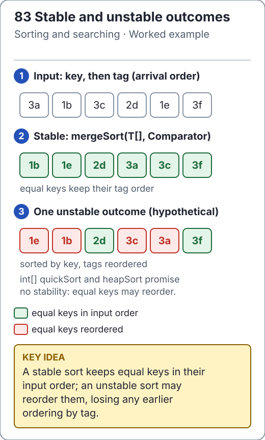

# Choosing a sort

Every sort in this repository lives in
[SortAlgorithms](../../src/main/java/io/github/ichillous/dsa/algorithms/SortAlgorithms.java).
This page compares them with the JDK sorts you would normally call, so you can pick
one by the properties you need rather than by name.

| At&nbsp;a&nbsp;glance | |
| --- | --- |
| **Use&nbsp;it&nbsp;when** | You must choose between the repository sorts and the JDK sorts for a concrete input. |
| **Avoid&nbsp;it&nbsp;when** | You only need the default: call `Arrays.sort` for primitives and `List.sort` for objects. |
| **Cost** | From O(n) (radix) to O(n²) (insertion, bubble); see the table below |
| **In&nbsp;this&nbsp;repo** | [`SortAlgorithms`](../../src/main/java/io/github/ichillous/dsa/algorithms/SortAlgorithms.java) |
| **In&nbsp;the&nbsp;JDK** | `Arrays.sort`, `List.sort`, `Arrays.parallelSort` |

<!-- visual:generated sort-stability | A stable sort keeps the tag order of equal keys; an unstable outcome may not. Stability is the property most often needed when sorting records. -->
<picture><source media="(prefers-color-scheme: dark)" srcset="../../docs/visuals/assets/sort-stability-dark.svg"></picture>

**Figure 92.** A stable sort keeps the tag order of equal keys; an unstable outcome may not. Stability is the property most often needed when sorting records. [Visual index and step-throughs](../../docs/visuals/README.md).
<!-- /visual:generated -->

## Comparison table

"Stable" means equal elements keep their input order. "In place" means the caller's
array is rewritten; it does not rule out auxiliary buffers, which the next columns state.

| Sort | Stable | In place | Worst-case time | Extra space | Pick it when |
| --- | --- | --- | --- | --- | --- |
| [Insertion](insertion-sort.md) `insertionSort(int[])` | yes | yes | O(n²) | O(1) | Tiny or nearly sorted arrays |
| [Bubble](bubble-sort.md) `bubbleSort(int[])` | yes | yes | O(n²) | O(1) | Teaching the sorted-suffix invariant |
| [Merge](merge-sort.md) `mergeSort(int[])` | yes | yes | O(n log n) | O(n) buffer, O(log n) stack | A guaranteed bound; stability is free |
| [Comparator merge](non-comparison-and-comparator-sorts.md) `mergeSort(T[], Comparator)` | yes | yes | O(n log n) comparisons | O(n) copy, O(log n) stack | A readable stable object sort with a null policy |
| [Quicksort](quick-sort.md) `quickSort(int[])` | no | yes | O(n²) | O(log n) stack | Many duplicates, in place, typical speed |
| [Heapsort](heap-sort.md) `heapSort(int[])` | no | yes | O(n log n) | O(1) | A worst-case bound with no extra memory |
| [Counting](non-comparison-and-comparator-sorts.md) `countingSort(int[])` | n/a: values are rewritten from tallies | yes | O(n + r) | O(r) | Small value range `r` (at most 2^20) |
| [LSD radix](non-comparison-and-comparator-sorts.md) `radixSort(int[])` | yes (each pass stable) | yes | O(n) (four passes) | O(n) | Many ints of any value |
| JDK `Arrays.sort(int[])` and other primitive overloads | no promise (the API documentation makes no stability statement) | yes | OpenJDK implementation note: Dual-Pivot Quicksort, "O(n log(n)) performance on all data sets" | not specified by the API documentation | The default for primitive arrays |
| JDK `Arrays.sort(Object[])`, `Arrays.sort(T[], Comparator)`, `Collections.sort` | yes (guaranteed) | yes, in the array | OpenJDK implementation note: "a stable, adaptive, iterative mergesort", about n comparisons on nearly sorted input; no bound is specified by the API documentation | OpenJDK implementation note: up to n/2 temporary references | The default for object arrays |
| JDK `List.sort` | yes (guaranteed) | the list must be modifiable, need not be resizable | as `Arrays.sort(Object[])` (OpenJDK implementation note) | the default implementation copies the list to an array and writes it back | The default for lists |
| JDK `Arrays.parallelSort` | primitives: no promise; objects: yes (guaranteed) | yes | primitives: OpenJDK implementation note as for `Arrays.sort(int[])`; objects: not specified by the API documentation | objects, OpenJDK implementation note: working space no greater than the size of the original array | Very large arrays on a multi-core machine |

For `int[]` sorts the Stable column describes the algorithm; equal ints cannot be told apart, so
no `int[]` sort's stability is observable.

Notes on the JDK rows:

- The Javadoc guarantees stability for the object sorts (`Arrays.sort(Object[])`,
  `Arrays.sort(T[], Comparator)`, the object overloads of `parallelSort`, `List.sort`
  and `Collections.sort`). It makes no stability statement for the primitive sorts;
  equal primitives are indistinguishable anyway.
- The algorithm names and the O(n log n) figures for the JDK sorts come from
  "Implementation note" paragraphs of the Javadoc, so they may change between JDK
  versions. They are the Dual-Pivot Quicksort for primitives, "a stable, adaptive,
  iterative mergesort" for objects and lists, and, for the object overloads of
  `parallelSort`, a parallel sort-merge on the ForkJoin common pool (the primitive
  overloads' note names the Dual-Pivot Quicksort). The API documentation itself states no time bound for
  these methods. See the [solution finder](../../docs/solution-finder.md#11-sorting).
- No speed claims are made here: measure on your own data before choosing between
  sorts with the same bound.

## Question-first chooser

1. **Are you sorting objects by a key, or a `List`?** Use `List.sort` or
   `Arrays.sort(T[], Comparator)`: stable and the default.
2. **Is it a primitive array and stability does not matter?** Use `Arrays.sort`.
3. **Must equal keys keep their order and the keys are primitives attached to records?**
   Sort the records, not the keys, with a stable object sort.
4. **Is the array huge and you have several cores?** Consider `Arrays.parallelSort`.
5. **Do you need a worst-case O(n log n) bound and O(1) extra space?** Heapsort.
6. **Are the integer keys within a range of about the array's length?** Counting sort.
7. **Is the array tiny or almost sorted?** Insertion sort.

```java
import io.github.ichillous.dsa.algorithms.SortAlgorithms;
import java.util.Arrays;

int[] input = {5, -3, 5, 0, -3, 9, 2};
int[] expected = input.clone();
Arrays.sort(expected);
for (int variant = 0; variant < 7; variant++) {
    int[] copy = input.clone();
    switch (variant) {
        case 0 -> SortAlgorithms.insertionSort(copy);
        case 1 -> SortAlgorithms.bubbleSort(copy);
        case 2 -> SortAlgorithms.mergeSort(copy);
        case 3 -> SortAlgorithms.quickSort(copy);
        case 4 -> SortAlgorithms.heapSort(copy);
        case 5 -> SortAlgorithms.countingSort(copy);
        default -> SortAlgorithms.radixSort(copy);
    }
    assert Arrays.equals(copy, expected) : "variant " + variant;
}
```

## Check yourself

<details>
<summary>Which repository sorts are stable?</summary>

Insertion, bubble, the `int[]` merge sort, LSD radix sort (each counting pass is stable)
and the Comparator merge sort. Quicksort and heapsort are not stable; counting sort
rewrites values from tallies, so stability does not apply. For any `int[]` sort it
cannot be observed, because equal ints are indistinguishable.

</details>

<details>
<summary>Why prefer <code>List.sort</code> over a hand-written sort for a list of records?</summary>

Its Javadoc guarantees stability, so multi-key sorting by successive passes is safe, and
the implementation is maintained and tested. The list must be modifiable.

</details>

<details>
<summary>What does stability add that the worst-case bound does not?</summary>

The bound says how long a sort takes; stability says what happens to equal keys.
Sorting records by one key and then another relies on the second sort keeping the order
established by the first.

</details>

See the [catalog](../../docs/catalog.md), the
[complexity guide](../../docs/complexity.md) and the
[solution finder](../../docs/solution-finder.md#11-sorting).
