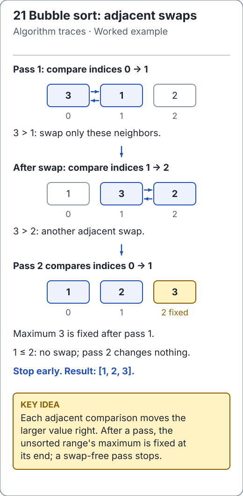

# Bubble sort, insertion sort and local order

Adjacent exchanges make bubble sort useful for learning invariants, although
quadratic worst-case work makes it a poor default for large arrays. The maintained
[SortAlgorithms](../../src/main/java/io/github/ichillous/dsa/algorithms/SortAlgorithms.java)
mutates `int[]` in ascending order, rejects null and accepts empty input.

| At&nbsp;a&nbsp;glance | |
| --- | --- |
| **Use&nbsp;it&nbsp;when** | You are learning the sorted-suffix invariant, or an array is known to be almost sorted and tiny. |
| **Avoid&nbsp;it&nbsp;when** | The input is large or reversed: the work is quadratic and insertion sort does less data movement. |
| **Cost** | O(n²) worst case; O(n) on sorted input with the early exit; O(1) extra space; stable |
| **In&nbsp;this&nbsp;repo** | [`SortAlgorithms.bubbleSort`](../../src/main/java/io/github/ichillous/dsa/algorithms/SortAlgorithms.java) |
| **In&nbsp;the&nbsp;JDK** | No direct equivalent; use `Arrays.sort` or `List.sort` |

<!-- visual:generated bubble-swaps -->
<picture><source media="(prefers-color-scheme: dark)" srcset="../../docs/visuals/assets/bubble-swaps-dark.svg"></picture>

**Figure 21.** Swap neighboring values; each pass settles a maximum on the right. [Visual index and step-throughs](../../docs/visuals/README.md).
<!-- /visual:generated -->

## Bubble-sort invariant and trace

During a left-to-right pass, the largest value seen so far moves right. At the end
of the pass, the maximum of the active prefix is at its final position. The suffix
after `end` is therefore sorted and never needs another comparison.

```text
input                  [4, 1, 3, 2]
after first pass       [1, 3, 2 | 4]
after second pass      [1, 2 | 3, 4]
third pass: no swaps    [1 | 2, 3, 4] -> stop
```

A pass with no swaps proves the active portion was already sorted. The maintained
implementation exits early in that case.

```java
import io.github.ichillous.dsa.algorithms.SortAlgorithms;
import java.util.Arrays;

int[] values = {4, 1, 3, 2, 2};
SortAlgorithms.bubbleSort(values);
assert Arrays.equals(values, new int[] {1, 2, 2, 3, 4});
int[] empty = {};
SortAlgorithms.bubbleSort(empty);
assert empty.length == 0;
```

## Insertion sort uses a different invariant

Before inserting element `i`, prefix `[0, i)` is sorted. Shift only larger values
right, then place the saved value in the gap. On nearly sorted data, the number of
shifts tracks the number of inversions rather than always taking quadratic work.

```java
import io.github.ichillous.dsa.algorithms.SortAlgorithms;
import java.util.Arrays;

int[] nearlySorted = {1, 2, 4, 3, 5};
SortAlgorithms.insertionSort(nearlySorted);
assert Arrays.equals(nearlySorted, new int[] {1, 2, 3, 4, 5});
```

Both algorithms take O(n²) worst-case time, O(n) time on already sorted input and
O(1) auxiliary space. Both are stable: equal keys are never swapped or shifted
past one another. Stability is conceptual for primitive integers, whose equal
values do not carry distinct identities.

**Pitfall:** swapping on `>=` instead of `>` destroys that stability. Omitting the
no-swap exit also removes bubble sort's linear best-case bound. A reverse-sorted
array remains quadratic with or without early exit. The
[insertion sort lesson](insertion-sort.md) develops the second invariant on its own.

## In real Java

Production code rarely hand-writes an adjacent-swap sort. For primitives call
`Arrays.sort(int[])`; for a `List` call `List.sort`, which requires a modifiable
list. An immutable list such as `List.of(...)` rejects the call even when it is
already sorted.

```java
import io.github.ichillous.dsa.algorithms.SortAlgorithms;
import java.util.ArrayList;
import java.util.Arrays;
import java.util.List;

int[] data = {5, -3, 5, 0, -3, 9};
int[] viaBubble = data.clone();
SortAlgorithms.bubbleSort(viaBubble);
int[] viaJdk = data.clone();
Arrays.sort(viaJdk);
assert Arrays.equals(viaBubble, viaJdk);

List<Integer> modifiable = new ArrayList<>(List.of(5, -3, 5, 0, -3, 9));
modifiable.sort(null); // null comparator: natural order
assert modifiable.equals(List.of(-3, -3, 0, 5, 5, 9));
try {
    List.of(1, 2, 3).sort(null);
    assert false : "an immutable list cannot be sorted, even if already ordered";
} catch (UnsupportedOperationException expected) {
    // the contract: List.sort requires a modifiable list
}
```

## Common mistakes

1. **Swapping equal neighbors (`>=`).** Records `2a, 2b` with equal keys become `2b, 2a`.
   This breaks stability: equal keys must never change relative order.
2. **Dropping the no-swap exit.** For `[1, 2, 3, 4, 5]` the loop still runs
   n - 1 passes. This breaks the early-exit invariant that a pass without swaps proves
   the whole active prefix is sorted.
3. **Letting the inner loop run to `values.length`.** The comparison `values[index + 1]`
   then reads past the last element when `index == n - 1`. It breaks the invariant that
   the suffix after `end` is final and is never touched again.

## Check yourself

<details>
<summary>After the first pass over <code>[4, 1, 3, 2]</code>, where is 4 and what is the array?</summary>

The largest value is carried right by every swap, so 4 ends at index 3 and the array is
`[1, 3, 2, 4]`.

</details>

<details>
<summary>How many passes does <code>bubbleSort</code> make on <code>[1, 2, 3, 4, 5]</code>?</summary>

One. It makes four comparisons, finds no swap and returns, which is the O(n) best case.

</details>

<details>
<summary>Why is bubble sort stable?</summary>

It swaps only when the left value is strictly greater than the right one, so equal
values are never exchanged and never pass each other.

</details>

## Practice

1. Count comparisons and swaps for `[3, 2, 1]`.
2. Explain why insertion sort needs to save the current value before shifting.
3. Compare all sorts with `Arrays.sort` on copies; check duplicate multiplicities,
   not only whether the result is ordered.

See [solutions](../../docs/solutions.md), then study
[merge sort](merge-sort.md) for a different time/space tradeoff. The [solution finder](../../docs/solution-finder.md#11-sorting) compares this technique with its alternatives.
