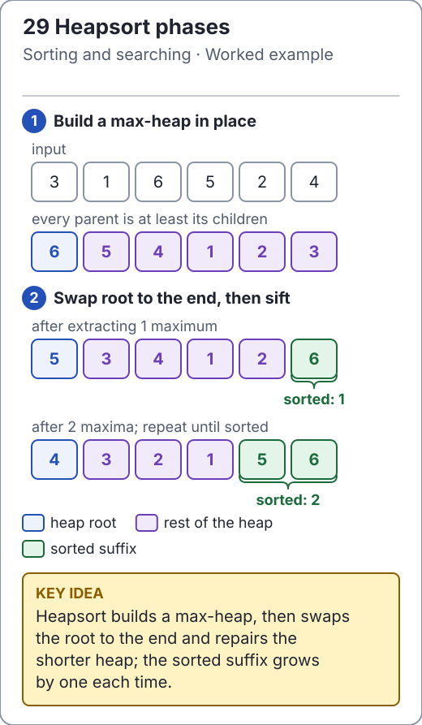

# Heapsort and the sorted suffix

Heapsort first builds a max-heap, then repeatedly moves its largest value to the
end of the remaining array. The maintained
[SortAlgorithms](../../src/main/java/io/github/ichillous/dsa/algorithms/SortAlgorithms.java)
method sorts ascending in the supplied `int[]`, rejects null and accepts empty
input. It uses neither an auxiliary heap object nor a recursion stack.

| At a glance | |
| --- | --- |
| **Use it when** | You need a worst-case O(n log n) bound and O(1) extra space for an `int[]` |
| **Avoid it when** | You need stability, or you sort objects by a key: use a stable object sort |
| **Cost** | O(n log n) worst case; O(n) heap build; O(1) extra space; unstable |
| **In this repo** | [`SortAlgorithms.heapSort`](../../src/main/java/io/github/ichillous/dsa/algorithms/SortAlgorithms.java) |
| **In the JDK** | No heapsort method; `PriorityQueue` is a heap, and `Arrays.sort` is the general default |

For a zero-based array, the children of index `i` are `2*i + 1` and `2*i + 2` when
those positions exist. A max-heap requires each parent to be at least as large as
its children; siblings need not be ordered.

## Two invariants

1. While building bottom-up, the child subtrees of the current node are already
   heaps. Sifting the current value down restores the whole subtree.
2. During extraction, `[0, end)` is a max-heap and `[end, n)` is a sorted suffix
   containing the largest values in final position.

```text
input                 [4, 1, 3, 2]
after heap build      [4, 2, 3, 1]
extract 4 and repair  [3, 2, 1 | 4]
extract 3 and repair  [2, 1 | 3, 4]
extract 2             [1 | 2, 3, 4]
```

The two phases on a six-value input:

<!-- visual:generated heapsort-phases | The heap shrinks from the right while the sorted suffix grows; the heap array itself is never sorted order. -->
<picture><source media="(prefers-color-scheme: dark)" srcset="../../docs/visuals/assets/heapsort-phases-dark.svg"></picture>

**Figure 87.** The heap shrinks from the right while the sorted suffix grows; the heap array itself is never sorted order. [Visual index and step-throughs](../../docs/visuals/README.md).
<!-- /visual:generated -->

```java
import io.github.ichillous.dsa.algorithms.SortAlgorithms;
import java.util.Arrays;

int[] values = {4, 1, 3, 2, 2, -1};
SortAlgorithms.heapSort(values);
assert Arrays.equals(values, new int[] {-1, 1, 2, 2, 3, 4});
int[] singleton = {9};
SortAlgorithms.heapSort(singleton);
assert singleton[0] == 9;
```

Bottom-up heap construction costs O(n), not O(n log n): most nodes are close to
leaves and move only a short distance. Extraction performs O(n) sifts costing
O(log n) each, for O(n log n) worst-case total time and O(1) auxiliary space.
Heapsort is unstable because swapping the root with the end can reorder equal
keys. These costs assume constant-time primitive comparisons.

**Counterexample:** `[9, 1, 8, 0, -2, 7]` can be a valid max-heap while clearly not
being sorted. Reading the heap array from left to right does not produce sorted
order. A min-heap is a different structure: use
[BinaryMinHeap](../../src/main/java/io/github/ichillous/dsa/structures/BinaryMinHeap.java)
when a changing collection needs repeated minimum queries.

## In real Java

The JDK has no heapsort method, but `PriorityQueue` is a binary heap: `poll()` removes
the least element, so offering every value and polling until empty yields ascending
order. The Javadoc implementation note (OpenJDK) gives O(log n) time for `offer` and
`poll`, so the loop costs O(n log n). The Javadoc warns that its iterator is not guaranteed to traverse
the elements in any particular order, which is the same lesson as the counterexample
above: a heap's array is not a sorted array.

```java
import io.github.ichillous.dsa.algorithms.SortAlgorithms;
import java.util.ArrayList;
import java.util.Arrays;
import java.util.List;
import java.util.PriorityQueue;

int[] input = {3, 1, 6, 5, 2, 4};
PriorityQueue<Integer> queue = new PriorityQueue<>();
for (int value : input) {
    queue.offer(value);
}
List<Integer> drained = new ArrayList<>();
while (!queue.isEmpty()) {
    drained.add(queue.poll());
}
assert drained.equals(List.of(1, 2, 3, 4, 5, 6));
int[] viaHeapSort = input.clone();
SortAlgorithms.heapSort(viaHeapSort);
assert Arrays.equals(viaHeapSort, new int[] {1, 2, 3, 4, 5, 6});
```

## Common mistakes

1. **Starting the build at the root only, or skipping the last parent.** For the array
   `[1, 2, 3, 9]` sifting just index 0 gives `[3, 2, 1, 9]`, where index 1 holds 2
   above its child 9. The build must go from the last parent down to 0 so that the
   child subtrees are already heaps.
2. **Repairing with the old size after a swap.** For the heap `[4, 3, 2, 1]`, swapping the
   root with the last slot gives `[1, 3, 2, 4]`; sifting with size 4 pulls the settled 4
   back into the heap. The extraction invariant requires `[end, n)` to stay final, so
   sift only within `[0, end)`.
3. **Always taking the left child when sifting down.** Sifting the root of `[1, 2, 3]`
   (both children are valid heaps) swaps it with 2 and yields `[2, 1, 3]`, where 2 is
   above its larger child 3. The sift must pick the larger child so the parent is at least both children.

## Practice

1. Draw the heap corresponding to `[9, 4, 7, 1, 2]`.
2. Justify why leaf indices need no work in the build loop.
3. Compare heapsort, merge sort and quicksort for a fixed memory budget; separate
   stability, worst-case time and allocation from observed speed.

See the [solutions](../../docs/solutions.md) and the
[maintained complexity table](../../docs/complexity.md). The [solution finder](../../docs/solution-finder.md#11-sorting) compares this technique with its alternatives.

## Check yourself

<details>
<summary>After building the max-heap for <code>[3, 1, 6, 5, 2, 4]</code>, which value is at index 0 and what is the array?</summary>

The maximum, 6, is at index 0 and the array is `[6, 5, 4, 1, 2, 3]`.

</details>

<details>
<summary>Why is heapsort unstable? Give an input.</summary>

Swapping the root with the last slot moves equal keys across each other. For the
records `2a, 2b, 1c` (key then tag) heapsort ends with `1c, 2b, 2a`, so `2a` and `2b`
swapped places.

</details>

<details>
<summary>Why does building the heap cost O(n) even though each sift can cost O(log n)?</summary>

About half the nodes are leaves and need no work, a quarter move at most one level,
and so on, so the total number of moves is bounded by a linear sum.

</details>
