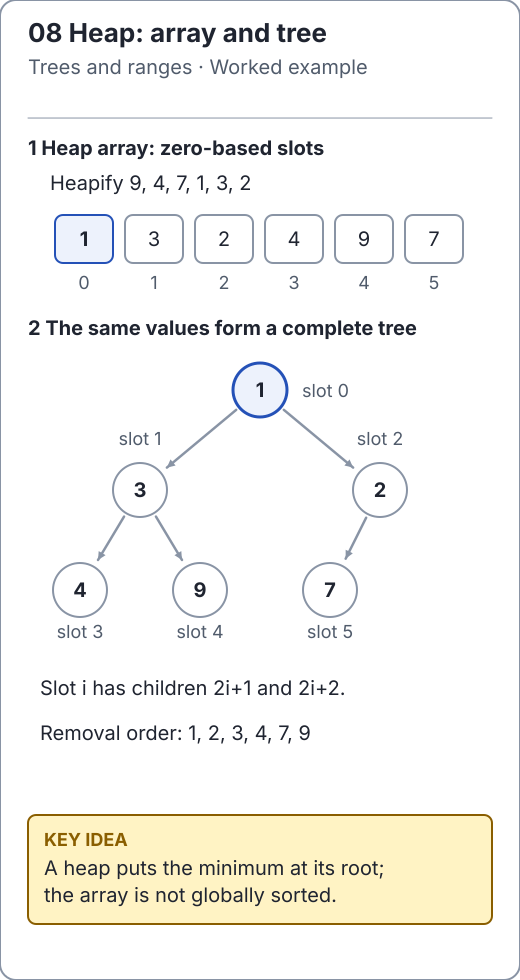

# Heapsort and the sorted suffix

Heapsort first builds a max-heap, then repeatedly moves its largest value to the
end of the remaining array. The maintained
[SortAlgorithms](../../src/main/java/io/github/ichillous/dsa/algorithms/SortAlgorithms.java)
method sorts ascending in the supplied `int[]`, rejects null and accepts empty
input. It uses neither an auxiliary heap object nor a recursion stack.

For a zero-based array, the children of index `i` are `2*i + 1` and `2*i + 2` when
those positions exist. A max-heap requires each parent to be at least as large as
its children; siblings need not be ordered.

<!-- visual:generated -->
<picture><source media="(prefers-color-scheme: dark)" srcset="../../docs/visuals/assets/heap-anatomy-dark.svg"></picture>

**Figure 08.** This is a min-heap for priority removal. In-place ascending heapsort instead builds a max-heap and moves each maximum to the array's end. [Visual index and step-throughs](../../docs/visuals/README.md).
<!-- /visual:generated -->

## Two invariants

1. While building bottom-up, the child subtrees of the current node are already
   heaps. Sifting the current value down restores the whole subtree.
2. During extraction, `[0, end)` is a max-heap and `[end, n)` is a sorted suffix
   containing the largest values in final position.

```text
input                 [4, 1, 3, 2]
after heap build      [4, 2, 3, 1]
extract 4 and repair  [3, 2, 1 | 4]
extract 3 and repair  [2, 1 | 3, 4]
extract 2             [1 | 2, 3, 4]
```

```java
import io.github.ichillous.dsa.algorithms.SortAlgorithms;
import java.util.Arrays;

int[] values = {4, 1, 3, 2, 2, -1};
SortAlgorithms.heapSort(values);
assert Arrays.equals(values, new int[] {-1, 1, 2, 2, 3, 4});
int[] singleton = {9};
SortAlgorithms.heapSort(singleton);
assert singleton[0] == 9;
```

Bottom-up heap construction costs O(n), not O(n log n): most nodes are close to
leaves and move only a short distance. Extraction performs O(n) sifts costing
O(log n) each, for O(n log n) worst-case total time and O(1) auxiliary space.
Heapsort is unstable because swapping the root with the end can reorder equal
keys. These costs assume constant-time primitive comparisons.

**Counterexample:** `[9, 1, 8, 0, -2, 7]` can be a valid max-heap while clearly not
being sorted. Reading the heap array from left to right does not produce sorted
order. A min-heap is a different structure: use
[BinaryMinHeap](../../src/main/java/io/github/ichillous/dsa/structures/BinaryMinHeap.java)
when a changing collection needs repeated minimum queries.

## Practice

1. Draw the heap corresponding to `[9, 4, 7, 1, 2]`.
2. Justify why leaf indices need no work in the build loop.
3. Compare heapsort, merge sort and quicksort for a fixed memory budget; separate
   stability, worst-case time and allocation from observed speed.

See the [solutions](../../docs/solutions.md) and the
[maintained complexity table](../../docs/complexity.md).
