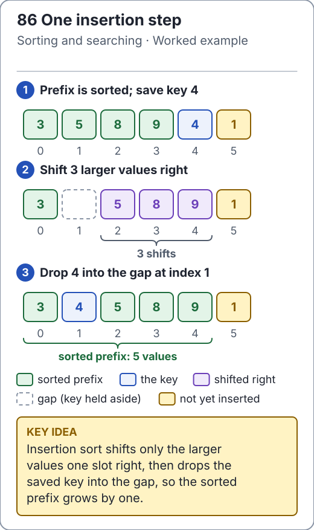

# Insertion sort: grow a sorted prefix

Insertion sort keeps a sorted prefix and inserts the next value into it. The
maintained
[SortAlgorithms.insertionSort](../../src/main/java/io/github/ichillous/dsa/algorithms/SortAlgorithms.java)
sorts an `int[]` in ascending order in place, rejects null and accepts empty and
one-element arrays. Equal values keep their relative order.

| At a glance | |
| --- | --- |
| **Use it when** | The array is tiny or nearly sorted, or you insert a few values into an already sorted array |
| **Avoid it when** | The array is large and far from sorted, such as a reversed array |
| **Cost** | O(n²) worst case; O(n) on sorted input; O(1) extra space; stable |
| **In this repo** | [`SortAlgorithms.insertionSort`](../../src/main/java/io/github/ichillous/dsa/algorithms/SortAlgorithms.java) |
| **In the JDK** | `Arrays.sort(int[])` for the whole array; `ArrayList.add(int, E)` shifts later elements right, the same move as one insertion step |

## The invariant

Before the step for index `i`, the prefix `[0, i)` holds the first `i` input values in
sorted order. The step saves `values[i]` as the key, shifts every prefix value that is
strictly greater than the key one slot right, and writes the key into the gap. Now
`[0, i + 1)` is sorted, so the invariant holds for `i + 1`.

<!-- visual:generated insertion-sort-shift -->
<picture><source media="(prefers-color-scheme: dark)" srcset="../../docs/visuals/assets/insertion-sort-shift-dark.svg"></picture>

**Figure 50.** In 3, 5, 8, 9, 4, 1 the prefix 3, 5, 8, 9 is sorted. The key 4 is saved, the three larger values 5, 8 and 9 shift one slot right, and 4 drops into index 1. [Visual index and step-throughs](../../docs/visuals/README.md).
<!-- /visual:generated -->

Shifting stops at the first value that is not greater than the key. That is why equal
values are not passed and the sort is stable.

```text
input            [3, 5, 8, 9, 4, 1]
i = 1..3          prefix already sorted: no shifts
i = 4, key 4      shift 9, 8, 5   -> [3, 4, 5, 8, 9 | 1]      3 shifts
i = 5, key 1      shift 9, 8, 5, 4, 3 -> [1, 3, 4, 5, 8, 9]   5 shifts
```

Total shifts: 3 + 5 = 8. That equals the number of inversions in the input (pairs
that are out of order): `(5,4) (8,4) (9,4) (3,1) (5,1) (8,1) (9,1) (4,1)`.

```java
import io.github.ichillous.dsa.algorithms.SortAlgorithms;
import java.util.Arrays;

int[] values = {3, 5, 8, 9, 4, 1};
SortAlgorithms.insertionSort(values);
assert Arrays.equals(values, new int[] {1, 3, 4, 5, 8, 9});

int[] withDuplicates = {2, 3, 2, 1, 3, 1};
SortAlgorithms.insertionSort(withDuplicates);
assert Arrays.equals(withDuplicates, new int[] {1, 1, 2, 2, 3, 3});

int[] empty = {};
SortAlgorithms.insertionSort(empty);
assert empty.length == 0;
```

## Why nearly sorted input is fast

Each step does one comparison that fails (or runs off the front) plus one shift per
greater prefix value. Summed over all steps, the shifts equal the number of inversions
and the comparisons are at most n - 1 more than that. A sorted array has no
inversions, so the work is O(n). A reversed array has n(n - 1)/2 inversions, so the
work is O(n²). An array where each value is at most k places from its final position
has at most 2·n·k inversions (an inverted pair is at most 2k positions apart), so it costs O(n·k).

```java
import io.github.ichillous.dsa.algorithms.SortAlgorithms;
import java.util.Arrays;

int[] almost = {1, 2, 4, 3, 5, 6, 8, 7};
SortAlgorithms.insertionSort(almost);
assert Arrays.equals(almost, new int[] {1, 2, 3, 4, 5, 6, 7, 8});

int[] reversed = {5, 4, 3, 2, 1};
SortAlgorithms.insertionSort(reversed);
assert Arrays.equals(reversed, new int[] {1, 2, 3, 4, 5});
```

## Costs

| Case | Time | Auxiliary space | Notes |
| --- | --- | --- | --- |
| Sorted input | O(n) | O(1) | n - 1 failed comparisons, no shifts |
| Reversed input | O(n²) | O(1) | n(n - 1)/2 shifts |
| `k` places from final position | O(n·k) | O(1) | at most 2·n·k inversions |
| Stability | stable | | shifting stops at an equal value |

These counts assume constant-time primitive comparisons.

## In real Java

Use `Arrays.sort` for a whole array. The idea of one insertion step is still useful on a
sorted `List`: `Collections.binarySearch` returns `-(insertion point) - 1` for a missing
key, and `ArrayList.add(index, element)` shifts the later elements right, as the figure
shows. Finding the place costs O(log n) comparisons, but the shift is still O(n) moves.

```java
import java.util.ArrayList;
import java.util.Collections;
import java.util.List;

List<Integer> sorted = new ArrayList<>(List.of(3, 5, 8, 9));
int found = Collections.binarySearch(sorted, 4);
assert found < 0; // 4 is absent
int at = -found - 1; // the insertion point
sorted.add(at, 4);
assert at == 1 && sorted.equals(List.of(3, 4, 5, 8, 9));
```

## Pitfall

Shifting while `values[position - 1] >= value` instead of `>` moves the key past equal
values. For records `2a, 2b` (equal keys) the order becomes `2b, 2a`, so the sort is
no longer stable and does extra work. Overwriting the key slot before saving the key
loses a value: the key must be held in a local variable while the shifts run.

**Counterexample for "insertion sort is always fast":** `[5, 4, 3, 2, 1]` takes ten
shifts, and the cost grows quadratically with reversed input.

## Practice

1. Count the shifts for `[2, 3, 1]` and compare with the number of inversions.
2. Explain why binary search can speed up finding the position but not the shifting.
3. Give an input of eight values where insertion sort is clearly faster than
   merge sort on comparison count, and one where it is clearly slower.

See the [bubble sort lesson](bubble-sort.md) for the other quadratic stable sort, the
[catalog](../../docs/catalog.md) and [complexity guide](../../docs/complexity.md) for
the stated bounds, and the [solution finder](../../docs/solution-finder.md#11-sorting)
for alternatives.

## Check yourself

<details>
<summary>After the step for index 4 on <code>[3, 5, 8, 9, 4, 1]</code>, which values moved and where is the key?</summary>

The values 5, 8 and 9 each moved one slot right, and the key 4 is at index 1. The
array is `[3, 4, 5, 8, 9, 1]`.

</details>

<details>
<summary>Why is the number of shifts equal to the number of inversions?</summary>

Each shift moves one prefix value past a smaller key, which fixes exactly one
out-of-order pair, and no step creates a new one.

</details>

<details>
<summary>Why must the key be saved before shifting?</summary>

The first shift overwrites the key's slot. Without a saved copy the value would be lost.

</details>
