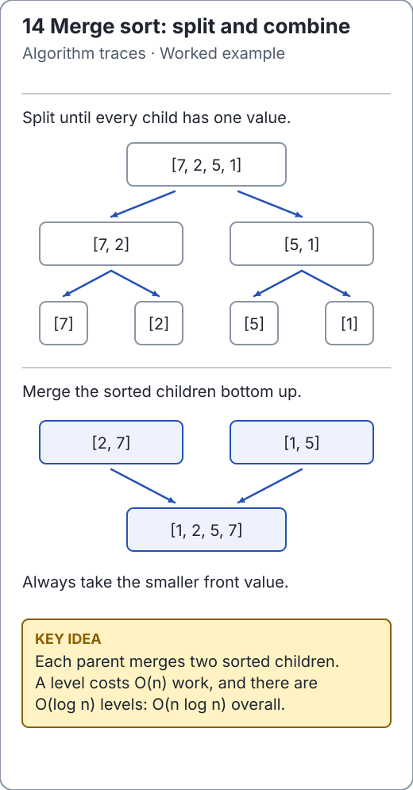

# Merge sort: combine two proven results

Merge sort divides an array into contiguous halves, sorts each half and merges
them. The maintained [implementation](../../src/main/java/io/github/ichillous/dsa/algorithms/SortAlgorithms.java)
uses half-open ranges, one reusable buffer and ascending `int[]` order. It mutates
input, rejects null and accepts empty input.

| At&nbsp;a&nbsp;glance | |
| --- | --- |
| **Use&nbsp;it&nbsp;when** | You need a guaranteed O(n log n) bound and stability, and can afford an O(n) buffer. |
| **Avoid&nbsp;it&nbsp;when** | Memory is tight: it needs a buffer of the array's size plus O(log n) stack. |
| **Cost** | O(n log n) worst case; O(n) buffer; O(log n) stack; stable |
| **In&nbsp;this&nbsp;repo** | [`SortAlgorithms.mergeSort`](../../src/main/java/io/github/ichillous/dsa/algorithms/SortAlgorithms.java) for `int[]` and for `T[]` with a `Comparator` |
| **In&nbsp;the&nbsp;JDK** | `Arrays.sort(Object[])`, `Arrays.sort(T[], Comparator)` and `List.sort`, all guaranteed stable |

<!-- visual:generated merge-recursion -->
<picture><source media="(prefers-color-scheme: dark)" srcset="../../docs/visuals/assets/merge-recursion-dark.svg"></picture>

**Figure 14.** Split into singletons, then merge sorted children bottom up. [Visual index and step-throughs](../../docs/visuals/README.md).
<!-- /visual:generated -->

## A merge invariant

At each output position, the buffer prefix already contains the smallest consumed
values in sorted order. The unconsumed values in each half remain sorted. Taking
the smaller front value preserves both facts. On a tie, taking the left value
preserves the original relative order of equal keys.

```text
[4, 1, 3, 2]
  /        \
[4, 1]    [3, 2]
  |          |
[1, 4]    [2, 3]
  \        /
 merge fronts: 1, 2, 3, 4
```

```java
import io.github.ichillous.dsa.algorithms.SortAlgorithms;
import java.util.Arrays;

int[] original = {4, 1, 3, 2, 2};
int[] sorted = original.clone();
SortAlgorithms.mergeSort(sorted);
assert Arrays.equals(sorted, new int[] {1, 2, 2, 3, 4});
assert Arrays.equals(original, new int[] {4, 1, 3, 2, 2});
```

The unchanged `original` above comes from cloning before the call; `mergeSort`
itself is in-place only in the API sense that it overwrites the supplied array.
Its temporary buffer means it is not an O(1)-space algorithm.

## Recurrence and optimization

There are two half-size recursive problems and O(n) merging work:
`T(n) = 2T(n/2) + O(n)`, giving O(n log n) worst-case time. The single buffer costs
O(n) auxiliary space, and the recursion stack adds O(log n). The buffer is
allocated even if the array turns out to be sorted.

After sorting both halves, the implementation skips merging when the left maximum
is no greater than the right minimum. Already sorted input therefore takes O(n)
time in this implementation; the O(n log n) statement is a worst-case bound.

**Counterexample:** choosing the right half first on equality still sorts numbers
correctly but loses stability for records with equal keys. Allocating a fresh
buffer for every element would add needless allocation; a shared buffer is enough
because recursive subproblems complete before their parent merge uses it.

## In real Java

For objects, call `List.sort` or `Arrays.sort(T[], Comparator)`: the Javadoc guarantees
the sort is stable, so equal elements are not reordered. That makes multi-key sorting
by repeated passes safe: sort by the secondary key first, then stably by the primary
key. The result equals one sort with `thenComparing`.

```java
import java.util.ArrayList;
import java.util.Comparator;
import java.util.List;

record Person(String city, String name) {}

List<Person> people = new ArrayList<>(List.of(
        new Person("Rome", "Zoe"), new Person("Oslo", "Ann"),
        new Person("Rome", "Bo"), new Person("Oslo", "Cy")));
List<Person> twoPasses = new ArrayList<>(people);
twoPasses.sort(Comparator.comparing(Person::name));
twoPasses.sort(Comparator.comparing(Person::city)); // stable: names stay ordered per city
List<Person> onePass = new ArrayList<>(people);
onePass.sort(Comparator.comparing(Person::city).thenComparing(Person::name));
assert twoPasses.equals(onePass);
assert twoPasses.get(0).name().equals("Ann") && twoPasses.get(3).name().equals("Zoe");
```

## Common mistakes

1. **Taking the right element on a tie.** Merging `[2a]` with `[2b]` (equal keys) then
   gives `2b, 2a`. That breaks stability: equal keys must keep their input order, so
   a tie must take the left value.
2. **Merging without a buffer.** Merging halves `[2, 3]` and `[1]` directly into
   the array writes 1 at index 0 and overwrites the unconsumed 2. The merge invariant
   needs the unconsumed left values to stay intact, which the buffer guarantees.
3. **Computing the middle as `(from + to) / 2`.** For `from = 1_500_000_000` and
   `to = 2_000_000_000` the sum overflows `int` and gives a negative middle. The range
   split must keep `from <= middle <= to`, so use `from + (to - from) / 2`.

## Practice

1. Trace merging `[1, 4, 7]` and `[2, 4, 6]`, labeling the two `4` values by origin.
2. Explain which allocation survives across all recursive calls.
3. Count inversions during merging: when a right value wins, how many unconsumed
   left values form an inversion with it? Continue in
   [divide-and-conquer problems](../divide-and-conquer/problems.md).

Compare your reasoning with the [solutions](../../docs/solutions.md) and
[space analysis](../../complexity-analysis/space-complexity.md). The [solution finder](../../docs/solution-finder.md#11-sorting) compares this technique with its alternatives.

## Check yourself

<details>
<summary>Why does merge sort need an O(n) buffer when heapsort needs none?</summary>

Merging writes outputs while left values are still unconsumed, so writing in place
would overwrite them. The buffer holds the merged run until the merge finishes.

</details>

<details>
<summary>How many merges does the implementation perform on <code>[1, 2, 3, 4]</code>?</summary>

None. After sorting each half it compares the left maximum with the right minimum, finds
them in order and skips the merge, so the array costs n - 1 boundary comparisons.

</details>

<details>
<summary>Where does the stability of the merge come from?</summary>

When the front values tie, the merge takes the left one, so equal elements never move
past each other.

</details>
