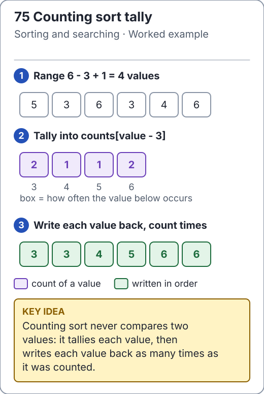
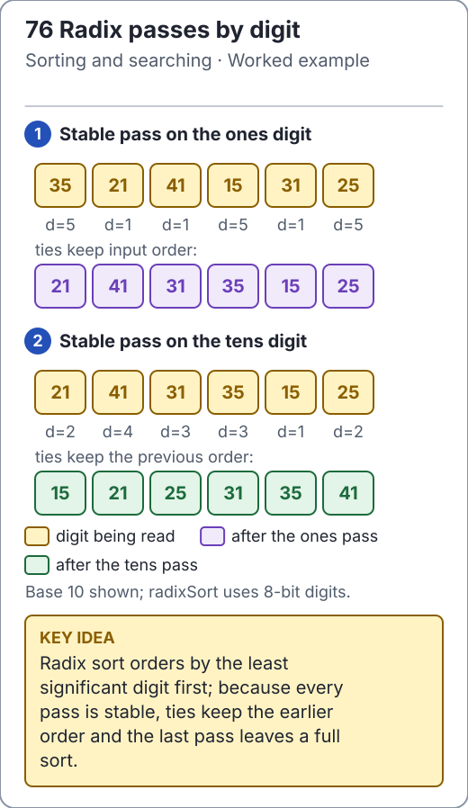
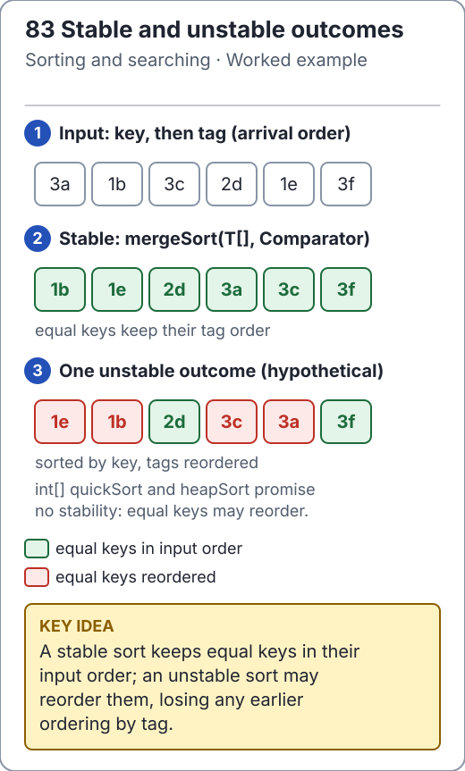

# Counting, radix and stable Comparator sorts

Use these three methods in the maintained
[SortAlgorithms](../../src/main/java/io/github/ichillous/dsa/algorithms/SortAlgorithms.java)
when the generic `int[]` sorts are not the right fit:

- `countingSort(int[])` sorts ints whose values span a small range.
- `radixSort(int[])` sorts ints of any value, in four linear passes.
- `mergeSort(T[], Comparator)` sorts objects by a caller-chosen order and keeps equal
  elements in their original order.

All three sort in place, reject a null array and accept an empty one. The Comparator
sort also rejects a null comparator and null elements, checking before it moves
anything. Counting sort requires `max - min + 1` to be at most
`COUNTING_SORT_MAX_RANGE` (2^20) and throws `IllegalArgumentException` otherwise,
leaving the array unchanged.

| At a glance | |
| --- | --- |
| **Use it when** | Integer keys fall in a small range (`countingSort`), keys span the full `int` range (`radixSort`), or objects need a stable sort by a key (`mergeSort(T[], Comparator)`) |
| **Avoid it when** | The value range is huge and the count is small (counting), or the keys are not integers (radix) |
| **Cost** | Counting O(n + r) time and O(r) space; radix O(n) time and O(n) space; Comparator merge sort O(n log n) comparisons |
| **In this repo** | [`SortAlgorithms.countingSort`](../../src/main/java/io/github/ichillous/dsa/algorithms/SortAlgorithms.java), `radixSort`, `mergeSort(T[], Comparator)` |
| **In the JDK** | No counting or radix sort; `Arrays.sort(T[], Comparator)` and `List.sort` are the stable object sorts |

## Why these can beat n log n

A comparison sort learns one bit per comparison. Distinguishing the n! possible input
orders needs at least log2(n!) bits, which is Ω(n log n) comparisons in the worst case.
Counting and radix sort are not comparison sorts: they use each value as an array
index or digit, so a single step reveals far more than one bit. The bound does not
apply to them, but the trade is real. They need integer keys, and they pay in memory
(a count table of size r, or a buffer of size n) or in passes (one per digit).

<!-- visual:generated counting-sort-counts -->
<picture><source media="(prefers-color-scheme: dark)" srcset="../../docs/visuals/assets/counting-sort-counts-dark.svg"></picture>

**Figure 52.** For 5, 3, 6, 3, 4, 6 the range 3 to 6 has four counts: 2, 1, 1 and 2. Writing each value back that many times gives 3, 3, 4, 5, 6, 6. [Visual index and step-throughs](../../docs/visuals/README.md).
<!-- /visual:generated -->

<!-- visual:generated radix-lsd-passes | Two stable passes, ones digit then tens digit, sort six numbers; radixSort does the same with 8-bit digits. -->
<picture><source media="(prefers-color-scheme: dark)" srcset="../../docs/visuals/assets/radix-lsd-passes-dark.svg"></picture>

**Figure 53.** Two stable passes, ones digit then tens digit, sort six numbers; radixSort does the same with 8-bit digits. [Visual index and step-throughs](../../docs/visuals/README.md).
<!-- /visual:generated -->

## The invariants

- **Counting:** after the tally, `counts[v - min]` is exactly the number of times `v`
  occurs. Writing each value back that many times, in increasing order, is the sorted
  array.
- **LSD radix:** after pass `k`, the array is sorted by its lowest `k` digits. Each pass
  is stable, so it keeps the order established by the earlier, less significant
  digits among elements that tie on the current digit. Sorting by the lowest digit
  first and the highest digit last is therefore a full sort.
- **Sign handling:** in two's complement a negative int has its top bit set, so
  unsigned digit order would place it after every non-negative value. The
  implementation XORs each key with `Integer.MIN_VALUE`, flipping that bit, before
  extracting a digit. The stored values are never altered.
- **Comparator merge:** each half is sorted and stable. On a tie the merge takes the
  left element, so equal elements never swap sides.

## A worked trace

An LSD pass on `[170, 45, 75, 90, 2, 24, 802, 66]`, shown in base 10 for readability. The
implementation uses base 256, four passes of 8 bits, but the mechanism is identical.

```text
input             170  45  75  90   2  24 802  66
pass 1 (ones)     bucket 0: 170 90 | 2: 2 802 | 4: 24 | 5: 45 75 | 6: 66
after pass 1      170  90   2 802  24  45  75  66
pass 2 (tens)     bucket 0: 2 802 | 2: 24 | 4: 45 | 6: 66 | 7: 170 75 | 9: 90
after pass 2        2 802  24  45  66 170  75  90
pass 3 (hundreds) bucket 0: 2 24 45 66 75 90 | 1: 170 | 8: 802
after pass 3        2  24  45  66  75  90 170 802
```

In pass 2, `170` and `75` share tens digit 7 and keep the relative order from pass 1 (170
before 75). That is stability doing the work.

## Executable example

```java
import io.github.ichillous.dsa.algorithms.SortAlgorithms;
import java.util.Arrays;
import java.util.Comparator;

int[] small = {3, -2, 3, 0, -2, 1};
SortAlgorithms.countingSort(small);
assert Arrays.equals(small, new int[] {-2, -2, 0, 1, 3, 3});

int[] wide = {Integer.MAX_VALUE, Integer.MIN_VALUE, 0, -1, 1, Integer.MIN_VALUE};
SortAlgorithms.radixSort(wide);
assert Arrays.equals(wide,
        new int[] {Integer.MIN_VALUE, Integer.MIN_VALUE, -1, 0, 1, Integer.MAX_VALUE});

int[] tooWide = {Integer.MIN_VALUE, Integer.MAX_VALUE};
try {
    SortAlgorithms.countingSort(tooWide);
    assert false : "range is far above COUNTING_SORT_MAX_RANGE";
} catch (IllegalArgumentException expected) {
    assert tooWide[0] == Integer.MIN_VALUE && tooWide[1] == Integer.MAX_VALUE;
}

String[] words = {"pear", "fig", "kiwi", "apple", "plum", "date"};
SortAlgorithms.mergeSort(words, Comparator.comparingInt(String::length));
assert Arrays.equals(words, new String[] {"fig", "pear", "kiwi", "plum", "date", "apple"});
```

The four-letter words come out as `pear, kiwi, plum, date`, their original relative order.

## Costs

| Method | Time | Auxiliary space | Notes |
| --- | --- | --- | --- |
| `countingSort` | O(n + r), r = max - min + 1 | O(r) | r at most 2^20; range is computed in `long` |
| `radixSort` | O(n): four passes of n + 256 steps | O(n) | Full int range, negatives included |
| `mergeSort(T[], Comparator)` | O(n log n) comparisons | O(n) buffer, O(log n) stack | Stable; null elements rejected |

Counting sort is only a good choice when r is not much larger than n. Sorting two
values that are 2^20 - 1 apart (for example 0 and 1,048,575) still allocates a 4 MiB
table; at 2^20 apart the method rejects the range.

## Stability and why a Comparator sort needs it

<!-- visual:generated sort-stability -->
<picture><source media="(prefers-color-scheme: dark)" srcset="../../docs/visuals/assets/sort-stability-dark.svg"></picture>

**Figure 54.** Records 3a, 1b, 3c, 2d, 1e, 3f sorted by their number: a stable sort gives 1b, 1e, 2d, 3a, 3c, 3f, keeping tags in order, while a hypothetical unstable outcome 1e, 1b, 2d, 3c, 3a, 3f reorders equal keys. [Visual index and step-throughs](../../docs/visuals/README.md).
<!-- /visual:generated -->

Sorting records by one key is usually one step of several: sort by name, then by city,
and expect people in the same city to stay in name order. That only works if the
second sort is stable. Primitive ints have no identity, so stability is invisible for
them; once elements are objects compared by a key, it is observable and must be a
documented guarantee. `Arrays.sort(T[], Comparator)` makes the same guarantee, which
is what the tests compare against.

## Pitfall: `(a, b) -> a - b`

Subtraction looks like a comparator but overflows. For `a = Integer.MAX_VALUE` and
`b = -1`, `a - b` wraps to a negative number, so the comparator reports that the
larger value is smaller. A sort using it can return a wrong order with no error. Use
`Integer.compare(a, b)` or `Comparator.comparingInt`.

```java
import java.util.Comparator;

Comparator<Integer> broken = (a, b) -> a - b;
Comparator<Integer> correct = Integer::compare;
assert broken.compare(Integer.MAX_VALUE, -1) < 0;
assert correct.compare(Integer.MAX_VALUE, -1) > 0;
```

A comparator must also be consistent (a total preorder). The sort does not verify that.

## In real Java

For object records use the JDK: `List.sort` and `Arrays.sort(T[], Comparator)` are
guaranteed stable, so sorting by the secondary key and then by the primary key equals
one sort with `thenComparing`. `Arrays.sort(int[])` is the default for primitives and
promises no stability. Equal ints are indistinguishable, so only a sort of records
shows the difference.

```java
import java.util.Arrays;
import java.util.Comparator;

record Entry(String city, String name) {}

Entry[] entries = {
    new Entry("Rome", "Zoe"), new Entry("Oslo", "Ann"),
    new Entry("Rome", "Bo"), new Entry("Oslo", "Cy")
};
Entry[] twoPasses = entries.clone();
Arrays.sort(twoPasses, Comparator.comparing(Entry::name));
Arrays.sort(twoPasses, Comparator.comparing(Entry::city)); // stable second pass
Entry[] onePass = entries.clone();
Arrays.sort(onePass, Comparator.comparing(Entry::city).thenComparing(Entry::name));
assert Arrays.equals(twoPasses, onePass);
assert twoPasses[0].name().equals("Ann") && twoPasses[1].name().equals("Cy");
```

## Common mistakes

1. **Forgetting to subtract the minimum in counting sort.** For `{3, -2}` the index
   `value` is -2 for the second value, which throws `ArrayIndexOutOfBoundsException`.
   The invariant is `counts[v - min]` with `0 <= v - min < range`.
2. **Computing the range in `int`.** For `{Integer.MIN_VALUE, Integer.MAX_VALUE}`,
   `max - min + 1` wraps to 0, so the range check passes and the count table has size 0.
   Compute `(long) max - min + 1`, as the repository does.
3. **Using an unstable pass in LSD radix sort.** In the figure's input, 21 and 25 share
   tens digit 2 and 21 comes first after the ones pass. An unstable tens pass can
   output 25 before 21, which breaks the invariant that the array is sorted by its
   lowest `k` digits after pass `k`.

## Practice

1. Trace `radixSort` on `[-1, 1]` in binary by hand: show the key after the sign-bit
   flip and explain why `-1` ends up first.
2. Choose between `countingSort` and `radixSort` for one million ages in `[0, 150]` and
   for one million arbitrary ints. State the time and space cost of each choice.
3. Sort `(city, name)` pairs by name, then by city with the stable Comparator sort, and
   show what happens to the name order within a city if the second sort were not stable.

See the [catalog](../../docs/catalog.md) and the
[complexity guide](../../docs/complexity.md) for assumptions behind the bounds. The [solution finder](../../docs/solution-finder.md#11-sorting) compares this technique with its alternatives.

## Check yourself

<details>
<summary>Why can counting sort beat n log n without contradicting the comparison-sort bound?</summary>

It never compares two values with each other; it uses each value as an array index. The
Ω(n log n) bound applies only to sorts that learn about order through comparisons.

</details>

<details>
<summary>What does <code>countingSort</code> do for <code>{0, 1048576}</code>, and what happens to the array?</summary>

The range is 1,048,577, above `COUNTING_SORT_MAX_RANGE` (2^20), so it throws
`IllegalArgumentException` and leaves the array unchanged.

</details>

<details>
<summary>In the radix figure, why does 21 end before 25?</summary>

Both have tens digit 2, so the tens pass keeps the order from the ones pass, where 21
(digit 1) came before 25 (digit 5). Stability of each pass is what makes the final
order correct.

</details>
