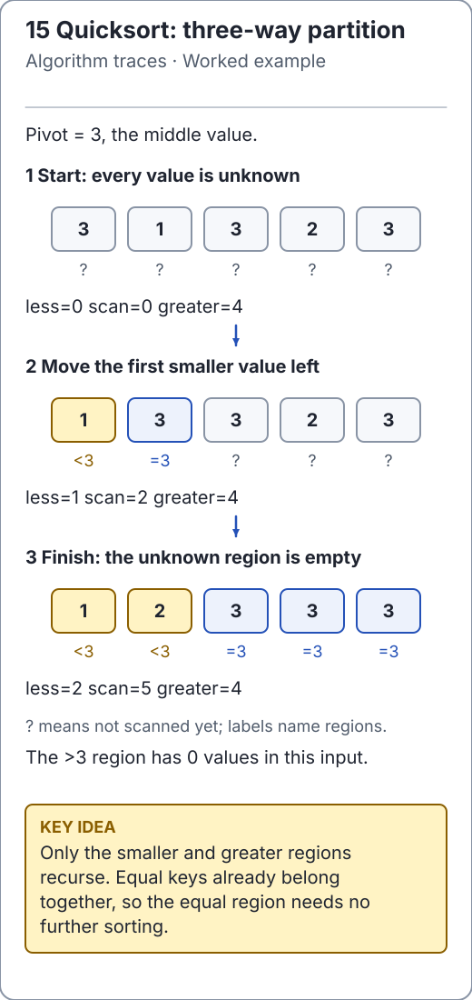

# Three-way quicksort with a bounded call stack

Quicksort partitions around a pivot, then sorts the regions below and above it.
The maintained [implementation](../../src/main/java/io/github/ichillous/dsa/algorithms/SortAlgorithms.java)
uses a deterministic middle-position pivot and groups equal values together.
It mutates `int[]` in ascending order, rejects null and accepts empty arrays.

| At a glance | |
| --- | --- |
| **Use it when** | You sort an `int[]` in place, especially one with many duplicate values |
| **Avoid it when** | You need stability, or a worst-case O(n log n) time bound |
| **Cost** | O(n log n) typical; O(n²) worst case; O(log n) stack; unstable |
| **In this repo** | [`SortAlgorithms.quickSort`](../../src/main/java/io/github/ichillous/dsa/algorithms/SortAlgorithms.java) |
| **In the JDK** | `Arrays.sort(int[])`, described in the Javadoc implementation note as a Dual-Pivot Quicksort |

<!-- visual:generated quick-partition -->
<picture><source media="(prefers-color-scheme: dark)" srcset="../../docs/visuals/assets/quick-partition-dark.svg"></picture>

**Figure 15.** Gather duplicate pivot values into one finished equal region. [Visual index and step-throughs](../../docs/visuals/README.md).
<!-- /visual:generated -->

## Four regions during partitioning

```text
[ low ... less ) [ less ... scan ) [ scan ... greater ] ( greater ... high ]
     < pivot          == pivot           unknown              > pivot
```

When the scanned value is smaller, swap it into the first region and advance both
`less` and `scan`. When it is larger, swap with `greater` and shrink the unknown
region without advancing `scan`: the incoming value still needs inspection.
An equal value only advances `scan`. Each step shrinks the unknown region.

For `[3, 1, 3, 2, 3]` and pivot `3`, partitioning ends with a below-pivot region
containing `1, 2`, an equal region containing three `3`s, and an empty upper
region. Equal values need no further sorting.

```java
import io.github.ichillous.dsa.algorithms.SortAlgorithms;
import java.util.Arrays;

int[] values = {3, 1, 3, 2, 3, Integer.MIN_VALUE, Integer.MAX_VALUE};
int[] expected = values.clone();
Arrays.sort(expected);
SortAlgorithms.quickSort(values);
assert Arrays.equals(values, expected);
int[] equal = {7, 7, 7, 7};
SortAlgorithms.quickSort(equal);
assert Arrays.equals(equal, new int[] {7, 7, 7, 7});
```

## Time and stack are separate questions

Balanced partitions give O(n log n) time. Bad deterministic pivot choices can give
O(n²) time; the implementation does not randomize and claims no worst-case
O(n log n) time guarantee. All-equal input is handled in O(n) by one partition.

Only the smaller partition is recursive. The larger one is processed by a loop,
so each nested call has at most half as many elements. This bounds auxiliary
stack space to O(log n), even if the total partition work is quadratic. The sort
is unstable because long-distance swaps can reorder equal keys.

**Pitfalls:** advancing `scan` after swapping in an unexamined value can leave an
out-of-place element. Recursing on both partitions instead of looping over the
larger one can require O(n) stack space on an unlucky input. Comparing arbitrary
integers by subtraction can overflow; direct `<` and `>` comparisons are safe.

## In real Java

Call `Arrays.sort(int[])` in production; its Javadoc implementation note (OpenJDK, not specification) describes a Dual-Pivot
Quicksort, and the API documentation makes no stability promise for primitives. The overload
`Arrays.sort(int[], fromIndex, toIndex)` sorts a half-open range and leaves every
other element untouched, which is the same range convention the repository uses.

```java
import io.github.ichillous.dsa.algorithms.SortAlgorithms;
import java.util.Arrays;

int[] data = {9, 3, 1, 2, 0, 8};
Arrays.sort(data, 1, 5); // sorts indices 1..4 only
assert Arrays.equals(data, new int[] {9, 0, 1, 2, 3, 8});
int[] whole = data.clone();
SortAlgorithms.quickSort(whole);
assert Arrays.equals(whole, new int[] {0, 1, 2, 3, 8, 9});
```

## Common mistakes

1. **Advancing `scan` after swapping with `greater`.** On `[2, 1, 3]` the pivot is 1;
   the swapped-in 3 is never inspected and the result is `[3, 1, 2]`. The unknown
   region `[scan, greater]` must still contain the incoming value.
2. **Computing the pivot index as `(low + high) / 2`.** For a range
   `[1_500_000_000, 2_000_000_000]` the sum overflows `int`. The pivot must lie inside
   `[low, high]`, so use `low + (high - low) / 2`.
3. **Comparing with subtraction.** With `values[scan] - pivot < 0`, the pair
   `Integer.MAX_VALUE` and `-1` wraps negative and `MAX_VALUE` lands in the "below pivot"
   region. That breaks the partition invariant `[low, less) < pivot`.

## Practice

1. Trace all four regions for `[2, 3, 1, 2]`.
2. Explain why the equal region is excluded from both later subproblems.
3. Compare maximum call depth with total comparison count; construct partition
   sizes that show one can remain logarithmic while the other is quadratic.

Use the [solutions](../../docs/solutions.md) and contrast the worst-case guarantee
of [heapsort](heap-sort.md). The [solution finder](../../docs/solution-finder.md#11-sorting) compares this technique with its alternatives.

## Check yourself

<details>
<summary>Why does the equal region need no further sorting?</summary>

Every value in it equals the pivot, and everything below is smaller and everything above
is larger, so each equal value is already in its final position.

</details>

<details>
<summary>What bounds the stack depth to O(log n) even when time is quadratic?</summary>

Only the smaller partition is handled by recursion and the larger one by the loop, so
each nested call works on at most half as many elements.

</details>

<details>
<summary>Why is this quicksort unstable?</summary>

Partitioning swaps values across long distances, so two equal keys can end up in the
opposite order from their input order.

</details>
