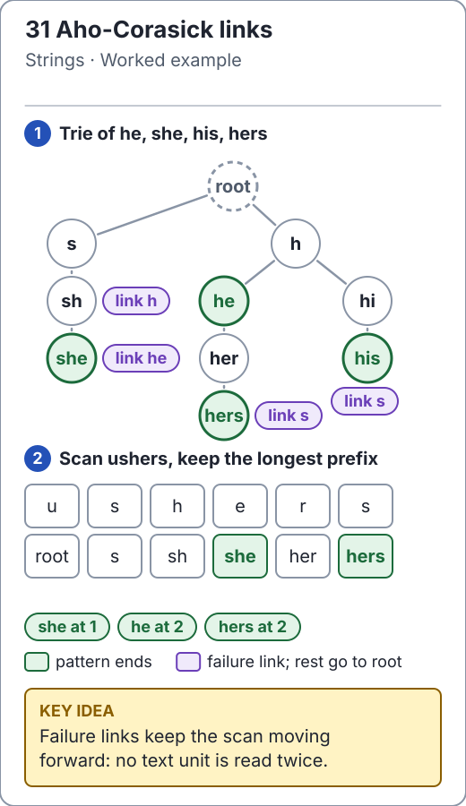
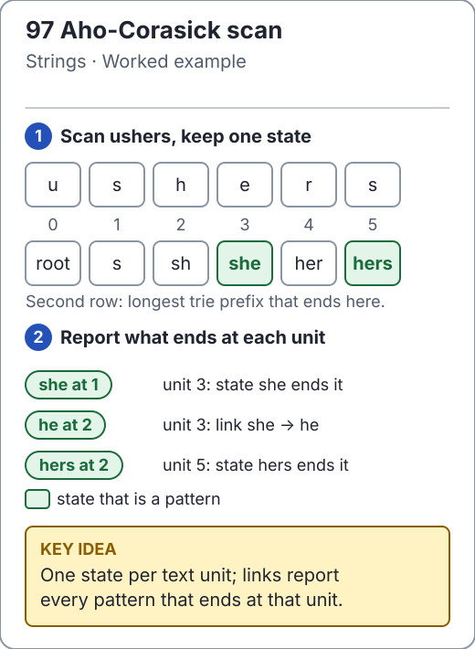
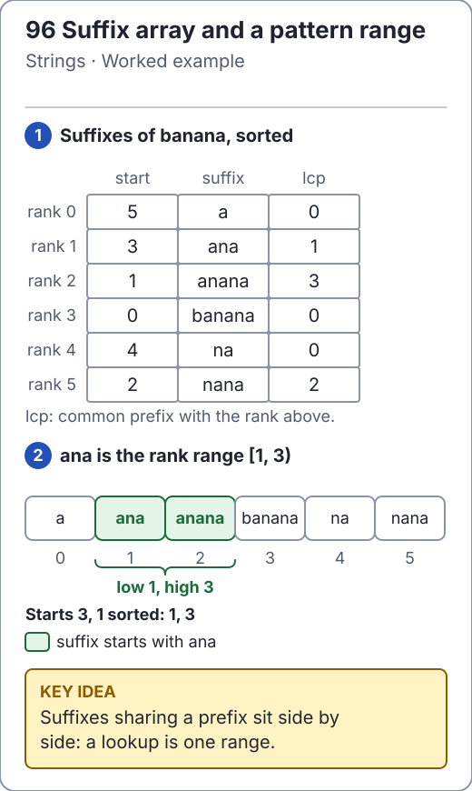

# Multi-pattern matching and suffix arrays

Use [AhoCorasick](../../src/main/java/io/github/ichillous/dsa/algorithms/AhoCorasick.java)
to find every occurrence of many patterns in one pass over a text. Use
[SuffixArray](../../src/main/java/io/github/ichillous/dsa/algorithms/SuffixArray.java)
when the text is fixed and you will ask many questions about it: occurrences of
arbitrary patterns, distinct substrings, or the longest repeated substring.
Positions are UTF-16 code-unit indices, matching `StringAlgorithms.kmpFindAll`;
no case folding or normalization happens. Both classes copy their input and
never mutate it. Aho-Corasick rejects empty patterns, collapses duplicates in the trie and
accepts an empty pattern set (it then never matches).

| At a glance | |
| --- | --- |
| **Use it when** | Many fixed patterns must be found in one pass over a text (Aho–Corasick), or a fixed text will answer many substring questions: occurrences, distinct substrings, the longest repeated substring (suffix array). |
| **Avoid it when** | There is one pattern (use `String.indexOf` or KMP), the pattern set changes often (the automaton is immutable), or the text changes (rebuild the suffix array). |
| **Cost** | Aho–Corasick: O(P) expected build, O(t + k) expected search. Suffix array: O(n log n) build, O(p log n + k log k) per `occurrences` call. |
| **In this repo** | [`AhoCorasick`](../../src/main/java/io/github/ichillous/dsa/algorithms/AhoCorasick.java) (`findAll`), [`SuffixArray`](../../src/main/java/io/github/ichillous/dsa/algorithms/SuffixArray.java) (`suffixes`, `lcp`, `occurrences`) |
| **In the JDK** | `java.util.regex.Pattern` for a few alternatives; no direct equivalent for either structure |

## The invariants

**Aho-Corasick.** Patterns form a trie. For a node spelling `s`, its failure
link is the node for the longest *proper suffix* of `s` that is also a trie
prefix. Scanning keeps the longest trie prefix that ends at the current text
position; on a mismatch it follows failure links, and each text character
advances the depth by at most one, so all failure steps together are O(t).
A second link per node jumps to the nearest pattern ending on the failure chain,
so every match is emitted exactly once. Links are built breadth first, so
shallow nodes are final before deeper ones need them and long patterns cannot
overflow the stack.

<!-- visual:generated aho-corasick-links -->
<picture><source media="(prefers-color-scheme: dark)" srcset="../../docs/visuals/assets/aho-corasick-links-dark.svg"></picture>

**Figure 96.** The trie of he, she, his and hers, then its failure links listed one per row: sh to h, she to he, his to s and hers to s; every other node links to the root. [Visual index and step-throughs](../../docs/visuals/README.md).
<!-- /visual:generated -->

**Suffix array.** `suffixes()[r]` is the start of the r-th smallest suffix.
Prefix doubling ranks suffixes by their first `k` characters, then by `2k`,
`4k`, and so on. Each round sorts the pair (rank of the first half, rank of the
second half) with two stable counting passes, giving O(n log n) overall.
Kasai's algorithm then fills `lcp[i]`, the common prefix length of ranks `i - 1`
and `i`, in O(n): moving from suffix `i` to `i + 1` can lose at most one
matching character.

Searching `"ushers"` for `he`, `she`, `his`, `hers`:

```text
pos char  trie prefix kept  matches reported
 0   u    (root)
 1   s    s
 2   h    sh
 3   e    she               she at 1, then via output link he at 2
 4   r    her               (fell back from she to he, then extended)
 5   s    hers              hers at 2
result ordered by start, then length: (1,she) (2,he) (2,hers)
```

<!-- visual:generated aho-corasick-scan -->
<picture><source media="(prefers-color-scheme: dark)" srcset="../../docs/visuals/assets/aho-corasick-scan-dark.svg"></picture>

**Figure 97.** Scanning ushers keeps the states root, s, sh, she, her and hers, and reports she at 1, he at 2 (through the link she to he) and hers at 2. [Visual index and step-throughs](../../docs/visuals/README.md).
<!-- /visual:generated -->

Suffix array of `banana`:

```text
rank suffix   start  lcp with previous
 0   a          5     0
 1   ana        3     1
 2   anana      1     3
 3   banana     0     0
 4   na         4     0
 5   nana       2     2
distinct substrings = 6*7/2 - (0+1+3+0+0+2) = 15
longest repeated    = "ana" (largest lcp, 3)
```

<!-- visual:generated suffix-array-lcp -->
<picture><source media="(prefers-color-scheme: dark)" srcset="../../docs/visuals/assets/suffix-array-lcp-dark.svg"></picture>

**Figure 98.** The sorted suffixes of banana start at 5, 3, 1, 0, 4, 2 with lcp 0, 1, 3, 0, 0, 2; the pattern ana is the rank range [1, 3), whose starts 3 and 1 sort to 1, 3. [Visual index and step-throughs](../../docs/visuals/README.md).
<!-- /visual:generated -->

```java
import io.github.ichillous.dsa.algorithms.AhoCorasick;
import io.github.ichillous.dsa.algorithms.AhoCorasick.Match;
import io.github.ichillous.dsa.algorithms.StringAlgorithms;
import io.github.ichillous.dsa.algorithms.SuffixArray;
import java.util.Arrays;
import java.util.List;

AhoCorasick dictionary = new AhoCorasick(List.of("he", "she", "his", "hers"));
assert dictionary.findAll("ushers").equals(
        List.of(new Match(1, "she"), new Match(2, "he"), new Match(2, "hers")));
assert dictionary.findAll("").isEmpty();

SuffixArray banana = new SuffixArray("banana");
assert Arrays.equals(banana.suffixes(), new int[] {5, 3, 1, 0, 4, 2});
assert Arrays.equals(banana.lcp(), new int[] {0, 1, 3, 0, 0, 2});
assert banana.occurrences("ana").equals(List.of(1, 3));
assert banana.occurrences("ana").equals(StringAlgorithms.kmpFindAll("banana", "ana"));
assert banana.occurrences("").equals(List.of(0, 1, 2, 3, 4, 5, 6));
assert banana.distinctSubstrings() == 15L;
assert banana.longestRepeatedSubstring().equals("ana");
assert new SuffixArray("abc").longestRepeatedSubstring().isEmpty();
```

## Costs

For text length `t`, total pattern length `P` and `k` matches in Aho-Corasick; for
text length `n`, pattern length `p` and `k` hits in the suffix array:

| Operation | Time | Extra space |
| --- | --- | --- |
| `AhoCorasick` constructor | O(P) expected (hash-map children) | O(P) |
| `AhoCorasick.findAll` | O(t + k) expected | O(t + k) |
| `SuffixArray` constructor | O(n log n) | O(n + 65,536) counting table |
| `lcp()`, `suffixes()` | O(n) copy | O(n) |
| `occurrences` | O(p log n + k log k) | O(k) |
| `distinctSubstrings`, `longestRepeatedSubstring` | O(n) | O(1) beyond the result |

`occurrences` sorts its `k` hits into ascending text order, which is where the
`k log k` term comes from; the binary search itself is O(p log n). The number of
matches can be quadratic in the input (`"aaaa..."` against `a`, `aa`, `aaa`, ...),
so O(t + k) is output-sensitive, not O(t).

**Pitfall.** Running KMP once per pattern costs O(t) *per pattern*, so a
dictionary of thousands of words rescans the text thousands of times;
Aho-Corasick is one scan. Conversely, Aho-Corasick answers only the patterns
fixed at construction. For a fixed text and arbitrary later patterns, build a
suffix array. Mind the empty pattern: `SuffixArray.occurrences("")` returns
every boundary `0..n`, like `kmpFindAll`, while `AhoCorasick` refuses it.

Not implemented here: the suffix automaton (a minimal automaton of all
substrings, with online construction) and the Burrows-Wheeler transform with an
FM-index. Both build on the same ideas but are outside this library.

## In real Java

For a handful of words, one regular expression is the least code:
`Pattern.compile` over alternatives, with `Pattern.quote` around each literal.
`Matcher.find` resumes at the first character not matched by the previous match,
so it reports non-overlapping matches only, where `AhoCorasick.findAll` reports
every occurrence. For ordering suffixes, `String.compareTo` orders UTF-16 code
units, which is the order `SuffixArray` uses, so sorting `substring(i)` values is
an independent check of `suffixes()`.

```java
import io.github.ichillous.dsa.algorithms.AhoCorasick;
import io.github.ichillous.dsa.algorithms.AhoCorasick.Match;
import io.github.ichillous.dsa.algorithms.SuffixArray;
import java.util.ArrayList;
import java.util.Arrays;
import java.util.List;
import java.util.regex.Matcher;
import java.util.regex.Pattern;

List<String> words = List.of("he", "she", "his", "hers");
String alternatives = String.join("|", words.stream().map(Pattern::quote).toList());
Matcher matcher = Pattern.compile(alternatives).matcher("ushers");
List<Match> viaRegex = new ArrayList<>();
while (matcher.find()) {
    viaRegex.add(new Match(matcher.start(), matcher.group()));
}
assert viaRegex.equals(List.of(new Match(1, "she")));
assert new AhoCorasick(words).findAll("ushers").size() == 3;

String text = "banana";
List<Integer> starts = new ArrayList<>();
for (int i = 0; i < text.length(); i++) {
    starts.add(i);
}
starts.sort((a, b) -> text.substring(a).compareTo(text.substring(b)));
assert Arrays.equals(starts.stream().mapToInt(Integer::intValue).toArray(),
        new SuffixArray(text).suffixes());
```

## Check yourself

<details>
<summary>Why is the failure link of the node `hers` the node `s`, not the root?</summary>

The proper suffixes of `hers` are `ers`, `rs` and `s`; the longest one that is
also a prefix of some pattern is `s` (it starts `she`). Reading `hers` therefore
leaves the scan one step into `she`, ready for text that continues that way.

</details>

<details>
<summary>`SuffixArray("banana").occurrences("ana")` finds ranks 1 and 2, whose starts are 3 and 1. Why does it return `[1, 3]`?</summary>

All suffixes that start with the pattern are adjacent in sorted order, so the
binary search yields a rank range. Ranks follow suffix order, not text order, so
the starts come out as 3, 1 and `occurrences` sorts them ascending.

</details>

<details>
<summary>Why can an `AhoCorasick` automaton not answer a pattern given after construction, while a suffix array can?</summary>

The automaton is built from the fixed pattern set, so only those patterns have
nodes and failure links. A suffix array indexes the text instead, so any later
pattern is one binary search over the sorted suffixes.

</details>

## Practice

1. Trace the failure links for patterns `a`, `ab`, `bab`, `bc`, `bca`, `c`,
   `caa` and list the output link of each terminal node.
2. Using only `suffixes()` and `lcp()`, find the longest substring that occurs at
   least three times. (Hint: look at two consecutive lcp values at once.)
3. Explain why `distinctSubstrings` for `"aaaa"` is 4, and compute the count for
   `"abab"` by hand from the lcp array.

For a single pattern (KMP, the Z-function, Rabin–Karp) or palindromes, see
[pattern matching](pattern-matching.md).

See the [catalog](../../docs/catalog.md) for the source and tests and the
[complexity guide](../../docs/complexity.md) for the shared assumptions. The [solution finder](../../docs/solution-finder.md#13-string-matching-and-text) compares this technique with its alternatives.
