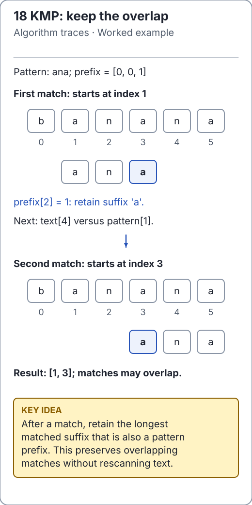
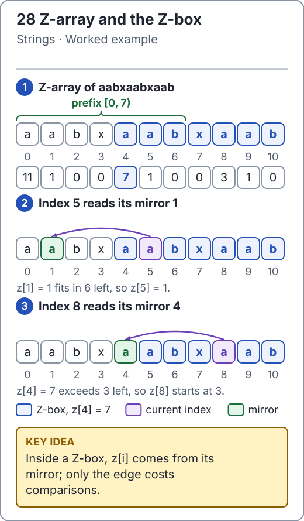
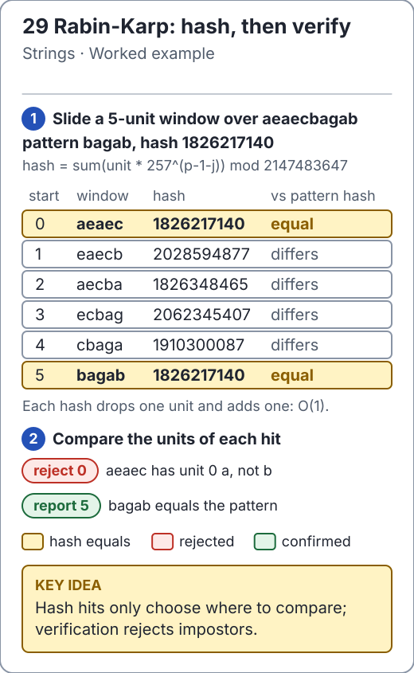
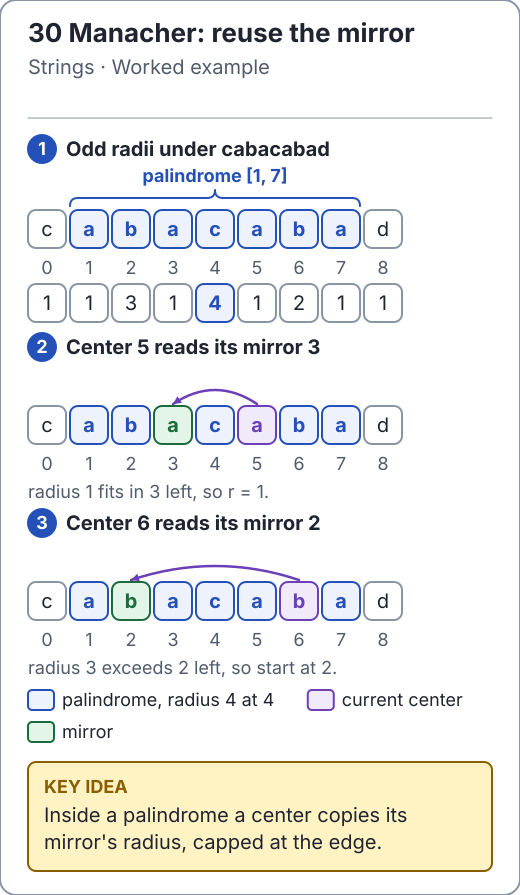

# Pattern matching: Z-function, Rabin–Karp and Manacher

Use these when one pattern is searched in one text, or when palindromes are the
question. The maintained
[StringAlgorithms](../../src/main/java/io/github/ichillous/dsa/algorithms/StringAlgorithms.java)
works on UTF-16 code units, never mutates inputs, rejects null and returns
immutable lists. `kmpFindAll`, `zFindAll` and `rabinKarpFindAll` return identical
results: every start index, overlaps included. An empty pattern matches at every
boundary `0..text.length()`.

| At a glance | |
| --- | --- |
| **Use it when** | One pattern is searched in one text and you need every match or a linear-time guarantee (KMP, Z-function), a cheap rolling-hash filter before an exact check (Rabin–Karp), or the longest palindromic substring (Manacher). |
| **Avoid it when** | You need one first match in ordinary text (use `String.indexOf`), many patterns at once (use Aho–Corasick), or many queries on one fixed text (use a suffix array). |
| **Cost** | `zFunction` and `longestPalindromicSubstring` are O(n); `zFindAll` is O(t + p + k); `rabinKarpFindAll` is O(t + p + k·p) when spurious hits are rare and O(t·p) in the worst case. |
| **In this repo** | [`StringAlgorithms`](../../src/main/java/io/github/ichillous/dsa/algorithms/StringAlgorithms.java): `kmpFindAll`, `zFunction`, `zFindAll`, `rabinKarpFindAll`, `longestPalindromicSubstring` |
| **In the JDK** | `String.indexOf` and `java.util.regex.Pattern` for searching; no direct equivalent for the Z-function or Manacher's algorithm |

## Which matcher

| Need | Choice | Why |
| --- | --- | --- |
| One first match in ordinary text | `String.indexOf` | Already in the JDK; no code to own |
| Guaranteed linear time, small extra space | KMP (`kmpIndexOf`, `kmpFindAll`) | O(t + p), table of size p |
| Prefix-overlap questions, or a matcher built from one array | Z-function (`zFunction`, `zFindAll`) | The z-array also answers borders and periods |
| Many equal-length windows, or a cheap filter before an exact check | Rabin–Karp (`rabinKarpFindAll`) | Rolling hash; every hit is verified |
| Many patterns in one pass | Aho–Corasick | One automaton for the whole dictionary |
| Many queries against one fixed text | Suffix array | Pay once to index the text, then each query is a binary search |
| Sublinear skipping on large alphabets | Boyer–Moore–Horspool | Not implemented here |

KMP never rescans the text. When a match ends, or a comparison fails, it keeps
the longest proper prefix of the pattern that is also a suffix of what matched,
so an overlapping match such as `aaa` inside `aaaaa` is found without restarting.

<!-- visual:generated kmp-overlap -->
<picture><source media="(prefers-color-scheme: dark)" srcset="../../docs/visuals/assets/kmp-overlap-dark.svg"></picture>

**Figure 18.** Prefix fallback retains the overlap between two pattern matches. [Visual index and step-throughs](../../docs/visuals/README.md).
<!-- /visual:generated -->

## The invariants

**Z-array.** `z[i]` is the length of the longest common prefix of the text and
its suffix starting at `i`; by convention `z[0] = text.length()`. The algorithm
keeps `[left, right)`, the rightmost prefix match seen so far. Inside it, `z[i]`
starts from `min(right - i, z[i - left])` because the window copies the prefix,
and only a unit past `right` can extend that value, so total work is O(n).

<!-- visual:generated z-box -->
<picture><source media="(prefers-color-scheme: dark)" srcset="../../docs/visuals/assets/z-box-dark.svg"></picture>

**Figure 91.** The Z-array of aabxaabxaab is 11, 1, 0, 0, 7, 1, 0, 0, 3, 1, 0; the match at index 4 is a Z-box [4, 11), index 5 copies z[1] = 1 from it, and index 8 starts at 3 because z[4] = 7 overruns the box. [Visual index and step-throughs](../../docs/visuals/README.md).
<!-- /visual:generated -->

`zFindAll` computes the z-array of `pattern + text`. A position `p + i` with
`z >= p` means the first `p` units of the combined string, which are the pattern,
also start there, so the pattern occurs at text index `i`. No separator is needed
because a match is read only as "at least `p`", never as an exact length.

**Rabin–Karp.** Each window of length `p` has hash
`sum(c[j] * 257^(p-1-j)) mod (2^31 - 1)`. Removing the outgoing unit and appending
the incoming one updates it in O(1). A window is reported only when its hash equals
the pattern hash *and* `startsWith` confirms the units. Operands stay below 2^31
and units below 2^16, so every product fits in a `long`.

<!-- visual:generated rabin-karp-rolling -->
<picture><source media="(prefers-color-scheme: dark)" srcset="../../docs/visuals/assets/rabin-karp-rolling-dark.svg"></picture>

**Figure 92.** Searching aeaecbagab for bagab slides a five-unit window; windows 0 and 5 have the pattern's hash, window 0 (aeaec) is rejected at unit 0 and window 5 is reported. [Visual index and step-throughs](../../docs/visuals/README.md).
<!-- /visual:generated -->

**Manacher.** For every center, the algorithm reuses the mirror image inside the
rightmost palindrome `[left, right]` found so far and expands only past `right`.
Odd and even centers are handled by two arrays. Among palindromes of equal length
the earliest start wins.

<!-- visual:generated manacher-mirror -->
<picture><source media="(prefers-color-scheme: dark)" srcset="../../docs/visuals/assets/manacher-mirror-dark.svg"></picture>

**Figure 93.** In cabacabad the palindrome abacaba around index 4 spans [1, 7]; index 5 copies radius 1 from index 3 and index 6 caps radius 3 from index 2 at the 2 units left, giving odd radii 1, 1, 3, 1, 4, 1, 2, 1, 1. [Visual index and step-throughs](../../docs/visuals/README.md).
<!-- /visual:generated -->

## Worked trace

Z-array of `aabxaab`:

```text
i  suffix    common prefix with "aabxaab"  z[i]
0  aabxaab   whole string (convention)      7
1  abxaab    a, then b != a                 1
2  bxaab     none                           0
3  xaab      none                           0
4  aab       a a b, then end                3
5  ab        a, then b != a                 1
6  b         none                           0
```

With `pattern = "aab"` and `text = "aabxaab"`, the combined string
`aabaabxaab` has `z >= 3` at combined positions 3 and 7, giving text starts 0
and 4.

## Executable example

```java
import io.github.ichillous.dsa.algorithms.StringAlgorithms;
import java.util.List;

assert java.util.Arrays.equals(StringAlgorithms.zFunction("aabxaab"),
        new int[] {7, 1, 0, 0, 3, 1, 0});
assert StringAlgorithms.zFindAll("aabxaab", "aab").equals(List.of(0, 4));
assert StringAlgorithms.zFindAll("aaaaa", "aaa").equals(List.of(0, 1, 2));
assert StringAlgorithms.rabinKarpFindAll("aaaaa", "aaa").equals(List.of(0, 1, 2));
assert StringAlgorithms.rabinKarpFindAll("abc", "").equals(List.of(0, 1, 2, 3));
assert StringAlgorithms.rabinKarpFindAll("abc", "abc").equals(
        StringAlgorithms.kmpFindAll("abc", "abc"));

StringAlgorithms.Span babad = StringAlgorithms.longestPalindromicSubstring("babad");
assert babad.equals(new StringAlgorithms.Span(0, 3));
assert "babad".substring(babad.startInclusive(), babad.endExclusive()).equals("bab");
assert StringAlgorithms.longestPalindromicSubstring("cbbd")
        .equals(new StringAlgorithms.Span(1, 3));
assert StringAlgorithms.longestPalindromicSubstring("")
        .equals(new StringAlgorithms.Span(0, 0));
```

## In real Java

For one match in ordinary code, call `String.indexOf`: it returns the smallest
index at which the pattern starts, or `-1`, and `indexOf(str, fromIndex)` resumes
from a position, so advancing `fromIndex` by one after each hit lists overlapping
matches. `java.util.regex.Matcher.find` behaves differently: each call resumes at
the first character not matched by the previous match, so overlapping matches are
skipped. `Pattern.quote` turns literal text into a pattern, so `.` is not a wildcard.

```java
import io.github.ichillous.dsa.algorithms.StringAlgorithms;
import java.util.ArrayList;
import java.util.List;
import java.util.regex.Matcher;
import java.util.regex.Pattern;

String text = "aaaaa";
List<Integer> viaIndexOf = new ArrayList<>();
for (int at = text.indexOf("aaa"); at >= 0; at = text.indexOf("aaa", at + 1)) {
    viaIndexOf.add(at);
}
assert viaIndexOf.equals(List.of(0, 1, 2));
assert viaIndexOf.equals(StringAlgorithms.kmpFindAll(text, "aaa"));

Matcher matcher = Pattern.compile(Pattern.quote("aaa")).matcher(text);
List<Integer> viaRegex = new ArrayList<>();
while (matcher.find()) {
    viaRegex.add(matcher.start());
}
assert viaRegex.equals(List.of(0));

assert !Pattern.compile(Pattern.quote("a.c")).matcher("abc").find();
assert Pattern.compile("a.c").matcher("abc").find();
```

## Costs

| Method | Time | Extra space |
| --- | --- | --- |
| `zFunction` | O(n) | O(n) result |
| `zFindAll` | O(t + p + k) | O(t + p + k): the concatenation and its z-array |
| `rabinKarpFindAll` | O(t + p + k·p) when spurious hits are rare; worst O(t·p) | O(1) plus the k results |
| `longestPalindromicSubstring` | O(n) | O(n) |

Rabin–Karp verifies each of its k reported matches in O(p), so its cost depends on
the input, not on chance. The worst case is real: for text `aaaa…` and pattern `aaa`,
every window matches and is verified in full. The base 257 and modulus 2^31 − 1 are
fixed, not randomized, so an adversary who knows them can also construct many
distinct windows with equal hashes.

## Pitfall: trusting the hash

Two different strings can have the same hash. A matcher that stops at
`windowHash == patternHash` reports false positives. The test suite finds two
different seven-unit strings with equal hashes by seeded search and checks that
`rabinKarpFindAll` rejects the impostor. The verification step is what makes the
answer exact; the hash only decides where to spend an O(p) comparison.

Positions are UTF-16 units. A supplementary character is two units, so a match
index may fall between the halves of a pair, and a palindrome is judged unit by
unit rather than by code point.

## Common mistakes

1. **Stopping at the hash.** `rabinKarpFindAll("aeaecbagab", "bagab")` is
   `[5]`, but windows 0 (`aeaec`) and 5 both hash to 1826217140. A matcher that
   reports on equal hashes also reports 0. The invariant broken: every reported
   index `i` must satisfy `text.startsWith(pattern, i)`.
2. **Testing `z == p` instead of `z >= p`.** For text `aaa` and pattern `aa`
   the combined string `aaaaa` has z-values 3, 2, 1 at positions 2, 3, 4, so
   the match at text index 0 has `z = 3`, longer than the pattern. An equality
   test misses it. The invariant: the pattern occurs at `i` exactly when the
   combined string's z-value at `p + i` is at least `p`.
3. **Copying a mirror radius without the cap.** In `cabacabad`, center 6 mirrors
   center 2, whose radius is 3, but only 2 units remain up to the palindrome's
   right edge 7. Copying 3 claims that `cabad` (indices 4 to 8) is a palindrome,
   which is false. The invariant: a
   copied radius may not exceed `right - i + 1`; beyond the edge nothing is known.

## Check yourself

<details>
<summary>Why does <code>zFindAll</code> need no separator between the pattern and the text?</summary>

A match is read only as "z at `p + i` is at least `p`", never as an exact length,
so a z-value that runs past the pattern into the text cannot cause a false match.
The pattern's own prefix is what the z-value compares against.

</details>

<details>
<summary>Text <code>aeaecbagab</code>, pattern <code>bagab</code>: two windows share the pattern's hash. What does <code>rabinKarpFindAll</code> return?</summary>

`[5]`. Both window 0 and window 5 trigger a comparison, but window 0 differs from
the pattern at its first unit (`a` against `b`) and is rejected; only window 5
equals the pattern.

</details>

<details>
<summary>In <code>cabacabad</code>, why is the radius at center 6 equal to 2 although its mirror's radius is 3?</summary>

The current palindrome ends at index 7, so only 2 units to the right of center 6
are known to mirror. The algorithm starts at 2, then compares `c` (index 4) with
`d` (index 8), which differ, so the radius stays 2.

</details>

## Practice

1. Compute the z-array of `abacaba` by hand, then use it to list every border
   (a proper prefix that is also a suffix) of the string.
2. Rolling-hash `abcd` with window 2 using a tiny base and modulus of your choice.
   Find a different pair of windows that collide, and say what the verified matcher
   does with them.
3. Trace Manacher's algorithm on `abaaba`. Which center gives the longest
   palindrome, and what is its half-open span?

To search many patterns at once, or to index a fixed text for repeated queries, continue with
[multi-pattern matching and suffix arrays](multi-pattern-and-suffix-arrays.md).

Browse the [catalog](../../docs/catalog.md) and the
[complexity guide](../../docs/complexity.md) for the assumptions behind these bounds. The [solution finder](../../docs/solution-finder.md#13-string-matching-and-text) compares this technique with its alternatives.
