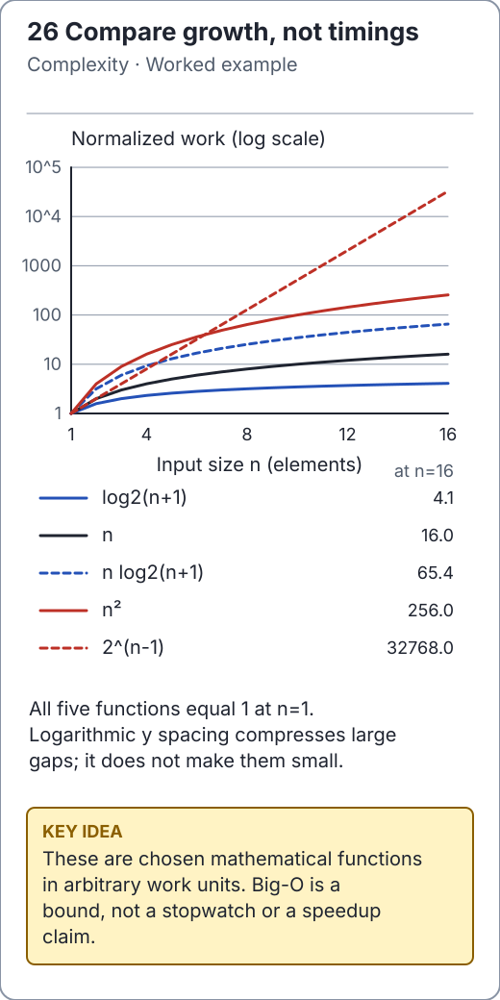

# Time complexity: name the input and the case

A complexity statement describes how a count of operations grows with an input
parameter. It is not a stopwatch result. State what `n` means, what counts as a
constant-time operation, and whether the bound is worst-case, best-case, expected
or amortized. The [maintained table](../docs/complexity.md) applies these choices
to the actual source implementations.

<!-- visual:generated -->
<picture><source media="(prefers-color-scheme: dark)" srcset="../docs/visuals/assets/complexity-growth-dark.svg"></picture>

**Figure 26.** Five illustrative functions share a value of one at input size one. A logarithmic work axis shows logarithmic, linear, n log n, quadratic and exponential growth without implying benchmark timings. [Visual index and step-throughs](../docs/visuals/README.md).
<!-- /visual:generated -->

## Upper, lower and tight bounds

`O(f(n))` is an asymptotic upper bound, `Ω(f(n))` a lower bound and `Θ(f(n))` a
matching pair. Big O does not intrinsically mean “worst case”: specify the running
cost function being bounded. A linear scan has constant best-case time for a
first-position hit and linear worst-case time for absence.

```java
import io.github.ichillous.dsa.algorithms.SearchAlgorithms;

int[] values = {8, 3, 5, 1};
assert SearchAlgorithms.linearSearch(values, 8) == 0;
assert SearchAlgorithms.linearSearch(values, 9) == -1;
assert SearchAlgorithms.binarySearch(new int[] {1, 3, 5, 8}, 5) == 2;
```

The scan performs at most `n` equality checks. Binary search shrinks an already
sorted unknown interval by a constant factor, so it uses O(log(n + 1)) comparisons.
Sorting or validating first must be included when it is part of the requested task.

## Count the actual iteration ranges

For two full loops of length `n`, the count is `n²`. For a triangular loop, it is
`1 + 2 + ... + n = n(n+1)/2`, still Θ(n²). The invariant is that the counter equals
the number of innermost visits completed so far; the ranges determine the sum.

```java
int n = 8;
long squareVisits = 0L;
long triangularVisits = 0L;
for (int row = 0; row < n; row++) {
    for (int column = 0; column < n; column++) {
        squareVisits++;
    }
    for (int column = 0; column <= row; column++) {
        triangularVisits++;
    }
}
assert squareVisits == 64L;
assert triangularVisits == 36L;
```

**Counterexample:** nested loops are not automatically quadratic. If the inner
loop doubles a positive index until it reaches `n`, it performs O(log n) visits
per outer iteration, giving O(n log n). If both indices move monotonically across
the array and never restart, two nested-looking loops may total only O(n).

## Four distinct qualifiers

| Qualifier | Meaning | Example assumption |
| --- | --- | --- |
| Worst case | Upper bound for every valid input of the stated size | Unbalanced BST can have height `n` |
| Best case | Cheapest valid input of that size | Early-exit bubble sort on sorted input |
| Expected | Average under a stated probabilistic/distribution model | Hash chains stay short with suitable key distribution |
| Amortized | Total bound over a sequence, without randomness | Geometric array growth gives O(1) append per operation amortized |

A single dynamic-array append can copy all existing elements. Amortized O(1) does
not promise constant latency for that append. An adversarial hash distribution
can make a lookup linear even when load factor is bounded.

Primitive comparisons and arithmetic are usually treated as O(1) in this library's
RAM model. Comparing long strings or adding growing `BigInteger` values requires
including their lengths. Amount-based DP is pseudopolynomial in its numeric
amount, and enumeration may require output proportional to `n!`.

## Practice

1. Derive the exact counts in the two loops for general `n` before simplifying.
2. Explain why checking sortedness inside every binary-search call costs O(n).
3. Distinguish a typical quicksort partition shape from a randomized expected bound.

Continue with [recurrences and amortization](../algorithms/complexity-analysis/time-complexity.md),
then check the [solutions](../docs/solutions.md).
