# Data structures

These lessons explain how each structure stores its data, the invariant that keeps it correct, what each operation costs, and which maintained Java class implements it. Start from the question you need answered most often; the map below names the family that answers it, a method to start with and the folder to open.

| At a glance | |
| --- | --- |
| **Use it when** | You must decide how to store data so that the question you ask most (by position, arrival, key, order, priority, prefix, range, connectivity, or approximately) stays cheap. |
| **Avoid it when** | You need a procedure rather than a container: searching, sorting, graph methods and dynamic programming live in [algorithms](../algorithms/README.md). |
| **Cost** | Each lesson states its bounds; the [complexity guide](../docs/complexity.md) collects them for every maintained class. |
| **In this repo** | The [`collections`](../src/main/java/io/github/ichillous/dsa/collections), [`structures`](../src/main/java/io/github/ichillous/dsa/structures) and [`graphs`](../src/main/java/io/github/ichillous/dsa/graphs) packages. |
| **In the JDK** | `java.util` collections such as `ArrayList`, `ArrayDeque`, `HashMap`, `TreeMap` and `PriorityQueue`; each lesson names the closest one. |

<!-- visual:generated data-structures-map | Each card pairs a question with the family that answers it, a method to start with and the folder to open. -->
<picture><source media="(prefers-color-scheme: dark)" srcset="../docs/visuals/assets/data-structures-map-dark.svg"></picture>

**Figure 52.** Each card pairs a question with the family that answers it, a method to start with and the folder to open. [Visual index and step-throughs](../docs/visuals/README.md).
<!-- /visual:generated -->

## Start here

1. [Arrays: position is the address](arrays/overview.md): contiguous storage and amortized growth, which most other structures build on.
2. [Hash tables: separate equality from position](hash-tables/overview.md): the default for lookups by key, and the base of the LRU and LFU caches.
3. [Trees: choose the invariant before the shape](trees/overview.md): how ordered keys, priorities, prefixes and ranges each call for a different tree.
4. [Binary heaps: a partial order is enough](heaps/overview.md): the structure behind priority queues, Dijkstra's algorithm and top-k.
5. [Graphs: model relationships explicitly](graphs/overview.md): vertices, edges and representations, the entry point to the graph algorithms.

## Pick by problem

| If you need to | Read | Solution finder |
| :--- | :--- | :--- |
| Read or replace the item at an index, and append cheaply | [Arrays](arrays/overview.md) | none |
| Handle items oldest first (queue) or newest first (stack) | [Queues](queues/overview.md), [stacks](stacks/overview.md) | [Stack or queue](../docs/solution-finder.md#last-in-first-out-stack-or-first-in-first-out-queue) |
| Find a value by key when order does not matter | [Hash tables](hash-tables/overview.md) | [Look up by key](../docs/solution-finder.md#find-a-value-by-key-when-order-does-not-matter) |
| Keep the most recently used entries | [Hash tables](hash-tables/overview.md) | [LRU](../docs/solution-finder.md#keep-the-most-recently-used-entries-lru) |
| Evict the least frequently used entry | [LFU cache](hash-tables/lfu-cache.md) | [LFU](../docs/solution-finder.md#evict-the-least-frequently-used-entry) |
| Find the nearest key, or count keys in a range | [Red-black trees](trees/red-black-trees.md) | [Nearest key](../docs/solution-finder.md#find-the-nearest-key-floor-ceiling-or-scan-a-key-range) |
| Always take the smallest item next | [Binary heaps](heaps/overview.md) | [Smallest next](../docs/solution-finder.md#always-take-the-smallest-or-largest-item-next) |
| List every word that starts with a prefix | [Tries](tries/overview.md) | [Prefix search](../docs/solution-finder.md#find-all-keys-that-start-with-a-prefix-autocomplete) |
| Answer range sums while values change | [Range queries](range-queries/overview.md) | [Range queries](../docs/solution-finder.md#update-values-or-ranges-while-answering-range-sums) |
| Ask whether two items are in the same group as groups merge | [Union-find](union-find/overview.md) | [Disjoint sets](../docs/solution-finder.md#merge-groups-and-ask-whether-two-items-are-in-the-same-group) |
| Ask "have I seen this item?" with little memory | [Bloom filter and Count-Min sketch](probabilistic/overview.md) | [Approximate membership](../docs/solution-finder.md#ask-have-i-seen-this-item-with-limited-memory) |
| Choose between an adjacency list and a matrix | [Graph representations](graphs/representation.md) | none |

## Every lesson

Generated from each lesson's first figure, title and "Use it when" row.

<!-- visual:gallery data-structures -->
### Arrays

| Figure | Lesson | Use it when |
| :---: | :--- | :--- |
| <a href="arrays/operations.md"><picture><source media="(prefers-color-scheme: dark)" srcset="../docs/visuals/assets/array-insertion-dark.svg">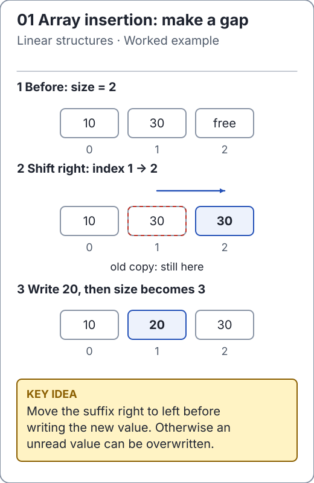</picture></a> | [Array operations: move the right elements](arrays/operations.md) | You need ordered, indexed storage that grows, and you can pay O(n) for an insertion or removal away from the end. |
| <a href="arrays/overview.md"><picture><source media="(prefers-color-scheme: dark)" srcset="../docs/visuals/assets/array-vs-list-access-dark.svg">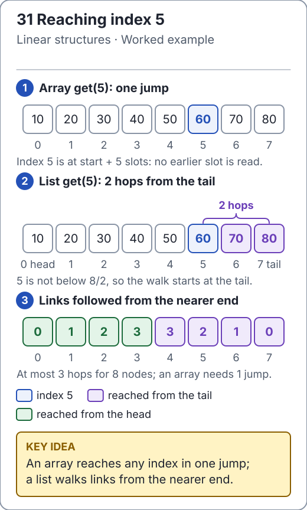</picture></a> | [Arrays: position is the address](arrays/overview.md) | Positions matter and you read or replace by index far more often than you insert or remove in the middle. |

### Graphs

| Figure | Lesson | Use it when |
| :---: | :--- | :--- |
| <a href="graphs/overview.md"><picture><source media="(prefers-color-scheme: dark)" srcset="../docs/visuals/assets/shortest-path-chooser-dark.svg">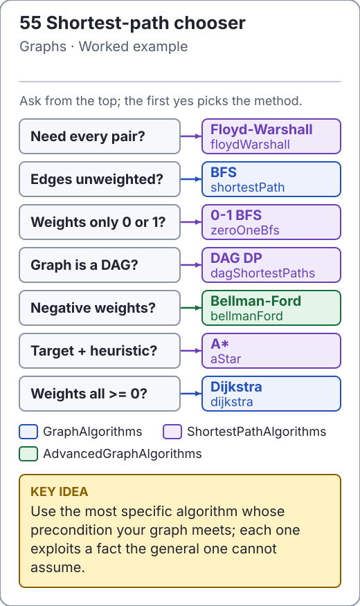</picture></a> | [Graphs: model relationships explicitly](graphs/overview.md) | Entities and relationships form a network: routes, prerequisites, links between accounts. |
| <a href="graphs/representation.md"><picture><source media="(prefers-color-scheme: dark)" srcset="../docs/visuals/assets/graph-representations-dark.svg">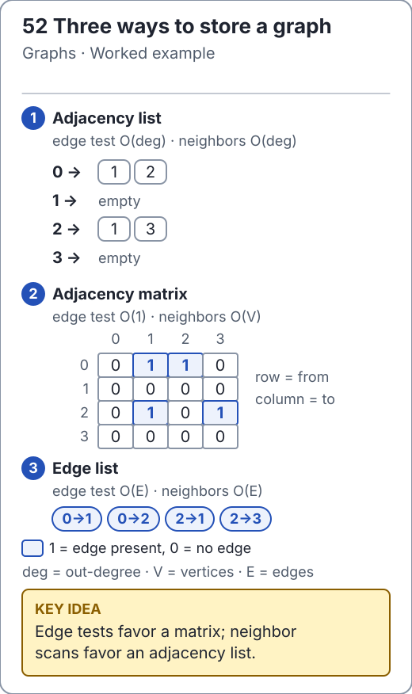</picture></a> | [Graph representations: pay for the operations you need](graphs/representation.md) | You must decide how edges are stored before writing algorithms: a list when you scan neighbors, a matrix when you test arbitrary edges. |
| <a href="graphs/traversal.md"><picture><source media="(prefers-color-scheme: dark)" srcset="../docs/visuals/assets/bfs-vs-dfs-order-dark.svg">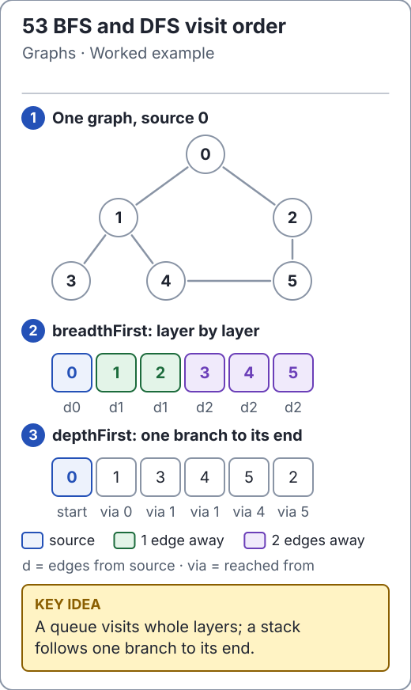</picture></a> | [Graph traversal: schedule each vertex deliberately](graphs/traversal.md) | You need what is reachable, the fewest edges to a target, connected components or a dependency order. |

### Hash tables

| Figure | Lesson | Use it when |
| :---: | :--- | :--- |
| <a href="hash-tables/collision-resolution.md"><picture><source media="(prefers-color-scheme: dark)" srcset="../docs/visuals/assets/hash-chaining-dark.svg">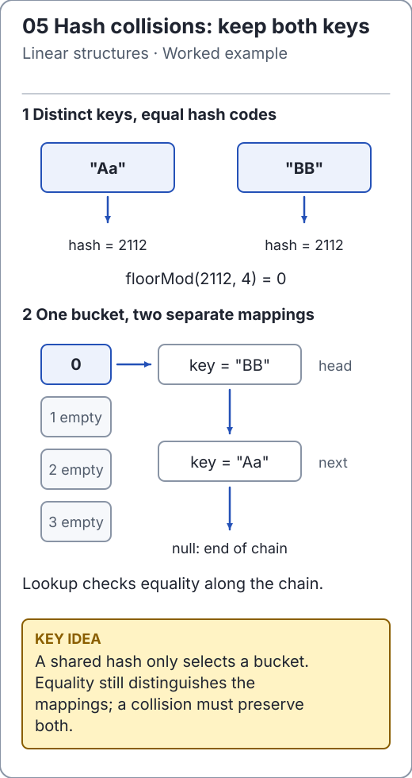</picture></a> | [Collision resolution: never confuse a bucket with a key](hash-tables/collision-resolution.md) | Choosing or reviewing how a hash table resolves two keys that select the same bucket or slot. |
| <a href="hash-tables/functions.md"><picture><source media="(prefers-color-scheme: dark)" srcset="../docs/visuals/assets/hash-chaining-dark.svg"></picture></a> | [Hash functions and key contracts](hash-tables/functions.md) | You define a key type, or need to understand how a hash code becomes a bucket or slot index. |
| <a href="hash-tables/lfu-cache.md"><picture><source media="(prefers-color-scheme: dark)" srcset="../docs/visuals/assets/lfu-buckets-dark.svg">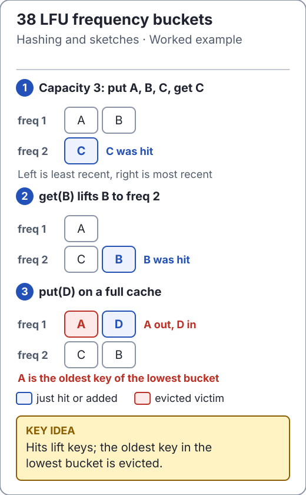</picture></a> | [LFU cache: evict the least used, break ties by recency](hash-tables/lfu-cache.md) | A few keys are used far more often than the rest and a one-time scan over cold keys must not flush them. |
| <a href="hash-tables/open-addressing.md"><picture><source media="(prefers-color-scheme: dark)" srcset="../docs/visuals/assets/open-addressing-probe-dark.svg">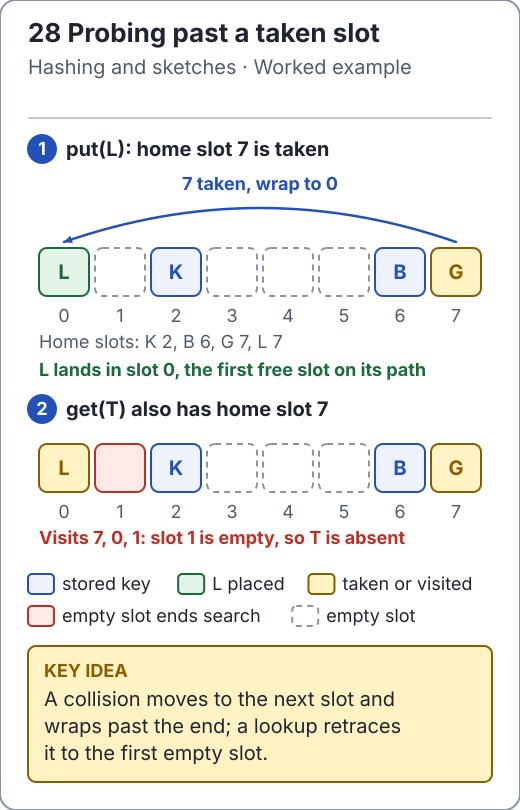</picture></a> | [Open addressing: linear probing with backward-shift deletion](hash-tables/open-addressing.md) | You want a hash map with no per-entry nodes, many small entries, and neighboring slots that share cache lines. |
| <a href="hash-tables/overview.md"><picture><source media="(prefers-color-scheme: dark)" srcset="../docs/visuals/assets/lru-recency-dark.svg">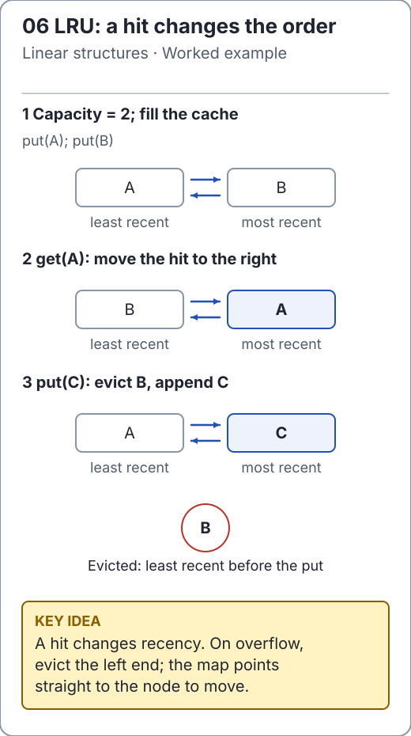</picture></a> | [Hash tables: separate equality from position](hash-tables/overview.md) | You look entries up by key and need no ordering: membership, counting, indexing, caching. |

### Heaps

| Figure | Lesson | Use it when |
| :---: | :--- | :--- |
| <a href="heaps/operations.md"><picture><source media="(prefers-color-scheme: dark)" srcset="../docs/visuals/assets/heap-anatomy-dark.svg">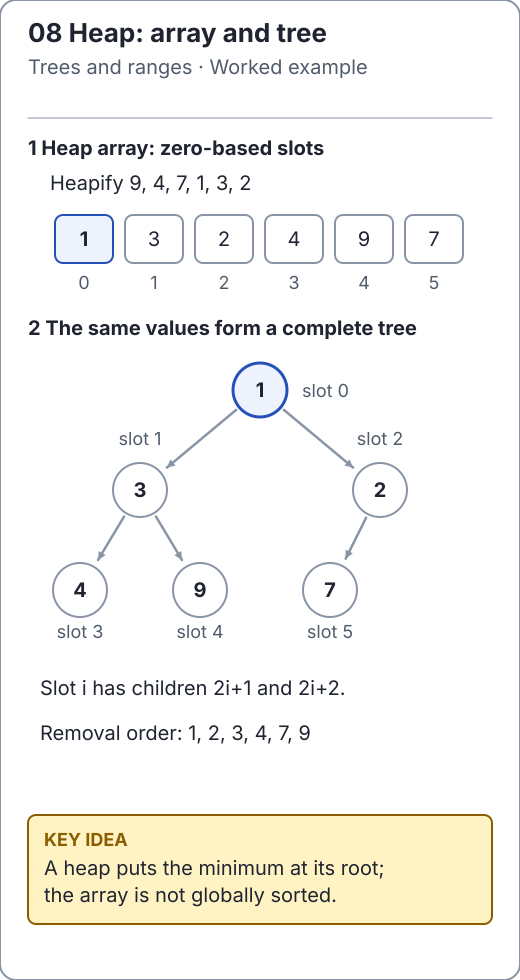</picture></a> | [Heap operations: restore order along one path](heaps/operations.md) | You need to understand or review how a binary heap restores order after add, remove and bulk construction. |
| <a href="heaps/overview.md"><picture><source media="(prefers-color-scheme: dark)" srcset="../docs/visuals/assets/heap-anatomy-dark.svg"></picture></a> | [Binary heaps: a partial order is enough](heaps/overview.md) | You repeatedly need the smallest (or largest) of a changing collection: scheduling, event simulation, Dijkstra, the best `k` of a stream. |

### Linked lists

| Figure | Lesson | Use it when |
| :---: | :--- | :--- |
| <a href="linked-lists/doubly.md"><picture><source media="(prefers-color-scheme: dark)" srcset="../docs/visuals/assets/linked-unlink-dark.svg">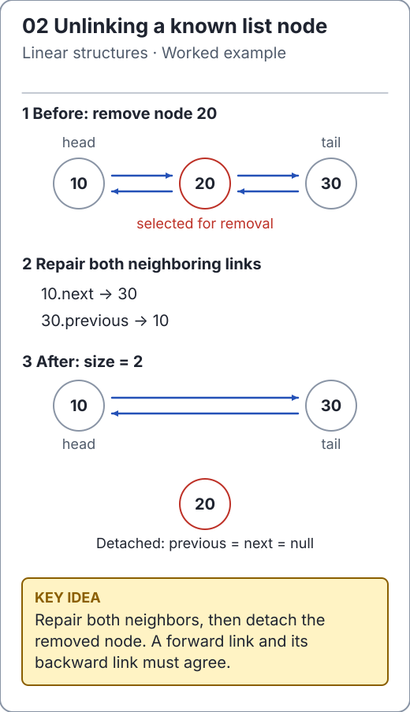</picture></a> | [Doubly linked lists: repair both neighbors](linked-lists/doubly.md) | You need O(1) changes at both ends or O(1) removal of a node you hold, as in an LRU recency list. |
| <a href="linked-lists/overview.md"><picture><source media="(prefers-color-scheme: dark)" srcset="../docs/visuals/assets/linked-unlink-dark.svg"></picture></a> | [Linked lists: preserve connections](linked-lists/overview.md) | You work at the ends or at nodes you already hold, as in queues, deques and recency lists. |
| <a href="linked-lists/singly.md"><picture><source media="(prefers-color-scheme: dark)" srcset="../docs/visuals/assets/singly-insert-after-dark.svg">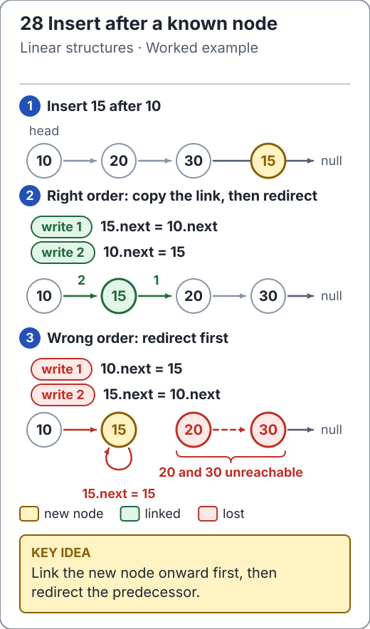</picture></a> | [Singly linked lists: one direction, explicit predecessors](linked-lists/singly.md) | You only walk forward and edit at the head, or you keep a tail for appends and never remove from the back. |

### Probabilistic structures

| Figure | Lesson | Use it when |
| :---: | :--- | :--- |
| <a href="probabilistic/overview.md"><picture><source media="(prefers-color-scheme: dark)" srcset="../docs/visuals/assets/bloom-filter-bits-dark.svg">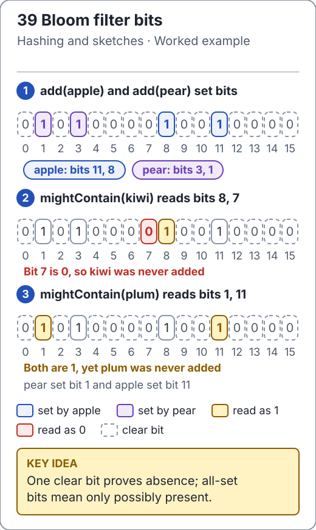</picture></a> | [Probabilistic membership and frequency: Bloom filter and Count-Min sketch](probabilistic/overview.md) | Exact answers cost too much memory and a small one-sided error is acceptable: skip a disk lookup for most absent keys (Bloom filter), or track approximate counts in a huge key space (Count-Min sketch). |

### Queues

| Figure | Lesson | Use it when |
| :---: | :--- | :--- |
| <a href="queues/implementation.md"><picture><source media="(prefers-color-scheme: dark)" srcset="../docs/visuals/assets/queue-wrap-dark.svg">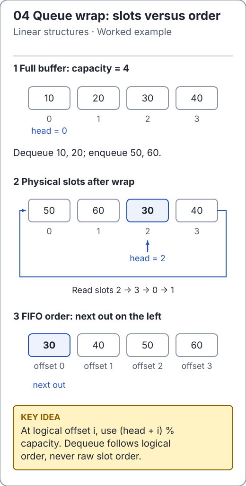</picture></a> | [Circular queues and deques](queues/implementation.md) | You need FIFO order, or both-end insertion and removal, without per-element node allocation. |
| <a href="queues/overview.md"><picture><source media="(prefers-color-scheme: dark)" srcset="../docs/visuals/assets/queue-wrap-dark.svg"></picture></a> | [Queues: process in arrival order](queues/overview.md) | Earlier arrivals must be handled first: breadth-first traversal, buffering, simple task processing. |
| <a href="queues/priority-queues.md"><picture><source media="(prefers-color-scheme: dark)" srcset="../docs/visuals/assets/heap-anatomy-dark.svg"></picture></a> | [Priority queues: remove the best candidate](queues/priority-queues.md) | The next item to process is the one with the best priority, not the oldest: scheduling, Dijkstra, event simulation, top-`k`. |

### Range queries

| Figure | Lesson | Use it when |
| :---: | :--- | :--- |
| <a href="range-queries/overview.md"><picture><source media="(prefers-color-scheme: dark)" srcset="../docs/visuals/assets/fenwick-blocks-dark.svg">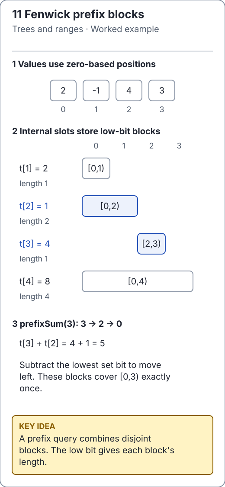</picture></a> | [Range queries: sparse tables and lazy segment trees](range-queries/overview.md) | Many range queries (sum or minimum) hit the same array, so some build work is worth paying for. |

### Stacks

| Figure | Lesson | Use it when |
| :---: | :--- | :--- |
| <a href="stacks/implementation.md"><picture><source media="(prefers-color-scheme: dark)" srcset="../docs/visuals/assets/stack-bracket-matching-dark.svg">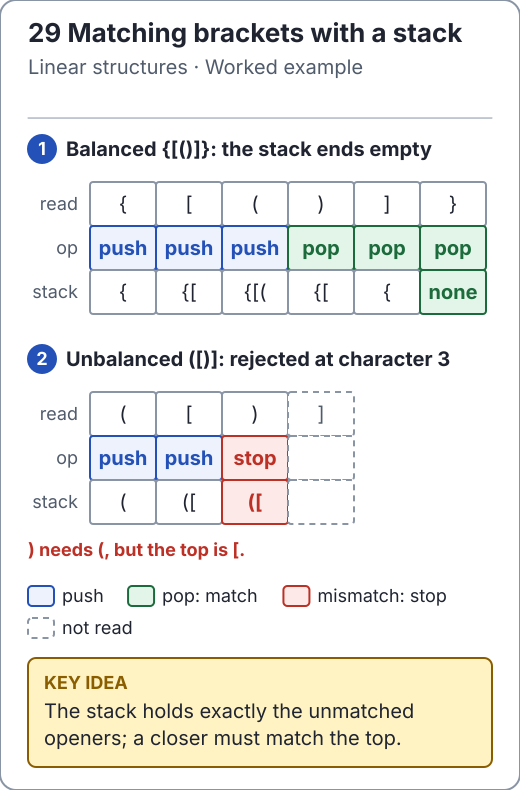</picture></a> | [Implementing a stack by composition](stacks/implementation.md) | You want LIFO access over growable storage and the empty-state, bounds and growth rules to be inspectable. |
| <a href="stacks/overview.md"><picture><source media="(prefers-color-scheme: dark)" srcset="../docs/visuals/assets/stack-lifo-dark.svg">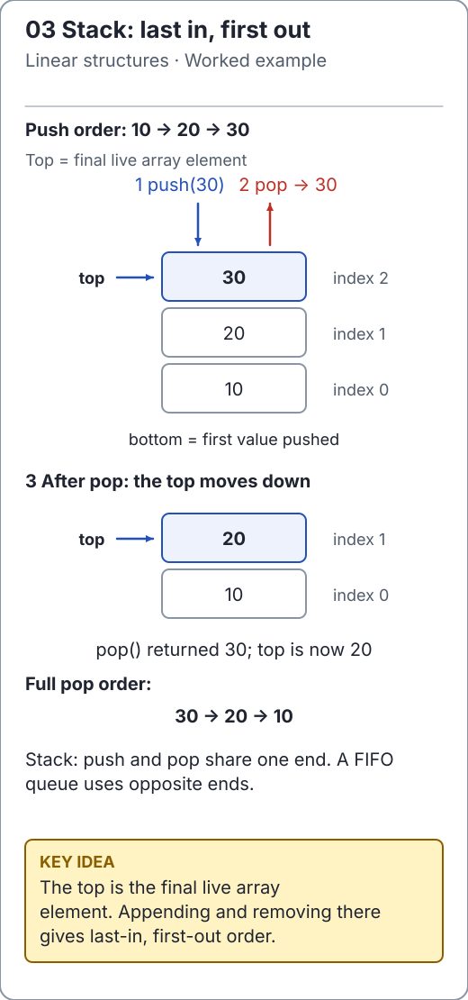</picture></a> | [Stacks: the most recent unfinished task](stacks/overview.md) | The most recent unfinished item must be handled first: nested brackets, undo history, explicit DFS or traversal frames. |

### Trees

| Figure | Lesson | Use it when |
| :---: | :--- | :--- |
| <a href="trees/avl-trees.md"><picture><source media="(prefers-color-scheme: dark)" srcset="../docs/visuals/assets/avl-rotation-dark.svg">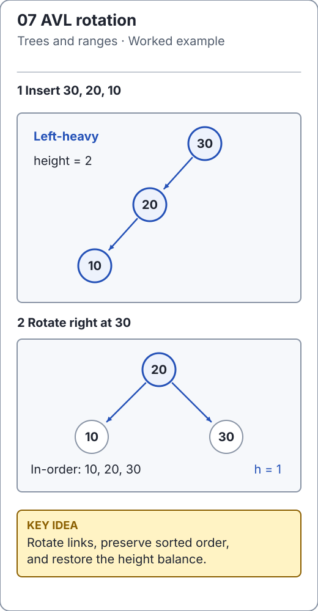</picture></a> | [AVL trees: restore balance locally](trees/avl-trees.md) | Lookups dominate and you want the shallowest guaranteed height, with membership and sorted traversal only |
| <a href="trees/binary-search-trees.md"><picture><source media="(prefers-color-scheme: dark)" srcset="../docs/visuals/assets/bst-delete-successor-dark.svg">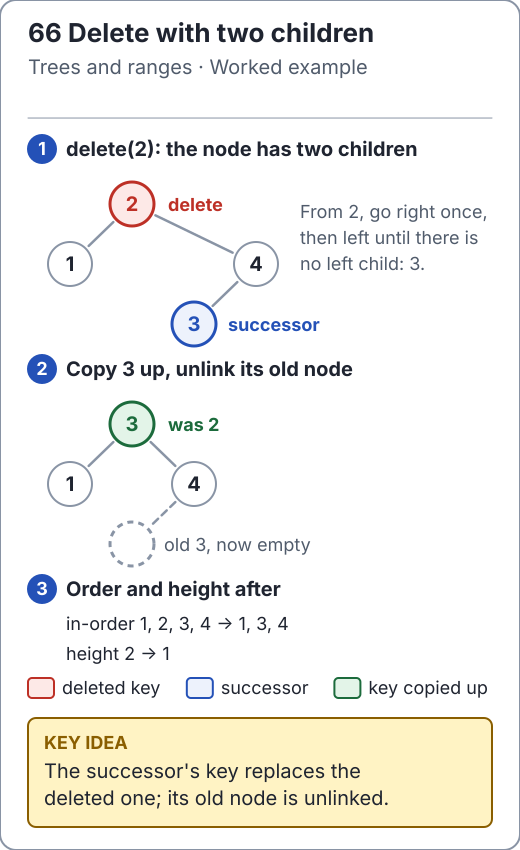</picture></a> | [Binary search trees: an invariant over descendants](trees/binary-search-trees.md) | Keys are inserted and removed over time and you need ordered membership or sorted traversal, and the input order is not adversarial |
| <a href="trees/binary-trees.md"><picture><source media="(prefers-color-scheme: dark)" srcset="../docs/visuals/assets/tree-traversals-dark.svg">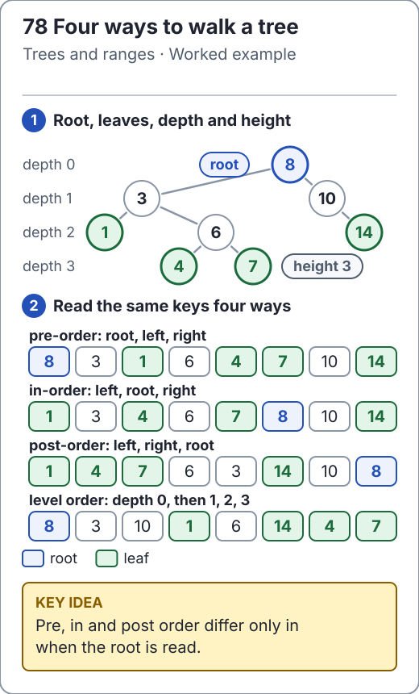</picture></a> | [Binary trees: shape and traversal are separate choices](trees/binary-trees.md) | You model a hierarchy with at most two children per node, such as an expression tree, and need to name traversal orders precisely |
| <a href="trees/overview.md"><picture><source media="(prefers-color-scheme: dark)" srcset="../docs/visuals/assets/tree-traversals-dark.svg"></picture></a> | [Trees: choose the invariant before the shape](trees/overview.md) | You must pick a tree: ordered keys, repeated minimum, prefixes or interval queries each need a different invariant |
| <a href="trees/red-black-trees.md"><picture><source media="(prefers-color-scheme: dark)" srcset="../docs/visuals/assets/red-black-23-nodes-dark.svg">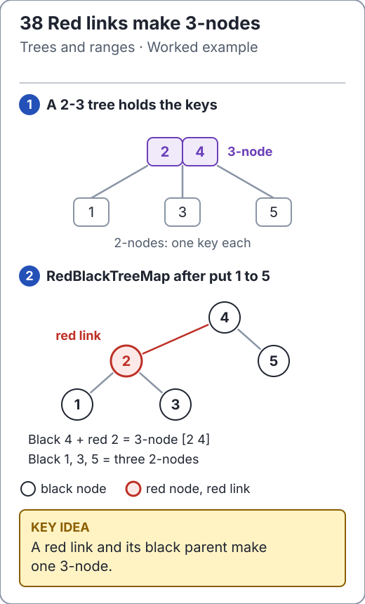</picture></a> | [Red-black trees: a 2-3 tree in binary form](trees/red-black-trees.md) | Keys change while you keep asking ordered questions: nearest key, rank, select or range counts |

### Tries

| Figure | Lesson | Use it when |
| :---: | :--- | :--- |
| <a href="tries/implementation.md"><picture><source media="(prefers-color-scheme: dark)" srcset="../docs/visuals/assets/trie-pruning-dark.svg">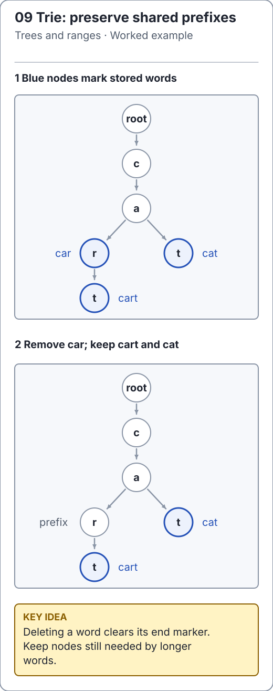</picture></a> | [Trie updates: prune paths without deleting other words](tries/implementation.md) | You need to know exactly how a trie inserts, prunes on delete and collects suggestions with a limit. |
| <a href="tries/overview.md"><picture><source media="(prefers-color-scheme: dark)" srcset="../docs/visuals/assets/trie-pruning-dark.svg"></picture></a> | [Tries: share prefixes, mark whole words separately](tries/overview.md) | Prefix queries such as autocomplete are central, over a set of strings that changes. |

### Union-find

| Figure | Lesson | Use it when |
| :---: | :--- | :--- |
| <a href="union-find/overview.md"><picture><source media="(prefers-color-scheme: dark)" srcset="../docs/visuals/assets/union-find-dark.svg">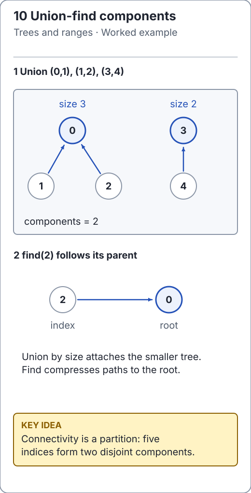</picture></a> | [Union-find: merge groups, ask who is together](union-find/overview.md) | Groups only merge and you ask "are these connected?": Kruskal's algorithm, cycle detection while adding undirected edges, grouping equivalent items. |

<!-- /visual:gallery -->

See also the [solution finder](../docs/solution-finder.md), the [implementation catalog](../docs/catalog.md), the [complexity guide](../docs/complexity.md) and the [visual index](../docs/visuals/README.md).
