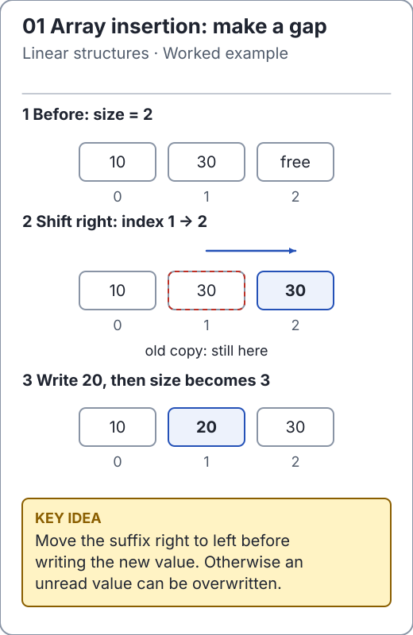
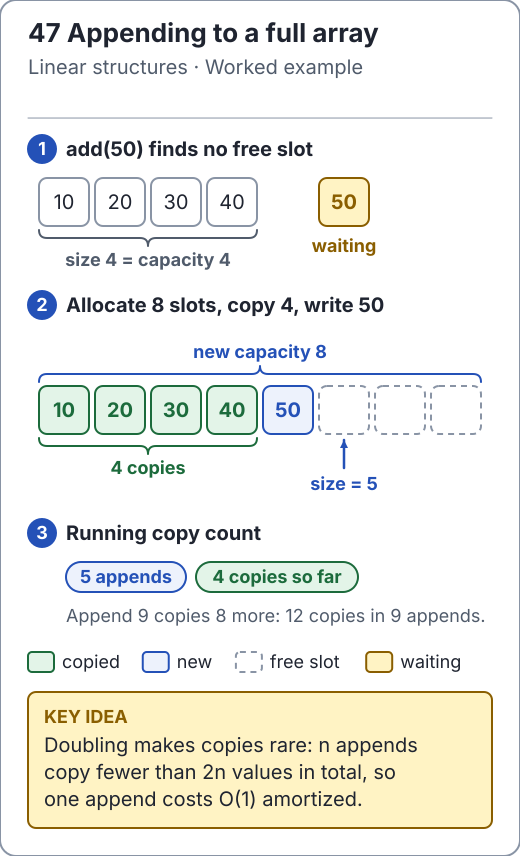

# Array operations: move the right elements

Use [`DynamicArray`](../../src/main/java/io/github/ichillous/dsa/collections/DynamicArray.java) to study resizable indexed storage. The implementation owns its backing array, preserves insertion order, rejects null elements and exposes only the live prefix through its iterator.

| At a glance | |
| --- | --- |
| **Use it when** | You need ordered, indexed storage that grows, and you can pay O(n) for an insertion or removal away from the end. |
| **Avoid it when** | You insert or remove at the front or middle all the time, or you need stable node references while the sequence changes. |
| **Cost** | `get`/`set` O(1); `add(index, x)` and `remove(index)` O(n); append O(1) amortized, O(n) when a resize copies. |
| **In this repo** | [`DynamicArray`](../../src/main/java/io/github/ichillous/dsa/collections/DynamicArray.java) |
| **In the JDK** | `java.util.ArrayList` |

## Insertion and removal invariants

<!-- visual:generated array-insertion -->
<picture><source media="(prefers-color-scheme: dark)" srcset="../../docs/visuals/assets/array-insertion-dark.svg"></picture>

**Figure 01.** Shift the suffix before writing the new value into the live array. [Visual index and step-throughs](../../docs/visuals/README.md).
<!-- /visual:generated -->

To insert `X` at index 1 in `[A, B, C]`, first ensure capacity. Shift elements **right to left**, then write `X` and increase size.

```text
before         A B C _
move C         A B C C
move B         A B B C
write X        A X B C
```

Copying left to right would overwrite `C` before it could be moved. Removal goes in the opposite direction: shift the suffix left, reduce size, and clear the vacated last reference so removed objects can be collected.

```java
import io.github.ichillous.dsa.collections.DynamicArray;

DynamicArray<Integer> values = new DynamicArray<>(1);
values.add(10);
values.add(30);
values.add(1, 20);
int removed = values.remove(0);
int previous = values.set(1, 99);
assert removed == 10;
assert previous == 30;
assert values.size() == 2;
assert values.get(0) == 20 && values.get(1) == 99;
```

`set` replaces a value and returns the previous value; it does not change size. `remove(int)` removes by index, unlike the overloaded value-removal APIs on some JDK lists. `clear()` retains capacity for reuse.

<!-- visual:generated dynamic-array-growth -->
<picture><source media="(prefers-color-scheme: dark)" srcset="../../docs/visuals/assets/dynamic-array-growth-dark.svg"></picture>

**Figure 35.** A DynamicArray with capacity 4 holds 10, 20, 30 and 40, so add(50) allocates 8 slots, copies the four values and writes 50 at index 4. That append copies 4 values; the next copy happens at append 9 and moves 8, for 12 copies in 9 appends. [Visual index and step-throughs](../../docs/visuals/README.md).
<!-- /visual:generated -->

The growth policy is visible through `capacity()`, which returns the backing array's length and never shrinks. Counting capacity changes over 1,000 appends shows why doubling is cheap: each resize copies the live elements once, and the copies add up to less than twice the final size.

```java
import io.github.ichillous.dsa.collections.DynamicArray;

DynamicArray<Integer> values = new DynamicArray<>(1);
int resizes = 0;
int copied = 0;
for (int n = 1; n <= 1000; n++) {
    int capacityBefore = values.capacity();
    int sizeBefore = values.size();
    values.add(n);
    if (values.capacity() != capacityBefore) {
        resizes++;
        copied += sizeBefore; // A resize copies every live element once.
    }
}
assert resizes == 10;           // Capacities 2, 4, 8, ..., 1024.
assert values.capacity() == 1024;
assert copied == 1023;          // 1 + 2 + 4 + ... + 512
assert copied < 2 * values.size();
```

Growing by one slot instead would copy `1 + 2 + ... + 999 = 499,500` elements for the same 1,000 appends.

## Boundaries are part of the API

```java
import io.github.ichillous.dsa.collections.DynamicArray;

DynamicArray<String> values = new DynamicArray<>();
values.add(0, "first"); // Insertion at size is allowed.
boolean rejected = false;
try {
    values.get(values.size()); // Reading at size is not allowed.
} catch (IndexOutOfBoundsException expected) {
    rejected = true;
}
assert rejected;
assert values.size() == 1;
```

## Aggregates without shifting

A [Fenwick tree](../../src/main/java/io/github/ichillous/dsa/structures/FenwickTree.java) stores sums of selected intervals. At internal one-based index `i`, the low set bit `i & -i` determines the interval length. A prefix query repeatedly removes that low bit; a point addition visits the ancestors covering that position.

```java
import io.github.ichillous.dsa.structures.FenwickTree;

FenwickTree sums = new FenwickTree(new long[] {2, -1, 4, 3});
assert sums.prefixSum(3) == 5;
sums.add(1, 5); // The logical values are now [2, 4, 4, 3].
assert sums.rangeSum(1, 3) == 8;
assert sums.rangeSum(2, 2) == 0;
```

Fenwick construction costs O(n) time/space; updates and queries cost O(log n) time. Construction or an update throws `ArithmeticException` if and only if a final stored node sum overflows `long`, and an overflowing update leaves the tree unchanged. Queries are exact: they throw only when the true prefix or range sum is outside `long`, even if an intermediate prefix would overflow. It supports additions, not an O(1) general-purpose `set`.

Dynamic-array access/replacement is O(1), indexed shifting is O(n), and append is O(1) amortized with O(n) resize events. Iterators fail fast after structural changes; replacing an element is not structural. Fail-fast behavior detects mistakes and does not make concurrent mutation safe.

## In real Java

`ArrayList` has the same two-overload trap that `DynamicArray` avoids by name: `remove(int)` removes by position and `remove(Object)` removes by value. With `Integer` elements the compiler picks the overload from the static type of the argument.

```java
import java.util.ArrayList;
import java.util.List;

List<Integer> list = new ArrayList<>(List.of(10, 20, 30));
int byIndex = list.remove(1);                 // remove(int): position 1
assert byIndex == 20 && list.equals(List.of(10, 30));
boolean byValue = list.remove(Integer.valueOf(10)); // remove(Object): the value 10
assert byValue && list.equals(List.of(30));
```

## Common mistakes

1. **Not clearing the vacated slot.** After `remove(1)` on `[a, b, c]`, the shifted array still holds `c` at the old index 2 unless that slot is set to `null`. The unused positions of the backing array must retain no elements, or removed objects stay reachable.
2. **Growing by a constant.** Appending 1,000 elements to an array that grows by one slot copies 499,500 elements, against 1,023 for doubling from capacity 1. The amortized O(1) bound needs geometric growth.
3. **Mutating during iteration.** Iterating `[1, 2, 3]` and calling `add` or `remove` before the next `next()` makes the iterator throw `ConcurrentModificationException`, because the modification count changed. Replacing an element with `set` is not structural and is allowed.

## Check yourself

<details>
<summary>Why must insertion shift the suffix from right to left?</summary>

Copying left to right overwrites each element before it has been moved. Moving the last element first keeps every source slot intact until it is copied.

</details>

<details>
<summary>After 1,000 appends and then `clear()`, what are the size and the capacity of a `DynamicArray`?</summary>

The size is 0, and the capacity is unchanged (1,024 when it started at 1), because `clear()` and removal retain the backing array.

</details>

<details>
<summary>Is every `add` O(1)?</summary>

No. An append that finds the array full copies every live element, which is O(n). Spread over many appends the cost averages to O(1), which is what amortized means.

</details>

## Practice

1. Draw every write when inserting at the front of a full array.
2. Derive `[from, to)` sum as the difference of two prefix sums, including an empty range.
3. Add a reference-array model test for random Fenwick additions and all valid ranges; separately test overflow atomicity.

See the [worked solutions](../../docs/solutions.md), then compare [linked storage](../linked-lists/overview.md). The [solution finder](../../docs/solution-finder.md#5-range-queries-over-arrays) compares this technique with its alternatives.
