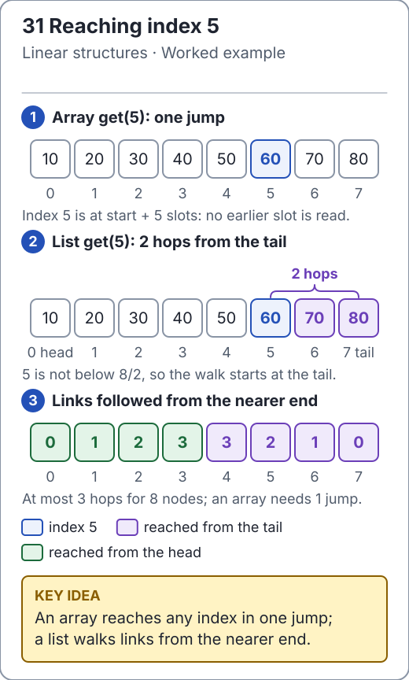

# Arrays: position is the address

An array stores a fixed number of values addressed by integer index. Use an array when positions matter and size is known; use a dynamic array when the sequence must grow. Contiguous storage makes indexed reads cheap, but inserting at the front still moves later elements.

| At a glance | |
| --- | --- |
| **Use it when** | Positions matter and you read or replace by index far more often than you insert or remove in the middle. |
| **Avoid it when** | You mostly insert or remove near the front or middle of a long sequence, or you need to hold a node and splice around it. |
| **Cost** | Indexed read and replace O(1); insert or remove at an index O(n); append O(1) amortized with a growable array. |
| **In this repo** | [`DynamicArray`](../../src/main/java/io/github/ichillous/dsa/collections/DynamicArray.java) |
| **In the JDK** | `java.util.ArrayList` for a growable sequence; plain `int[]` or `T[]` for a fixed length. |

A Java array has indices `0..length-1`. A range `[from, to)` includes `from`, excludes `to`, and has `to - from` elements. This convention makes the empty range `[i, i)` natural and lets adjacent ranges join without overlap.

## Trace the storage

```text
index        0    1    2    3
value       10   20   30   40
range [1,3)      [20   30]
```

```java
import java.util.Arrays;

int[] values = {10, 20, 30, 40};
int[] middle = Arrays.copyOfRange(values, 1, 3);
assert Arrays.equals(middle, new int[] {20, 30});
middle[0] = 99;
assert values[1] == 20; // The copied array owns different storage.
```

Assigning `int[] alias = values` would share the same array instead. For object arrays, cloning copies references, so referenced mutable objects remain shared. An array's fixed length says nothing about whether its elements may change.

## Grow a logical sequence

[`DynamicArray`](../../src/main/java/io/github/ichillous/dsa/collections/DynamicArray.java) separates **size**, the live element count, from **capacity**, the allocated storage. Its invariant is that live elements occupy exactly the prefix `[0, size)`; unused positions contain no retained elements.

```java
import io.github.ichillous.dsa.collections.DynamicArray;

DynamicArray<String> names = new DynamicArray<>(0);
names.add("Ada");
names.add("Grace");
names.add(1, "Edsger");
assert names.size() == 3;
assert names.get(1).equals("Edsger");
assert names.get(2).equals("Grace");
```

Zero initial capacity is valid; negative capacity is rejected. This library rejects null elements. Existing-element operations require `index < size`, while insertion also permits `index == size`.

## Costs and tradeoffs

<!-- visual:generated array-vs-list-access | An array reads any index in one jump; a doubly linked list follows links from the nearer end. -->
<picture><source media="(prefers-color-scheme: dark)" srcset="../../docs/visuals/assets/array-vs-list-access-dark.svg"></picture>

**Figure 39.** An array reads any index in one jump; a doubly linked list follows links from the nearer end. [Visual index and step-throughs](../../docs/visuals/README.md).
<!-- /visual:generated -->

The array's one jump is why indexed reads are O(1): the address of slot `i` is computed, not searched for.

| Operation | Fixed array | Dynamic array |
| --- | --- | --- |
| Get / replace by valid index | O(1) | O(1) |
| Append with spare capacity | Needs a separate logical size | O(1) |
| Append when full | Allocate and copy manually | O(n) for that append; O(1) amortized over appends |
| Insert / remove at an index | Shift manually | O(n) worst case |
| Stored space | O(length) | O(capacity), with O(n) temporary space during growth |

Geometric growth is essential to the amortized bound. Growing by exactly one slot on every append copies `1 + 2 + ... + n` elements, which is quadratic overall. Amortized O(1) does not mean each individual append is constant time.

For repeated range sums with point additions, study [`FenwickTree`](../../src/main/java/io/github/ichillous/dsa/structures/FenwickTree.java). For range minimum with point replacement, use [`SegmentTree`](../../src/main/java/io/github/ichillous/dsa/structures/SegmentTree.java). Neither makes ordinary array insertion cheap. The [range-query lesson](../range-queries/overview.md) compares these with a static sparse table and a lazy range-add segment tree.

## In real Java

Production code usually takes `ArrayList` for a growable sequence. Its backing array is hidden, but the fixed-length array you pass to `Arrays.asList` is not copied: the returned list is a fixed-size view that writes through.

```java
import java.util.ArrayList;
import java.util.Arrays;
import java.util.List;

Integer[] backing = {10, 20, 30};
List<Integer> view = Arrays.asList(backing);
view.set(0, 99);
assert backing[0] == 99; // The view writes through to the array.
boolean rejected = false;
try {
    view.add(40);
} catch (UnsupportedOperationException expected) {
    rejected = true; // A fixed-size view cannot grow.
}
assert rejected;
List<Integer> growable = new ArrayList<>(view);
growable.add(40);
assert growable.size() == 4 && backing.length == 3;
```

`ArrayList` documents constant-time `get` and `set` and amortized constant-time `add`, the same costs as the table above. Copy into an `ArrayList` when the sequence must grow.

## Common mistakes

1. **Shifting left to right on insertion.** Inserting `X` at index 1 of `[10, 20, 30]` with a forward loop first copies `20` over `30` (slot 2), then copies that same `20` into slot 3, and finally writes `X` at index 1. The result is `[10, X, 20, 20]` instead of `[10, X, 20, 30]`: `30` is lost. This breaks the rule that every live element survives an insertion.
2. **Reading at `size` instead of below it.** With three elements, `get(3)` is out of range even when the capacity is eight. Live elements occupy exactly the prefix `[0, size)`; only insertion may use `index == size`.
3. **Treating a copy as a clone of the contents.** `Arrays.copyOfRange` on an array of mutable objects copies references, so changing an object through the copy changes it in the original. The copied array has its own slots, but its elements are shared.

## Check yourself

<details>
<summary>Why does writing `middle[0] = 99` leave `values[1]` unchanged after `Arrays.copyOfRange(values, 1, 3)`?</summary>

The copy is a new array with its own storage, and `int` elements are copied by value. Aliasing (`int[] alias = values`) would share one array instead.

</details>

<details>
<summary>A `DynamicArray` created with capacity 8 holds three elements. What are its size, its valid read indices and its capacity?</summary>

Its size is 3, valid read indices are 0 to 2, and its capacity is 8; `get(3)` throws `IndexOutOfBoundsException` although slots 3 to 7 exist.

</details>

<details>
<summary>What does the range `[i, i)` contain, and why is that convenient?</summary>

It is empty: `to - from` is zero. Adjacent ranges `[a, b)` and `[b, c)` then join without overlap or gap, so empty ranges need no special case.

</details>

## Practice

1. Predict the logical size and physical contents after removing index 1 from `[10, 20, 30]`.
2. Explain why copying references does not deep-copy mutable objects.
3. Compare 1,000 seeded insert/remove operations with `ArrayList`, including insertion at `size`.

Continue with [array operations](operations.md) and check the [worked solutions](../../docs/solutions.md).
