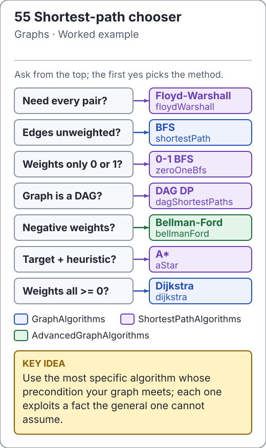

# Graphs: model relationships explicitly

A graph has vertices and edges. Vertices may be isolated; edges may be directed, weighted, repeated or self-loops. Decide these semantics before choosing an algorithm: a route map and a prerequisite graph use different contracts.

| At a glance | |
| --- | --- |
| **Use it when** | Entities and relationships form a network: routes, prerequisites, links between accounts. |
| **Avoid it when** | A tree, an array or a keyed map already holds the relationship; graph machinery then adds cost without adding meaning. |
| **Cost** | Storage O(V + E); BFS, DFS and topological order O(V + E); `neighbors` O(out-degree). |
| **In this repo** | [`Graph`](../../src/main/java/io/github/ichillous/dsa/graphs/Graph.java) and [`WeightedGraph`](../../src/main/java/io/github/ichillous/dsa/graphs/WeightedGraph.java) |
| **In the JDK** | no direct equivalent: the JDK has no graph type, so you compose `Map` and `List` (or arrays) yourself |

[`Graph`](../../src/main/java/io/github/ichillous/dsa/graphs/Graph.java) uses integer vertices `[0, vertexCount)`, an explicit directed/undirected factory, and insertion-ordered adjacency sets. Repeated unweighted edges are ignored. In an undirected graph, adding the reverse of an existing edge does not add a new logical edge.

```java
import io.github.ichillous.dsa.graphs.Graph;
import java.util.List;

Graph relationships = Graph.undirected(4);
relationships.addEdge(0, 1).addEdge(0, 2).addEdge(1, 0);
assert relationships.vertexCount() == 4; // Vertex 3 is isolated.
assert relationships.edgeCount() == 2;
assert relationships.neighbors(0).equals(List.of(1, 2));
assert relationships.neighbors(3).isEmpty();
```

## Pick the right question

| Question | Algorithm / restriction |
| --- | --- |
| Which vertices are reachable? | BFS or DFS; directed edges are followed in their direction |
| Fewest edges from s to t? | BFS in an unweighted graph |
| Which undirected components exist? | Connected-components traversal |
| What prerequisite order is possible? | Topological sort of a directed acyclic graph |
| Least total nonnegative edge weight? | Dijkstra |
| Cheapest acyclic connections within every component? | Minimum spanning forest of an undirected weighted graph |

<!-- visual:generated shortest-path-chooser | The shortest-path question is answered by asking about the graph, from the top down. -->
<picture><source media="(prefers-color-scheme: dark)" srcset="../../docs/visuals/assets/shortest-path-chooser-dark.svg"></picture>

**Figure 68.** The shortest-path question is answered by asking about the graph, from the top down. [Visual index and step-throughs](../../docs/visuals/README.md).
<!-- /visual:generated -->

“Reachable from s” is not the same as “connected” in a directed graph. Strong and weak connectivity have separate meanings; the maintained `connectedComponents` API accepts only undirected input to avoid silently choosing one.

## Weighted edges have their own representation

[`WeightedGraph`](../../src/main/java/io/github/ichillous/dsa/graphs/WeightedGraph.java) keeps parallel edges, including identical ones, and accepts signed `long` weights. Its `edges()` returns each added undirected edge once; neighbor entries are oriented outward from the queried vertex.

```java
import io.github.ichillous.dsa.graphs.WeightedGraph;

WeightedGraph routes = WeightedGraph.directed(3);
routes.addEdge(0, 1, 5).addEdge(0, 1, 2).addEdge(1, 2, 4);
assert routes.edgeCount() == 3;
assert routes.neighbors(0).size() == 2;
assert routes.neighbors(1).get(0).to() == 2;
assert routes.neighbors(2).isEmpty();
```

A representation may permit weights that an algorithm rejects. Dijkstra requires every edge to be nonnegative, even in an unreachable component; Kruskal's minimum spanning forest permits negative weights. Negative edges are not universally “invalid graph data.”

## Connectivity without storing every path

[`UnionFind`](../../src/main/java/io/github/ichillous/dsa/structures/UnionFind.java) maintains undirected component membership as connections are added. Union by size and path compression give O(α(V)) amortized operations with O(V) storage. It cannot reconstruct a path or delete an edge; those are different requirements.

```java
import io.github.ichillous.dsa.structures.UnionFind;

UnionFind components = new UnionFind(4);
components.union(0, 1);
components.union(1, 2);
boolean mergedAgain = components.union(0, 2);
assert components.connected(0, 2);
assert !components.connected(0, 3);
assert !mergedAgain && components.components() == 2;
assert components.componentSize(1) == 3;
```

## Costs and ownership

Both adjacency representations store O(V + E) data. Adding an unweighted edge is O(1) expected; adding a weighted edge is O(1) amortized. `neighbors` returns an immutable snapshot in O(out-degree) time and space. Algorithms return detached immutable results, so later graph mutation does not update an old answer.

BFS, DFS, topological ordering and undirected components take O(V + E) time and space here, including snapshots. Dijkstra's lazy heap and Kruskal sorting take O(V + E log(E + 1)) time. Count parallel weighted edges in E; do not assume E is bounded by V² for a multigraph.

## In real Java

The JDK has no graph class, and real data has labels (room names, account ids), not the dense integers `0..V-1` that `Graph` needs. Number the labels once at the boundary, run the integer algorithms, then translate the answer back. A `LinkedHashMap` iterates in insertion order, so the numbering is reproducible.

```java
import io.github.ichillous.dsa.graphs.Graph;
import io.github.ichillous.dsa.graphs.GraphAlgorithms;
import java.util.ArrayList;
import java.util.LinkedHashMap;
import java.util.List;
import java.util.Map;

List<String> names = List.of("lobby", "kitchen", "garden", "cellar");
Map<String, Integer> id = new LinkedHashMap<>();
for (String name : names) {
    id.put(name, id.size());
}
Graph rooms = Graph.undirected(id.size());
rooms.addEdge(id.get("lobby"), id.get("kitchen"));
rooms.addEdge(id.get("kitchen"), id.get("cellar"));
rooms.addEdge(id.get("lobby"), id.get("garden"));
List<String> visited = new ArrayList<>();
for (int vertex : GraphAlgorithms.breadthFirst(rooms, id.get("kitchen"))) {
    visited.add(names.get(vertex));
}
assert visited.equals(List.of("kitchen", "lobby", "cellar", "garden"));
```

## Common mistakes

1. **Counting adjacency entries as edges.** In `Graph.undirected(2).addEdge(0, 1)` the edge is stored in two adjacency lists, yet `edgeCount()` is 1. An edge count taken from adjacency entries would be 2E, double the real E, and skew every cost formula.
2. **Assuming Dijkstra only inspects reachable edges.** With `WeightedGraph.directed(5).addEdge(0, 1, 1).addEdge(3, 4, -1)`, `dijkstra(graph, 0)` throws `IllegalArgumentException` although the negative edge is unreachable from vertex 0. The precondition "every weight is nonnegative" is checked on the whole graph.
3. **Treating reachability as symmetric in a directed graph.** With only `0 -> 1`, vertex 0 reaches 1 but 1 cannot reach 0, so "connected" has no single meaning; `connectedComponents(Graph.directed(2))` throws `IllegalArgumentException` instead of guessing.

## Practice

1. Model course prerequisites and decide edge direction before drawing a sample schedule.
2. Give a directed graph where 0 reaches 1 but 1 cannot reach 0.
3. Compare reachability on small random graphs with an independent adjacency-matrix reference, including isolated vertices and self-loops.

## Check yourself

<details>
<summary>An undirected graph has 10 edges. How many adjacency entries does an adjacency list hold?</summary>

20, because every undirected edge appears once in each endpoint's list (a self-loop is the exception and appears once). `edgeCount()` still reports 10.

</details>

<details>
<summary>Why does <code>Graph</code> ignore <code>addEdge(1, 0)</code> after <code>addEdge(0, 1)</code> in an undirected graph, but <code>WeightedGraph</code> keeps repeated edges?</summary>

`Graph` stores unweighted adjacency as ordered sets, so the reverse edge is the same logical edge. `WeightedGraph` keeps parallel edges because two edges between the same vertices can carry different weights.

</details>

<details>
<summary>Which algorithm answers "what is the cheapest route" when every weight is nonnegative and no better structure is known?</summary>

Dijkstra's algorithm (`GraphAlgorithms.dijkstra`). BFS counts edges, not weights, and Bellman–Ford is only needed once negative weights appear.

</details>

Continue with [representations](representation.md), [traversals and paths](traversal.md) and the [worked solutions](../../docs/solutions.md). The [solution finder](../../docs/solution-finder.md#14-graph-traversal-and-structure) compares this technique with its alternatives.
