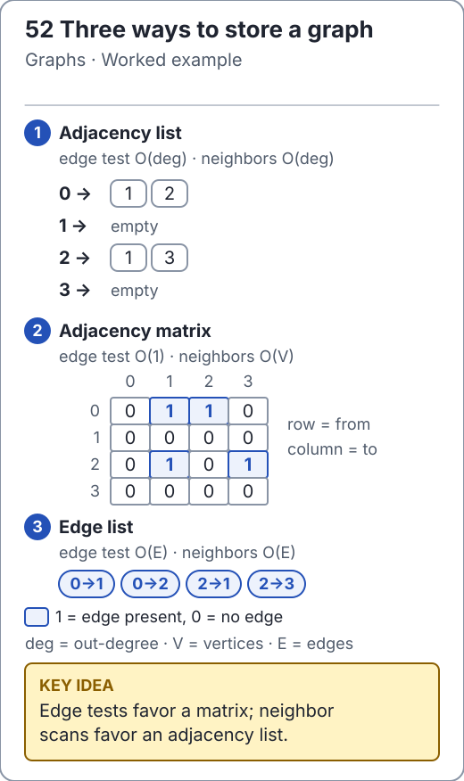

# Graph representations: pay for the operations you need

An adjacency list stores outgoing neighbors per vertex. An adjacency matrix stores a cell for every ordered vertex pair. Neither is universally better; choose based on graph density, edge checks and traversal workload.

| At a glance | |
| --- | --- |
| **Use it when** | You must decide how edges are stored before writing algorithms: a list when you scan neighbors, a matrix when you test arbitrary edges. |
| **Avoid it when** | A V-by-V matrix for a large sparse graph; it allocates V² cells to hold few edges. |
| **Cost** | List: O(V + E) space, neighbors in O(out-degree). Matrix: O(V²) space, edge test O(1). |
| **In this repo** | [`Graph`](../../src/main/java/io/github/ichillous/dsa/graphs/Graph.java) (ordered adjacency sets) and [`WeightedGraph`](../../src/main/java/io/github/ichillous/dsa/graphs/WeightedGraph.java) (edge records) |
| **In the JDK** | no direct equivalent graph type; `BitSet` is a compact boolean matrix row |

```text
edges: 0 -> 1, 0 -> 2, 2 -> 1

list                 matrix (row = from, column = to)
0: [1, 2]               0 1 2
1: []                0  0 1 1
2: [1]               1  0 0 0
                     2  0 1 0
```

| Operation | Adjacency list/set | Boolean matrix |
| --- | --- | --- |
| Stored space | O(V + E) | O(V²) |
| Enumerate outgoing neighbors | O(out-degree) | O(V), scanning a row |
| Test a particular edge | O(out-degree) for a list; O(1) expected for a set | O(1) |
| Traverse all possible outgoing positions | O(V + E) total | O(V²) total |

<!-- visual:generated graph-representations | The same four-edge graph as an adjacency list, an adjacency matrix and an edge list, with the cost of an edge test and of listing neighbors. -->
<picture><source media="(prefers-color-scheme: dark)" srcset="../../docs/visuals/assets/graph-representations-dark.svg"></picture>

**Figure 65.** The same four-edge graph as an adjacency list, an adjacency matrix and an edge list, with the cost of an edge test and of listing neighbors. [Visual index and step-throughs](../../docs/visuals/README.md).
<!-- /visual:generated -->

[`Graph`](../../src/main/java/io/github/ichillous/dsa/graphs/Graph.java) uses ordered sets internally for deduplication and reproducible neighbor order. Its public neighbor list is a snapshot, not a mutable set view.

```java
import io.github.ichillous.dsa.graphs.Graph;
import java.util.List;

Graph graph = Graph.directed(3).addEdge(0, 1);
List<Integer> snapshot = graph.neighbors(0);
graph.addEdge(0, 2);
assert snapshot.equals(List.of(1));
assert graph.neighbors(0).equals(List.of(1, 2));
```

## Build a reference matrix

A small matrix is a useful independent test model for an adjacency implementation. This example constructs both representations from the same edge list and compares their meaning.

```java
import io.github.ichillous.dsa.graphs.Graph;

int[][] edges = {{0, 1}, {0, 2}, {2, 1}};
boolean[][] matrix = new boolean[3][3];
Graph graph = Graph.directed(3);
for (int[] edge : edges) {
    graph.addEdge(edge[0], edge[1]);
    matrix[edge[0]][edge[1]] = true;
}
for (int from = 0; from < 3; from++) {
    for (int to = 0; to < 3; to++) {
        assert matrix[from][to] == graph.neighbors(from).contains(to);
    }
}
assert !matrix[1][0]; // Directed edges are not automatically symmetric.
```

This tiny comparison intentionally favors clarity over efficient repeated snapshot calls. Production traversal obtains a neighbor snapshot once per visited vertex rather than once per candidate edge.

## Weights, parallel edges and absence

A single numeric matrix cell cannot represent multiple parallel edges without an explicit aggregation policy. Likewise, using zero to mean “no edge” discards valid zero-weight edges. `WeightedGraph` avoids that ambiguity with explicit edge records; it supports zero, negative and maximum-`long` weights.

For undirected storage, reverse adjacency entries describe the same logical edge. The public edge count counts that edge once, including a self-loop once. Mixing adjacency-entry count and edge count causes degree and complexity mistakes.

## In real Java

For a dense graph with a fixed vertex count, one `java.util.BitSet` per row is a compact boolean matrix. `nextSetBit` enumerates neighbors in ascending index order and returns -1 when none is left. That order is by index, while `Graph.neighbors` follows insertion order, so compare them as sets, not as lists.

```java
import io.github.ichillous.dsa.graphs.Graph;
import java.util.ArrayList;
import java.util.BitSet;
import java.util.List;

Graph graph = Graph.directed(4).addEdge(0, 2).addEdge(0, 1).addEdge(2, 3);
BitSet[] rows = new BitSet[4];
for (int vertex = 0; vertex < 4; vertex++) {
    rows[vertex] = new BitSet(4);
    for (int to : graph.neighbors(vertex)) {
        rows[vertex].set(to);
    }
}
List<Integer> ascending = new ArrayList<>();
for (int to = rows[0].nextSetBit(0); to >= 0; to = rows[0].nextSetBit(to + 1)) {
    ascending.add(to);
}
assert graph.neighbors(0).equals(List.of(2, 1)); // insertion order
assert ascending.equals(List.of(1, 2));          // BitSet order is by index
assert rows[3].nextSetBit(0) == -1;              // vertex 3 has no outgoing edge
assert rows[0].get(2) && !rows[2].get(0);        // directed: no automatic reverse edge
```

## Common mistakes

1. **Using 0 for "no edge" in a weighted matrix.** An edge `0 -> 1` of weight 0 stores 0 in cell `[0][1]`, exactly like a missing edge, so the algorithm loses the edge. The representation must distinguish absence from a legal zero weight, as `WeightedGraph` does with explicit edge records.
2. **Filling only one triangle of an undirected matrix.** After setting `matrix[0][1] = true` alone, reading row 1 reports no neighbor 0. An undirected matrix must be symmetric: `matrix[a][b] == matrix[b][a]`.
3. **Calling `neighbors(v)` once per candidate edge.** Each call copies an O(out-degree) snapshot, so testing all V² ordered pairs with `graph.neighbors(from).contains(to)` costs O(V² + V·E), because every call copies a whole row. Take one snapshot per vertex and reuse it: iterating the snapshots lists every edge in O(V + E), and marking each one in a boolean row answers all V² pair tests in O(V² + E).

## Practice

1. Convert the diagram to an undirected graph and update both the list and matrix.
2. Design a weighted matrix that distinguishes absent edges from zero-cost edges.
3. Compare memory growth conceptually for 10,000 vertices with 20,000 edges; state why a dense matrix allocates many unused cells.

## Check yourself

<details>
<summary>A graph has 10,000 vertices and 20,000 edges. Roughly how many stored items does each layout need?</summary>

An adjacency list stores about V + E = 30,000 items; a boolean matrix needs V² = 100,000,000 cells, almost all of them false.

</details>

<details>
<summary>Why can a numeric matrix with 0 meaning "no edge" not represent every weighted graph?</summary>

A legal edge of weight 0 is stored as 0 as well, so it looks like no edge. You need a separate presence marker (or a sentinel outside the weight range) or explicit edge records.

</details>

<details>
<summary>In an undirected graph with the single edge 0-1, how many adjacency entries and how many edges are there?</summary>

Two adjacency entries (1 in the list of 0, and 0 in the list of 1) but one edge. `edgeCount()` reports 1.

</details>

Read [traversal](traversal.md) and the [worked solutions](../../docs/solutions.md).
